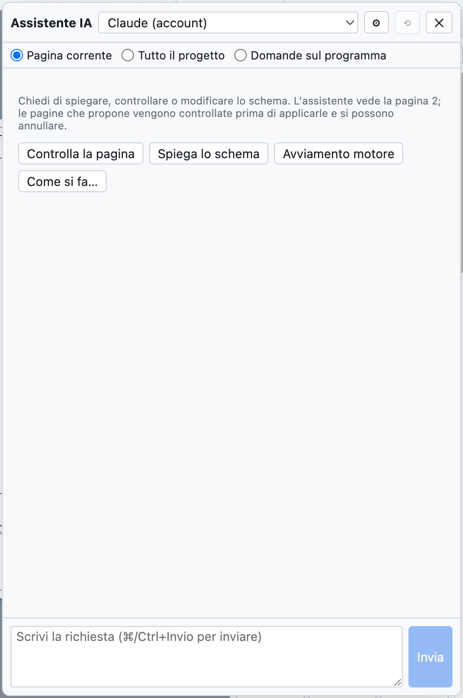
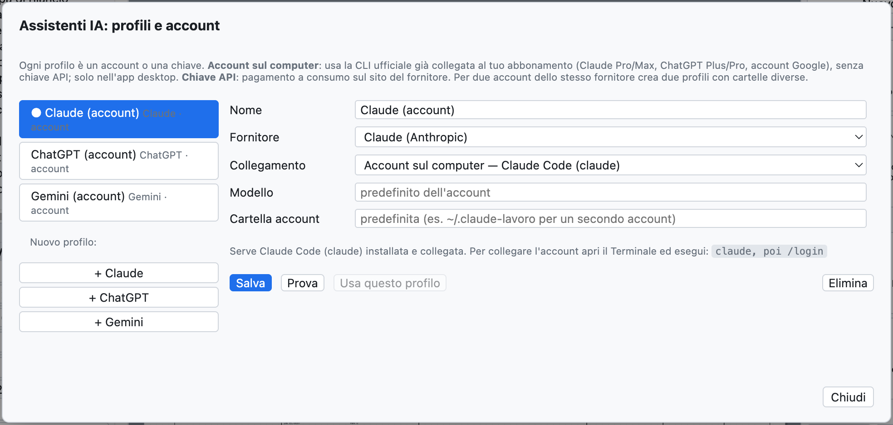
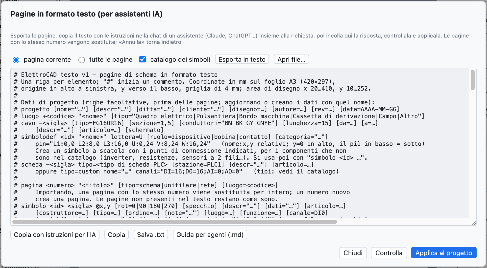

# 17. Asistente IA

El asistente IA es un compañero al que pedir, en tu idioma, que **explique**, **compruebe** o **dibuje**
partes del esquema. Funciona con **Claude** (Anthropic), **ChatGPT** (OpenAI) y **Gemini** (Google), usando
tus cuentas. Responde en el idioma de la interfaz.



*El panel del asistente, con los botones rápidos.*

## Abrir el asistente

*Proyecto ▸ Asistente IA…* o **⌘I** abre el panel a la derecha; el esquema sigue visible y se puede trabajar
mientras el asistente responde.

Arriba se elige:

- el **perfil**: qué asistente y qué cuenta;
- el **contexto**: qué ve el asistente.

| Contexto | El asistente recibe |
|---|---|
| *Página actual* | la página en formato de texto, la guía del formato con el catálogo de símbolos, los problemas de la verificación en la página |
| *Todo el proyecto* | todas las páginas, los datos del proyecto (ubicaciones, cables, tarjetas PLC) y todos los problemas de la verificación |
| *Preguntas sobre el programa* | el manual de OpenWiring, para preguntas sobre menús y comandos |

## Qué pedir

| Petición | Ejemplo |
|---|---|
| Explicar | «Explica cómo funciona el circuito de esta página» |
| Comprobar | «Comprueba esta página: conexiones, siglas, protecciones, norma UNE-EN 60204-1» |
| Dibujar | «Añade una página 7 con un arranque estrella-triángulo para un motor de 15 kW» |
| Modificar | «Añade un piloto de avería mandado por el contacto 95-96 del relé térmico» |
| Usar el programa | «¿Cómo se crea una regleta de dos niveles?» |

Los botones rápidos *Comprobar la página*, *Explicar el esquema*, *Arranque de motor*, *Cómo se hace…* envían
peticiones ya preparadas. **⌘Intro** envía, *Cancelar* interrumpe una respuesta larga, ⟲ empieza una
conversación nueva.

## Cuando el asistente dibuja

Si la respuesta contiene páginas en formato de texto, el panel las **comprueba enseguida**:

- *Listo: añade la página 7 · ningún problema* → pulsa **Aplicar al proyecto**;
- si hay errores o problemas de la verificación, aparecen debajo de la respuesta: **Pedir la corrección**
  devuelve al asistente errores y problemas, y él los corrige.

La aplicación se deshace con **⌘Z**. Una página con el mismo número que una existente la sustituye; un número
nuevo añade una página.

> **Ejemplo real.** Al pedir «Añade una página nueva (número 7) con un arranque directo para un motor
> trifásico de 4 kW: guardamotor, contactor, regleta y motor», Claude respondió en unos 30 segundos con la
> página completa (guardamotor `-7Q1`, contactor `-7K1`, bornes `-X2`, motor `-7M1`, cable `-7W1`), señalando
> por sí solo que faltaba la bobina del contactor en el circuito de mando.

## Perfiles y cuentas

*Proyecto ▸ Asistentes IA: perfiles y cuentas…* (o ⚙ en el panel).



*Un perfil por asistente: en el primer uso hay uno para Claude, ChatGPT y Gemini.*

Cada perfil tiene un nombre, un proveedor, un modo de conexión y un modelo. Se pueden tener varios perfiles
del mismo proveedor, por ejemplo la cuenta personal y la de la empresa.

### Cuenta en el ordenador (suscripción)

En la aplicación de escritorio el perfil puede usar la **CLI oficial** del proveedor, ya vinculada a tu
suscripción: sin clave API, se usa la cuota de la suscripción.

| Proveedor | Programa que instalar | Suscripción | Comando para vincular la cuenta |
|---|---|---|---|
| Claude | Claude Code (`claude`) | Claude Pro o Max | `claude`, luego `/login` |
| ChatGPT | Codex CLI (`codex`) | ChatGPT Plus o Pro | `codex login` |
| Gemini | Gemini CLI (`gemini`) | cuenta de Google | `gemini`, luego *Login with Google* |

El comando se ejecuta una vez en el Terminal. Para una **segunda cuenta** del mismo proveedor indica en el
perfil una **carpeta de la cuenta** distinta (por ejemplo `~/.claude-lavoro`): la ventana muestra el comando
exacto, por ejemplo `CLAUDE_CONFIG_DIR=~/.claude-lavoro claude`.

Si el acceso caduca, el asistente responde con el comando que ejecutar (por ejemplo `codex login`).

### Clave API

Con la conexión *Clave API* se paga por uso en la web del proveedor:

| Proveedor | Dónde se crea la clave |
|---|---|
| Claude | console.anthropic.com |
| ChatGPT | platform.openai.com |
| Gemini | aistudio.google.com |

Pega la clave en el perfil; *Listar* muestra los modelos disponibles con esa clave. En la aplicación de
escritorio la clave está **cifrada** por el sistema operativo y queda solo en ese ordenador.

**Probar** comprueba la conexión con una pregunta breve; **Usar este perfil** lo convierte en el activo.

## Traducir el diccionario

*Proyecto ▸ Traducir con el asistente IA* (o *Traducir con IA* en la pestaña Traducciones) envía al asistente
activo los textos del proyecto sin traducción, y los traducidos palabra por palabra, y pide inglés y alemán
con la terminología del sector. Las traducciones entran en el diccionario como **pendientes de revisar** (ver
[capítulo 16](16-lingue.md)).

## El formato de texto con un asistente externo

También se puede trabajar con un asistente en un chat del navegador, sin perfiles:



*La ventana de las páginas en formato de texto.*

1. *Archivo ▸ Páginas en texto (asistentes IA)…*: elige *página actual* o *todas las páginas* y pulsa
   **Exportar como texto**.
2. **Copiar con instrucciones para la IA** y pega en el chat, añadiendo tu petición al final.
3. Pega la respuesta en la ventana (incluso con el texto alrededor), pulsa **Comprobar** y luego
   **Aplicar al proyecto**.

El formato es una línea por elemento:

```text
luogo +Q1 "Quadro elettrico"
pagina 7 "Ventilazione quadro" luogo=Q1
  simbolo potential +24V @28,24
  filo 28,24 400,24
  simbolo potential 0V @28,232
  filo 28,232 400,232
  simbolo pb_no -? @100,60 descr="Marcia ventilatore"     # "-?" = sigla automática
  simbolo coil -7K1 @100,140 descr="Contattore ventilatore"
  collega -7S1:13 100,24                                  # hacia la barra +24V
  collega -7S1:14 -7K1:A1                                 # por sigla y punto de conexión
  collega -7K1:A2 100,232
```

La sintaxis completa está en la **guía para agentes** (*Ayuda ▸ Guía para agentes IA (.md)…*), ver el
[capítulo 19](19-riga-di-comando.md).

## Privacidad

El esquema enviado al asistente sale del ordenador y llega al proveedor elegido, con sus condiciones de uso.
Con *Página actual* solo se envía la página abierta.
