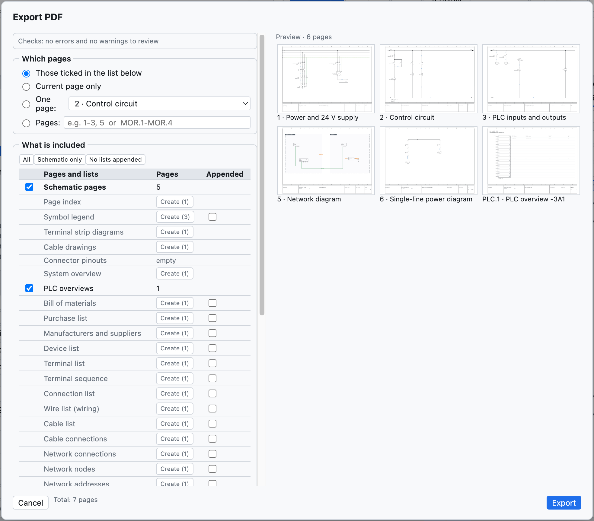
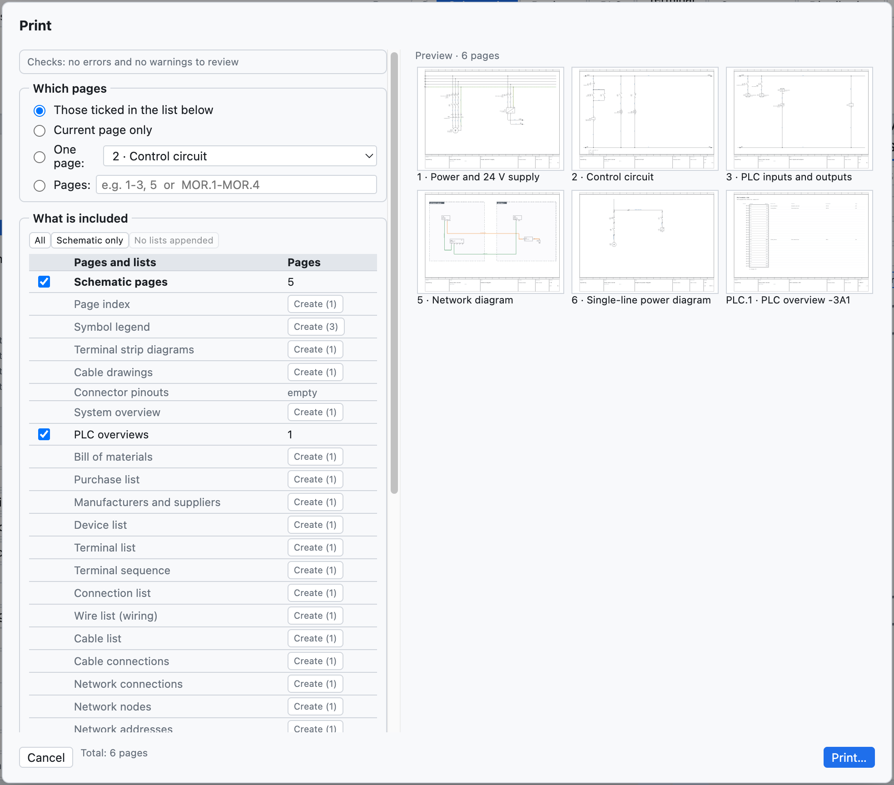

# 18. Importación y exportación

## PDF

**PDF** en la barra de herramientas (o *Archivo ▸ Exportar ▸ PDF…*) crea un PDF vectorial en A3.

*Las opciones del PDF.*

| Opción | Efecto |
|---|---|
| *Las marcadas en la lista de abajo*, *Solo la página actual*, *Una página*, *Páginas* | qué páginas; el intervalo se escribe con los números del proyecto (`1-3, 5` o `200-205`) |
| *Página de índice inicial* | índice con enlaces de las páginas y las listas |
| *Listas al final* | lista de materiales, dispositivos, bornes, conexiones, E/S PLC después de los esquemas |
| *Blanco y negro para imprimir* | hilos y números de hilo en negro |
| *Archivo compacto (más pequeño)* | activado de serie: archivo unas diez veces más pequeño, mismo dibujo, referencias y marcadores siguen con enlace |
| *Añadir las páginas de otros cuadros con dispositivos de los cuadros elegidos* | aparece al quitar cuadros: añade las páginas de otros cuadros donde están dibujados dispositivos de los cuadros impresos (capítulo 11) |
| *Idioma del PDF*, *Segundo idioma* | el PDF en otro idioma, sin cambiar el proyecto |

En el PDF las **referencias tienen enlace** (contactos ↔ bobina, puntos de interrupción entre páginas, PLC,
vistas generales), igual que las posiciones en las listas y el índice; el PDF tiene **marcadores** de páginas
y listas.

## Impresión

*Archivo ▸ Imprimir…* (⌘P) envía las páginas a la impresora en **A3 horizontal**, una página por hoja.

*Las opciones de impresión: páginas, blanco y negro, idioma.*

Para imprimir también las listas, crea primero las páginas de lista ([capítulo 14](14-liste-e-pagine-automatiche.md#páginas-automáticas)).

## DXF

| Comando | Resultado |
|---|---|
| *Archivo ▸ Exportar ▸ DXF de la página actual* | un DXF R12 a escala 1:1, en mm |
| *Archivo ▸ Exportar ▸ DXF de todo el proyecto (ZIP)* | un DXF por página, reunidos en un archivo ZIP |
| en la página de disposición | el DXF de taladrado de la placa ([capítulo 12](12-layout-quadro.md#taladrado)) |

Los DXF tienen las capas CORNICE, CARTIGLIO, SIMBOLI, FILI, TESTI, SIGLE, NUMERI_FILO (más CAVI y QUADRI
donde hacen falta) y se abren en AutoCAD, DraftSight, LibreCAD y los demás CAD. El formato DWG no está
disponible: se abre el DXF y se guarda como DWG desde el CAD.

## Excel y CSV

- Cada lista se exporta en **CSV** (separador `;`) desde la vista Listas.
- El **navegador de dispositivos** exporta y vuelve a importar Excel ([capítulo 7](07-dispositivi-e-articoli.md#excel)).
- La vista **PLC** exporta para TIA Portal, CODESYS, PLCopen y la lista de E/S ([capítulo 10](10-plc.md)).
- Las **etiquetas** salen en Excel o CSV ([capítulo 14](14-liste-e-pagine-automatiche.md#etiquetas-de-marcado)).
- El **diccionario** de traducciones sale en CSV ([capítulo 16](16-lingue.md)).

## Importar esquemas desde PDF (SEE Electrical y otros)

*Archivo ▸ Importar ▸ Esquema desde PDF (SEE Electrical…)…* crea un **proyecto nuevo** a partir de un
esquema exportado en **PDF vectorial** desde otro CAD. Se ha probado con un proyecto real de SEE Electrical de
207 páginas, importado en pocos segundos.

Qué se reconstruye:

- **hojas**: una por cada hoja de esquema, con número y título del cajetín; el prefijo del título
  (`Q1.1 Ingresso linea`) se convierte en la ubicación `+Q1.1`; la portada y las listas del CAD de origen se
  omiten;
- **hilos reales**, con el color del dibujo (azul → BU, amarillo-verde → PE, rojo → RD…) y el nombre escrito
  al lado (`L1-1.1`, `200.01`) como número de hilo;
- **componentes** con la **sigla** más cercana, los **bornes** a los que llegan los hilos y sus nombres
  (`1/L1`, `A1`, `95`);
- **bornes de regleta**, también de varios niveles (`X1.1.12:1A`);
- **puntos de interrupción** entre páginas, emparejados por nombre o por las referencias `hoja.columna`;
- **textos** libres y textos de los componentes.

Por revisar: los componentes se reconocen por el gráfico y no saben si son bobinas o contactos (por eso no
hay imagen de contactos); algunos elementos quedan como gráfico sin sigla. *Proyecto ▸ Verificación* indica
conductores interrumpidos y puntos de interrupción sin correspondiente. Un PDF escaneado (una imagen) no se
puede importar.

## Otras importaciones

| Comando | Qué importa | Ver |
|---|---|---|
| *Artículos EDZ / XML / CSV…* | artículos de los fabricantes, con imágenes, bornes, dibujo y datos comerciales (CSV) | [capítulo 7](07-dispositivi-e-articoli.md#importar-los-datos-de-los-fabricantes-edz) |
| *Símbolos QElectroTech…* | componentes `.elmt`, `.qet`, archivos comprimidos | [capítulo 13](13-macro-simboli-cartigli.md#componentes-de-qelectrotech) |
| *Macros…* | archivos `.ecmacro` | [capítulo 13](13-macro-simboli-cartigli.md#macros) |
| *Comparar con un archivo .ecad…* | diferencias con otro proyecto | [capítulo 15](15-verifica-ricerca-revisioni.md#comparar-dos-proyectos) |
| *Importar DXF…* en el editor de cajetines | cajetín dibujado en otro CAD | [capítulo 13](13-macro-simboli-cartigli.md#importar-un-cajetín-desde-dxf) |
| *Importar variables* (vista PLC) | tabla de variables de TIA Portal, CODESYS, CSV | [capítulo 10](10-plc.md#importación-de-variables) |
| *Páginas en texto* | páginas escritas por un asistente IA o por un script | [capítulo 17](17-assistente-ia.md#el-formato-de-texto-con-un-asistente-externo) |

## Otras exportaciones

| Comando | Resultado |
|---|---|
| *PLCopen XML (variables PLC)* | variables globales para CODESYS y entornos compatibles |
| *Artículos en XML (formato EPLAN)* | artículos de la biblioteca en un archivo XML en formato EPLAN |
| *Diccionario de traducciones (CSV)* | tabla `Italiano;English;Deutsch` |
