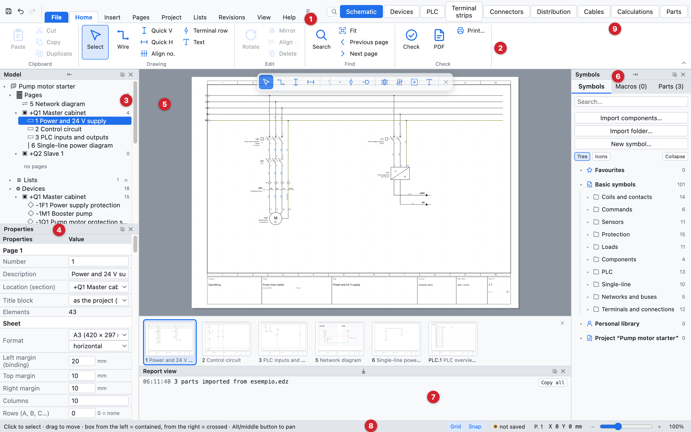
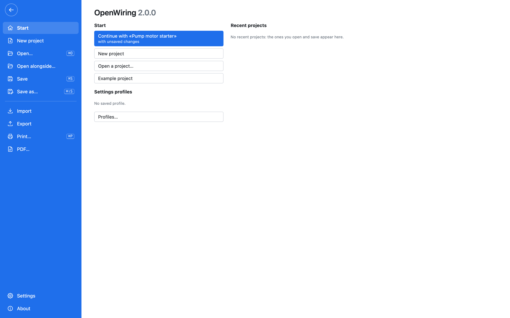
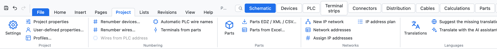
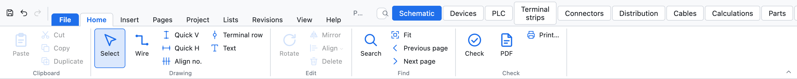
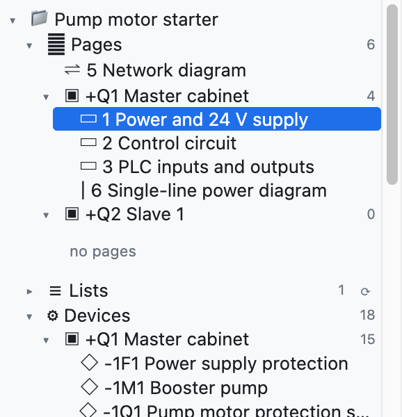
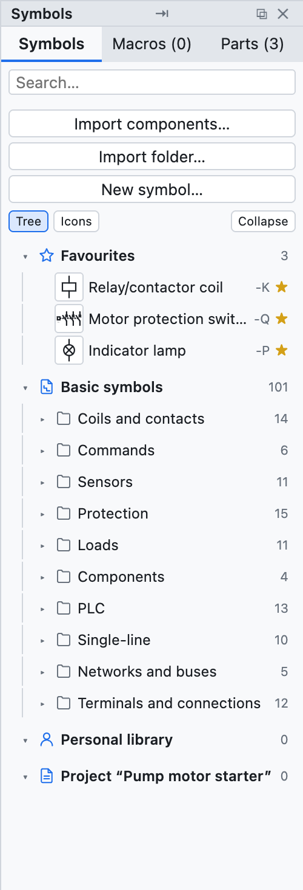
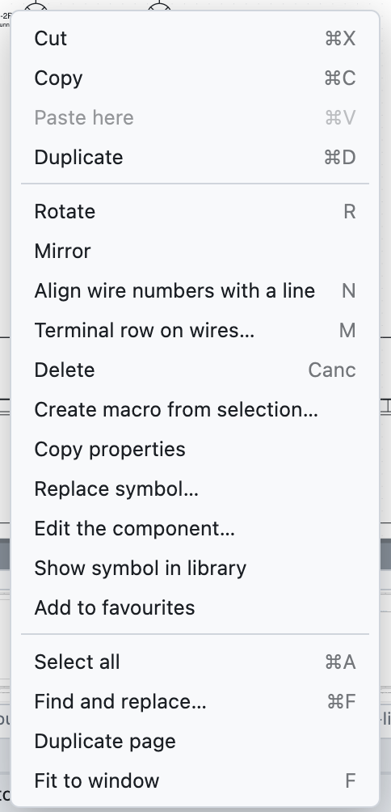

# 2. L'interface

*La fenêtre d'OpenWiring avec le projet d'exemple.*

| N° | Partie | À quoi elle sert |
|---|---|---|
| 1 | Onglets du ruban | *Fichier* et les onglets *Accueil, Insertion, Pages, Projet, Listes, Révisions, Affichage, Aide* |
| 2 | Commandes du ruban | les commandes de l'onglet ouvert, en groupes avec leur nom en dessous |
| 3 | Arborescence du modèle | pages, appareils, structure =/+, borniers, câbles, articles du projet |
| 4 | Propriétés | les données de l'élément sélectionné, de la page ou du projet |
| 5 | Zone de dessin | la page de schéma courante |
| 6 | Bibliothèque | symboles, macros et articles à insérer |
| 7 | Vue rapport | messages d'import, d'export et des opérations |
| 8 | Barre d'état | conseils sur la commande active, fichier, page, coordonnées du curseur |
| 9 | Onglets des vues | Schéma, Appareils, API, Borniers, Articles, Listes |

## Ruban

Les commandes sont réunies dans des **onglets** ; chaque onglet les répartit en groupes dont le nom est écrit en
dessous. Le raccourci clavier apparaît dans l'info-bulle de chaque bouton. Un **double clic** sur un onglet réduit
le ruban aux noms des onglets (un clic le rouvre pour une commande) ; *Affichage ▸ Barre de commandes ▸ Style*
choisit entre ruban, ruban compact et **menus classiques**, pour qui préfère les menus déroulants.
*Rechercher une commande…* (⌘K) trouve n'importe quelle commande en tapant son nom.

*L'onglet Fichier : démarrage, projets récents, nouveau, ouvrir, enregistrer, importer, exporter, imprimer et PDF, paramètres.*

| Onglet | Contenu |
|---|---|
| *Fichier* | nouveau, ouvrir, ouvrir à côté, enregistrer, **Importer** (articles EDZ/XML/CSV, symboles QElectroTech, schéma depuis PDF, macros) et **Exporter** (PDF, DXF, étiquettes, PLCopen, articles, dictionnaire), imprimer, paramètres, à propos |
| *Accueil* | presse-papiers, dessin (sélection, fil, fils rapides, rangée de bornes, texte), édition (rotation, miroir, aligner, supprimer), rechercher (recherche, ajuster, page précédente et suivante), vérification, PDF et impression |
| *Insertion* | symboles et macros, liaisons (faisceau de fils, bus réseau, câble, section), emplacements, graphisme (texte, image, dessin DXF) |
| *Pages* | nouvelle page de chaque type, pages automatiques (listes, dessins de câbles, brochages), organiser, feuille (cartouche, format et cadre) |
| *Projet* | paramètres et propriétés, profils, numérotation des appareils et des fils, articles, réseaux IP et adresses, traductions, assistant IA |
| *Listes* | vérifications, listes, liste E/S API, listes personnalisées, vues (appareils, borniers, connecteurs, câbles, répartiteurs, calculs), PDF complet, étiquettes, PLCopen |
| *Révisions* | révisions, publication, modifications de la révision, comparaison avec un autre projet, enregistrer comme modèle |
| *Affichage* | panneaux, thème, feuille, langue de l'interface et des schémas, grille, miniatures, plan de la feuille, menu radial, style du ruban |
| *Aide* | manuel, visite guidée, raccourcis, guide pour agents IA, mises à jour, à propos, site du projet |

*L'onglet Projet.*

## Onglet Accueil et outils sur le dessin

L'onglet *Accueil* réunit les commandes utilisées en permanence. Au-dessus du schéma se trouve aussi une petite
barre flottante avec les outils de dessin (sélection, fil, fils rapides, renvois, bornes, texte) : on l'active et
la désactive avec *Affichage ▸ Outils sur le dessin*.

| Bouton | Action |
|---|---|
| *Sélectionner* | retour à la sélection (aussi avec Échap) |
| *Fil* | dessiner des fils (touche **W**) |
| *Rapide V*, *Rapide H* | fil vertical ou horizontal en une fois |
| *Bornes en rangée* | une rangée de bornes sur les fils traversés |
| *Texte* | texte libre sur la page |
| *Faire pivoter, Miroir, Supprimer* | sur la sélection (touches **R** et **Suppr**) |
| *Rechercher* | rechercher et remplacer (⌘F) |
| *Ajuster* | afficher toute la page (touche **F**) |
| *Vérification* | vérifications du projet |
| *PDF*, *Imprimer…* | exporter en PDF ou imprimer |

La barre d'accès rapide en haut à gauche contient *Enregistrer*, *Annuler* et *Rétablir* (⌘S, ⌘Z, ⇧⌘Z).

## Arborescence du modèle

L'arborescence montre le projet et s'ouvre ou se ferme avec les triangles ▸ ▾ :

- **Pages**, regroupées par emplacement (armoire, boîte à boutons…) : un clic ouvre la page.
- **Appareils**, regroupés par emplacement : un clic va à l'appareil et le sélectionne.
- **Structure =Installation +Emplacement** : les appareils par fonction et emplacement (voir le [chapitre 7](07-dispositivi-e-articoli.md#structure-installation-emplacement)).
- **Borniers** et **Câbles** : un clic ouvre le bornier ou sélectionne la ligne du câble.
- **Articles du projet** : les articles utilisés.

Sous l'arborescence se trouvent les boutons des pages : *+ Page*, *+ Couverture*, *+ Unifilaire*,
*+ Réseau*, *+ Implantation*, *⧉* (dupliquer la page), *↑ ↓* (déplacer) et *✕* (supprimer).

## Propriétés

Le panneau affiche les données de ce qui est sélectionné :

- **rien de sélectionné** : la page courante et, dessous, les données du projet ;
- **un symbole** : repère, données de l'appareil, commande, points de connexion, position ;
- **un fil** : numéro de fil, réseau, connexions, section, couleur ;
- **plusieurs éléments** : les champs communs.

On écrit dans le champ et on confirme avec Entrée ou en quittant le champ. Les valeurs en gris italique sont
des suggestions ou des valeurs reprises de l'article.

## Bibliothèque

La colonne de droite a trois onglets :

- **Symboles** : les symboles CEI 60617 classés par catégorie (bobines et contacts, commandes, protections,
  récepteurs, bornes et connexions, API, réseaux et bus, unifilaire), plus ceux importés ou dessinés par vous.
  Le champ *Rechercher…* filtre par nom.
  En haut se trouvent les **★ Favoris** : l'étoile ☆ d'un symbole (ou le clic droit sur un composant ▸
  *Ajouter aux favoris*) l'y place. Les favoris valent pour tous les projets.
- **Macros** : les circuits enregistrés pour être réutilisés (voir le [chapitre 13](13-macro-simboli-cartigli.md)).
- **Articles** : la bibliothèque des articles des fabricants.

## Menu du clic droit

Le clic droit sur un élément ouvre les commandes les plus utilisées : couper, copier, coller ici, dupliquer,
faire pivoter, miroir, supprimer, créer une macro à partir de la sélection, **copier les propriétés** et **coller les propriétés de -X** (toutes les données de l'appareil sauf le repère, [chapitre 7](07-dispositivi-e-articoli.md#copier-les-propriétés)), modifier le composant, ajouter aux favoris, mettre en
évidence le potentiel (sur les fils), aller à l'élément principal ou aux contacts, ajouter un étage (sur les
bornes), tout sélectionner, rechercher, dupliquer la page, ajuster à la fenêtre.

## Vues

Les onglets en haut à droite changent la partie centrale :

| Vue | Contenu |
|---|---|
| *Schéma* | la page de dessin |
| *Appareils* | le navigateur des appareils sous forme de tableau |
| *API* | cartes, adresses et liste des E/S |
| *Borniers* | le navigateur des borniers |
| *Articles* | la gestion des articles |
| *Listes* | contrôles, traductions et toutes les listes |

## Se déplacer dans le dessin

| Action | Comment |
|---|---|
| Zoomer et dézoomer | molette de la souris, autour du curseur (sur le pavé tactile : pincement) |
| Déplacer la vue | bouton central de la souris, ou **Alt** + glisser |
| Voir toute la page | **F** ou *Ajuster* |
| Page précédente ou suivante | **PgPréc** / **PgSuiv** |
| Aller à une référence | cliquer sur un renvoi comme `/2.4` |

## Thème, feuille et langue

*Affichage ▸ Thème* choisit une interface claire, sombre ou comme le système. *Affichage ▸ Feuille de
dessin* choisit une feuille blanche ou sombre (comme dans les CAO à fond noir). PDF, DXF et impression sont
toujours sur feuille blanche. *Affichage ▸ Language · Lingua* choisit la langue de l'interface : italien,
anglais, français, allemand ou espagnol.
