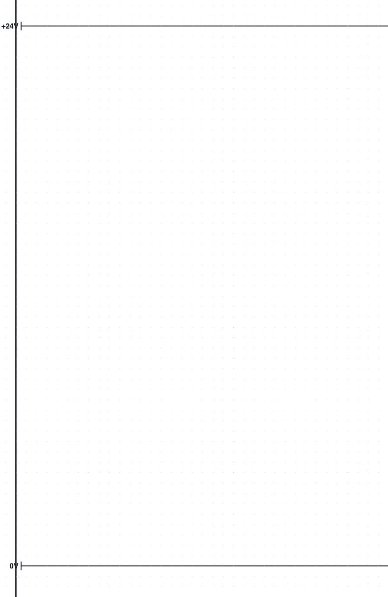
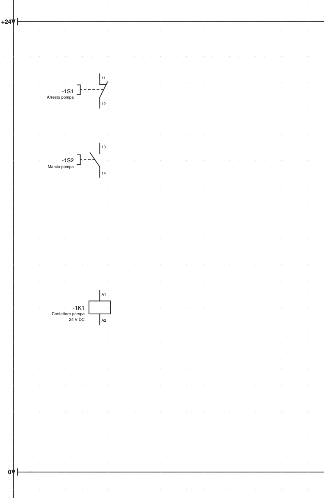
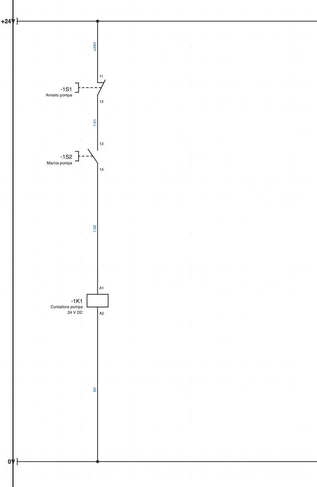
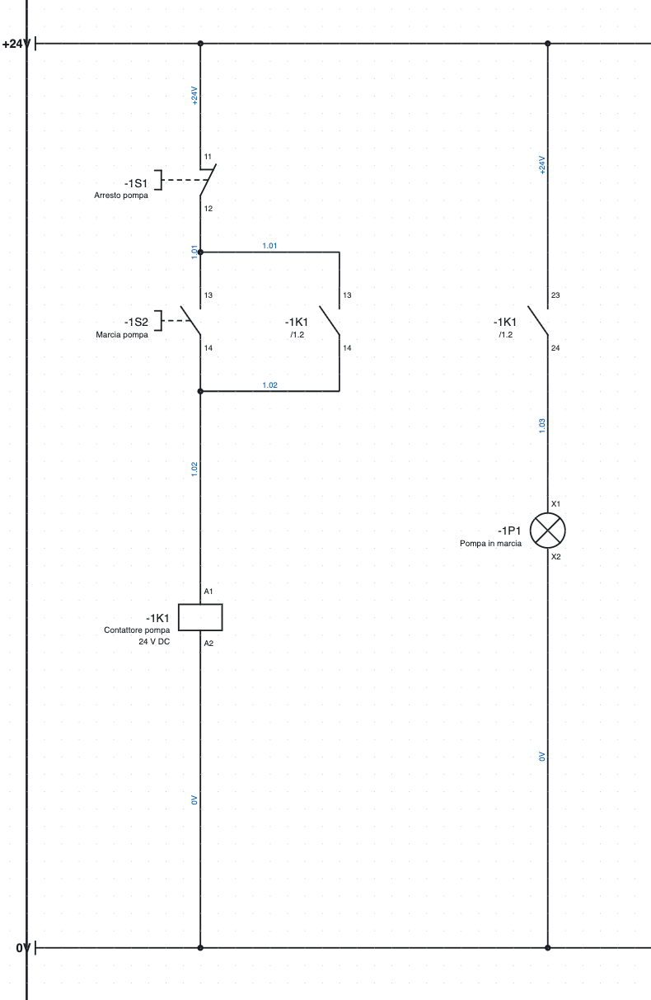
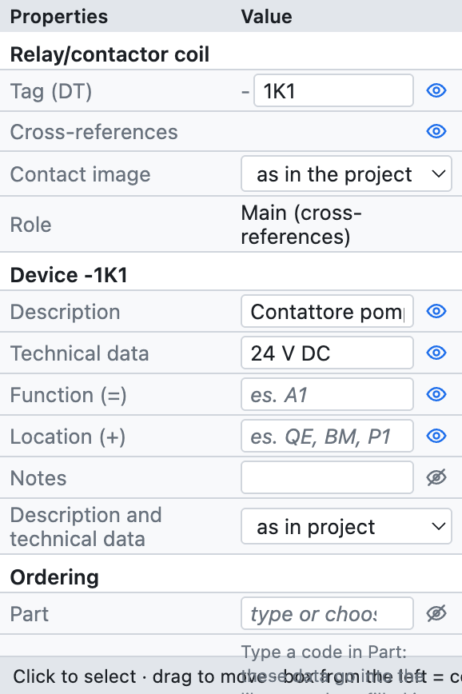
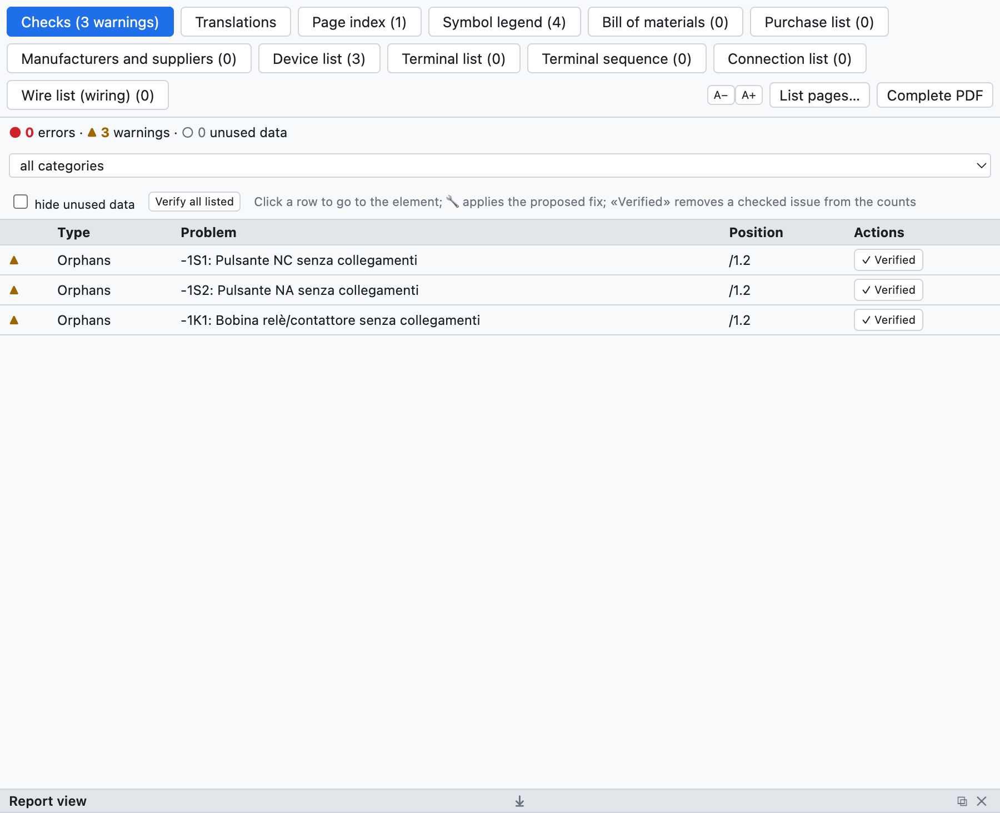
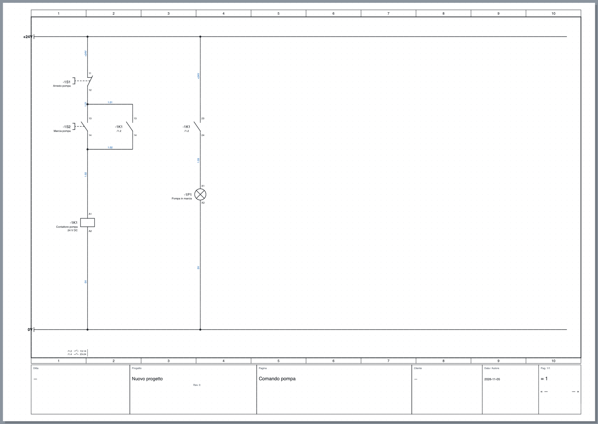

# 3. Le premier projet

Dans cet exercice on dessine la **commande d'une pompe** : un bouton d'arrêt, un bouton de marche, le
contacteur avec auto-maintien et un voyant de marche, alimentés en 24 V. Il faut une vingtaine de minutes et
à la fin on connaît les commandes de base : insérer des symboles, dessiner des fils, remplir les données,
vérifier et exporter.

## Étape 1 – Nouveau projet et barres d'alimentation

1. *Fichier ▸ Nouveau projet*. Une page vide s'ouvre, la page **1**.
2. Cliquez sur le nom de la page dans l'arborescence et, dans *Propriétés*, écrivez la **Description** :
   `Commande pompe`. Le titre apparaît dans le cartouche.
3. Dans la bibliothèque, catégorie *Bornes et connexions*, choisissez **Point de potentiel** et cliquez en
   haut à gauche de la page. Le point s'appelle `L1` : dans *Propriétés ▸ Nom* écrivez `+24V`.
4. Insérez un deuxième point de potentiel en bas et appelez-le `0V`. Appuyez sur **Échap** pour terminer
   l'insertion.
5. Appuyez sur **W** (outil *Fil*), cliquez sur le point `+24V` puis à l'extrémité droite de la page ;
   terminez le fil par un double clic. Faites de même pour la barre `0V`.

*Étape 1 : les barres d'alimentation.*

> **Pourquoi des points de potentiel ?** Tous les conducteurs de même nom (`+24V`, `0V`, `L1`, `PE`…) sont
> reliés entre eux, même sur des pages différentes. Les listes et la vérification le savent.

## Étape 2 – Les symboles

1. Catégorie *Commandes* : choisissez **Bouton-poussoir NF** et cliquez sous la barre `+24V`, dans la
   colonne 1–2. Le bouton reçoit tout seul le repère `-1S1` (page 1, lettre S, premier de la page).
2. Toujours dans *Commandes*, **Bouton-poussoir NO**, plus bas sur la même verticale : il devient `-1S2`.
3. Catégorie *Bobines et contacts* : **Bobine de relais/contacteur**, encore plus bas : elle devient `-1K1`.
4. Appuyez sur **Échap**.

Si un symbole doit être tourné, appuyez sur **R** (rotation de 90°) avant de l'insérer ; après
l'insertion, on le tourne avec **R** sur la sélection. Les symboles s'accrochent à la grille de 4 mm.

*Étape 2 : boutons et bobine, encore sans fils.*

## Étape 3 – Les fils

1. Appuyez sur **W**. Cliquez sur la barre `+24V` au-dessus du bouton `-1S1` : le fil part du point de la barre.
2. Cliquez sur le point de connexion du haut du bouton (`11`) : le fil se termine tout seul quand il arrive
   sur un point de connexion. Les points disponibles sont signalés par des petits cercles verts.
3. Reliez de la même façon `-1S1:12` à `-1S2:13`, `-1S2:14` à `-1K1:A1`, et `-1K1:A2` à la barre `0V`.

Là où un fil arrive sur un autre fil, le logiciel crée une **jonction** et la dessine avec un point.
Deux fils qui se croisent sans point ne sont pas reliés.

> **Connexion automatique.** Quand vous insérez ou déplacez un symbole, ses points de connexion libres se
> relient d'eux-mêmes aux points en face sur la même ligne : deux symboles placés l'un sous l'autre sur la même
> verticale sont déjà reliés par un fil. C'est pratique pour les circuits en colonne ; si vous préférez tracer
> chaque fil à la main, désactivez-la dans *Propriétés du projet ▸ Dessin ▸ Connexion automatique*.

*Étape 3 : le circuit de commande relié. Les numéros de fil bleus ont été attribués automatiquement.*

## Étape 4 – Auto-maintien et voyant

1. Catégorie *Bobines et contacts* : **Contact NO**. Insérez-le à droite du bouton de marche.
   La fenêtre *Contact NO : quel appareil ?* s'ouvre avec les bobines du projet : choisissez `-1K1` et
   appuyez sur Entrée. Le contact reçoit les bornes `13-14`. Si vous confirmez sans choisir, il reste un
   appareil nouveau (`-1K2`).
2. Reliez-le **en parallèle** au bouton de marche : un fil du segment au-dessus de `-1S2` vers le contact,
   un fil du contact vers le segment en dessous de `-1S2`. Les jonctions en T se forment toutes seules.
3. Insérez un deuxième **Contact NO** plus à droite : la fenêtre propose déjà `-1K1`, la dernière bobine
   choisie ; appuyez sur Entrée et le contact reçoit les bornes `23-24`.
4. Catégorie *Récepteurs* : **Voyant** sous le contact : il devient `-1P1`.
5. Reliez barre `+24V` → contact → voyant → barre `0V`.

*Étape 4 : l'auto-maintien `-1K1 13-14` et le voyant de marche commandé par `-1K1 23-24`.*

Sous chaque contact apparaît **`/1.2`** : la position de la bobine (page 1, colonne 2). En bas de la page,
sous la barre `0V`, apparaît l'**image des contacts** de la bobine avec les positions des contacts
(`/1.2 13-14`, `/1.4 23-24`). Un clic sur un renvoi mène à l'élément relié.

## Étape 5 – Les données du composant

Sélectionnez la bobine `-1K1`. Dans le panneau *Propriétés*, remplissez :

- **Description** : `Contacteur pompe` ;
- **Caractéristiques techniques** : `24 V CC` ;
- si vous le connaissez, l'**article**, sinon fabricant, type et référence de commande.

*Les propriétés de la bobine `-1K1` : repère, données de l'appareil, commande, points de connexion et position.*

Description et caractéristiques techniques apparaissent sur le schéma sous le repère et vont dans les
listes. Elles appartiennent à l'**appareil** : écrites sur la bobine, elles valent aussi pour ses
contacts. Remplissez aussi les boutons (`Arrêt pompe`, `Marche pompe`) et le voyant (`Pompe en marche`).

## Étape 6 – Vérification

Appuyez sur **Vérification** dans la barre d'outils. L'onglet *Contrôles* s'ouvre avec les erreurs (●),
les avertissements (▲) et les données inutilisées (○). Un clic sur une ligne mène à l'élément.

*Voici ce que signale la vérification si on la lance après l'étape 2, quand les symboles ne sont pas encore
reliés.*

Avec le schéma terminé, la vérification ne trouve aucun problème. Essayez d'effacer un fil : des
avertissements sur les points de connexion libres apparaissent.

## Étape 7 – Enregistrer et exporter

1. **Enregistrer** (⌘S) et choisissez le nom du fichier, par exemple `Commande pompe.ecad`.
2. **PDF** dans la barre d'outils : laissez *Celles cochées dans la liste ci-dessous* (au départ toutes sont
   cochées) et appuyez sur *Exporter*. Le PDF a
   l'index, les listes à la fin et des renvois cliquables.

*La page terminée, avec le cartouche rempli à partir des données du projet.*

## Et maintenant ?

- Les données du cartouche (société, client, numéro de plan) se remplissent dans les propriétés du projet :
  [chapitre 4](04-progetto-e-pagine.md).
- Pour relier des pages différentes, on utilise les renvois : [chapitre 5](05-disegnare.md#renvois-entre-pages).
- Pour la puissance (disjoncteur moteur, contacteur, moteur), ouvrez la page 1 du projet d'exemple.
- Le même schéma peut être dessiné par l'**assistant IA** à partir d'une description : [chapitre 17](17-assistente-ia.md).
