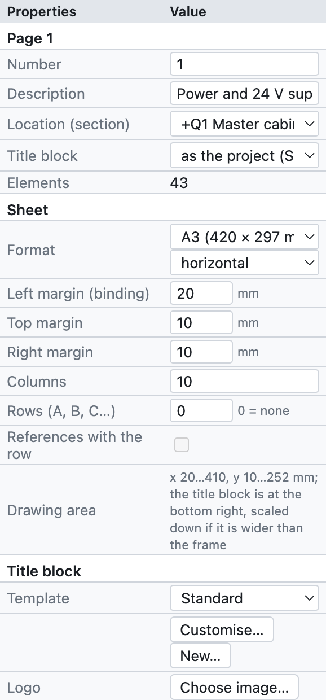
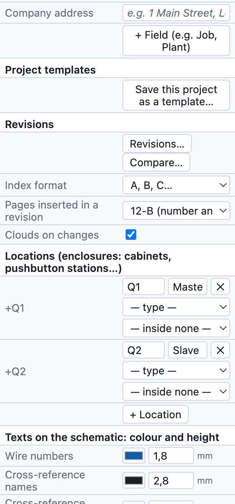
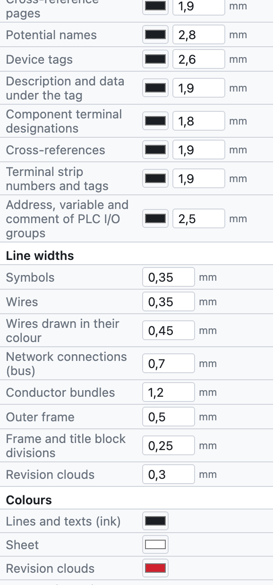
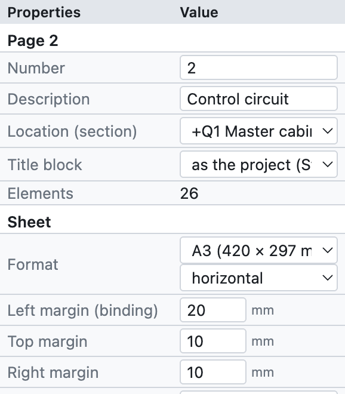
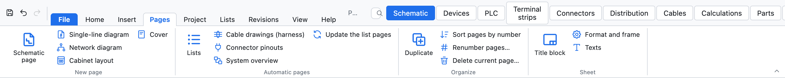
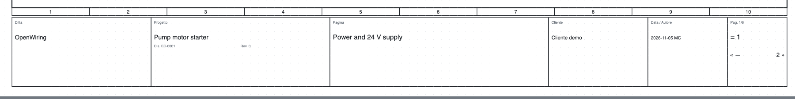
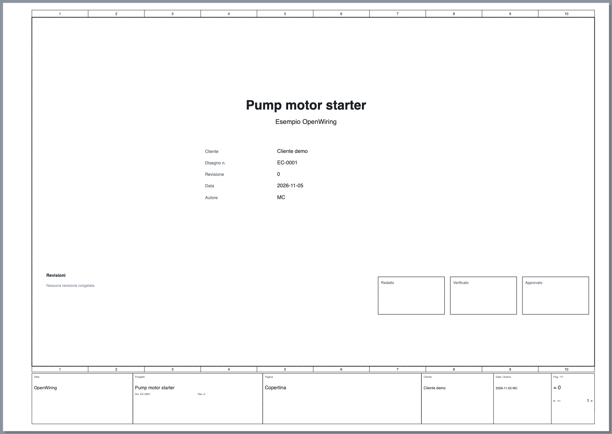

# 4. Projet et pages

## Propriétés du projet

Les paramètres du projet s'ouvrent avec *Projet ▸ Propriétés du projet*, en cliquant sur le nom du projet
dans l'arborescence, ou en désélectionnant tout (clic sur une zone vide) : le panneau *Propriétés* affiche
la page courante et, dessous, les données du projet.

*Le panneau des propriétés du projet, de haut en bas.*

| Groupe | Champs | Voir |
|---|---|---|
| *Page* | numéro, description, emplacement, cartouche de la page | [Pages](#pages) |
| *Cartouche* | modèle, logo, adresse de la société, champs supplémentaires | [Cartouche](#cartouche) |
| *Modèles de projet* | enregistrer le projet comme modèle | [Modèles de projet](#modèles-de-projet) |
| *Révisions* | nouvelle révision, comparaison, nuages | [chapitre 15](15-verifica-ricerca-revisioni.md#révisions) |
| *Emplacements* | armoires, boîtes à boutons, bord machine… | [chapitre 11](11-reti-luoghi-unifilare.md#emplacements) |
| *Langues* | langue des schémas et deuxième langue | [chapitre 16](16-lingue.md) |
| *Réseaux IP* | sous-réseaux du plan d'adressage | [chapitre 11](11-reti-luoghi-unifilare.md#plan-dadressage-ip) |
| *Projet (cartouche)* | nom, description, société, client, auteur, numéro de plan, révision, date | ci-dessous |
| *Repères des appareils* | modèle du repère, compteur, image des contacts | [chapitre 6](06-sigle-e-numerazione.md) |
| *Numéros de fil* | affichage, section et couleur, fils colorés, numérotation, modèle | [chapitre 6](06-sigle-e-numerazione.md#numéros-de-fil) |
| *Dessin* | descriptions sur le schéma, pas de la grille | ci-dessous |

### Données du cartouche

Nom, description, société, client, auteur, numéro de plan, révision et date apparaissent dans le cartouche
de chaque page, sur la couverture et dans les propriétés du PDF. On les écrit une seule fois.

### Dessin

- **Descriptions sur le schéma** : écrit la description et les caractéristiques techniques sous le repère
  des appareils (modifiable pour un seul appareil).
- **Pas de la grille** : 4 mm (conseillé), ou 1, 2, 5 ou 8 mm.

## Pages

La feuille est un **A3 paysage** (420 × 297 mm) avec le cadre divisé en **10 colonnes** numérotées et le
cartouche en bas. Les colonnes servent aux renvois : `/2.4` signifie page 2, colonne 4.

*Les propriétés de la page 2 du projet d'exemple.*

- **Numéro** : le nom de la page, libre (`1`, `200`, `10.1`). Il entre dans les repères (`-200K1`), les
  numéros de fil (`200.01`) et les renvois (`/200.4`).
- **Description** : le titre de la page, dans le cartouche et dans l'index.
- **Emplacement (section)** : l'armoire ou l'emplacement auquel appartient la page ; l'arborescence regroupe
  les pages par emplacement.
- **Cartouche** : le cartouche de la page, s'il diffère de celui du projet.

### Commandes des pages

| Commande | Où | Effet |
|---|---|---|
| Nouvelle page | *+ Page* sous l'arborescence, *Insertion ▸ Page de schéma* | page vide après la page courante, avec le numéro suivant |
| Dupliquer | *⧉*, *Insertion ▸ Dupliquer la page courante*, clic droit | copie avec de nouveaux repères et numéros de fil |
| Déplacer | *↑ ↓* sous l'arborescence | change l'ordre |
| Supprimer | *✕* sous l'arborescence | demande confirmation ; s'annule avec ⌘Z |
| Changer de page | clic dans l'arborescence, **PgPréc/PgSuiv** | |

*L'onglet Pages : nouvelles pages de chaque type, pages automatiques, ordre des pages et feuille.*

### Types de pages

| Type | Comment le créer | Contenu |
|---|---|---|
| Schéma multifilaire | *+ Page* | le schéma électrique proprement dit |
| Schéma unifilaire | *+ Unifilaire* | symboles unifilaires ([chapitre 11](11-reti-luoghi-unifilare.md#schéma-unifilaire)) |
| Schéma réseau | *+ Réseau* | nœuds et connexions bus entre les armoires ([chapitre 11](11-reti-luoghi-unifilare.md)) |
| Implantation de l'armoire | *+ Implantation* | vue de montage de la plaque ([chapitre 12](12-layout-quadro.md)) |
| Couverture | *+ Couverture* | titre, données, révisions, signatures |
| Vue d'ensemble API | vue API ▸ *Pages de vue d'ensemble* | générée ([chapitre 10](10-plc.md)) |
| Schéma du bornier | vue Borniers ▸ *Générer les schémas des borniers* | généré ([chapitre 8](08-morsettiere.md)) |
| Page de liste | *Insertion ▸ Pages automatiques* | générée ([chapitre 14](14-liste-e-pagine-automatiche.md)) |

Les pages générées se mettent à jour toutes seules : leur contenu vient toujours du schéma.

## Cartouche

*Le cartouche standard : société, projet avec numéro de plan et révision, titre de la page, client, date et
auteur, numéro de page.*

Dans le groupe *Cartouche* des propriétés :

- **Modèle** : *Standard*, *Avec tableau des révisions* (les trois dernières révisions), *Compact*, les six cartouches
  détaillés (*ISO 7200*, *Industriel détaillé*, *Machine EN 60204-1*, *Installation civile DM 37/08*, *Tableau
  EN 61439*, *Automatisme avec signatures*, décrits au [chapitre 13](13-macro-simboli-cartigli.md#cartouches-inclus)),
  ou un cartouche personnalisé. *Personnaliser…* ouvre le modèle dans l'éditeur, *Nouveau…* en crée un de zéro
  (voir le [chapitre 13](13-macro-simboli-cartigli.md#cartouches-personnalisés)).
- **Logo** : une image PNG, JPG ou SVG.
- **Adresse de la société** : sous le nom de la société.
- **+ Champ** : champs supplémentaires avec nom et valeur, par exemple *Commande* ou *Installation*. Si vous choisissez un modèle qui utilise
  ses propres champs (par exemple `{campo:Matricola}`), ces champs apparaissent d'eux-mêmes dans les propriétés
  du projet.

Chaque page peut avoir un cartouche différent du reste du projet (*Propriétés de la page ▸ Cartouche*).

## Propriétés définies par l'utilisateur

*Projet ▸ Propriétés définies par l'utilisateur…* ouvre la liste des propriétés propres au projet, en plus de
celles fournies : par exemple la commande du client, le numéro de commande ou un code interne. Pour chaque
propriété on indique :

- l'**identifiant**, avec au moins un point (par exemple `Ditta.Commessa`) ;
- le **nom affiché** ;
- à quoi elle s'applique : **appareils, pages, liaisons, projet ou articles** ;
- le **type**, l'**unité** et la **catégorie** ;
- une **liste de choix** (valeurs séparées par `;`) et, si besoin, *Ne plus utiliser* pour la mettre de côté sans
  la supprimer.

Les valeurs se saisissent dans les *Propriétés* des objets auxquels la propriété est assignée. Pour les appareils
elles apparaissent aussi comme colonnes dans l'onglet *Appareils* et dans Excel ; dans les cartouches on les
utilise avec le marqueur `{prop:nom}` ([chapitre 13](13-macro-simboli-cartigli.md#marqueurs)).

La liste peut être **exportée et importée en XML**. L'import est tolérant : il accepte des noms en anglais,
allemand ou italien et des textes en plusieurs langues ; les propriétés dont l'identifiant n'est pas valide sont
écartées et le logiciel indique combien.

## Couverture

*+ Couverture* ajoute en tête du projet la page **0** avec logo, titre, description, données du projet,
tableau des révisions et cases *Établi*, *Vérifié*, *Approuvé*. Elle se met à jour toute seule avec les
données du projet.

*La couverture du projet d'exemple.*

## Modèles de projet

Un modèle conserve paramètres, cartouche, logo, emplacements et couverture, sans les schémas.

1. Préparez un projet avec les paramètres de votre société.
2. *Projet ▸ Enregistrer comme modèle…* et donnez un nom, par exemple `Standard atelier`.
3. Dès lors *Fichier* affiche *Nouveau depuis le modèle « Standard atelier »*.

Les modèles restent sur l'ordinateur, disponibles pour tous les projets.
