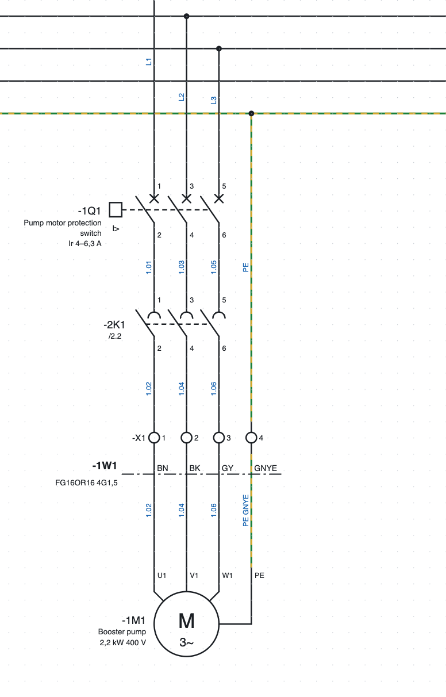
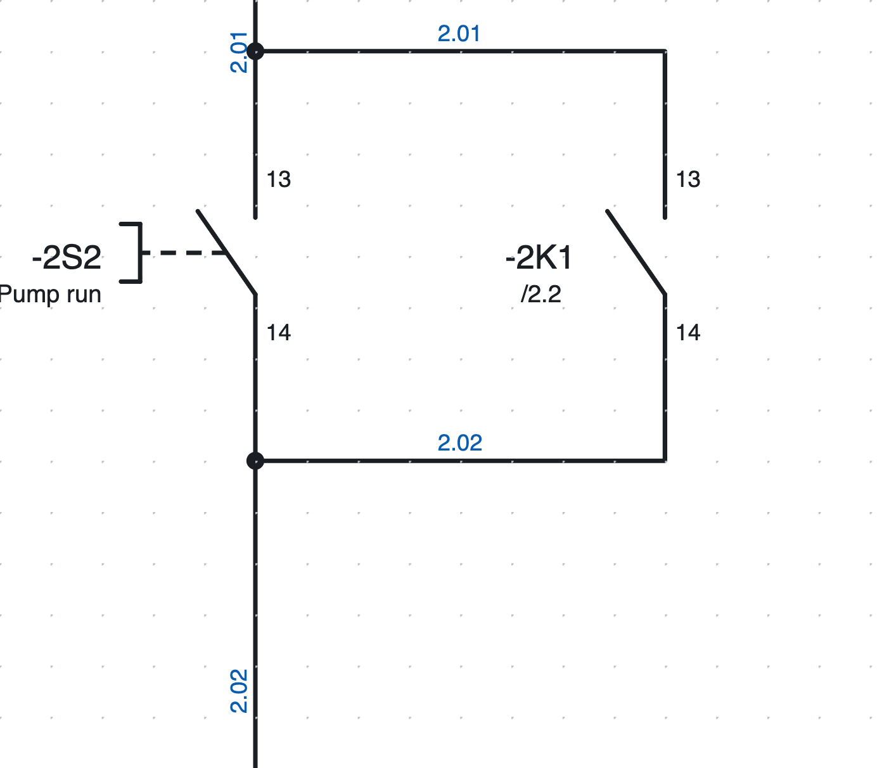
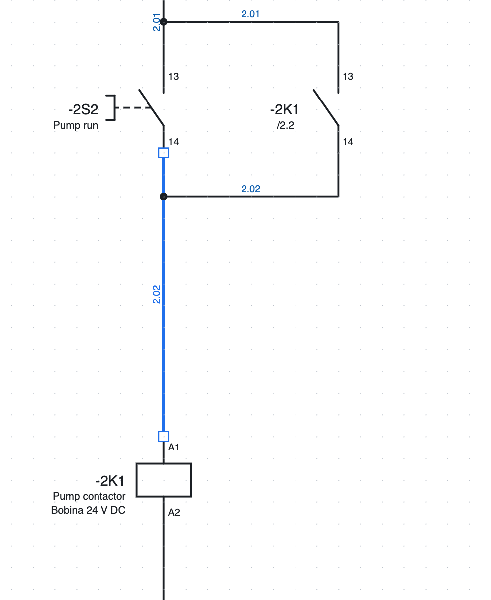
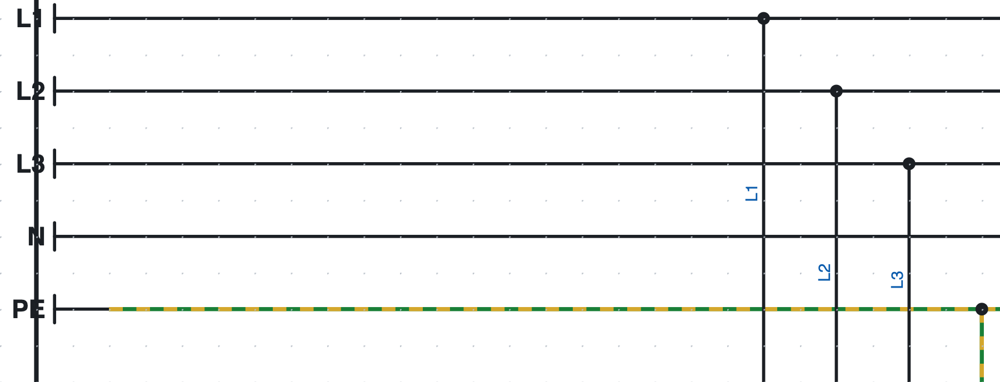
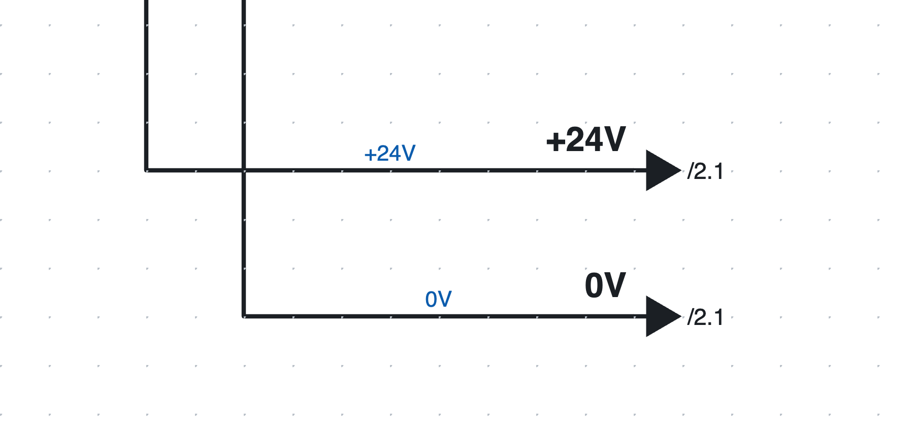

# 5. Dessiner le schéma

## Insérer des symboles

1. Dans la bibliothèque à droite (onglet *Symboles*), cliquez sur un symbole. Le champ *Rechercher…* filtre
   par nom (« contact », « moteur »…).
2. Cliquez sur la page : le symbole s'insère accroché à la grille et **reste actif**, pour en insérer
   d'autres identiques.
3. **R** fait pivoter le symbole de 90° avant de l'insérer.
4. **Échap** ou le clic droit terminent l'insertion.

Chaque nouveau symbole reçoit un **repère** libre selon le modèle du projet (par exemple `-2K3`, voir le
[chapitre 6](06-sigle-e-numerazione.md)). Pour un **contact auxiliaire** qui vient d'être inséré, une liste s'ouvre avec les appareils auxquels
l'associer : bobines et appareils du projet, d'abord ceux qui ont la même lettre, chacun avec description,
position et nombre de contacts. La liste se filtre pendant la saisie ; on peut aussi écrire un repère nouveau.
Le logiciel reproposera le dernier choisi.

### Les symboles fournis

| Catégorie | Symboles |
|---|---|
| Bobines et contacts | bobine de relais/contacteur, bobine temporisée, contact NO, contact NF, contact inverseur, contacts de puissance 3P |
| Commandes | bouton-poussoir NO, bouton-poussoir NF, arrêt d'urgence coup de poing, commutateur, fin de course, capteur de proximité PNP 3 fils |
| Protections | fusible, disjoncteurs magnétothermiques 1P, 2P et 3P, disjoncteur moteur 3P, relais thermique 3P |
| Récepteurs | moteur triphasé et monophasé, voyant, électrovanne, alimentation 230 V CA / 24 V CC, transformateur |
| Bornes et connexions | borne, borne PE, borne sectionnable, borne porte-fusible, broche de prise, de fiche et couple prise+fiche, point de potentiel, terre de protection PE, renvois de départ et d'arrivée |
| API | entrée et sortie TOR, entrée et sortie analogique, alimentation de carte L+/M |
| Réseaux et bus | nœud à 2 ports (IN/OUT ou P1/P2), nœud à 1 port, switch 5 ports, terminaison |
| Unifilaire | disjoncteur, disjoncteur moteur, sectionneur, fusible, contacteur, moteur, transformateur, variateur, alimentation, charge |

D'autres symboles se dessinent avec l'éditeur ou s'importent de QElectroTech et des fichiers EDZ des
fabricants ([chapitre 13](13-macro-simboli-cartigli.md) et [chapitre 7](07-dispositivi-e-articoli.md)).

*Le départ moteur de la page 1 : disjoncteur moteur `-1Q1`, contacts de puissance du contacteur `-2K1`,
bornier `-X1`, câble `-1W1` et moteur `-1M1`.*

## Dessiner les fils

1. Appuyez sur **W** ou *Fil*.
2. Cliquez sur le point de départ : un point de connexion, un fil existant ou un point libre.
3. Cliquez pour chaque angle. Le segment est toujours horizontal ou vertical ; avant le clic l'aperçu
   montre le tracé en L.
4. Le fil **se termine tout seul** quand vous cliquez sur un point de connexion ou sur un autre fil. Sinon
   terminez-le par un double clic, Entrée ou le clic droit.
5. **Échap** annule le fil en cours.

Les points de connexion libres sont signalés en vert pendant le dessin. En arrivant sur un fil un peu de
côté, le segment continue tout droit jusqu'au fil.

### Jonctions et croisements

*Les jonctions de l'auto-maintien de la page 2 : le point indique la connexion.*

- Un fil qui se termine sur un autre fil forme une **jonction en T**, dessinée avec un point.
- Deux fils qui se **croisent** sans point ne sont pas reliés.
- Le point ne se dessine pas à la main : le logiciel le place là où les fils sont vraiment reliés.

### Modifier les fils

*Un fil sélectionné montre ses sommets sous forme de petits carrés.*

- **Faites glisser un segment** pour le déplacer parallèlement : les extrémités restent reliées.
- **Faites glisser un sommet ou une extrémité** pour allonger, raccourcir ou relier le fil ailleurs.
- Le curseur change de forme pour indiquer ce que vous faites glisser.
- Pour supprimer un fil, sélectionnez-le et appuyez sur **Suppr**.

### Déplacer les symboles avec leurs fils

En faisant glisser un symbole, les fils reliés le suivent pendant le déplacement et restent orthogonaux, en
se pliant en Z si nécessaire. Un fil entre deux symboles déplacés ensemble se déplace en entier.

### Insérer un contact sur un fil

Si vous insérez (ou déplacez) un contact, un bouton ou un autre composant **sur un fil**, le fil se coupe sur
ses deux points de connexion : inutile de le couper à la main. Les deux tronçons gardent couleur et section.

## Points de potentiel

*Les barres L1, L2, L3, N et PE de la page 1.*

Le **point de potentiel** donne un nom à un conducteur : `L1`, `L2`, `L3`, `N`, `PE`, `+24V`, `0V`…

- Tous les conducteurs de même nom sont **reliés**, même sur des pages différentes.
- Le nom s'écrit dans les propriétés (*Nom*) ; un nouveau point s'appelle `L1`, la terre **PE** s'appelle `PE`.
- Les conducteurs d'un potentiel peuvent afficher le nom à la place du numéro de fil
  (*Propriétés du projet ▸ Numéros de fil ▸ Potentiels*).
- La vérification signale deux potentiels différents sur le même conducteur (par exemple `L1` relié à `N`).

## Renvois entre pages

*Les renvois `+24V` et `0V` de la page 1 : le nom au-dessus du fil, les pages d'arrivée à côté de la flèche.*

Quand un conducteur continue sur une autre page, on utilise une paire de **renvois**. Chaque départ est
relié à **une seule** arrivée, même si le nom se répète (par exemple c'est le numéro du fil) :

1. À la fin du fil, insérez un **Renvoi (départ)**. Son nom est le numéro du fil, s'il existe, sinon `R1`,
   `R2`…, et il se modifie dans *Propriétés*.
2. Sur l'autre page, au début du fil, insérez un **Renvoi (arrivée)** : la liste des départs encore libres
   apparaît, d'abord ceux qui ont le même nom. Choisissez-en un : l'arrivée prend son nom et les deux restent
   reliés. La première entrée (*aucun départ*) la laisse libre, quand le départ n'est pas encore dessiné.
   Cela marche aussi dans l'autre sens : en insérant un départ, on choisit parmi les arrivées libres.
   La liste se **filtre pendant la saisie** : chaque entrée montre le nom, la position et la page du renvoi.
3. Dans le champ *Nom* des *Propriétés*, les suggestions sont les renvois libres et les autres noms de renvoi ;
   en choisissant un renvoi libre, les deux sont reliés. La liaison se modifie dans *Propriétés ▸ Relié à*. Renommer un renvoi renomme aussi son correspondant.
4. À côté de chaque flèche apparaît la page où le conducteur continue (`/2.1`). Un clic mène à la page.
   Sur les fils verticaux, le nom et la page sont écrits verticalement, de bas en haut.

### Renvois en attente, sans correspondant et en étoile

Quand vous insérez un renvoi, le programme prend son nom dans le numéro du fil et cherche les renvois
libres :

- s'il y a **un seul** renvoi libre du même nom, les deux sont reliés tout de suite (un message dans la vue
  rapport l'indique) ;
- s'il y en a plusieurs, la liste s'ouvre avec le premier déjà choisi : *Entrée* le confirme ;
- s'il n'y en a aucun, le renvoi reste **en attente** : `/…` apparaît en orange à côté de la flèche, jusqu'à
  ce que vous dessiniez le correspondant.

Dans *Propriétés ▸ Relié à* on choisit le correspondant, on remet le renvoi *— en attente du correspondant
(/…)* ou on choisit *— aucun correspondant (le conducteur s'arrête ici)* quand le conducteur s'arrête
vraiment là : `//` apparaît alors à côté de la flèche et la vérification ne le signale plus comme erreur,
seulement comme information.

Dans la barre d'état, **Renvois en attente : N** compte les renvois encore à apparier ; chaque clic mène
au suivant. La vérification les liste comme avertissements.

**Départ en étoile.** Un départ avec *Propriétés ▸ En étoile* se relie à **toutes** les arrivées libres du
même nom (par exemple un `+24V` qui va sur de nombreuses pages) et affiche la liste de leurs pages. La
vérification propose l'étoile (avec le bouton 🔧) quand un départ est déjà relié et que d'autres arrivées
portent son nom.

## Bus de conducteurs

Quand de nombreux fils courent côte à côte (par exemple les trois phases et le neutre qui alimentent plusieurs
récepteurs), on peut les regrouper en un **bus de conducteurs**, sans dessiner toutes les lignes jusqu'au bout.

1. Choisissez l'outil **Bus fils** dans la barre d'outils (ou *Insertion ▸ Bus de conducteurs*) et tracez la
   ligne du bus : c'est une ligne épaisse. Dans les *Propriétés*, donnez au bus un **nom** (facultatif, par
   exemple `400V AC` ou `24V DC`).
2. Dessinez les fils qui arrivent au bus et les dérivations qui en partent, de façon qu'ils touchent la ligne.
3. Sur chaque fil qui touche le bus apparaît le **nom du conducteur** (`L1`, `L2`, `PE`…), écrit à côté du fil.
   On le choisit dans une liste qui se filtre pendant la saisie.

Les règles sont simples :

- les fils ayant le **même conducteur sur le même bus** sont le même fil et ont le même numéro de fil ;
- les bus qui se touchent, ou les bus de même nom sur plusieurs pages, forment **un seul bus** : les conducteurs
  continuent ;
- la vérification ([chapitre 15](15-verifica-ricerca-revisioni.md)) signale les fils qui touchent le bus sans nom
  de conducteur et les conducteurs qui entrent dans le bus sans en sortir nulle part.

Dans le format texte ([chapitre 17](17-assistente-ia.md)) la ligne du bus est un fil avec `busfili=nom`
(`busfili=_` s'il n'a pas de nom) et le conducteur aux deux extrémités d'un fil s'écrit avec `cond1=` et `cond2=`.

### Bus fils utilisé comme câble

Un câble qui passe d'une armoire à l'autre peut être dessiné comme bus fils : les fils entrent dans le bus
sur la page de départ et sortent d'un bus du même nom sur la page d'arrivée.

1. Donnez au bus **le repère du câble** (`W1112S1`). Si le câble n'est pas encore dans le projet, après le
   nom on choisit l'**article du câble** (aussi plus tard, dans *Propriétés ▸ Article du câble*).
2. Pour chaque fil le programme propose les **conducteurs du câble dans l'ordre** (couleurs ou numéros) :
   ceux déjà utilisés sont atténués, ceux entrés ailleurs qui attendent leur sortie sont mis en évidence et
   proposés en premier, les autres sont libres.
3. Avec **Nommer les conducteurs dans l'ordre** (*Propriétés* du bus) les fils de la page reçoivent leur
   conducteur de gauche à droite : au départ les premiers libres, à l'arrivée ceux qui attendent la sortie.
4. Dessinez la ligne du câble sur les fils, sur les deux pages : dans la vue *Câbles* chaque fil prend le
   conducteur écrit dans le bus. La ligne épaisse du bus ne compte pas comme conducteur.

Un **double clic sur le bus** ouvre ses propriétés : les conducteurs du câble avec leur état (utilisés
atténués, en attente de la sortie avec ⚠, libres avec la barre verte) et le tableau des fils du bus, où le
conducteur de chaque fil se corrige en le saisissant ou en le choisissant dans la liste.

La vue **Bus fils** (*Affichage ▸ Bus fils*, ou *Listes ▸ Bus fils*) montre tous les bus et, pour celui
choisi, chaque fil qui entre ou sort avec page, numéro de fil et liaisons ; le conducteur se corrige
directement dans le tableau. Les fils sans conducteur, ceux qui entrent sans sortir et les conducteurs que
le câble n'a pas sont signalés. La liste imprimable **Liaisons des bus fils** a un conducteur par ligne
(comme les connexions des câbles), avec les conducteurs libres du câble.

Un bus avec l'article d'un câble (conducteurs numérotés ou colorés) a aussi sa page de **câblage**,
comme les câbles : *Listes ▸ Dessins des câbles (faisceau)* crée la page « Cablaggio bus fili … » avec les
deux extrémités, les conducteurs et le tableau avec les libres. Un bus sans article reste seulement dans
la liste *Liaisons des bus fils*.

## Textes

*Texte* (ou *Insertion ▸ Texte*) et un clic sur la page insèrent un texte libre. Dans *Propriétés* on modifie
le texte et sa hauteur en mm. Les textes entrent dans le dictionnaire des traductions ([chapitre 16](16-lingue.md)).

## Images

Photos, logos ou dessins s'insèrent dans le schéma comme des images.

- *Insertion ▸ Image…* et choisissez un fichier PNG, JPG, SVG, GIF, WebP ou BMP ; ou **collez** une image
  depuis le presse-papiers avec ⌘V (Ctrl+V).
- L'image se **déplace** en la faisant glisser et se **redimensionne** en faisant glisser le coin inférieur droit :
  les proportions restent fixes, avec **Maj** enfoncée elles sont libres.
- Dans les *Propriétés* on modifie la position et les dimensions, on rétablit les proportions d'origine, on active
  le cadre, on choisit si l'image est **sous** ou **sur** le schéma et on la remplace avec *Remplacer l'image…*.
- Les images sortent dans le **PDF**. Dans le DXF il ne reste qu'un cadre avec le nom de l'image.
- Les images très grandes sont réduites (à 1600 points sur le grand côté) pour garder un fichier léger.

## Sélectionner, copier, déplacer

| Action | Comment |
|---|---|
| Sélectionner | clic sur l'élément |
| Ajouter ou retirer de la sélection | **Maj** + clic |
| Sélection par cadre | glisser sur une zone vide : **de gauche à droite** prend les éléments contenus, **de droite à gauche** aussi ceux touchés |
| Tout sélectionner | ⌘A |
| Déplacer | glisser, ou flèches (4 mm ; avec Maj 16 mm) |
| Faire pivoter, miroir | **R**, *Édition ▸ Miroir* |
| Dupliquer | ⌘D |
| Copier, couper, coller | ⌘C, ⌘X, ⌘V ; *Coller ici* du clic droit colle au point cliqué |
| Supprimer | **Suppr** ou Retour arrière |

Les copies reçoivent **de nouveaux repères et numéros de fil** ; bobine et contacts copiés ensemble restent
reliés. On peut aussi coller dans un autre projet : symboles et articles utilisés sont copiés avec les éléments.

Avec **couper et coller** les éléments sont **déplacés** : sur une autre page ils gardent repères, numéros
de borne, numéros de fil et la liaison des renvois. Avec **copier et coller** chaque borne copiée propose le
premier numéro libre du bornier, en partant du plus bas et avec le même étage (A, B…), et l'on choisit le
numéro ; les fils copiés prennent un nouveau numéro.

Un circuit souvent utilisé s'enregistre comme **macro** ([chapitre 13](13-macro-simboli-cartigli.md#macros)).

## Textes des symboles toujours lisibles

En faisant pivoter ou en mettant en miroir un symbole, ses textes internes (par exemple « M 3~ » du moteur)
ne sont jamais à l'envers ni en miroir : ils se lisent toujours depuis le bas ou depuis la droite, comme le
veut la norme. C'est valable à l'écran, dans le PDF et dans le DXF.
