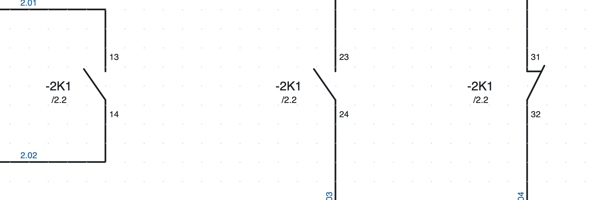
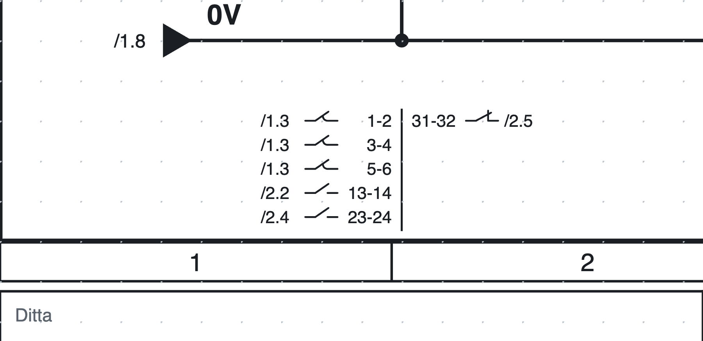
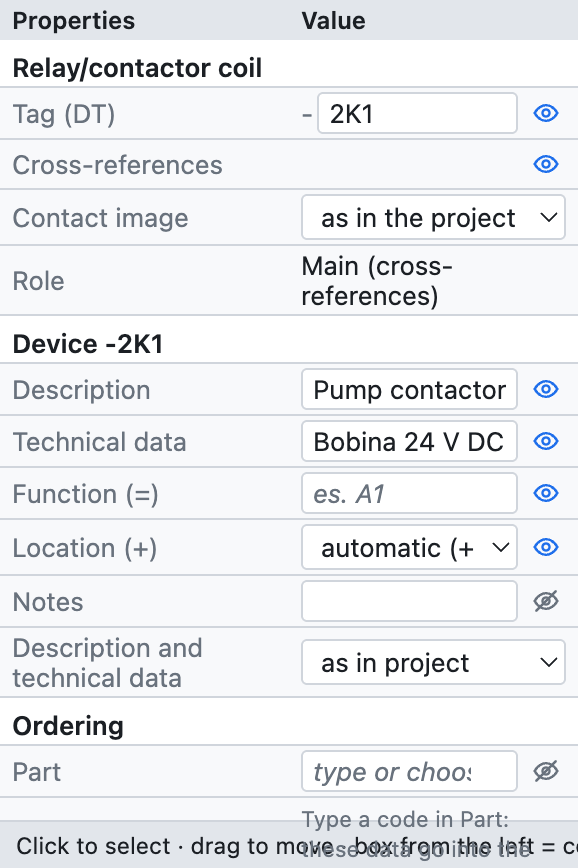
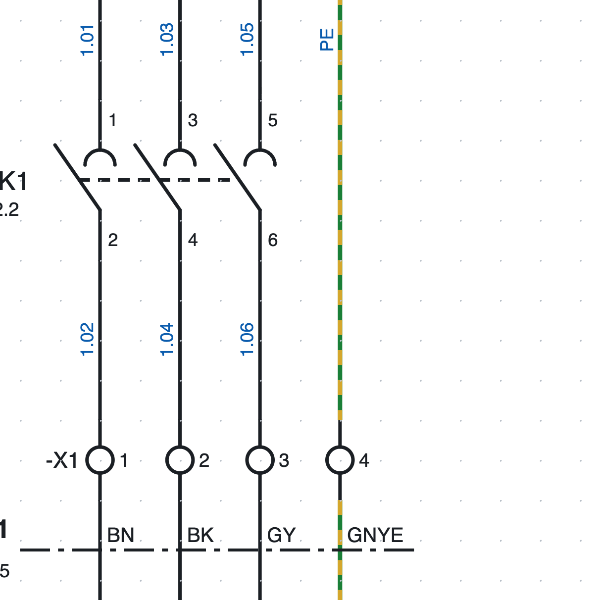
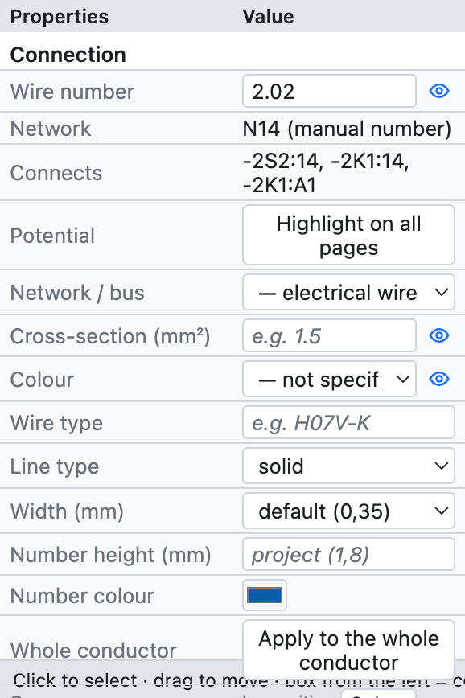
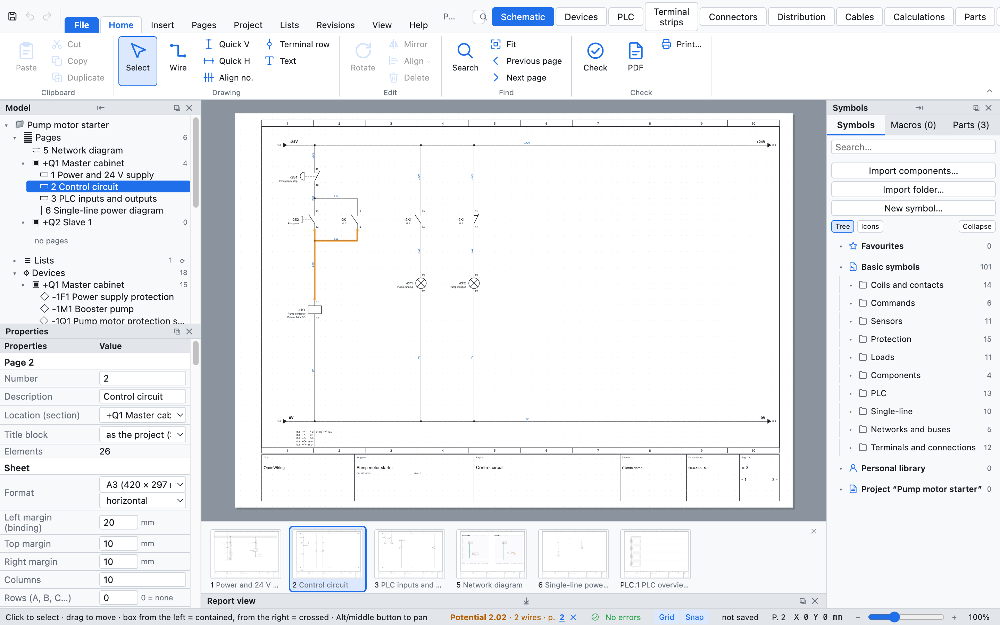

# 6. Repères, renvois croisés et numéros de fil

## Repères des appareils

Chaque appareil a un **repère** selon la CEI 81346 : un tiret, le numéro de la page, la **lettre** du type
d'appareil et un numéro d'ordre. `-2K1` est le premier contacteur de la page 2.

| Lettre | Appareils |
|---|---|
| K | relais, contacteurs, bobines temporisées |
| Q | disjoncteurs tripolaires, disjoncteurs moteur, sectionneurs |
| F | fusibles, disjoncteurs 1P et 2P, relais thermiques |
| S | boutons-poussoirs, arrêts d'urgence, commutateurs |
| B | capteurs, fins de course |
| P | voyants |
| M | moteurs, électrovannes |
| T | transformateurs, alimentations |
| A | API, cartes, nœuds réseau, appareils complexes |
| U | variateurs |
| E | charges génériques (unifilaire) |
| X | borniers et connecteurs |
| W | câbles |

La lettre dépend du symbole ; le repère peut toujours être changé à la main dans les propriétés.

### Le modèle du repère

Dans *Propriétés du projet ▸ Repères des appareils* on choisit comment se compose le repère :

| Champ | Signification | Exemple |
|---|---|---|
| `{pagina}` | numéro de la page | `200` |
| `{colonna}` | colonne (1–10) de l'appareil | `4` |
| `{lettera}` | lettre CEI 81346 | `K` |
| `{n}` | numéro d'ordre | `1` |
| `{n:2}` | numéro d'ordre à deux chiffres | `01` |

| Modèle | Résultat en page 200 |
|---|---|
| `{pagina}{lettera}{n}` (par défaut) | `-200K1` |
| `{lettera}{n}` | `-K1` |
| `{pagina}{lettera}{n:2}` | `-200K01` |
| `{pagina}.{colonna}{lettera}` | `-200.4K` |

- **Compteur** : repart à chaque page ou est unique dans tout le projet.
- **Repères stables** : un nouvel appareil prend le numéro après le plus élevé de la page (`-2K3` après
  `-2K2`) et les autres ne changent pas.
- **Renuméroter les appareils** (*Projet ▸ Renuméroter les appareils…*) renumérote tout dans l'ordre des
  pages, colonnes et lignes. Les contacts suivent leur bobine ; les bornes ont leur propre numérotation.

### Repère complet : fonction et emplacement

Avec la **fonction** (`=`, l'installation ou la partie de machine) et l'**emplacement** (`+`, l'armoire ou
la boîte à boutons) remplis, le repère devient complet : `=A1+Q1-2K1`. On les remplit dans les propriétés de
l'appareil ou, pour de nombreux appareils à la fois, dans le navigateur ([chapitre 7](07-dispositivi-e-articoli.md)).

## Bobines et contacts

L'**appareil principal** (la bobine d'un relais ou d'un contacteur) et ses **contacts** ont le même repère.
Le logiciel les relie tout seul :

1. Insérez la bobine : elle reçoit par exemple `-2K1`.
2. Insérez les contacts : une fenêtre demande *quel appareil ?* et liste les bobines et appareils du projet,
   d'abord ceux de même lettre. Choisissez dans la liste ou écrivez un nouveau repère ; à partir du contact
   suivant, la fenêtre propose la dernière bobine choisie.
3. Pour attribuer un contact à une autre bobine, écrivez le repère dans les propriétés du contact : la liste
   propose les repères existants de même lettre.

### Numérotation des contacts (EN 50005)

Les contacts auxiliaires se numérotent tout seuls avec le chiffre d'ordre et le chiffre de fonction : le
premier NO est `13-14`, le deuxième `23-24`, le premier NF `31-32` et ainsi de suite. On peut le désactiver
pour un contact et écrire les bornes à la main (*Propriétés ▸ Points de connexion*). Les contacts de
puissance sont `1-2`, `3-4`, `5-6`.

### Renvois croisés

*Sous chaque contact `-2K1` il y a `/2.2` : la bobine est en page 2, colonne 2.*

*L'image des contacts de `-2K1` en bas de la page 2 : à gauche de la ligne les contacts de puissance et NO,
à droite les NF, chacun avec sa position.*

- Sous chaque **contact** apparaît la position de la bobine (`/2.2`).
- Sous la **bobine** apparaît l'**image des contacts** : tous ses contacts avec les bornes et la position.
  Elle est **en bas de la page**, sous la barre inférieure, à la verticale de la bobine ; ou
  bien sous le symbole (*Propriétés du projet ▸ Repères des appareils ▸ Contacts des bobines*).
- Chaque renvoi est **cliquable** : il mène à la page et sélectionne l'élément. Dans le PDF il devient un lien.
- Le clic droit sur une bobine propose *Aller au contact…*, sur un contact *Aller à l'élément principal*.

La vérification signale les contacts sans bobine et les contacts plus nombreux que ceux de l'article (par
exemple un cinquième contact sur un contacteur à 4 auxiliaires).

### Renvois par paire

Un contact peut aussi être **montré sur une autre page** sans le dupliquer, par exemple un contact auxiliaire
du disjoncteur sur la page de vue d'ensemble : clic droit sur le contact ▸ *Dessiner une représentation
(renvoi par paire)…*, puis un clic là où elle doit être dessinée.

On peut aussi partir de l'**élément principal** : clic droit sur la bobine ou le disjoncteur moteur ▸
*Dessiner une représentation d'un contact…* (ou *Représentation…* dans l'onglet *Symbole*) liste ses contacts
déjà placés dans le schéma, les auxiliaires d'abord : choisissez celui à dessiner et cliquez où il va.

- La représentation est **seulement un dessin** : elle ne compte pas comme contact, ne se relie pas aux
  fils et n'entre ni dans les listes ni dans la nomenclature. Repère et bornes suivent toujours le vrai
  contact.
- Le vrai contact et la représentation se renvoient l'un à l'autre par des renvois croisés, dans les deux
  sens.
- *Propriétés ▸ Représentation de* indique le vrai contact (un clic y mène) ; *En faire un vrai contact* la
  transforme en contact avec ses propres liaisons.
- Le dessin est **réduit** : pas de repère (il est déjà à côté de l'élément principal), seulement le petit
  dessin du contact avec la page du vrai contact d'un côté et les bornes de l'autre (ex. `/1304.3 ─╱─ 13-14`).
  Il est vertical comme le contact ; **R** (avant ou après le clic) le met à l'horizontale. Hauteur et couleur
  sont celles des *Renvois* (Aspect ▸ Textes) ; *Propriétés ▸ Hauteur des textes* change seulement celui-ci.
  *Propriétés ▸ Dessin ▸ symbole complet avec repère* revient au symbole complet.
- Si le vrai contact est supprimé, la vérification signale la représentation restée seule et propose de
  l'effacer.

## Propriétés d'un appareil

*Les propriétés de la bobine `-2K1` du projet d'exemple.*

| Groupe | Champs |
|---|---|
| *(nom du symbole)* | repère, rôle (principal, contact, appareil, borne…) |
| *Appareil* | description, caractéristiques techniques, fonction (=), emplacement (+), notes, textes sur le schéma |
| *Commande* | article, fabricant, type, référence de commande |
| *Points de connexion* | le nom de chaque borne (A1, A2, 13, 14…) |
| *Position* | X et Y en mm, rotation, en miroir |
| *Numéro de fil* | si le numéro de fil traverse l'élément |

Les données des groupes *Appareil* et *Commande* valent pour **tout l'appareil** : écrites sur la bobine,
elles valent aussi pour les contacts. Si un article est attribué, les champs vides affichent ses données en gris.

## Numéros de fil

*Numéros de fil de la page 1 : `1.01`, `1.03`… au-dessus du contacteur, les mêmes numéros dessous, car les
bornes `-X1` ne changent pas le numéro.*

Chaque **conducteur** (tous les fils reliés entre eux jusqu'aux points de connexion des composants) a un
numéro, écrit sur chacun de ses segments. Le modèle par défaut est `{pagina}.{n:2}` : `200.01`, `200.02`…

### Numérotation bloquée ou recalculée

Dans *Propriétés du projet ▸ Numéros de fil ▸ Numérotation* :

- **bloquée** (par défaut) : un conducteur numéroté garde son numéro ; un nouveau conducteur prend le premier
  numéro libre de la page, même dessiné au milieu ; en reliant deux conducteurs numérotés il reste un seul
  numéro, en en coupant un la nouvelle partie reçoit un nouveau numéro. *Renuméroter les fils* recalcule tout
  dans l'ordre des colonnes.
- **recalculée** : les numéros sont recalculés à chaque modification, toujours dans l'ordre.

### Numéro manuel

Sélectionnez un fil et écrivez le numéro dans *Propriétés ▸ Numéro de fil* : il vaut pour tout le conducteur.
En l'effaçant on revient au numéro automatique.

### Où il s'écrit

Le numéro s'écrit à un **endroit libre** du fil : s'il y a au milieu du segment un croisement, un composant,
un repère ou un autre numéro, il se déplace le long du fil ou de l'autre côté. C'est valable à l'écran, dans
le PDF et dans le DXF. *Afficher* (propriétés du projet) les masque complètement.

### Déplacer ou répéter le numéro

Le numéro se **fait glisser** où l'on veut, même loin du fil : il reste ensuite à cet endroit et suit le fil
quand on le déplace. Clic droit sur le fil :

- **Ajouter le numéro de fil ici** : un autre numéro sur le même fil, à côté du tronçon cliqué ;
- **Retirer ce numéro de fil** (en cliquant sur un numéro, quand il y en a plusieurs) ;
- **Numéro de fil en position automatique** : retour à la position choisie par le programme.

### Le numéro traverse les bornes

Une borne n'est qu'un point de passage : les fils de ses deux côtés ont **le même numéro**. Chaque élément à
deux points de connexion ou plus a la case **Le numéro de fil traverse** dans *Propriétés ▸ Numéro de fil* :

- cochée par défaut sur les bornes, décochée sur les autres composants ;
- modifiable pour un seul élément, par exemple pour faire traverser le numéro par un sectionneur.

Les deux côtés restent des conducteurs distincts pour la liste des bornes et la liste des connexions.

### Compteur avancé

Dans *Propriétés du projet ▸ Numéros de fil* :

- **Modèle** : en plus de `{pagina}` (page), `{colonna}` (colonne) et `{n}` on peut utiliser `{quadro}` (code
  de l'armoire de la page), `{n:2}` (au moins 2 chiffres : `01`) et `{n:A}` ou `{n:a}` (compteur en
  lettres : `A`, `B`… `Z`, `AA`). Exemple : `{quadro}.{n:A}` donne `Q1.A`, `Q1.B`… Les repères des
  appareils acceptent aussi `{quadro}`.
- **Compteur** : recommence à chaque page, recommence à chaque armoire, ou unique dans le projet.
- **Réserve par page** : numéros laissés libres après chaque page. Avec une réserve de 3, la page 1 utilise
  1 et 2 et la page 2 commence à 6 : un fil ajouté ensuite à la page 1 prend le 3 et les pages suivantes
  gardent leurs numéros. Quand la réserve est épuisée, le compteur saute les numéros déjà utilisés par les
  pages suivantes.
- **Ordre sur la page** : par colonnes (de gauche à droite) ou par lignes (de haut en bas).

Les numéros écrits à la main, ceux des renvois et les noms des voies d'automate sont fixes : le compteur les
saute même quand ils sont écrits sur une autre page.

## Section et couleur des fils

*Les propriétés d'un fil : numéro, réseau, connexions, potentiel, section et couleur.*

- **Section** en mm² (`1,5`, `2,5`, `6`…) et **couleur** avec les codes CEI 60757 : `BK` noir, `BN` marron,
  `GY` gris, `BU` bleu, `DBU` bleu foncé, `RD` rouge, `WH` blanc, `GNYE` vert-jaune…
- La **couleur** choisie sur un segment vaut pour tout le conducteur, même après un renvoi ou une borne.
- Avec *Fils colorés* (propriétés du projet), le fil est dessiné dans sa couleur ; le PE est vert-jaune pointillé.
- La section peut changer le long du conducteur (départ en 6 mm², dérivation en 1,5 mm²) ;
  *Appliquer à tout le conducteur* copie section et couleur sur tous les segments.
- Avec *Section et couleur* activé, elles s'écrivent à côté du numéro (`200.01  1,5 mm² BU`).

## Mettre en évidence un potentiel

Pour suivre un conducteur dans tout le projet : sélectionnez un fil et appuyez sur **Mettre en évidence sur
toutes les pages** dans les propriétés (ou clic droit ▸ *Mettre en évidence le potentiel*).

*Le conducteur `2.02` mis en évidence en orange ; la barre d'état en bas énumère les pages où il apparaît.*

- Tous les conducteurs reliés sont colorés en **orange**, même au-delà des renvois, potentiels et bornes.
- La barre d'état affiche le nom, le nombre de fils et les **pages**, cliquables.
- ✕ dans la barre d'état, ou *Retirer la mise en évidence*, l'éteint.
