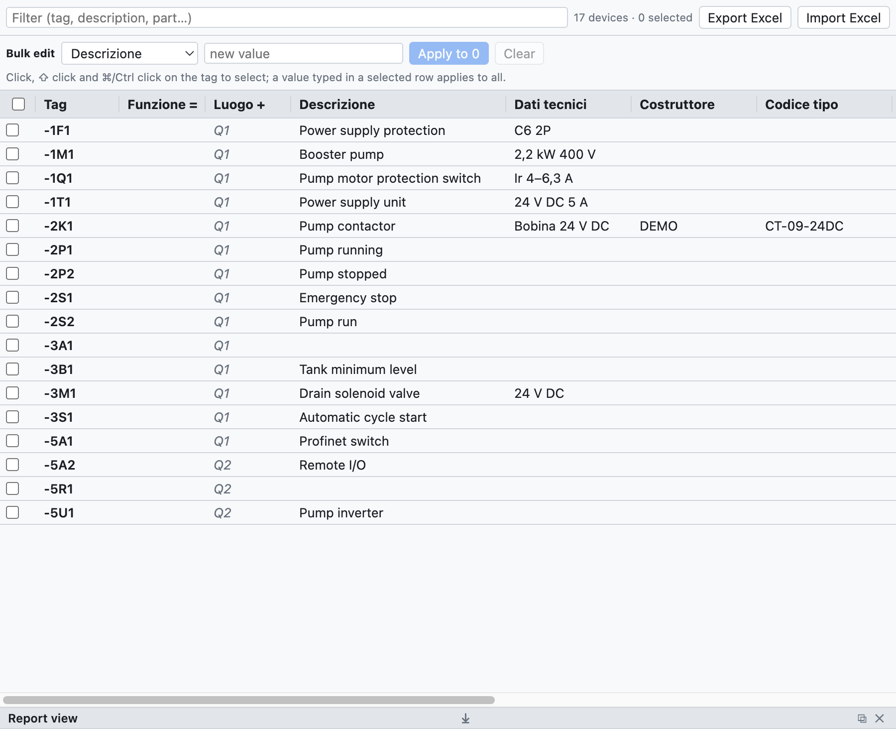
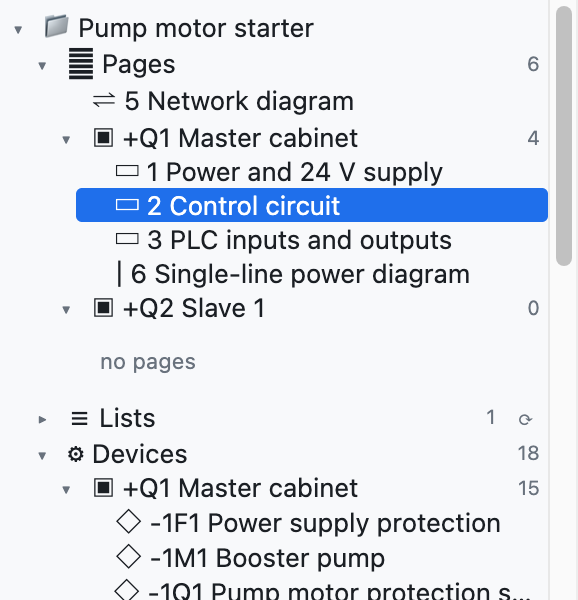
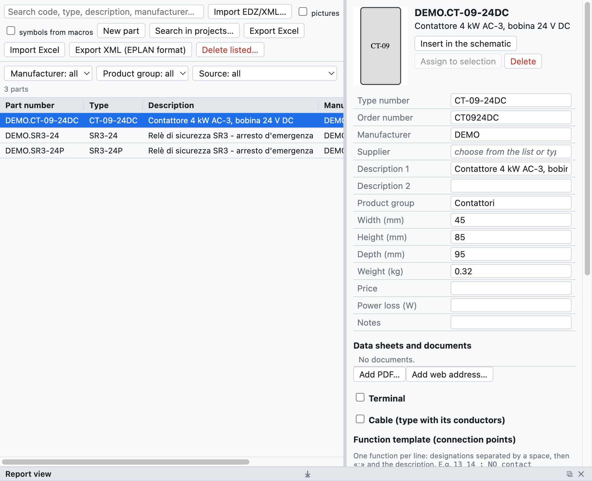

# 7. Appareils et articles

Un **appareil** est un composant réel avec un repère : le contacteur `-2K1` est un appareil, même si sur le
schéma il apparaît comme une bobine, trois contacts de puissance et deux contacts auxiliaires sur des pages
différentes. Un **article** est le produit du catalogue d'un fabricant (référence, description, dimensions,
bornes) à attribuer aux appareils.

## Données de l'appareil

| Champ | Exemple | Où il apparaît |
|---|---|---|
| Description | `Contattore pompa` | schéma (sous le repère), listes, étiquettes |
| Caractéristiques techniques | `Bobina 24 V DC`, `2,2 kW 400 V` | schéma, listes |
| Fabricant | `Schneider Electric` | nomenclature, liste d'achat |
| Type | `LC1D09BD` | nomenclature |
| Référence de commande | `LC1D09BD` | nomenclature, liste d'achat |
| Notes | texte libre | liste des appareils |
| Fonction (=) | `A1` | repère complet `=A1+Q1-2K1` |
| Emplacement (+) | `Q1` | repère complet, regroupements, implantation |
| Article | `DEMO.CT-09-24DC` | remplit les champs vides avec les données du catalogue |

Les données appartiennent à l'appareil : elles se saisissent sur n'importe quel élément (bobine ou contact)
et valent pour tous. Les valeurs saisies à la main l'emportent sur celles de l'article.

**Articles supplémentaires** : un appareil peut avoir plusieurs articles (par exemple un contacteur et son bloc
de contacts auxiliaires). Dans le navigateur, la colonne *Articles supplémentaires* s'écrit comme du texte, avec
la référence et la quantité après × : `LADN22 ×2; LA4DA2U`. Elle se modifie aussi en bloc et dans Excel.

**Descriptions sur le schéma** : avec *Propriétés du projet ▸ Dessin ▸ Descriptions sur le schéma* activé,
la description et les caractéristiques techniques apparaissent sous le repère de l'élément principal. Le
champ *Textes sur le schéma* de l'appareil les force ou les masque pour cet appareil seulement.

## Navigateur des appareils

L'onglet **Appareils** (en haut à droite) montre tous les appareils du projet dans un tableau qui se
modifie comme un tableur.

*Le navigateur avec les 17 appareils du projet d'exemple. Les valeurs en gris italique viennent de
l'article ou de l'emplacement de la page.*

- **Modifier une valeur** : cliquez dans la cellule, saisissez et appuyez sur Entrée.
- **Renommer** : changez le repère dans la première colonne ; les contacts et les autres représentations
  changent aussi. Si le repère est déjà utilisé, le programme le signale et ne change rien.
- **Filtrer** : le champ du haut cherche dans le repère, la description, l'article et les autres champs.
- **Sélectionner plusieurs lignes** : clic sur le repère, ⇧ clic pour un intervalle, ⌘/Ctrl clic pour
  ajouter, ou les cases à gauche.
- **Aller à l'appareil** : clic sur la position `/2.2` dans la dernière colonne.

### Modification en bloc

Pour donner la même valeur à de nombreux appareils :

1. Sélectionnez les lignes (par exemple tous les appareils de l'armoire `+Q2`, en filtrant sur `Q2`).
2. Dans la ligne *Modification en bloc* choisissez le champ (*Fonction =*, *Fabricant*…) et saisissez la valeur.
3. Appuyez sur **Appliquer à N**. *Vider* efface ce champ sur tous les appareils sélectionnés.

Sinon saisissez la valeur directement dans une cellule d'une ligne sélectionnée : elle vaut pour toutes les
lignes sélectionnées. Toute la modification s'annule avec un seul ⌘Z.

### Excel

- **Exporter Excel** enregistre le tableau des appareils (repère, champs, position).
- Remplissez-le dans Excel, même par une autre personne, et utilisez **Importer Excel** : les appareils sont
  reconnus par la colonne *Repère* et seuls les champs modifiés sont mis à jour. Les repères qui n'existent
  pas dans le projet sont signalés dans la vue rapport.

### Copier les propriétés

Le clic droit sur un appareil propose **Copier les propriétés** : il copie toutes les données de l'appareil
(description, caractéristiques techniques, fabricant, type, références, article, articles supplémentaires,
notes, fonction, emplacement, propriétés définies par l'utilisateur) sauf le repère. Sur un autre appareil, ou sur
une sélection de plusieurs appareils, le clic droit propose **Coller les propriétés de -X** : les données copiées
remplacent celles de l'appareil.

Cela sert aussi à **remplacer un symbole** par un autre : copiez les propriétés de l'ancien, insérez le nouveau
symbole, collez les propriétés et supprimez l'ancien.

## Structure =Installation +Emplacement

Dans l'arborescence, le nœud **Structure =Installation +Emplacement** regroupe les appareils d'abord par
**fonction** (`=A1`, `=A2`…) puis par **emplacement** (`+Q1`, `+P1`…), comme le prévoit la CEI 81346. Les
appareils sans fonction ou sans emplacement sont en bas, dans *sans fonction (=)* et *sans emplacement (+)*.
Un clic sur un appareil l'ouvre dans le schéma.

*Dans le projet d'exemple les appareils n'ont pas de fonction : ils sont tous dans «sans fonction»,
répartis entre les armoires `+Q1` et `+Q2`.*

L'emplacement d'un appareil est celui saisi dans ses propriétés ; s'il manque, celui du cadre dans lequel
il est dessiné sur le schéma réseau, ou celui de sa page.

## Articles

L'onglet **Articles** est la bibliothèque personnelle d'articles, enregistrée sur l'ordinateur et
disponible dans tous les projets.

*Un contacteur importé depuis un EDZ : données, image, modèle de fonction et symbole.*

### Importer les données des fabricants (EDZ)

1. Téléchargez le fichier **EDZ** depuis l'Eplan Data Portal ou le site du fabricant (Schneider, Siemens,
   Phoenix Contact…). L'EDZ est une archive au format de l'Eplan Data Portal avec les données de l'article.
2. *Fichier ▸ Importer ▸ Articles EDZ / XML / CSV…* (ou le bouton *EDZ*) et choisissez un ou plusieurs fichiers.
3. Les articles entrent dans la bibliothèque avec référence, type, référence de commande, fabricant,
   descriptions (en italien s'il y en a, sinon en anglais ou en allemand), dimensions, poids, image et
   **modèle de fonction** (les bornes).

Si l'EDZ contient le dessin du fabricant dans une macro au format EPLAN lisible, ce dessin devient le symbole de
l'article (catégorie *Macro EPLAN / costruttore* dans la bibliothèque). Sinon l'article est dessiné comme
une **boîte noire** automatique : entrées en haut, sorties en bas, contacts et pôles dessinés à l'intérieur.

On importe aussi les fichiers **XML** au format EPLAN ; *Exporter XML (format EPLAN)* écrit les articles dans un
fichier du même format.

Les fichiers **CSV de données commerciales** (`commercial_data.csv` de l'Eplan Data Portal) s'importent avec la
même commande, plusieurs fichiers à la fois : pour chaque article ils apportent fabricant, type, référence de
commande, groupe, descriptions et description longue. Les articles déjà importés depuis un EDZ sont complétés sans
perdre symbole ni bornes. Les liens vers les fiches techniques et les notices apparaissent dans la fiche de
l'article, dans la section **Documents**.

### La fiche de l'article

En sélectionnant un article, on voit et on modifie :

- les données principales (référence, type, commande, fabricant, fournisseur, descriptions, groupe,
  dimensions, poids, prix, notes) ;
- le **modèle de fonction** : une ligne par fonction, avec les bornes séparées par des espaces et la
  description après `;` (par exemple `13 14 ; Contatto NA`) ;
- le **symbole dans le schéma** : un des symboles de base, un composant importé ou le dessin du fabricant.

### Utiliser les articles

- **Insérer dans le schéma** : insère le symbole de l'article, déjà attribué.
- **Attribuer à la sélection** : sélectionnez un appareil dans le schéma et attribuez-lui l'article. Sinon
  choisissez l'article dans le champ *Article* des propriétés de l'appareil.
- Les articles utilisés sont copiés dans le projet (*Articles du projet* dans l'arborescence) : le fichier
  `.ecad` reste ainsi complet aussi sur un autre ordinateur.

### La base de données des articles

La bibliothèque personnelle est une base de données qui passe d'une installation à l'autre : les données saisies
une fois ne se ressaisissent pas.

- Dans le champ **Article** (dans les *Propriétés*, dans le navigateur *Appareils* et dans l'onglet *Connecteurs*)
  on écrit ou on choisit une référence. Si la référence est **nouvelle**, elle devient un article de la
  bibliothèque, avec fabricant, type, référence de commande et caractéristiques techniques de l'appareil. À la
  prochaine utilisation de la référence, les données se remplissent toutes seules.
- Si l'article existe déjà et que les données de l'appareil sont différentes, **Enregistrer ces données dans
  l'article** les écrit dans l'article existant.
- Description et fabricant des articles supplémentaires vont eux aussi dans la bibliothèque.

### Nouvel article

*Nouvel article* crée un article vide à remplir à la main : utile pour les composants sans EDZ.
