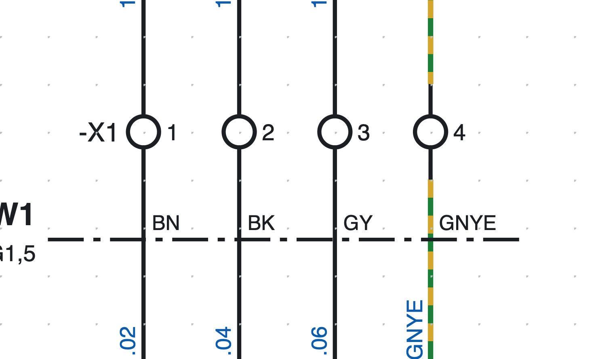
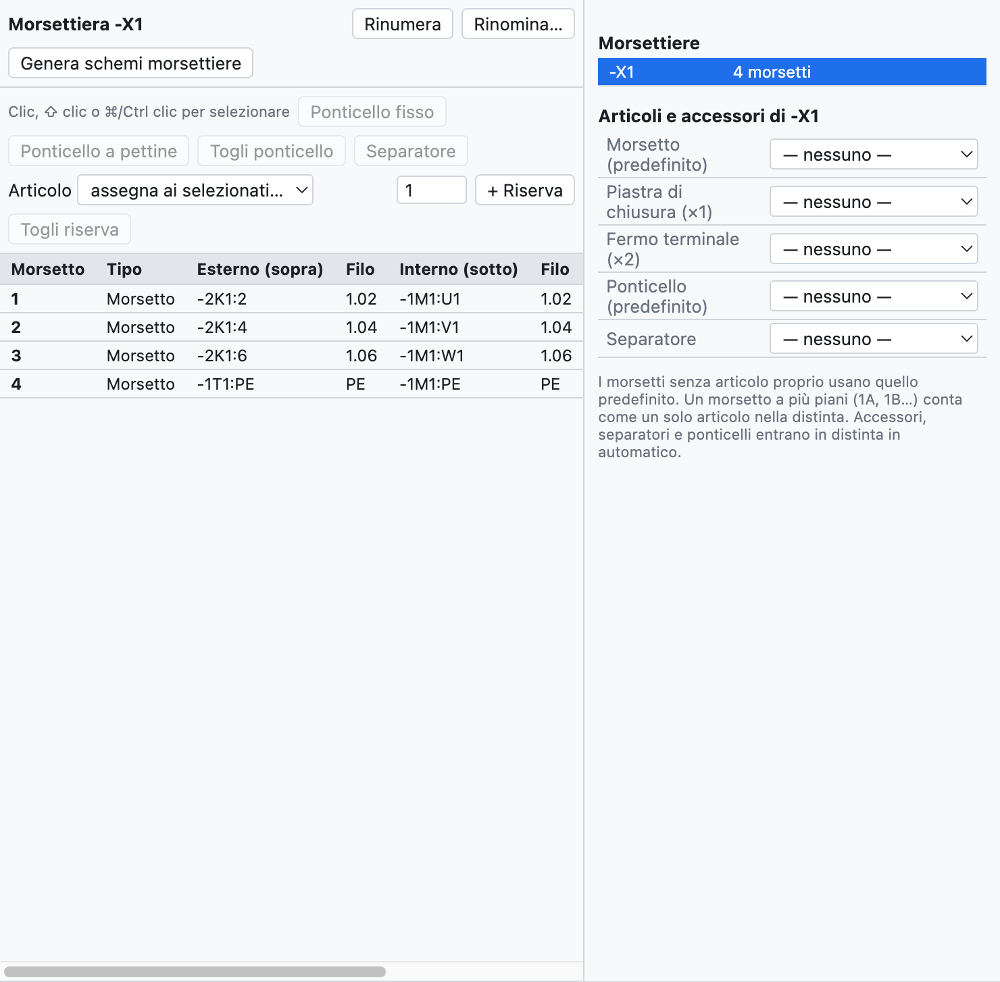
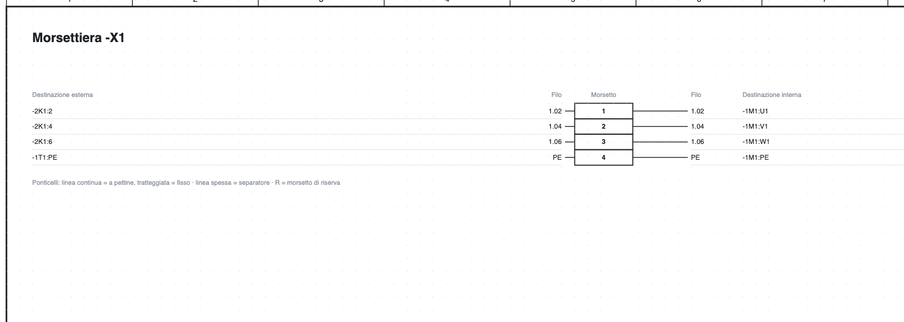

# 8. Borniers

## Bornes dans le schéma

*Les bornes `-X1:1…4` de la page 1 : le repère du bornier n'apparaît que sur la première de la rangée.*

1. Dans la bibliothèque, catégorie *Bornes et connexions*, choisissez **Borne** (ou *Borne PE*,
   *Borne sectionnable*, *Borne porte-fusible*).
2. Insérez-la **sur le fil** : le fil est interrompu des deux côtés de la borne.
3. La borne prend le repère `-X1:1` ; les suivantes `-X1:2`, `-X1:3`…

Le repère d'une borne est `<bornier>:<numéro><étage>` :

- le **bornier** a un nom libre, même hiérarchique comme `X1.1.2` ;
- le **numéro** suit les deux-points (`X1.1.2:3`) ;
- l'**étage** est une lettre pour les bornes à plusieurs étages (`X1:1A`, `X1:1B`).

Sur un fil vertical le repère du bornier est à gauche et le numéro à droite ; sur un fil horizontal
(symbole tourné) le numéro est en haut et le repère en bas.

> Le **numéro de fil** traverse la borne sans changer : les fils des deux côtés ont le même numéro
> (voir [chapitre 6](06-sigle-e-numerazione.md#le-numéro-traverse-les-bornes)).

## Le navigateur des borniers

L'onglet **Borniers** montre les borniers du projet et leurs bornes dans un tableau.

*Le bornier `-X1` du projet d'exemple : destinations externes et internes, numéros de fil, articles et
accessoires.*

- À droite la liste des **borniers** du projet ; un clic en ouvre un.
- Au centre le **tableau des bornes** : numéro, type, destination externe (en haut) et interne (en bas),
  numéros de fil, ponts, article, position cliquable.
- Les bornes se sélectionnent par clic, ⇧ clic (intervalle) et ⌘/Ctrl clic (ajout).

## Bornes à plusieurs étages

Une borne à deux ou trois étages a le même numéro et une lettre par étage.

1. Sélectionnez la borne dans le schéma, par exemple `-X1:1`.
2. Dans les propriétés appuyez sur **Ajouter un étage** (aussi par le clic droit) : la borne devient
   `-X1:1A` et le programme fait insérer `-X1:1B` d'un clic, même sur une autre page.
3. Les clics suivants insèrent `1C`, `1D`…

Dans la nomenclature une borne à plusieurs étages compte comme **un seul article** (`-X1:1A/B`).

## Numéroter et renommer

- Une nouvelle borne prend le numéro qui suit le plus élevé du bornier ; les autres ne changent pas.
- **Renuméroter** numérote à partir de 1 dans l'ordre du schéma (page, puis de gauche à droite et de haut
  en bas) : les étages restent ensemble avec leur lettre, les réserves vont à la fin, les bornes avec un nom
  non numérique (par exemple `PE`) restent telles quelles.
- **Renommer…** change le nom du bornier sur toutes ses bornes (`X1` → `X2.1`).

## Ponts

1. Sélectionnez deux bornes ou plus dans le tableau.
2. Appuyez sur **Pont fixe** ou **Pont en peigne**.

Les ponts apparaissent dans le tableau, dans la liste des bornes, dans la liste des connexions et dans le
schéma du bornier ; chacun peut avoir son article. *Retirer le pont* les supprime.

## Réserves et séparateurs

- **+ Réserve** ajoute à la fin des bornes non dessinées : elles entrent dans la liste et la nomenclature.
  *Retirer la réserve* les enlève.
- **Séparateur** après une borne : une plaque de séparation, dessinée comme un trait épais dans le schéma
  du bornier.

## Articles et accessoires

Dans le cadre *Articles et accessoires* du bornier on choisit :

| Champ | Quantité dans la nomenclature |
|---|---|
| Borne (par défaut) | une par borne physique sans article propre |
| Flasque d'extrémité | 1 |
| Butée d'arrêt | 2 |
| Pont (par défaut) | un par pont sans article propre |
| Séparateur | un par séparateur |

*Article ▸ attribuer aux sélectionnés* donne un article différent à certaines bornes (par exemple les
sectionnables). Tout entre automatiquement dans la nomenclature et la liste d'achat.

## Schéma du bornier

**Générer les schémas des borniers** crée une page par bornier (plusieurs feuilles au-delà de 40 bornes)
avec destinations, numéros de fil, ponts, séparateurs, réserves et positions cliquables, aussi dans le PDF.

*La partie haute du schéma du bornier `-X1`.*

La page se met à jour toute seule quand vous modifiez le schéma ; en la régénérant, les pages des nouveaux
borniers s'ajoutent et celles des borniers disparus sont retirées.

## Contrôles

La vérification signale les bornes en double, les bornes avec un côté libre et les données de borniers qui
n'existent plus.
