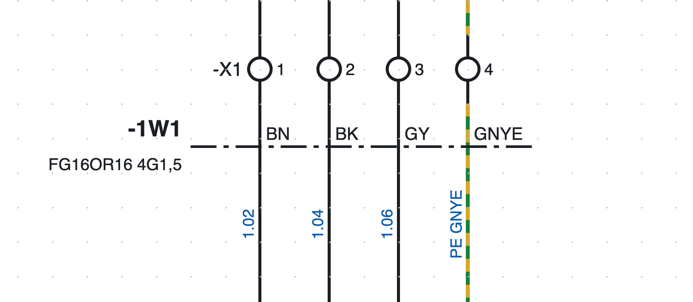
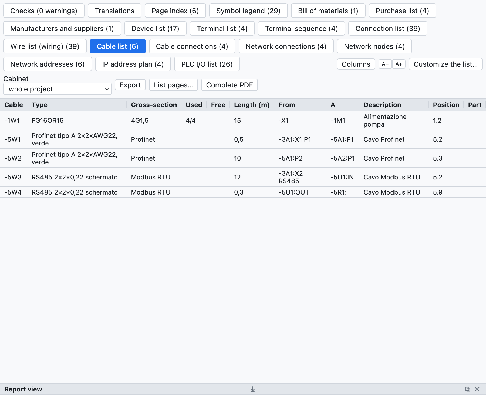

# 9. Câbles et connecteurs

## Câbles

Un câble se définit avec une **ligne de définition** qui traverse les fils.

*Le câble `-1W1 FG16OR16 4G1,5` de la page 1 : la ligne en trait mixte traverse les quatre fils vers le
moteur, chacun avec la couleur de son conducteur.*

1. Appuyez sur **Câble** dans la barre d'outils (ou *Insertion ▸ Ligne de définition de câble*).
2. Cliquez d'un côté des fils puis de l'autre côté.
3. Les fils traversés deviennent des **conducteurs** du câble `-1W1` (repère selon le modèle du projet).

### Conducteurs

Le programme propose les conducteurs selon le nombre de fils :

- jusqu'à 5 fils, en couleurs : `BN BK GY BU GNYE` ;
- au-delà, numérotés avec le vert-jaune ;
- le fil PE (ou vert-jaune) prend le conducteur vert-jaune.

Dans les propriétés du câble on change la **composition** (`5G1,5`, `7x0,75`…), le **type** (`FG16OR16`),
la **longueur** en mètres, les **extrémités** (de, à), le **blindage**, la description et l'**article** ;
dans les propriétés de la ligne on choisit le conducteur de chaque fil.

Plusieurs lignes, même sur des pages différentes, peuvent se rapporter au même câble : un conducteur
traversé deux fois ne compte qu'une fois.

### Listes des câbles

*La liste des câbles du projet d'exemple : le câble du moteur et les câbles réseau.*

- **Liste des câbles** : un câble par ligne avec type, composition, conducteurs utilisés et libres,
  longueur, extrémités, position, article.
- **Connexions des câbles** : un conducteur par ligne avec les deux extrémités et le numéro de fil.
- La **liste des connexions** a la colonne *Câble* ; dans la nomenclature la quantité d'un câble avec
  article est sa longueur en mètres ; dans la liste d'achat les câbles sans article sont additionnés par type.

### Contrôles

La vérification signale les conducteurs épuisés (plus de fils que de conducteurs) ou en double, les câbles
sans ligne de définition et les repères de câble en double.

## Connecteurs et fiches

Pour les fiches et les prises des connecteurs multipolaires on utilise les symboles de la catégorie
*Bornes et connexions* :

| Symbole | Usage |
|---|---|
| Broche de prise (femelle) | le côté prise |
| Broche de fiche (mâle) | le côté fiche |
| Broche prise + fiche | la paire accouplée en un seul symbole |

- Le repère est comme celui des bornes : `-X10:3` est la broche 3 du connecteur `-X10` ; les broches se
  numérotent toutes seules.
- Le nombre total de broches se saisit dans les propriétés du connecteur ou se lit dans l'article.
- La **contrepartie** (par exemple la fiche volante pour une prise d'armoire) s'indique par son article et
  entre dans la nomenclature.
- La **liste des connecteurs** énumère chaque broche avec son côté, les fils, la position et les broches
  utilisées.
- Dans l'onglet **Connecteurs**, le tableau des broches a les colonnes **Description** et **Notes**, qui se
  saisissent directement dans la cellule. Description, caractéristiques techniques et notes sont **propres à chaque
  broche** (dans les *Propriétés* de la broche elles ne valent que pour cette broche) ; fabricant, type, article
  et les autres données valent pour tout le connecteur. Les **notes du connecteur** se saisissent dans les
  données du connecteur, à droite du tableau.
- La vérification signale les broches au-delà du nombre du connecteur.
