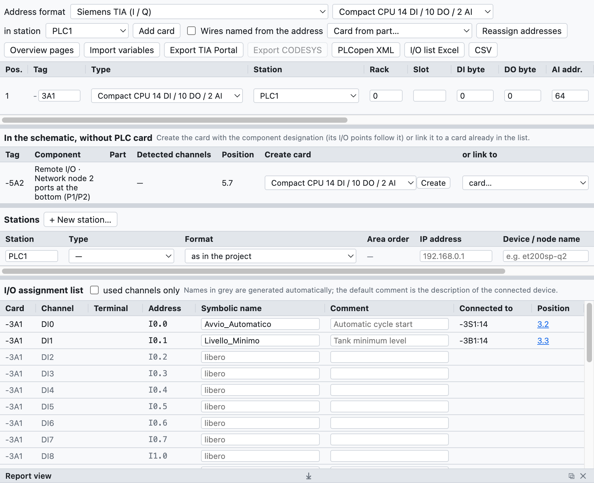
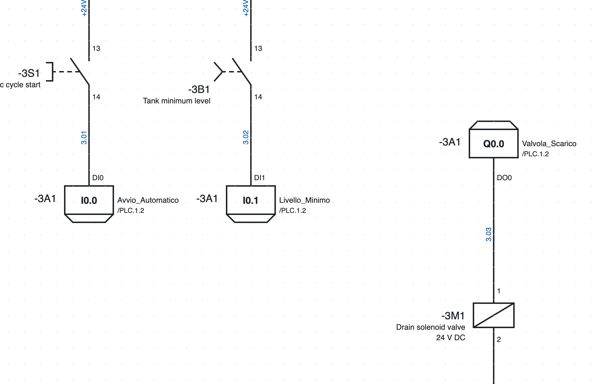
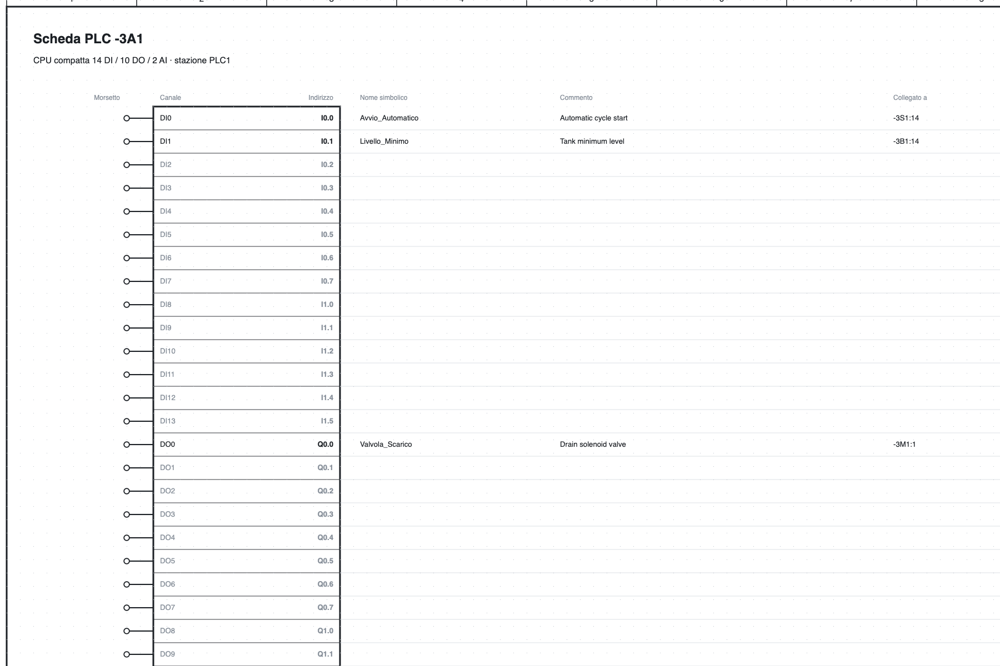

# 10. API

OpenWiring réunit le schéma électrique et l'affectation des E/S de l'API : chaque entrée et sortie dessinée
prend un canal et une adresse, apparaît dans la liste des E/S et dans la vue d'ensemble de la carte, et
s'exporte vers TIA Portal, CODESYS ou PLCopen.

## La vue API

*La vue API du projet d'exemple : la CPU `-3A1`, la station `PLC1` et la liste d'affectation des E/S.*

L'onglet **API** en haut à droite regroupe :

- la barre avec le format des adresses, le type de carte à ajouter et l'export ;
- la liste des **cartes** avec repère, type, station, rack, slot et adresses de départ ;
- la liste des **stations** avec type, adresse IP et nom de l'appareil ;
- la **liste d'affectation des E/S**.

## Cartes

**Ajouter une carte** ajoute le type choisi dans la liste :

- CPU compactes 14 DI / 10 DO / 2 AI et 8 DI / 6 DO ;
- modules TOR 8 DI, 16 DI, 8 DO, 16 DO, 8 DI / 8 DO ;
- modules analogiques 4 AI, 8 AI, 2 AO, 4 AO ;
- maîtres **IO-Link** à 4 ou 8 ports.

Pour chaque carte on indique repère (`-3A1`), station (`PLC1` : les adresses sont attribuées par station),
rack, slot (attribué automatiquement), adresses de départ, description et référence de commande. La carte
entre dans la nomenclature.

**Carte depuis un article…** crée une carte à partir d'un article de la bibliothèque, par exemple un module
d'E/S importé d'un EDZ : le nombre de canaux est tiré du modèle de fonction et peut être corrigé avant de
créer la carte. Les points de connexion de l'article deviennent les bornes des canaux.

**Adresses stables** : une nouvelle carte prend les premières adresses libres de sa station, celles des
cartes existantes ne changent pas. **Réattribuer les adresses** les recalcule dans l'ordre de la liste
(flèches ↑ ↓).

### Stations

Chaque station a un type (CPU locale, Profinet, EtherCAT, Profibus DP, EtherNet/IP, Modbus TCP), une adresse
IP et un nom d'appareil. La vérification signale les slots en double, les IP et les noms répétés.

### Format et ordre des zones par station

Dans le tableau des **Stations**, chaque station a deux colonnes de plus :

- **Format** : une station peut avoir un format différent de celui du haut, par exemple un nœud CODESYS à
  côté d'une CPU Siemens. Le format du haut vaut pour les stations sans format propre. Changer le format
  d'une station réattribue seulement ses adresses.
- **Ordre des zones** (formats IEC et TwinCAT, où TOR et analogiques partagent la même zone) : *cartes à la
  suite* (par défaut) ou *analogiques d'abord (WAGO)*, comme font les nœuds WAGO et d'autres coupleurs
  CODESYS. En ajoutant une carte à une station « analogiques d'abord », les adresses sont réattribuées
  automatiquement.

**TwinCAT (Beckhoff).** Avec le format TwinCAT les adresses sont `%I*` et `%Q*` : c'est TwinCAT qui les
lie. Dans la GVL exportée les variables ont `AT %I*` / `AT %Q*` ; les fils reliés à une voie prennent le nom
de la carte et de la voie (`400A1.DI3`), car `%I*` est le même pour tous.

Les exports travaillent par station : *Exporter TIA Portal* ne prend que les stations Siemens, *Exporter
CODESYS* les stations IEC et TwinCAT.

### IO-Link

Pour chaque port d'un maître IO-Link on indique l'appareil, la description et les octets de données de
process ; le programme calcule les adresses (`IB4…IB5`, `%IB4`, `EB4`).

## Points E/S dans le schéma

*Deux entrées et une sortie de la page 3 : dans le cadre l'adresse, à droite le nom symbolique et le renvoi
à la vue d'ensemble `/4.2`, à gauche le repère de la carte.*

1. Dans la bibliothèque, catégorie *API*, choisissez entrée ou sortie, TOR ou analogique.
2. Insérez-la dans le schéma et reliez-la à l'appareil (bouton-poussoir, capteur, électrovanne…).
3. Le point prend automatiquement le **premier canal libre** du bon type ; si aucune carte n'en a, le
   programme en crée une nouvelle (la première est une CPU compacte).

Dans les propriétés du point on change carte, canal (ceux qui sont occupés sont signalés), **nom
symbolique** et **commentaire**. La borne porte le nom du canal (`DI0`, `DO3`).

L'**alimentation L+ / M** de la carte est un symbole à part avec le repère de la carte : elle se dessine sur
le circuit d'alimentation et sa position apparaît dans la vue d'ensemble.

## Adresses

Le format se choisit en haut de la vue API :

| Format | Entrée TOR | Sortie TOR | Entrée analogique | Sortie analogique |
|---|---|---|---|---|
| Siemens TIA | `I0.0` | `Q0.0` | `IW64` | `QW64` |
| Siemens allemand | `E0.0` | `A0.0` | `EW64` | `AW64` |
| IEC 61131 / CODESYS | `%IX0.0` | `%QX0.0` | `%IW0` | `%QW0` |
| Omron CJ/CP | `0.00` | `100.00` | `2000` | `2100` |
| Beckhoff TwinCAT | `%I*` | `%Q*` | `%I*` | `%Q*` |

Les analogiques partent de 64 dans les formats Siemens et de 0 en CEI ; en changeant de format elles sont
adaptées. Omron utilise des mots de 16 bits : en passant d'Omron ou vers Omron, les adresses sont
réattribuées.

## Pages de vue d'ensemble

**Pages de vue d'ensemble** crée une page par carte, à la fin du projet, et retire celles des cartes
supprimées.

*La vue d'ensemble de la CPU `-3A1` : pour chaque canal la borne, l'adresse, le nom symbolique, le
commentaire, l'appareil relié et la page.*

La vue d'ensemble est toujours alignée sur le schéma, elle n'a pas besoin d'être régénérée quand vous
changez quelque chose. Chaque point E/S du schéma renvoie à sa ligne de la vue d'ensemble (`/4.2`) et
inversement.

## Liste d'affectation des E/S

La liste contient tous les canaux de toutes les cartes, utilisés ou libres, avec adresse, nom symbolique,
commentaire, **appareil relié** (`-3S1:14`, déduit des fils) et position.

- Le nom et le commentaire se modifient directement dans le tableau.
- Si le nom manque, il est généré (`DI2_3A1`) ; le commentaire par défaut est la description de l'appareil
  relié.
- *canaux utilisés seulement* masque les canaux libres.
- La liste apparaît aussi dans l'onglet *Listes* et dans le PDF.
- La vérification signale les canaux utilisés deux fois, les noms en double, les points sans carte ou avec
  un canal du mauvais type.

## Échange avec le logiciel de l'API

### Export

| Bouton | Fichier | Usage |
|---|---|---|
| *Exporter TIA Portal* | Excel avec la feuille `PLC Tags` | dans TIA : *Variables API ▸ Importer* ; les variables vont dans la table `OpenWiring` (formats Siemens) |
| *Exporter CODESYS* | texte `VAR_GLOBAL … END_VAR` | à coller dans une liste de variables globales (format CEI) |
| *PLCopen XML* | XML TC6 | variables globales avec adresse CEI, aussi pour les données IO-Link ; pour CODESYS et les environnements compatibles |
| *Liste E/S Excel*, *CSV* | tableau | documentation |

Exemple de ligne CODESYS : `Avvio_Automatico AT %IX0.0 : BOOL; (* Avvio ciclo automatico - -3S1:14 *)`.

> L'export pour TIA Portal suit le format de la table des variables de TIA mais n'a pas encore été essayé
> sur une installation réelle : si l'import signale des erreurs, exportez de TIA une table vide et comparez
> les colonnes.

### Import des variables

**Importer les variables** lit les noms et les commentaires dans le logiciel de l'API et les reporte dans le
schéma :

- **TIA Portal** : le fichier Excel de *Variables API ▸ Exporter* ;
- **CODESYS** : une GVL (`Nome AT %IX0.0 : BOOL; (* commento *)`) ;
- **CSV** avec les colonnes Nom, Adresse, Commentaire.

La correspondance se fait par **adresse** (`%E0.0` et `I0.0` sont équivalentes). Les canaux déjà dessinés
reçoivent nom et commentaire ; ceux qui ne sont pas encore dessinés les gardent sur la carte et les montrent
dès qu'ils sont dessinés. Les variables sans canal sont énumérées dans la vue rapport.
