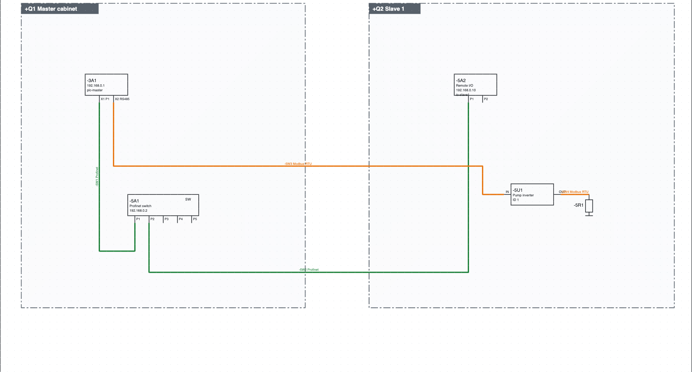
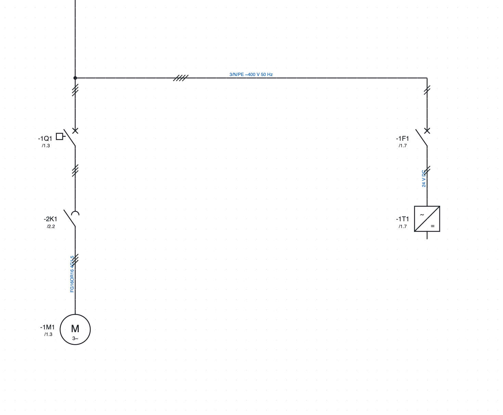

# 11. Réseaux, emplacements et schéma unifilaire

## Emplacements

Un **emplacement** est un contenant physique : armoire électrique, boîte à boutons, bord de machine, boîte de
dérivation, terrain. Son code est la partie `+` du repère (`+Q1-2K1`).

1. *Projet ▸ Nouvel emplacement…*, ou *+ Emplacement* dans les propriétés du projet.
2. Saisissez le **code** (`Q1`, `BM`, `P1`), le **nom** (`Quadro master`) et le **type**.
3. Attribuez les pages à l'emplacement avec *Propriétés de la page ▸ Emplacement (section)* : une nouvelle
   page reste dans l'emplacement de celle dont elle part.

Chaque appareil se trouve dans un emplacement : celui saisi dans ses propriétés, sinon le cadre dans lequel
il est dessiné sur le schéma réseau, sinon l'emplacement de sa page.

Où l'on voit les emplacements :

- l'**arborescence** regroupe pages et appareils par emplacement ;
- la **liste des appareils** montre le repère complet (`+BM-1M1`) ;
- les **étiquettes** des appareils sont regroupées par emplacement ;
- une **page d'implantation** attribuée à un emplacement ne propose que ses appareils.

### Un composant d'une armoire raccordé à une autre armoire

Cas typique : un capteur monté dans **+Q2** va sur une entrée API de **+Q1**. Si vous le dessinez sur
la page des entrées de +Q1 avec le cadre d'emplacement +Q2, le repère est juste (`+Q2-B1`) et le
capteur entre dans les listes de +Q2. Mais le schéma est sur les pages de +Q1 : celui qui câble +Q2
et ne reçoit que ses pages ne le voit pas.

La technique conseillée est de **couper le circuit à la limite de l'armoire**, sur les bornes :

1. sur la page de +Q1 : entrée API → borne `-X1:5` → câble `-W12` → renvoi vers la page de +Q2 ;
2. sur une page de +Q2 : renvoi depuis +Q1 → câble `-W12` → borne `-X2:5` → capteur `-B1`.

Chaque composant est dessiné sur les pages de l'armoire où il est monté ; la liaison entre les
armoires est le câble, présent dans les plans de câbles des deux ; les renvois sont cliquables dans
le PDF. Chaque armoire a son entrée sur bornes et chaque câbleur travaille jusqu'à la borne.

Les **vérifications** avertissent quand un appareil d'une armoire, d'un boîtier de commande ou d'une
boîte de dérivation est dessiné sur les pages d'une autre armoire : *+Q2-B1 est dessiné page 310 de
l'armoire +Q1 : en imprimant seulement +Q2 il n'apparaît pas*. Le bord machine et le terrain ne
comptent pas, car on les dessine en général sur les pages de l'armoire ; un sous-emplacement de la
même armoire (ex. la porte) non plus.

Si vous préférez garder le composant près de l'entrée API, en imprimant seulement certaines armoires
cochez dans le PDF *Ajouter les pages d'autres armoires avec des appareils des armoires choisies*
(chapitre 18).

## Schéma réseau

Le schéma réseau montre sur une seule page tous les nœuds de l'installation et les liaisons de bus entre les
armoires.

*Le schéma réseau du projet d'exemple : la CPU `-3A1` et le switch `-5A1` dans l'armoire `+Q1`, les E/S
déportées `-5A2` et le variateur `-5U1` dans l'armoire `+Q2`, reliés en Profinet (vert) et Modbus RTU
(orange).*

1. **+ Réseau** sous l'arborescence crée la page.
2. **Armoire** dans la barre d'outils : cliquez sur deux coins pour dessiner le cadre d'une armoire et
   choisir son emplacement. Les nœuds à l'intérieur du cadre appartiennent à cette armoire.
3. Depuis la catégorie *Réseaux et bus* insérez les **nœuds** : nœud à deux ports (IN/OUT ou P1/P2), nœud à
   un port, switch 5 ports, terminaison. Un nœud prend le repère d'un appareil existant (la CPU, un
   variateur…) et en devient une représentation.
4. Choisissez le protocole à côté du bouton **Bus** et reliez les ports comme un fil.

### Protocoles

Profinet, EtherCAT, Modbus TCP, Modbus RTU, Profibus DP, EtherNet/IP, CANopen, IO-Link, RS485, Ethernet.
Chaque protocole a sa couleur et son nom écrit sur la ligne. Les bus ne reçoivent pas de numéro de fil et
n'entrent pas dans les connexions électriques. Un fil existant se transforme en bus depuis ses propriétés
(*Réseau / bus*).

### Câbles réseau

Chaque liaison de bus est un **câble** : elle prend toute seule un repère (`-5W1`, écrit sur la ligne à côté
du protocole). Dans les propriétés de la liaison on indique le type (proposé selon le protocole, par exemple
*Profinet tipo A 2×2×AWG22*), la longueur et l'article. Les câbles réseau apparaissent dans la liste des
câbles avec les ports aux extrémités (`-3A1:X1 P1` → `-5A1:P1`), dans les étiquettes et, avec l'article,
dans la nomenclature en mètres.

Un câble qui continue sur une autre page par une paire de renvois (par exemple du contrôleur du robot à la
page du robot) est **un seul câble** : il a un seul repère sur tous les tronçons. Le tronçon avec le repère donné par le programme prend tout
seul celui du câble, même si vous appariez les renvois après l'avoir dessiné. Changer le repère, le
type, la longueur ou l'article sur un tronçon change aussi les autres. Si les tronçons ont des repères
différents, la vérification le signale, et le bouton **Utiliser -… sur tous les tronçons** met partout le
repère du tronçon de la première page. Les renvois du câble prennent d'eux-mêmes le nom du câble (`1102W1`) et le suivent si vous changez le repère ; renommer un renvoi renomme le câble, sur tous les tronçons et sur le renvoi correspondant. Type, longueur et article écrits sur un tronçon passent aux autres tronçons qui ne les ont pas. Ainsi à côté du
renvoi le repère n'est pas répété. Pour l'afficher ou le masquer sur un tronçon, utilisez l'œil de
**Repère du câble** ; l'œil de **Numéro de fil** éteint tous les textes de la liaison.

### Listes et contrôles

- **Connexions réseau** : protocole, ports, armoires, liaisons entre armoires différentes.
- **Nœuds réseau** : adresse, protocoles, armoire.
- La vérification signale les adresses répétées sur le même réseau (aussi à travers les switchs) et les
  ports Ethernet avec plus d'une liaison (il faut un switch). Les bus multipoints (Modbus RTU, Profibus,
  CANopen, RS485) admettent plusieurs nœuds sur le même tronçon.

## Plan d'adressage IP

1. *Projet ▸ Nouveau réseau IP* : nom, adresse et préfixe (`192.168.0.0/24`), passerelle, protocole qui
   l'utilise et première adresse à attribuer.
2. Dans les propriétés de chaque nœud il y a le champ **Adresse IP**, distinct de l'adresse de bus (nom
   Profinet, ID Modbus…). L'IP est écrite dans le cadre du nœud.
3. *Projet ▸ Attribuer les adresses IP* donne la première adresse libre aux nœuds reliés en Profinet, Modbus
   TCP, EtherNet/IP ou Ethernet qui n'en ont pas (pas EtherCAT ni les bus série).
4. *Projet ▸ Plan d'adressage IP* ouvre la liste : IP, masque, passerelle, réseau, appareil, nom,
   protocoles, emplacement, y compris les stations API.

La vérification signale les IP répétées, non valides, hors des réseaux ou égales à l'adresse de réseau ou de
broadcast, ainsi que les passerelles hors réseau.

## Adresses réseau

*Projet ▸ Adresses réseau…* (aussi depuis le groupe *Réseaux* de l'onglet *Projet* du ruban) ouvre un tableau avec **tous** les
appareils qui ont un port réseau, même ceux qui n'ont pas encore d'adresse, et les stations d'automate.

**Comment les ports sont trouvés.** Un port est toute broche touchée par un fil de bus (Profinet, Ethernet,
Modbus, EtherCAT…) et tout nœud de réseau. Les symboles n'ont besoin d'aucune broche spéciale.

- Les ports IP d'un appareil (Profinet, Ethernet, Modbus TCP, EtherNet/IP) forment **une seule interface**,
  comme un switch intégré : une IP et un nom.
- Chaque bus non IP (Modbus RTU, CAN, EtherCAT…) a sa propre interface, avec son adresse.
- **Séparer…** donne à certains ports une interface propre, avec IP et nom différents (par exemple X2 hors du
  switch de X1). **Réunir** la ramène dans l'interface principale.

On écrit directement dans les colonnes *Adresse IP* et *Nom Profinet / adresse* ; *Entrée* confirme. Pour
une station d'automate, les valeurs restent alignées avec le tableau des stations. En bas :

- **Attribuer IP** : une IP libre du bon réseau aux interfaces IP qui n'en ont pas (il faut d'abord un
  réseau IP) ;
- **Noms Profinet automatiques** : un nom tiré du repère et de l'emplacement (`+Q1 -2A1` → `q1-2a1`, avec
  `pn-` devant si le nom commencerait par un chiffre) pour les appareils Profinet sans nom ; les noms déjà
  écrits restent ;
- **Liste et export** : le même tableau parmi les listes, à imprimer ou exporter en PDF, CSV et Excel.

La dernière colonne montre les problèmes : IP répétées ou hors réseau, noms Profinet non valides ou
répétés.

## Schéma unifilaire

Le schéma unifilaire représente la distribution de puissance avec une seule ligne par départ.

*L'unifilaire du projet d'exemple : les mêmes repères que le multifilaire, avec le renvoi à leur position.*

1. **+ Unifilaire** sous l'arborescence crée la page.
2. Depuis la catégorie *Unifilaire* insérez disjoncteur, disjoncteur-moteur, sectionneur, fusible,
   contacteur, moteur, transformateur, variateur, alimentation, récepteur.
3. Donnez à chaque symbole **le même repère** que l'appareil dans le multifilaire : le renvoi cliquable vers
   sa position apparaît (`/1.3`).
4. Les lignes ont le nombre de conducteurs (*Conducteurs (traits)*) et un texte (`3/N/PE ~400 V 50 Hz`).

Les lignes de l'unifilaire n'entrent ni dans les conducteurs, ni dans les numéros de fil, ni dans les
listes : le vrai schéma électrique reste le multifilaire.
