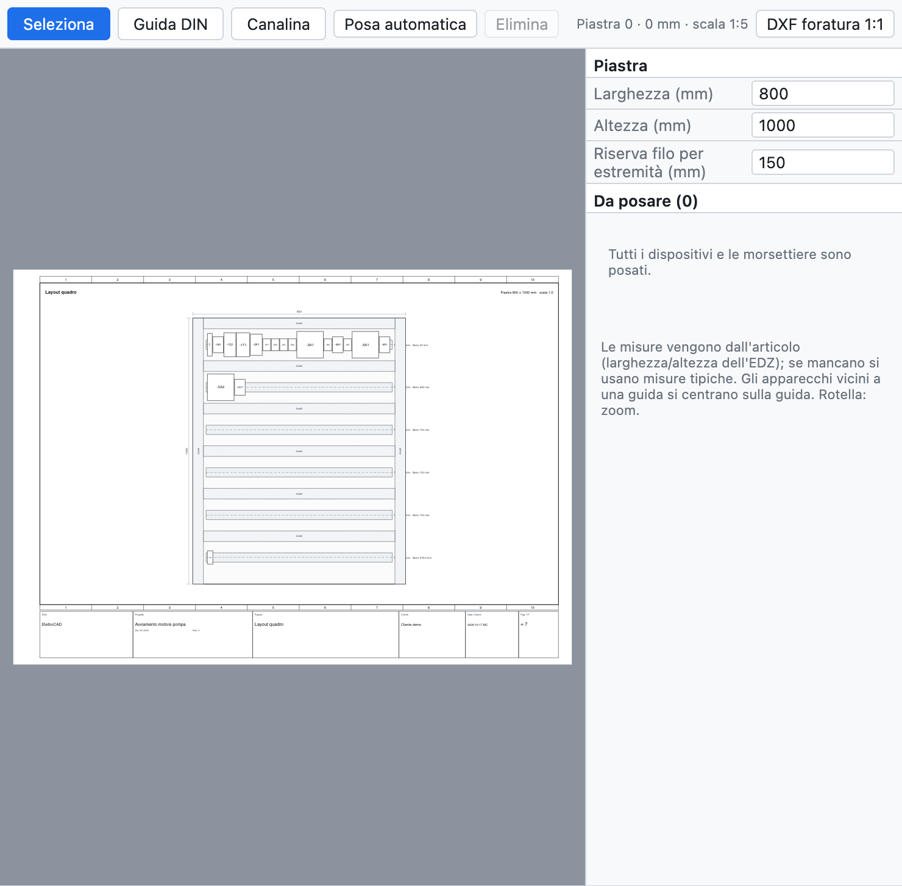

# 12. Implantation de l'armoire

La page d'implantation est la **vue de montage** de la plaque de l'armoire : rails DIN, goulottes et
appareils à l'échelle, avec les cotes. Elle sert à vérifier que tout tient, au perçage et à estimer la
longueur des fils.

*Une implantation créée avec le placement automatique : deux rangées de rails avec goulottes et les
appareils du projet d'exemple.*

## Créer l'implantation

1. **+ Implantation** sous l'arborescence crée une page d'implantation avec la plaque à une échelle
   normalisée (1:5, 1:10…), cotée.
2. Dans le panneau de droite réglez la **largeur** et la **hauteur** de la plaque en mm et la **réserve** de
   fil par extrémité.
3. Attribuez la page à un **emplacement** pour ne voir que les appareils de cette armoire.

## Rails DIN et goulottes

Avec **Rail DIN** et **Goulotte** dans la barre de la vue, faites glisser sur la plaque pour les dessiner.
Chaque rail affiche les millimètres libres.

## Placer les appareils

- La liste *À placer* montre les appareils et les borniers pas encore placés : faites-les glisser sur la
  plaque.
- Les appareils proches d'un rail se **centrent sur le rail**.
- Les **dimensions** viennent de l'article (largeur et hauteur de l'EDZ), sinon ce sont des valeurs
  typiques ; un bornier est aussi large que ses bornes (une borne à plusieurs étages occupe un pas).
- **Placement automatique** crée des rangées de goulottes et de rails s'il en manque et place sur les rails
  tous les appareils pas encore placés.

## Contrôles

La vérification signale les appareils hors de la plaque, superposés et les rails pleins.

## Perçage

**DXF de perçage 1:1** exporte la plaque, les rails, les goulottes, les contours des appareils et les trous
de fixation Ø 5,5 à l'échelle réelle, prêts pour l'usinage.

## Nomenclature et longueur des fils

- Les rails et les goulottes avec article entrent dans la **nomenclature en mètres**.
- La **liste des fils (câblage)** indique pour chaque fil la section, la couleur, les **embouts**
  (DIN 46228) et la **longueur estimée** à partir de l'implantation : parcours entre les appareils plus la
  réserve aux extrémités.
- La **liste d'achat** additionne le fil en vrac par section et couleur avec 10 % de marge
  ([chapitre 14](14-liste-e-pagine-automatiche.md#liste-dachat)).
