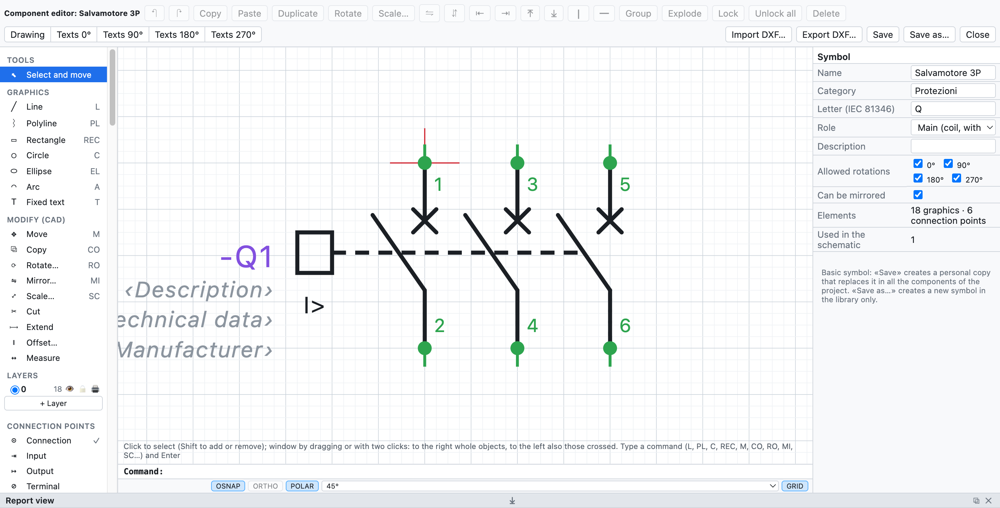
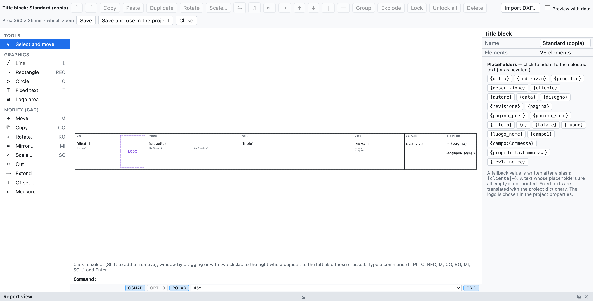

# 13. Macros, symboles et cartouches

## Macros

Une **macro** est un morceau de schéma à réutiliser : un démarrage moteur, un circuit d'arrêt d'urgence, un
départ avec variateur.

### Créer une macro

1. Sélectionnez le circuit dans le schéma (sélection par fenêtre).
2. Clic droit ▸ **Créer une macro à partir de la sélection…** (ou depuis l'onglet *Macros* de la
   bibliothèque).
3. Saisissez le nom, la catégorie et la description.

### Insérer une macro

1. Dans l'onglet **Macros** de la bibliothèque cliquez sur la macro.
2. Cliquez dans la page : le point cliqué est le coin supérieur gauche du circuit.

À l'insertion **les repères, numéros de fil, bornes, canaux API et câbles sont renumérotés** ; la bobine et
les contacts copiés ensemble restent liés. Les macros sont dans la bibliothèque personnelle, disponibles dans
tous les projets, et s'échangent sous forme de fichiers `.ecmacro` (*Fichier ▸ Importer ▸ Macros…* et le
bouton d'export dans l'onglet *Macros*).

## Éditeur de composants

L'éditeur dessine un composant à partir de zéro ou modifie un composant existant : symboles de base,
symboles personnels, composants importés de QElectroTech ou d'EPLAN, y compris les boîtes noires des
articles EDZ.

*Le disjoncteur-moteur 3P ouvert dans l'éditeur : à gauche les objets à ajouter, au centre le dessin avec
les points de connexion, à droite les propriétés.*

- Dans le schéma : clic droit sur le composant ▸ **Modifier le composant…**. Dans la bibliothèque :
  **Nouveau symbole…**, ou clic droit sur un symbole.
- Choisissez un objet dans le panneau de gauche et cliquez (ou faites glisser) dans le dessin :

| Groupe | Objets |
|---|---|
| *Graphisme* | ligne, polyligne (clic sur chaque sommet, double-clic ou Entrée pour terminer), rectangle, cercle, ellipse, arc, texte fixe |
| *Points de connexion* | connexion, entrée, sortie, borne : sur la grille de 4 mm, avec désignation (`13`, `A1`) et direction du fil |
| *Textes du composant* | repère, description, caractéristiques techniques, fabricant, type, référence de commande, article, fonction (=), emplacement (+), notes |

- Les **textes du composant** affichent dans le schéma les données de l'appareil (propriétés, article,
  fonction et emplacement). La description et les caractéristiques techniques placées ici ne se répètent
  pas sous le repère.
- *Sélectionner et déplacer* : clic pour sélectionner, glisser pour déplacer, **Suppr** pour supprimer. Les
  dimensions et les angles se corrigent dans le panneau de droite.
- À droite aussi le nom, la catégorie, la **lettre** CEI 81346, le **rôle** (appareil, bobine avec renvois
  croisés, contact NO/NF/inverseur, borne) et la description.
- La molette fait le zoom.

### Enregistrer

| Commande | Effet |
|---|---|
| **Enregistrer** | même nom : le symbole change dans la bibliothèque personnelle et dans **tous les composants du schéma** qui l'utilisent |
| **Enregistrer sous…** | nouveau nom : un symbole de plus dans la bibliothèque personnelle ; le schéma ne change pas |

Les symboles de base ne sont pas écrasés : *Enregistrer* crée une copie personnelle de même nom, qui les
remplace dans les composants du projet et aussi dans la bibliothèque, dans la même case : en le reprenant
dans la bibliothèque, on obtient la version modifiée. *Revenir au symbole de base* (dans l'éditeur) remet
l'original dans la bibliothèque. La boîte noire modifiée d'un article EPLAN reste le symbole de cet
article. Utilisé dans un projet, le symbole est copié dans le fichier `.ecad`.

## Composants de QElectroTech

*Fichier ▸ Importer ▸ Symboles QElectroTech…* (ou *Importer des composants…* dans la bibliothèque) lit les
composants de [QElectroTech](https://qelectrotech.org) : fichiers `.elmt`, projets `.qet` avec leurs
éléments, ou archives `.zip` ou `.7z` de dossiers entiers, comme la collection officielle téléchargée depuis
GitHub.

- Le graphisme est converti (lignes, rectangles, cercles, ellipses, arcs, polygones, textes) avec les bornes
  et leur nom.
- Le type devient le rôle : bobine avec renvois croisés, contact NO/NF avec numérotation automatique, borne,
  renvoi.
- La lettre du repère vient du type et du nom : disjoncteurs et sectionneurs **Q**, fusibles et relais
  thermiques **F**, bobines **K**.
- L'échelle est 10 px = 4 mm ; les bornes hors grille sont ramenées sur la grille par un court raccord, ainsi
  les fils s'y accrochent.
- Les composants restent dans la bibliothèque personnelle ; quand vous en insérez un, il est copié dans le
  projet.

> **Attention** : sur GitHub téléchargez le vrai fichier avec *Raw* ou *Download raw file*. En enregistrant
> la page web on obtient un fichier HTML qui ne contient pas le composant.

La collection de QElectroTech est © The QElectroTech team, licence CC-BY 3.0 : l'utilisation dans les
schémas est libre ; OpenWiring n'inclut pas leurs symboles, c'est vous qui les importez.

## Cartouches inclus

En plus de *Standard*, *Avec tableau des révisions* et *Compact*, le logiciel inclut six cartouches complets,
conçus pour différents types de travaux :

| Cartouche | Pour |
|---|---|
| *ISO 7200 (normatif)* | le cartouche des dessins techniques selon l'ISO 7200 |
| *Industriel détaillé* | schémas industriels, avec tableau des révisions et cases pour date, dessinateur, vérification |
| *Machine (EN 60204-1)* | équipement électrique des machines |
| *Installation civile (DM 37/08)* | installations électriques civiles, avec les données requises pour la déclaration de conformité |
| *Tableau électrique (EN 61439)* | tableaux basse tension |
| *Automatisme avec signatures* | installations d'automatisme, avec les cases de signatures |

On les choisit dans les propriétés du projet (*Cartouche ▸ Modèle*) ou dans celles d'une page. Les champs
particuliers de chaque modèle (par exemple `{campo:Matricola}`) apparaissent dans les *Propriétés du projet*,
prêts à remplir. Pour chaque cartouche inclus on peut choisir *Personnaliser…* et partir de ce dessin.

## Cartouches personnalisés

On peut aussi dessiner le cartouche de sa propre société.

*Le cartouche standard ouvert dans l'éditeur, avec la liste des marqueurs à droite.*

1. *Projet ▸ Cartouche : personnaliser ou dessiner…*, ou *Personnaliser…* / *Nouveau…* dans les propriétés
   du projet.
2. Dessinez avec des lignes, rectangles, cercles, textes et la **zone du logo**. La zone du cartouche fait
   390 × 35 mm.
3. Dans les textes utilisez les **marqueurs** : un clic sur un marqueur de la liste l'ajoute au texte
   sélectionné.
4. *Aperçu avec les données* montre le cartouche rempli avec les données du projet.
5. **Enregistrer et utiliser dans le projet**.

### Marqueurs

| Marqueur | Valeur |
|---|---|
| `{ditta}`, `{indirizzo}` | société et adresse |
| `{progetto}`, `{descrizione}`, `{cliente}`, `{autore}`, `{data}`, `{disegno}`, `{revisione}` | données du projet |
| `{pagina}`, `{titolo}` | numéro et titre de la page |
| `{n}`, `{totale}` | position de la page et nombre de pages (`{n}/{totale}`) |
| `{luogo}`, `{luogo_nome}` | emplacement de la page |
| `{campo1}`, `{campo:Commessa}` | champs supplémentaires |
| `{prop:Ditta.Commessa}` | propriété définie par l'utilisateur du projet ou de la page ([chapitre 4](04-progetto-e-pagine.md#propriétés-définies-par-lutilisateur)) |
| `{rev1.indice}`, `{rev1.descrizione}`… | dernières révisions |

Une valeur de secours s'écrit après une barre : `{cliente|—}`. Elle peut contenir à son tour un marqueur :
`{campo:Macchina|{progetto}}` écrit le champ *Macchina* et, s'il est vide, le nom du projet. Un texte dont tous les marqueurs sont vides
n'est pas imprimé.

### Importer un cartouche depuis un DXF

**Importer DXF…** dans l'éditeur amène dans le modèle un cartouche dessiné dans AutoCAD ou un autre CAO :
lignes, polylignes, cercles, arcs, textes et blocs. Les attributs deviennent des marqueurs (PROGETTO →
`{progetto}`, DATA → `{data}`, FOGLIO → `{pagina}`…). S'il est plus grand que la zone du cartouche, il est
réduit à l'échelle.

Les cartouches enregistrés restent dans la bibliothèque personnelle pour tous les projets et sont copiés dans
le fichier du projet. Chaque page peut utiliser un cartouche différent ; le cartouche vaut à l'écran, dans le
PDF et dans le DXF.
