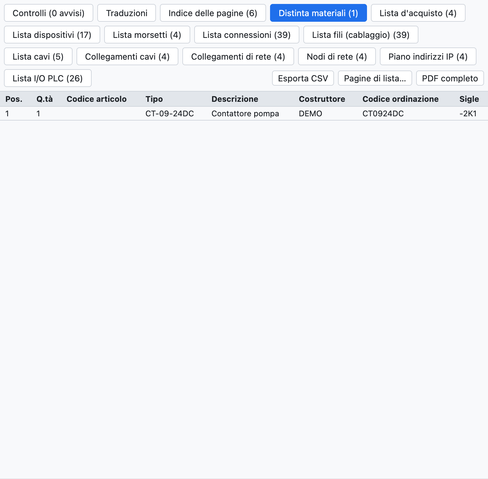
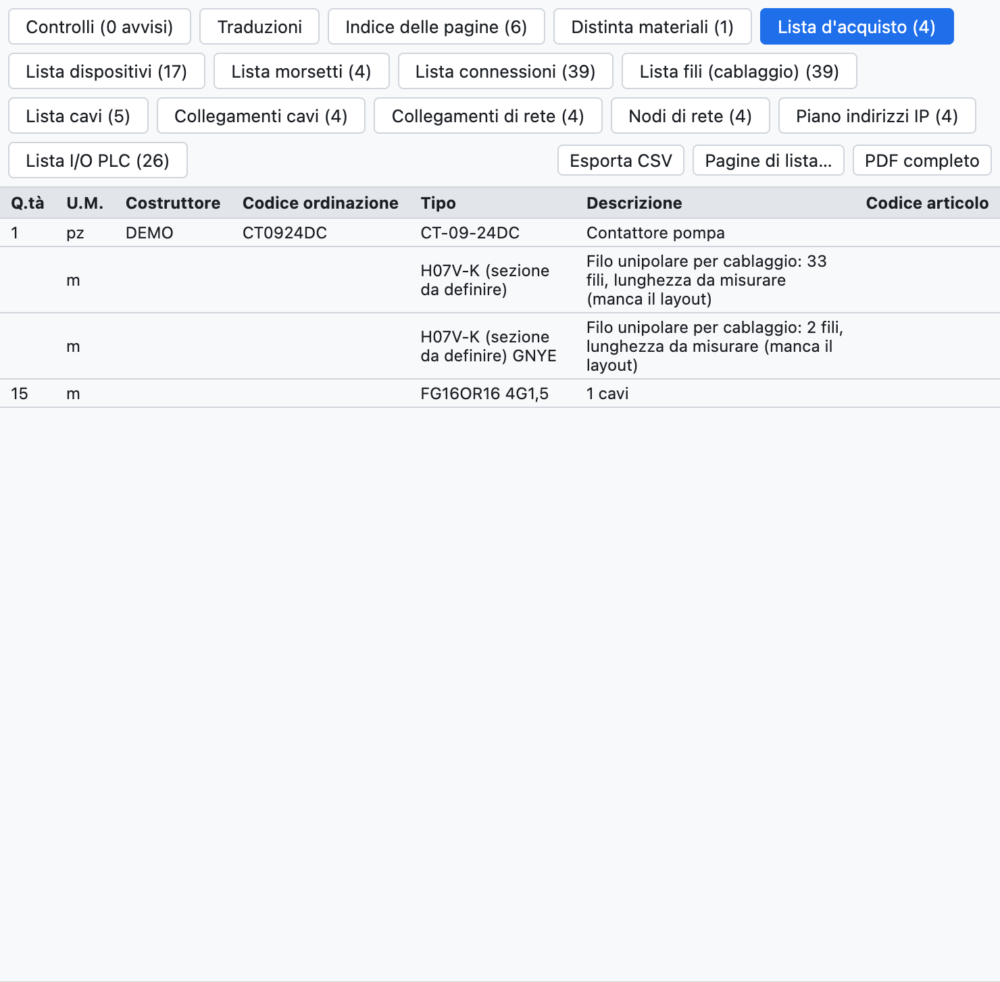
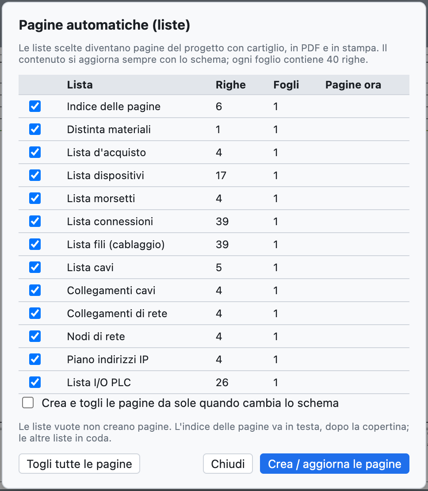
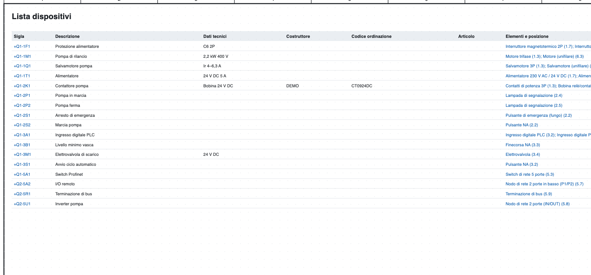
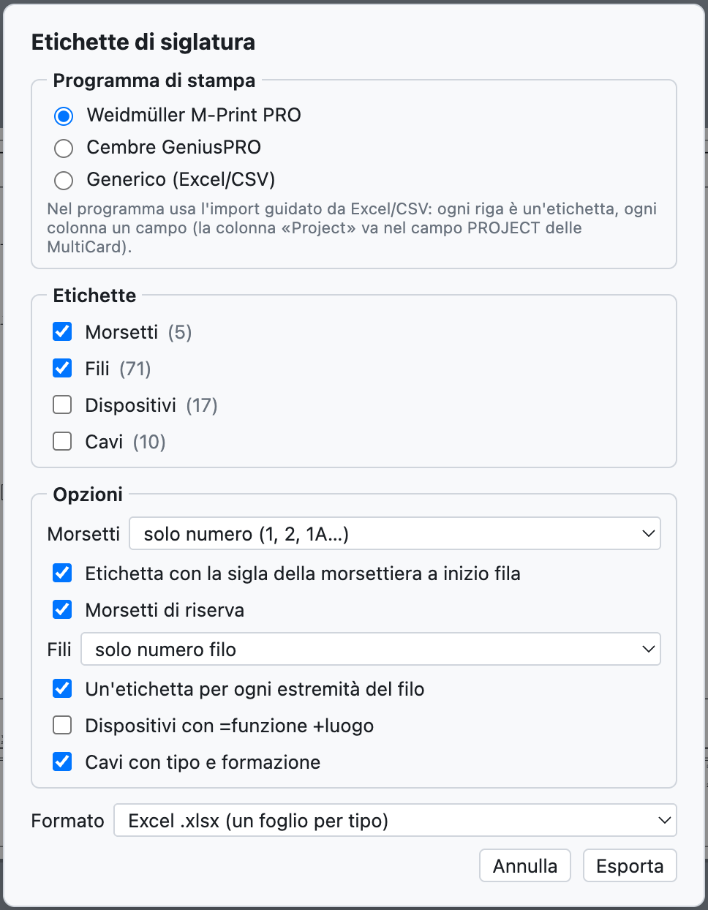

# 14. Listes et pages automatiques

Toutes les listes sont **calculées à partir du schéma** : elles ne se remplissent pas à la main et sont
toujours à jour.

## La vue Listes

*L'onglet Listes avec la nomenclature du projet d'exemple.*

L'onglet **Listes** a un sous-onglet par liste ; *Exporter CSV* enregistre la liste ouverte (séparateur `;`,
s'ouvre dans Excel), *PDF complet* exporte le projet avec toutes les listes à la fin.

| Liste | Contenu |
|---|---|
| Index des pages | numéro, titre, type et emplacement de chaque page |
| Nomenclature | articles regroupés par référence (ou par fabricant + référence de commande), quantité, repères |
| Liste d'achat | articles par fabricant avec l'unité de mesure, fil en vrac, câbles |
| Liste des appareils | repère complet, description, caractéristiques techniques, fabricant, références, éléments et positions |
| Liste des bornes | bornes avec destinations externes et internes, numéros de fil, ponts |
| Liste des connexions | chaque liaison : numéro de fil, de, à, pages, section, couleur, câble |
| Liste des fils (câblage) | chaque fil avec section, couleur, embouts et longueur estimée |
| Liste des câbles, Connexions des câbles | voir [chapitre 9](09-cavi-e-connettori.md) |
| Liste des connecteurs | broches, côtés, fils |
| Connexions réseau, Nœuds réseau, Plan d'adressage IP | voir [chapitre 11](11-reti-luoghi-unifilare.md) |
| Liste des E/S API | voir [chapitre 10](10-plc.md) |

Les listes vides n'apparaissent pas. Un clic sur une position (`/2.4`) mène à l'élément.

## Liste d'achat

*La liste d'achat du projet d'exemple.*

La liste d'achat sert à commander le matériel :

- les articles de la nomenclature sont **regroupés par fabricant**, ainsi chaque groupe est une commande à un
  fournisseur ;
- chaque ligne a l'**unité de mesure** : pièces, ou mètres pour les câbles, rails et goulottes ;
- le **fil en vrac** est additionné par section et couleur (`H07V-K 1,5 mm² BU`), en mètres estimés à partir
  de l'implantation de l'armoire avec 10 % de marge ; sans implantation, la ligne indique le nombre de fils
  et que la longueur est à mesurer ;
- les **câbles sans article** sont additionnés par type et composition.

## Pages automatiques

Les listes deviennent des **pages du projet** avec cartouche, à imprimer et à inclure dans le PDF.

*La fenêtre des pages automatiques : pour chaque liste les lignes, les feuilles nécessaires et les pages déjà
présentes.*

1. *Insertion ▸ Pages automatiques (listes)…*, ou *Pages de liste…* dans la vue Listes.
2. Cochez les listes que vous voulez en pages.
3. Appuyez sur **Créer / mettre à jour les pages**.

- Chaque feuille contient 40 lignes ; une liste plus longue occupe plusieurs feuilles.
- L'**index des pages** va en tête, après la couverture ; les autres listes à la fin.
- Le **contenu** des pages suit toujours le schéma.
- Avec **Créer et supprimer les pages automatiquement quand le schéma change** le nombre de feuilles
  s'adapte aussi tout seul : si la liste des bornes passe de 40 à 41 lignes, la deuxième feuille apparaît.
- *Retirer toutes les pages* retire les pages de liste.
- *Insertion ▸ Mettre à jour les pages de liste* réaligne les pages sur les listes choisies.

*La liste des appareils comme page du projet.*

## Étiquettes de repérage

*Fichier ▸ Exporter ▸ Étiquettes M-Print PRO / GeniusPRO…* prépare les étiquettes pour les imprimantes de
repérage.

*La fenêtre des étiquettes.*

- **Logiciel** : Weidmüller M-Print PRO (colonnes `Project`, `Text 1`, `Text 2`… ; la colonne `Project` va
  dans le champ PROJECT des MultiCards), Cembre GeniusPRO (colonnes `Riga 1`, `Riga 2`…, `Gruppo`) ou
  générique.
- **Étiquettes** : bornes, fils, appareils, câbles.
- **Options** : bornes avec le numéro seul ou le repère complet, étiquette du bornier en début de rangée,
  réserves ; fils avec le numéro seul ou avec la destination, une étiquette par extrémité ; appareils avec
  =fonction +emplacement ; câbles avec type et composition.
- **Format** : Excel (une feuille par type) ou CSV.

Les deux logiciels importent Excel et CSV avec un assistant dans lequel on associe chaque colonne à un champ.
