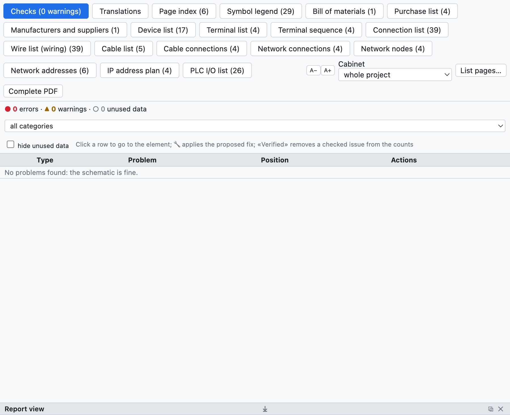
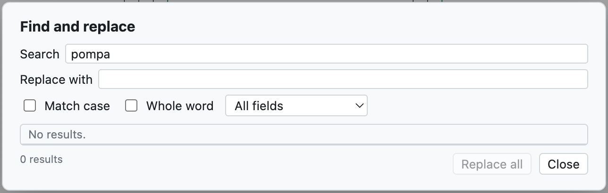

# 15. Vérification, recherche et révisions

## Vérification du projet

**Vérification** dans la barre d'outils (ou *Projet ▸ Vérification*) contrôle tout le projet et ouvre
l'onglet *Contrôles* de la vue Listes.

*Le projet d'exemple n'a pas de problèmes. Pour un exemple avec des avertissements voir le [chapitre 3](03-primo-progetto.md#étape-6--vérification).*

Les problèmes sont répartis en :

- **erreurs** (●) : à corriger, par exemple un court-circuit ;
- **avertissements** (▲) : erreurs probables, par exemple un point de connexion libre ;
- **données inutilisées** (○) : données à ranger, par exemple un article copié dans le projet mais non
  utilisé.

On les filtre par catégorie et *masquer les données inutilisées* enlève les ○. **Un clic sur une ligne**
mène à l'élément et le sélectionne.

### Ce qui est contrôlé

| Catégorie | Exemples |
|---|---|
| Courts-circuits | potentiels différents sur le même conducteur (`L1` avec `N`, `+24V` avec `0V`), renvois de noms différents reliés, composants avec les deux bornes sur le même conducteur |
| Connexions seulement apparentes | un fil qui passe sur un point de connexion sans s'y terminer : il semble relié mais ne l'est pas |
| Orphelins | composants, potentiels, renvois et nœuds sans liaisons, fils isolés, contacts sans bobine |
| Connexions incomplètes | bornes libres de bobines, contacts, voyants, boutons-poussoirs, points E/S ; fils avec une extrémité libre (les barres qui arrivent au bord sont admises) |
| Dessin | symboles inexistants ou superposés, fils superposés, éléments hors de la feuille, numéros de fil répétés, pages vides, rotations non admises par le symbole (corrigées en admettant la rotation dans le symbole) |
| Bus de conducteurs | fils qui touchent le bus sans nom de conducteur, conducteurs qui entrent dans le bus sans en sortir |
| Repères et données | repères en double ou manquants, plus de contacts que l'article n'en a, bornes répétées |
| Câbles, connecteurs, réseaux, API, implantation | voir les chapitres correspondants |
| Données inutilisées | articles, symboles, données de borniers et de connecteurs plus utilisés, emplacements vides |

> **Conseil** : lancez la vérification avant chaque livraison et avant d'exporter le PDF.

## Rechercher et remplacer

**⌘F** (ou *Rechercher*) ouvre la recherche dans tout le projet.

*La recherche de «pompa» trouve sept descriptions.*

- Elle cherche dans les repères, descriptions, textes, numéros de fil, noms API, références ; la liste
  *Tous les champs* restreint la recherche à un champ.
- *Respecter la casse* et *Mot entier* affinent la recherche.
- Un clic sur un résultat mène à l'élément.
- *Remplacer par* et **Tout remplacer** changent le texte dans tous les résultats, en une étape annulable.

## Révisions

Une **révision** fige l'état du projet livré, par exemple «Rev. A – prima emissione».

1. *Projet ▸ Nouvelle révision…* (ou *Nouvelle révision…* dans les propriétés du projet).
2. Saisissez l'indice, la date, l'auteur et la description.

À partir de ce moment :

- les modifications suivantes sont signalées par des **nuages** rouges à l'écran et dans le PDF (on les
  désactive avec *Nuages sur les modifications* dans les propriétés) ;
- le cartouche de chaque page montre l'indice de la dernière révision qui l'a modifiée ;
- l'index du PDF, la couverture et le cartouche *Avec tableau des révisions* reprennent les révisions.

## Comparer deux projets

*Fichier ▸ Importer ▸ Comparer avec un fichier .ecad…* (ou *Comparer…* dans les propriétés) compare le projet
ouvert avec un autre fichier, par exemple la version livrée au client. L'onglet *Comparaison* de la vue
Listes énumère les pages, appareils et données de projet ajoutés, retirés ou modifiés.
