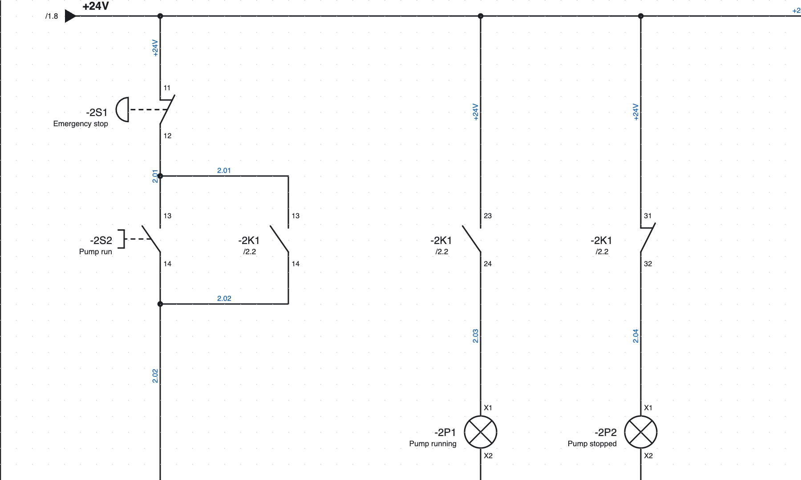
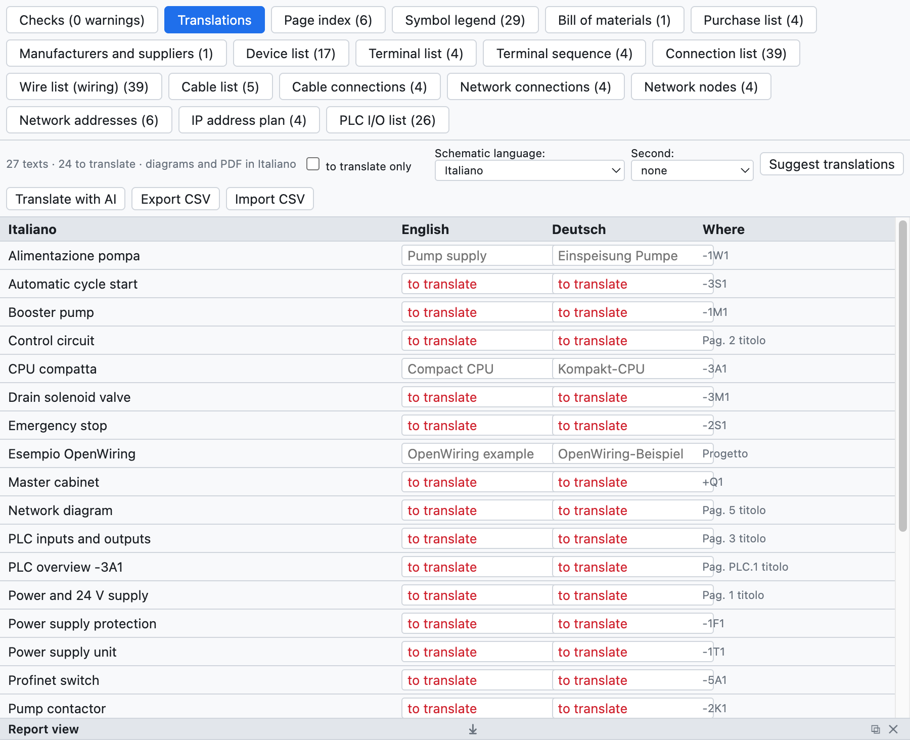

# 16. Langues des schémas

Les schémas se dessinent en italien et s'impriment aussi en **anglais** ou en **allemand**, ou bien en deux
langues ensemble. La langue de l'interface du programme est un autre réglage
([chapitre 1](01-introduzione.md#langue-de-linterface)).

*La page 2 en anglais avec l'italien en dessous : «Emergency stop / Arresto di emergenza».*

## Le dictionnaire du projet

L'onglet *Traductions* de la vue Listes (ou *Projet ▸ Traductions…*) énumère tous les textes traduisibles du
projet : titres de page, textes libres, descriptions des appareils, emplacements, commentaires API, champs du
cartouche. Pour chacun il y a la traduction anglaise, la traduction allemande et l'endroit où il apparaît.

*Le dictionnaire du projet d'exemple.*

- Saisissez la traduction dans la cellule ; *à traduire seulement* montre les textes qui n'en ont pas.
- Le programme contient déjà les textes fixes (cartouche, titres et colonnes des listes) et environ 250 termes
  électriques courants.

## Traduire automatiquement

| Commande | Comment elle traduit |
|---|---|
| *Proposer des traductions* | phrase entière si elle est dans le dictionnaire inclus, sinon mot à mot («Lampada guasto» → «Fault lamp») |
| *Traduire avec l'IA* | avec l'assistant IA choisi (Claude, ChatGPT, Gemini), avec la terminologie du secteur ([chapitre 17](17-assistente-ia.md#traduire-le-dictionnaire)) |

Les traductions automatiques sont **mises en évidence** comme à vérifier : on les confirme avec ✓ ou en les
modifiant.

## Choisir la langue

- **Langue des schémas** : *Affichage ▸ Langue des schémas*, les propriétés du projet (*Langues*) ou l'onglet
  Traductions. Elle change les schémas, le cartouche, la couverture, les pages de liste, les vues d'ensemble
  API et les schémas des borniers.
- **Deuxième langue** : écrit les textes en deux langues («Contattore pompa / Pump contactor»).
- Le **PDF** et l'**impression** peuvent se faire dans une autre langue sans changer celle du projet (choix
  *Langue* dans la fenêtre d'export).

## Avec un traducteur

*Exporter CSV* enregistre le dictionnaire comme tableau `Italiano;English;Deutsch` : le traducteur le complète
dans Excel et *Importer CSV* le relit.
