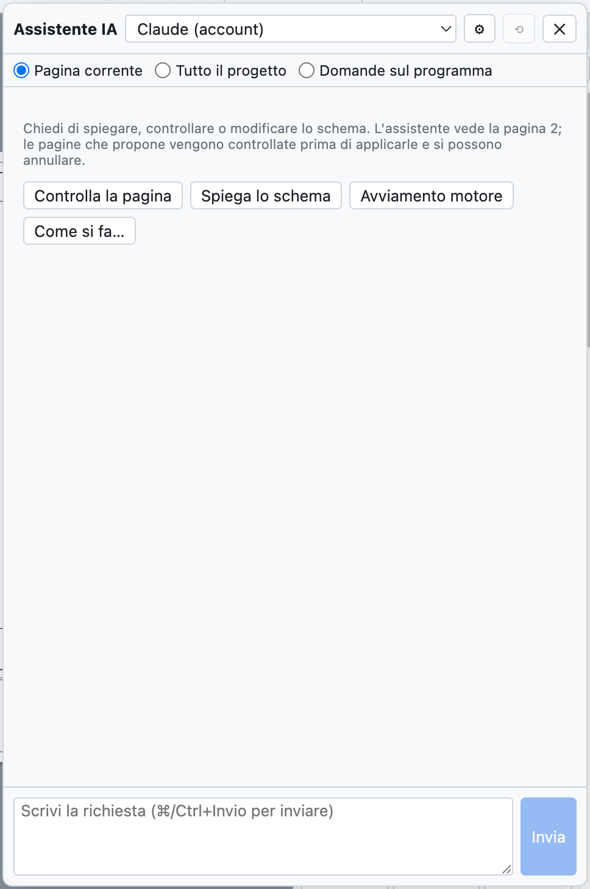
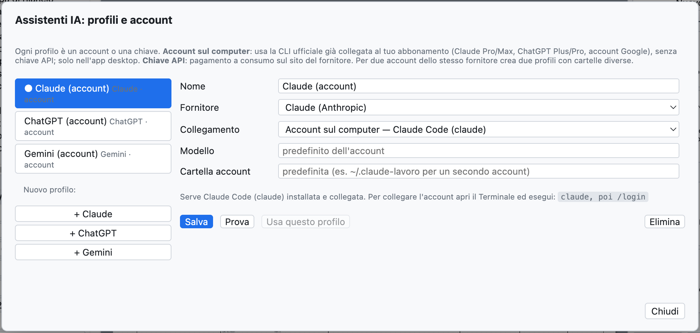
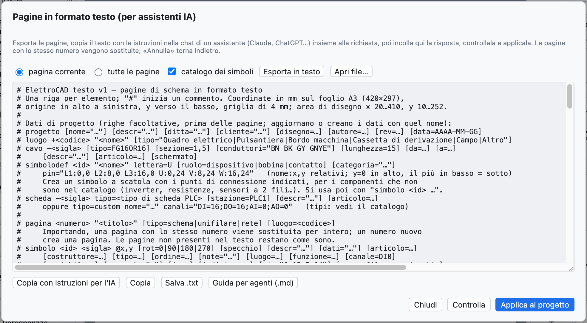

# 17. Assistant IA

L'assistant IA est un collègue à qui demander, dans votre langue, d'**expliquer**, de **vérifier** ou de
**dessiner** des parties du schéma. Il fonctionne avec **Claude** (Anthropic), **ChatGPT** (OpenAI) et
**Gemini** (Google), en utilisant vos comptes. Il répond dans la langue de l'interface.



*Le panneau de l'assistant, avec les boutons rapides.*

## Ouvrir l'assistant

*Projet ▸ Assistant IA…* ou **⌘I** ouvre le panneau à droite ; le schéma reste visible et on peut travailler
pendant que l'assistant répond.

En haut on choisit :

- le **profil** : quel assistant et quel compte ;
- le **contexte** : ce que voit l'assistant.

| Contexte | L'assistant reçoit |
|---|---|
| *Page courante* | la page au format texte, le guide du format avec le catalogue des symboles, les problèmes de la vérification sur la page |
| *Tout le projet* | toutes les pages, les données du projet (emplacements, câbles, cartes API) et tous les problèmes de la vérification |
| *Questions sur le programme* | le manuel d'OpenWiring, pour les questions sur les menus et les commandes |

## Que demander

| Demande | Exemple |
|---|---|
| Expliquer | «Explique comment fonctionne le circuit de cette page» |
| Vérifier | «Vérifie cette page : connexions, repères, protections, norme CEI EN 60204-1» |
| Dessiner | «Ajoute une page 7 avec un démarrage étoile-triangle pour un moteur de 15 kW» |
| Modifier | «Ajoute un voyant de défaut commandé par le contact 95-96 du relais thermique» |
| Utiliser le programme | «Comment crée-t-on un bornier à deux étages ?» |

Les boutons rapides *Vérifier la page*, *Expliquer le schéma*, *Démarrage moteur*, *Comment faire…* envoient
des demandes toutes prêtes. **⌘Entrée** envoie, *Annuler* interrompt une longue réponse, ⟲ commence une
nouvelle conversation.

## Quand l'assistant dessine

Si la réponse contient des pages au format texte, le panneau les **vérifie aussitôt** :

- *Prêt : ajoute la page 7 · aucun problème* → appuyez sur **Appliquer au projet** ;
- s'il y a des erreurs ou des problèmes de vérification, ils apparaissent sous la réponse :
  **Demander la correction** renvoie erreurs et problèmes à l'assistant, qui corrige.

L'application s'annule avec **⌘Z**. Une page portant le même numéro qu'une page existante la remplace ; un
nouveau numéro ajoute une page.

> **Exemple réel.** À la demande «Ajoute une nouvelle page (numéro 7) avec un démarrage direct pour un moteur
> triphasé de 4 kW : disjoncteur-moteur, contacteur, bornier et moteur», Claude a répondu en 30 secondes
> environ avec la page complète (disjoncteur-moteur `-7Q1`, contacteur `-7K1`, bornes `-X2`, moteur `-7M1`,
> câble `-7W1`), en signalant de lui-même qu'il manquait la bobine du contacteur dans le circuit de commande.

## Profils et comptes

*Projet ▸ Assistants IA : profils et comptes…* (ou ⚙ dans le panneau).



*Un profil par assistant : à la première utilisation il y en a un pour Claude, ChatGPT et Gemini.*

Chaque profil a un nom, un fournisseur, un mode de connexion et un modèle. On peut avoir plusieurs profils du
même fournisseur, par exemple le compte personnel et celui de l'entreprise.

### Compte sur l'ordinateur (abonnement)

Dans l'application de bureau le profil peut utiliser la **CLI officielle** du fournisseur, déjà liée à votre
abonnement : pas de clé API, on utilise le quota de l'abonnement.

| Fournisseur | Programme à installer | Abonnement | Commande pour lier le compte |
|---|---|---|---|
| Claude | Claude Code (`claude`) | Claude Pro ou Max | `claude`, puis `/login` |
| ChatGPT | Codex CLI (`codex`) | ChatGPT Plus ou Pro | `codex login` |
| Gemini | Gemini CLI (`gemini`) | compte Google | `gemini`, puis *Login with Google* |

La commande s'exécute une fois dans le Terminal. Pour un **deuxième compte** du même fournisseur, indiquez
dans le profil un **dossier du compte** différent (par exemple `~/.claude-lavoro`) : la fenêtre montre la
commande exacte, par exemple `CLAUDE_CONFIG_DIR=~/.claude-lavoro claude`.

Si la connexion expire, l'assistant répond avec la commande à exécuter (par exemple `codex login`).

### Clé API

Avec la connexion *Clé API* on paie à l'usage sur le site du fournisseur :

| Fournisseur | Où créer la clé |
|---|---|
| Claude | console.anthropic.com |
| ChatGPT | platform.openai.com |
| Gemini | aistudio.google.com |

Collez la clé dans le profil ; *Lister* montre les modèles disponibles avec cette clé. Dans l'application de
bureau la clé est **chiffrée** par le système d'exploitation et reste uniquement sur cet ordinateur.

**Tester** vérifie la connexion par une courte question ; **Utiliser ce profil** en fait le profil actif.

## Traduire le dictionnaire

*Projet ▸ Traduire avec l'assistant IA* (ou *Traduire avec l'IA* dans l'onglet Traductions) envoie à
l'assistant actif les textes du projet sans traduction, ainsi que ceux traduits mot à mot, et demande
l'anglais et l'allemand avec la terminologie du secteur. Les traductions entrent dans le dictionnaire comme
**à vérifier** (voir [chapitre 16](16-lingue.md)).

## Le format texte avec un assistant externe

On peut aussi travailler avec un assistant dans un chat du navigateur, sans profils :



*La fenêtre des pages au format texte.*

1. *Fichier ▸ Pages en texte (assistants IA)…* : choisissez *page courante* ou *toutes les pages* et appuyez
   sur **Exporter en texte**.
2. **Copier avec les instructions pour l'IA** et collez dans le chat, en ajoutant votre demande à la fin.
3. Collez la réponse dans la fenêtre (même avec le texte autour), appuyez sur **Vérifier** puis sur
   **Appliquer au projet**.

Le format est une ligne par élément :

```text
luogo +Q1 "Quadro elettrico"
pagina 7 "Ventilazione quadro" luogo=Q1
  simbolo potential +24V @28,24
  filo 28,24 400,24
  simbolo potential 0V @28,232
  filo 28,232 400,232
  simbolo pb_no -? @100,60 descr="Marcia ventilatore"     # "-?" = repère automatique
  simbolo coil -7K1 @100,140 descr="Contattore ventilatore"
  collega -7S1:13 100,24                                  # vers la barre +24V
  collega -7S1:14 -7K1:A1                                 # par repère et point de connexion
  collega -7K1:A2 100,232
```

La syntaxe complète se trouve dans le **guide pour agents** (*Aide ▸ Guide pour agents IA (.md)…*), voir le
[chapitre 19](19-riga-di-comando.md).

## Confidentialité

Le schéma envoyé à l'assistant quitte l'ordinateur et parvient au fournisseur choisi, selon ses conditions
d'utilisation. Avec *Page courante* on n'envoie que la page ouverte.
