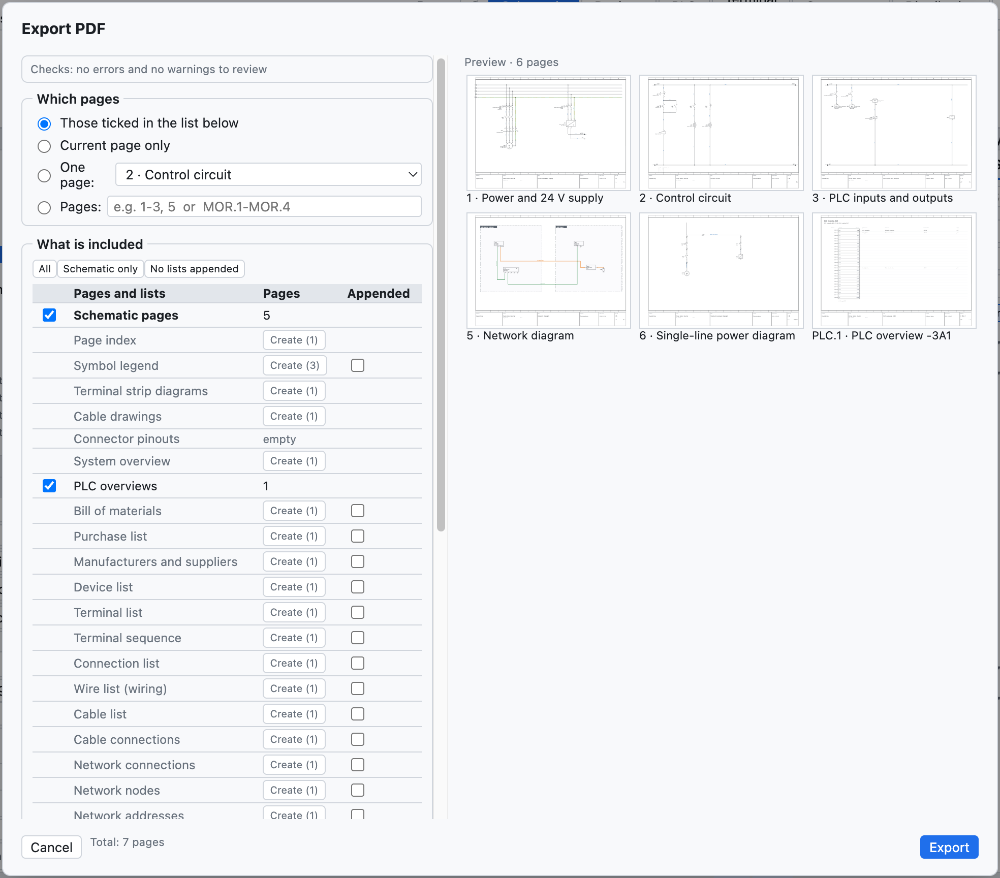
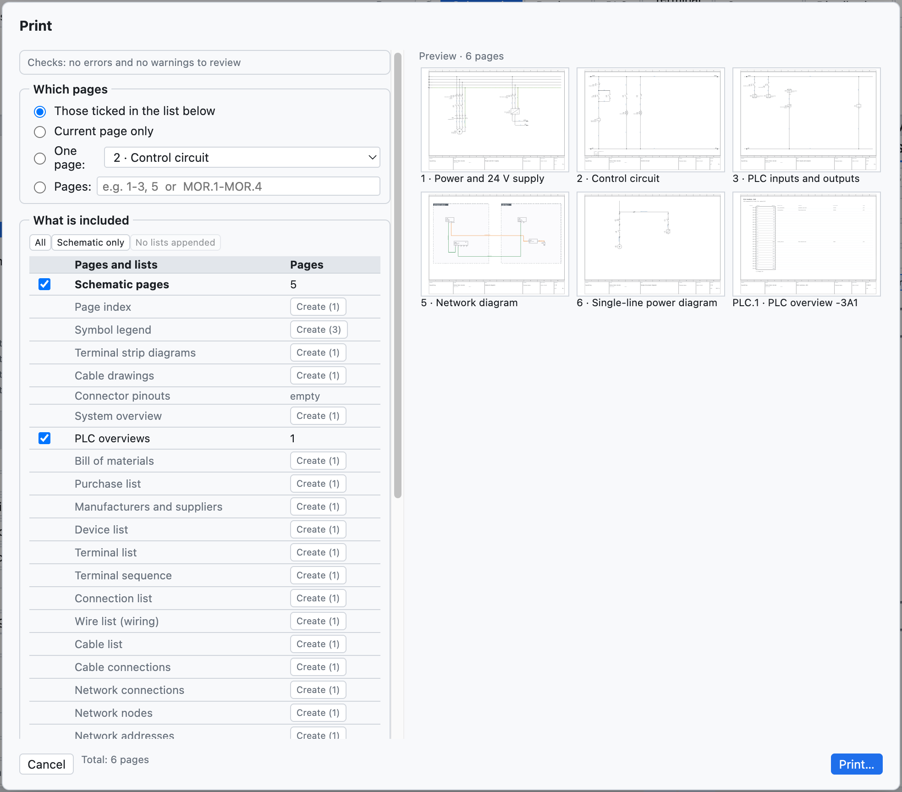

# 18. Import et export

## PDF

**PDF** dans la barre d'outils (ou *Fichier ▸ Exporter ▸ PDF…*) crée un PDF vectoriel en A3.

*Les options du PDF.*

| Option | Effet |
|---|---|
| *Celles cochées dans la liste ci-dessous*, *Page courante seulement*, *Une page*, *Pages* | quelles pages ; l'intervalle s'écrit avec les numéros du projet (`1-3, 5` ou `200-205`) |
| *Page d'index initiale* | index cliquable des pages et des listes |
| *Listes à la fin* | nomenclature, appareils, bornes, connexions, E/S API après les schémas |
| *Noir et blanc pour l'impression* | fils et numéros de fil en noir |
| *Fichier compact (plus petit)* | activé par défaut : fichier environ dix fois plus petit, même dessin, renvois et signets toujours cliquables |
| *Langue du PDF*, *Deuxième langue* | le PDF dans une autre langue, sans changer le projet |

Dans le PDF les **renvois sont cliquables** (contacts ↔ bobine, renvois entre pages, API, vues d'ensemble),
de même que les positions dans les listes et l'index ; le PDF a des **signets** pour les pages et les listes.

## Impression

*Fichier ▸ Imprimer…* (⌘P) envoie les pages à l'imprimante en **A3 paysage**, une page par feuille.

*Les options d'impression : pages, noir et blanc, langue.*

Pour imprimer aussi les listes, créez d'abord les pages de liste ([chapitre 14](14-liste-e-pagine-automatiche.md#pages-automatiques)).

## DXF

| Commande | Résultat |
|---|---|
| *Fichier ▸ Exporter ▸ DXF de la page courante* | un DXF R12 à l'échelle 1:1, en mm |
| *Fichier ▸ Exporter ▸ DXF de tout le projet (ZIP)* | un DXF par page, réunis dans une archive ZIP |
| sur la page d'implantation | le DXF de perçage de la plaque ([chapitre 12](12-layout-quadro.md#perçage)) |

Les DXF ont les calques CORNICE, CARTIGLIO, SIMBOLI, FILI, TESTI, SIGLE, NUMERI_FILO (plus CAVI et QUADRI là
où il le faut) et s'ouvrent dans AutoCAD, DraftSight, LibreCAD et les autres CAO. Le format DWG n'est pas
disponible : on ouvre le DXF et on l'enregistre en DWG depuis la CAO.

## Excel et CSV

- Chaque liste s'exporte en **CSV** (séparateur `;`) depuis la vue Listes.
- Le **navigateur des appareils** exporte et réimporte Excel ([chapitre 7](07-dispositivi-e-articoli.md#excel)).
- La vue **API** exporte pour TIA Portal, CODESYS, PLCopen et la liste des E/S ([chapitre 10](10-plc.md)).
- Les **étiquettes** sortent en Excel ou CSV ([chapitre 14](14-liste-e-pagine-automatiche.md#étiquettes-de-repérage)).
- Le **dictionnaire** des traductions sort en CSV ([chapitre 16](16-lingue.md)).

## Importer des schémas depuis un PDF (SEE Electrical et autres)

*Fichier ▸ Importer ▸ Schéma depuis PDF (SEE Electrical…)…* crée un **nouveau projet** à partir d'un schéma
exporté en **PDF vectoriel** par une autre CAO. Il a été essayé avec un vrai projet SEE Electrical de 207
pages, importé en quelques secondes.

Ce qui est reconstruit :

- les **feuilles** : une pour chaque feuille de schéma, avec numéro et titre tirés du cartouche ; le préfixe
  du titre (`Q1.1 Ingresso linea`) devient l'emplacement `+Q1.1` ; la couverture et les listes de la CAO
  d'origine sont ignorées ;
- les **vrais fils**, avec la couleur du dessin (bleu → BU, vert-jaune → PE, rouge → RD…) et le nom écrit à
  côté (`L1-1.1`, `200.01`) comme numéro de fil ;
- les **composants** avec le **repère** le plus proche, les **bornes** où arrivent les fils et leurs noms
  (`1/L1`, `A1`, `95`) ;
- les **bornes de bornier**, aussi à plusieurs étages (`X1.1.12:1A`) ;
- les **renvois** entre pages, appariés par nom ou par les références `feuille.colonne` ;
- les **textes** libres et les textes des composants.

À revérifier : les composants sont reconnus par le graphisme et ne savent pas s'ils sont des bobines ou des
contacts (donc pas d'image des contacts) ; certains éléments restent du graphisme sans repère.
*Projet ▸ Vérification* signale les conducteurs interrompus et les renvois sans correspondant. Un PDF scanné
(une image) ne peut pas être importé.

## Autres imports

| Commande | Ce qu'elle importe | Voir |
|---|---|---|
| *Articles EDZ / XML / CSV…* | articles des fabricants, avec images, bornes, dessin et données commerciales (CSV) | [chapitre 7](07-dispositivi-e-articoli.md#importer-les-données-des-fabricants-edz) |
| *Symboles QElectroTech…* | composants `.elmt`, `.qet`, archives | [chapitre 13](13-macro-simboli-cartigli.md#composants-de-qelectrotech) |
| *Macros…* | fichiers `.ecmacro` | [chapitre 13](13-macro-simboli-cartigli.md#macros) |
| *Comparer avec un fichier .ecad…* | différences avec un autre projet | [chapitre 15](15-verifica-ricerca-revisioni.md#comparer-deux-projets) |
| *Importer DXF…* dans l'éditeur de cartouches | cartouche dessiné dans une autre CAO | [chapitre 13](13-macro-simboli-cartigli.md#importer-un-cartouche-depuis-un-dxf) |
| *Importer les variables* (vue API) | table des variables de TIA Portal, CODESYS, CSV | [chapitre 10](10-plc.md#import-des-variables) |
| *Pages en texte* | pages écrites par un assistant IA ou par un script | [chapitre 17](17-assistente-ia.md#le-format-texte-avec-un-assistant-externe) |

## Autres exports

| Commande | Résultat |
|---|---|
| *PLCopen XML (variables API)* | variables globales pour CODESYS et les environnements compatibles |
| *Articles en XML (format EPLAN)* | articles de la bibliothèque dans un fichier XML au format EPLAN |
| *Dictionnaire des traductions (CSV)* | tableau `Italiano;English;Deutsch` |
