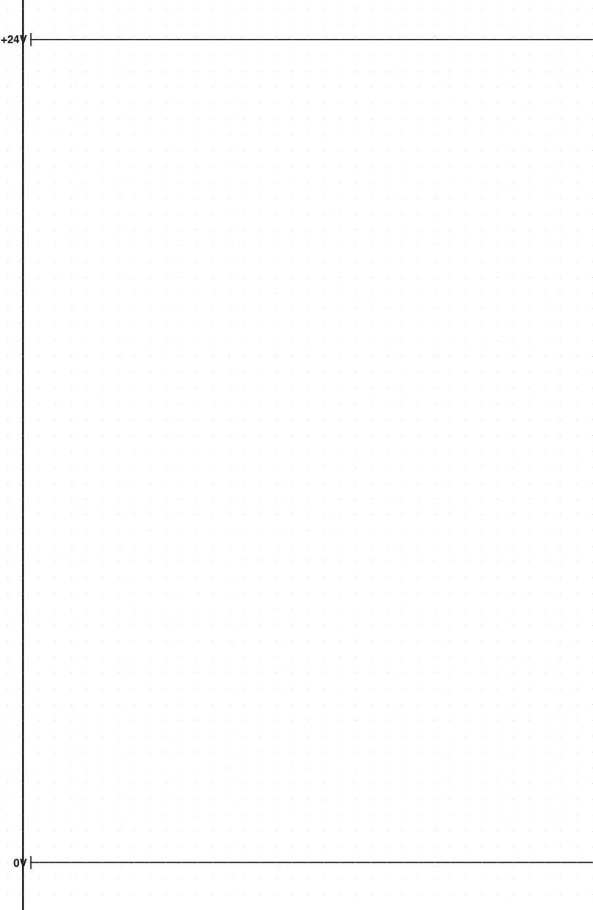
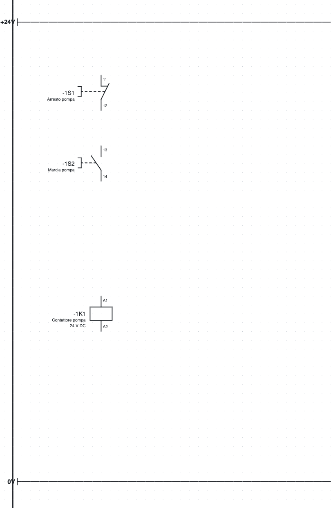
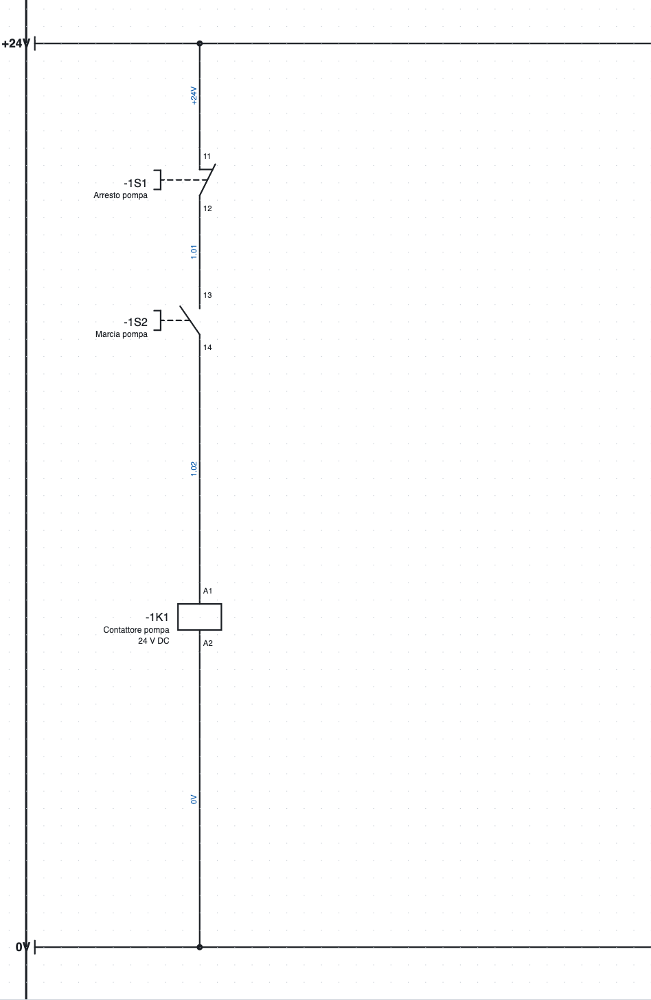
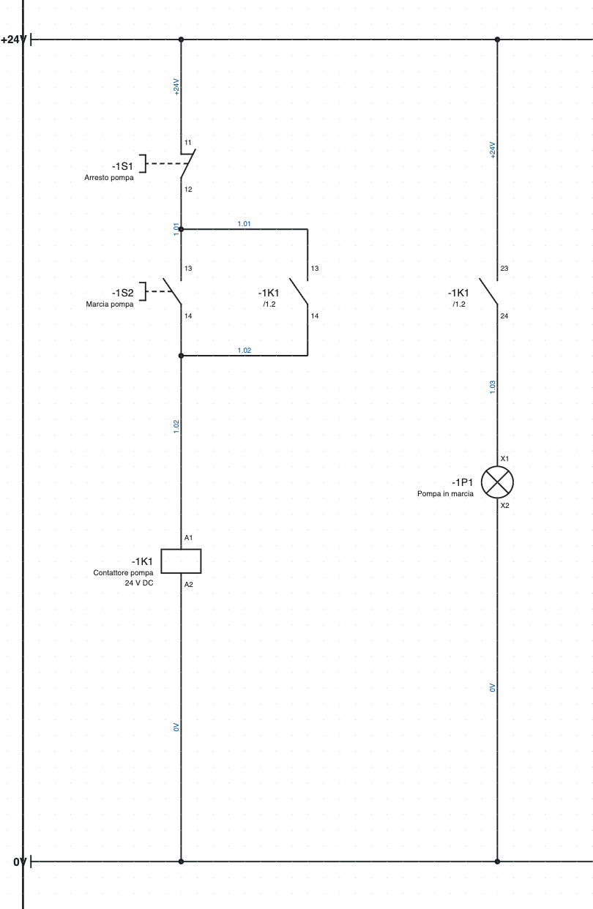
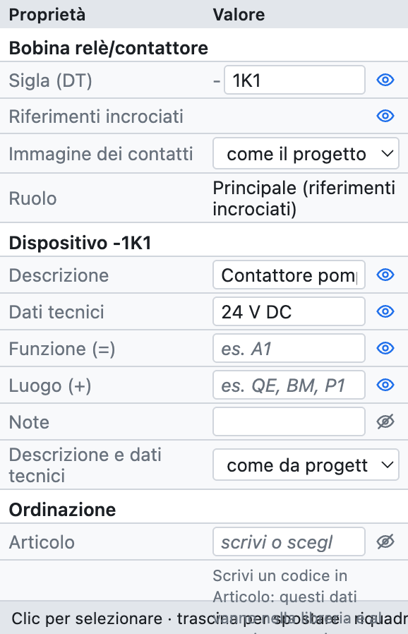
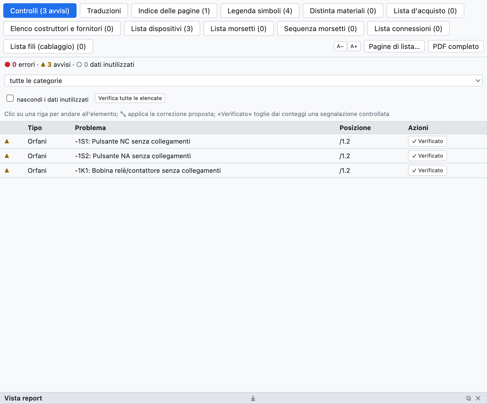
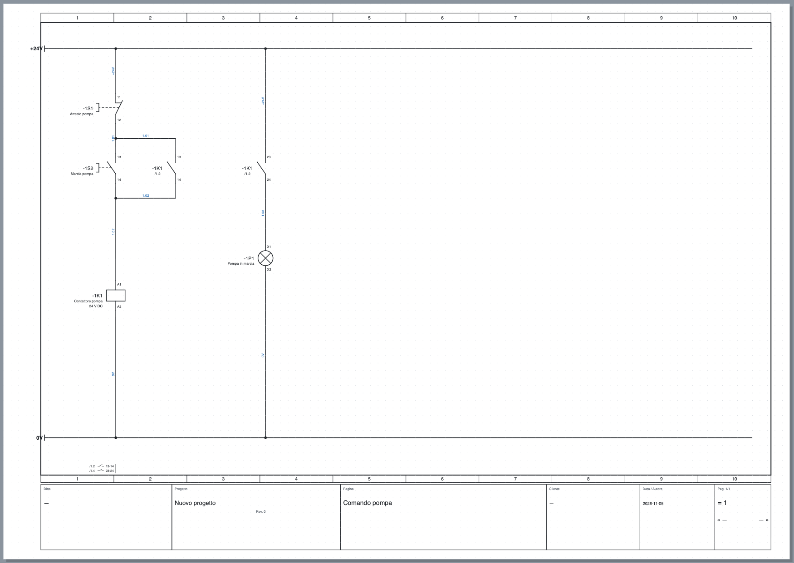

# 3. Il primo progetto

In questo esercizio si disegna il **comando di una pompa**: un pulsante di arresto, un pulsante di marcia,
il contattore con l'autoritenuta e una lampada di marcia, alimentati a 24 V. Servono una ventina di minuti
e alla fine si conoscono i comandi di base: inserire simboli, disegnare fili, compilare i dati, verificare
ed esportare.

## Passo 1 – Nuovo progetto e barre di alimentazione

1. *File ▸ Nuovo progetto*. Si apre una pagina vuota, la pagina **1**.
2. Clicca sul nome della pagina nell'albero e, in *Proprietà*, scrivi la **Descrizione**: `Comando pompa`.
   Il titolo compare nel cartiglio.
3. Nella libreria, categoria *Morsetti e collegamenti*, scegli **Punto di potenziale** e clicca in alto a
   sinistra nella pagina. Il punto prende il nome `L1`: in *Proprietà ▸ Nome* scrivi `+24V`.
4. Inserisci un secondo punto di potenziale in basso e chiamalo `0V`. Premi **Esc** per terminare l'inserimento.
5. Premi **W** (strumento *Filo*), clicca sul punto `+24V` e poi all'estremo destro della pagina; chiudi
   il filo con un doppio clic. Fai lo stesso per la barra `0V`.

*Passo 1: le barre di alimentazione.*

> **Perché i punti di potenziale?** Tutti i conduttori con lo stesso nome (`+24V`, `0V`, `L1`, `PE`…) sono
> collegati tra loro, anche su pagine diverse. Le liste e la verifica lo sanno.

## Passo 2 – I simboli

1. Categoria *Comandi*: scegli **Pulsante NC** e clicca sotto la barra `+24V`, nella colonna 1–2.
   Il pulsante prende da solo la sigla `-1S1` (pagina 1, lettera S, primo della pagina).
2. Sempre in *Comandi*, **Pulsante NA**, più in basso sulla stessa verticale: diventa `-1S2`.
3. Categoria *Bobine e contatti*: **Bobina relè/contattore**, ancora più in basso: diventa `-1K1`.
4. Premi **Esc**.

Se un simbolo va girato, prima di inserirlo premi **R** (ruota di 90°); dopo l'inserimento si ruota con
**R** sulla selezione. I simboli si agganciano alla griglia di 4 mm.

*Passo 2: pulsanti e bobina, ancora senza fili.*

## Passo 3 – I fili

1. Premi **W**. Clicca sulla barra `+24V` sopra il pulsante `-1S1`: il filo parte dal punto della barra.
2. Clicca sul punto di connessione in alto del pulsante (`11`): il filo termina da solo quando arriva su un
   punto di connessione. I punti disponibili sono evidenziati da cerchietti verdi.
3. Collega allo stesso modo `-1S1:12` con `-1S2:13`, `-1S2:14` con `-1K1:A1`, e `-1K1:A2` con la barra `0V`.

Dove il filo arriva su un altro filo, il programma crea una **giunzione** e la disegna con il pallino.
Due fili che si incrociano senza pallino non sono collegati.

> **Collegamento automatico.** Quando inserisci o sposti un simbolo, i suoi punti di connessione liberi si
> collegano da soli ai punti affacciati sulla stessa linea: due simboli messi uno sotto l'altro sulla stessa
> verticale risultano già uniti da un filo. È comodo per i circuiti in colonna; se preferisci tirare ogni
> filo a mano, spegnilo in *Proprietà del progetto ▸ Disegno ▸ Collegamento automatico*.

*Passo 3: il circuito di comando collegato. I numeri filo azzurri sono stati assegnati in automatico.*

## Passo 4 – Autoritenuta e lampada

1. Categoria *Bobine e contatti*: **Contatto NA**. Inseriscilo a destra del pulsante di marcia.
   Si apre la finestra *Contatto NA: di quale dispositivo?* con le bobine del progetto: scegli `-1K1` e premi
   Invio. Il contatto prende i morsetti `13-14`. Se confermi senza scegliere, resta un dispositivo nuovo
   (`-1K2`).
2. Collegalo **in parallelo** al pulsante di marcia: un filo dal tratto sopra `-1S2` al contatto, un filo
   dal contatto al tratto sotto `-1S2`. Le giunzioni a T si formano da sole.
3. Inserisci un secondo **Contatto NA** più a destra: la finestra propone già `-1K1`, l'ultima bobina scelta;
   premi Invio e il contatto prende i morsetti `23-24`.
4. Categoria *Utilizzatori*: **Lampada di segnalazione** sotto il contatto: diventa `-1P1`.
5. Collega barra `+24V` → contatto → lampada → barra `0V`.

*Passo 4: l'autoritenuta `-1K1 13-14` e la lampada di marcia comandata da `-1K1 23-24`.*

Sotto ogni contatto compare **`/1.2`**: è la posizione della bobina (pagina 1, colonna 2). In fondo alla
pagina, sotto la barra `0V`, compare l'**immagine dei contatti** della bobina con le posizioni dei contatti
(`/1.2 13-14`, `/1.4 23-24`). Un clic su un rimando porta all'elemento collegato.

## Passo 5 – I dati del componente

Seleziona la bobina `-1K1`. Nel pannello *Proprietà* compila:

- **Descrizione**: `Contattore pompa`;
- **Dati tecnici**: `24 V DC`;
- se lo conosci, l'**articolo**, oppure costruttore, tipo e codice di ordinazione.

*Le proprietà della bobina `-1K1`: sigla, dati del dispositivo, ordinazione, punti di connessione e posizione.*

Descrizione e dati tecnici compaiono sullo schema sotto la sigla e finiscono nelle liste. Appartengono al
**dispositivo**: scritti sulla bobina, valgono anche per i suoi contatti. Compila anche i pulsanti
(`Arresto pompa`, `Marcia pompa`) e la lampada (`Pompa in marcia`).

## Passo 6 – Verifica

Premi **Verifica** nella barra strumenti. Si apre la scheda *Controlli* con gli errori (●), gli avvisi (▲)
e i dati inutilizzati (○). Un clic su una riga porta all'elemento.

*Ecco cosa segnala la verifica se la lanci dopo il passo 2, quando i simboli non sono ancora collegati.*

Con lo schema finito la verifica non trova problemi. Prova a cancellare un filo: compaiono gli avvisi sui
punti di connessione liberi.

## Passo 7 – Salvare ed esportare

1. **Salva** (⌘S) e scegli il nome del file, per esempio `Comando pompa.ecad`.
2. **PDF** nella barra strumenti: lascia *Quelle spuntate nell'elenco qui sotto* (di partenza sono spuntate
   tutte) e premi *Esporta*. Il PDF ha l'indice, le liste
   in coda e i rimandi cliccabili.

*La pagina finita, con il cartiglio compilato dai dati del progetto.*

## E adesso?

- I dati del cartiglio (ditta, cliente, numero disegno) si compilano nelle proprietà del progetto:
  [capitolo 4](04-progetto-e-pagine.md).
- Per collegare pagine diverse si usano i rimandi: [capitolo 5](05-disegnare.md#rimandi-tra-pagine).
- Per la potenza (salvamotore, contattore, motore) apri la pagina 1 del progetto di esempio.
- Lo stesso schema si può far disegnare all'**assistente IA** descrivendolo a parole: [capitolo 17](17-assistente-ia.md).
