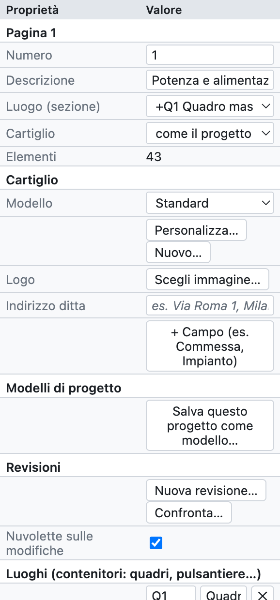
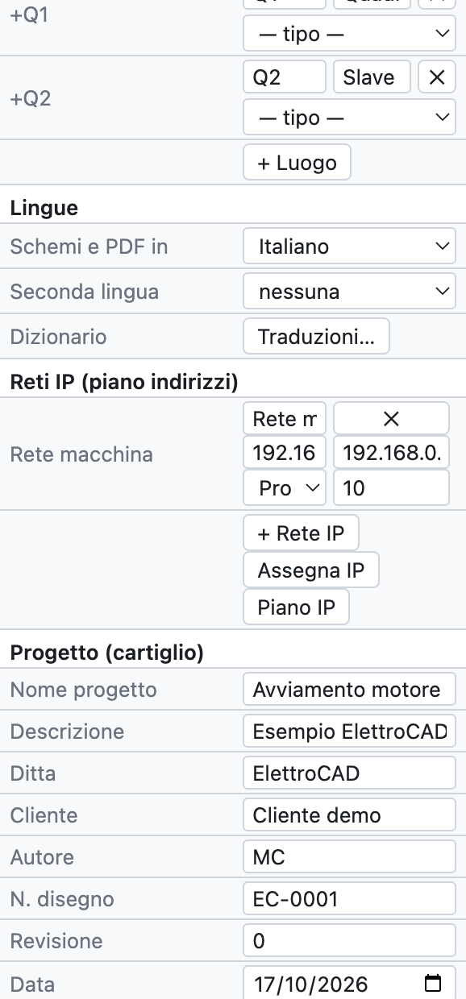
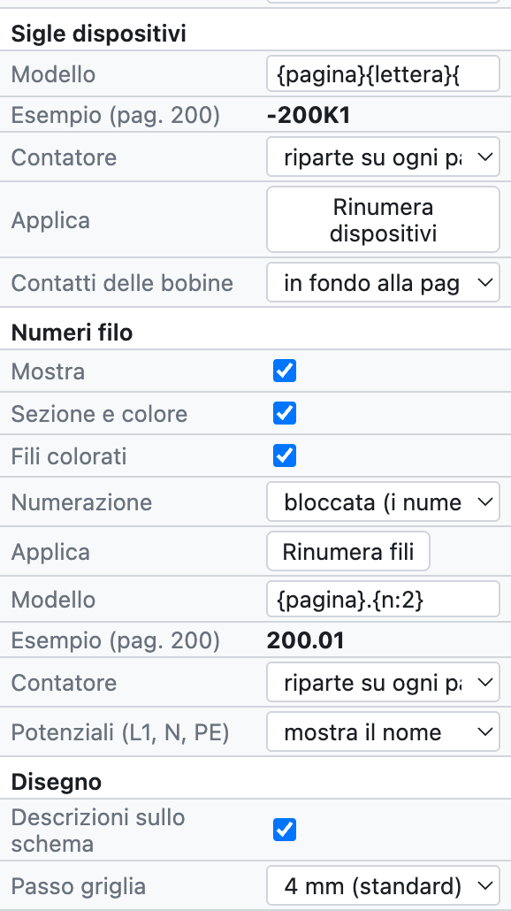
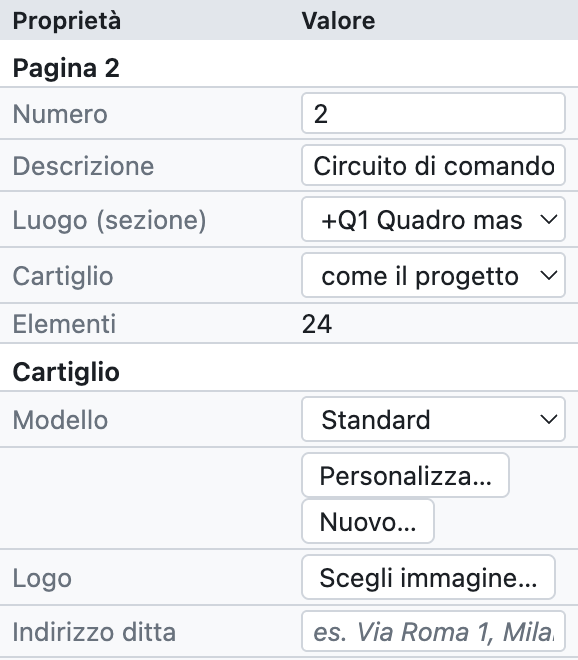
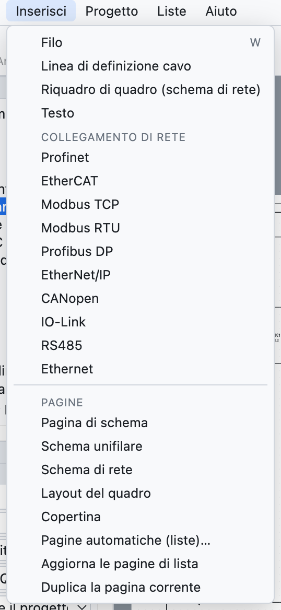
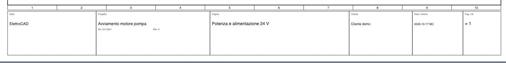
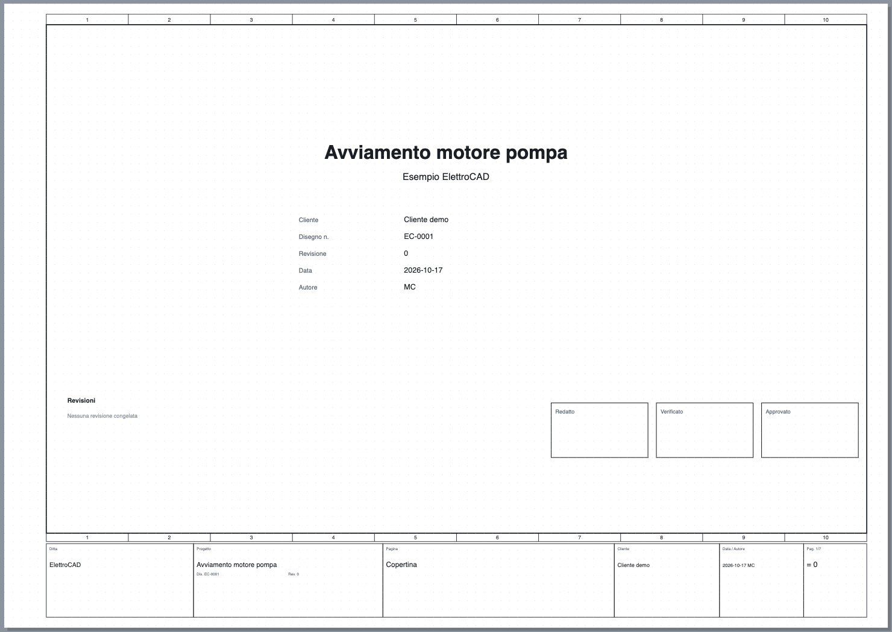

# 4. Progetto e pagine

## Proprietà del progetto

Le impostazioni del progetto si aprono con *Progetto ▸ Proprietà del progetto*, oppure cliccando sul nome
del progetto nell'albero, oppure deselezionando tutto (clic su una zona vuota): il pannello *Proprietà*
mostra la pagina corrente e, sotto, i dati del progetto.

*Il pannello delle proprietà del progetto, dall'alto in basso.*

| Gruppo | Campi | Vedi |
|---|---|---|
| *Pagina* | numero, descrizione, luogo, cartiglio della pagina | [Pagine](#pagine) |
| *Cartiglio* | modello, logo, indirizzo della ditta, campi aggiuntivi | [Cartiglio](#cartiglio) |
| *Modelli di progetto* | salva il progetto come modello | [Modelli di progetto](#modelli-di-progetto) |
| *Revisioni* | nuova revisione, confronto, nuvolette | [capitolo 15](15-verifica-ricerca-revisioni.md#revisioni) |
| *Luoghi* | quadri, pulsantiere, bordo macchina… | [capitolo 11](11-reti-luoghi-unifilare.md#luoghi) |
| *Lingue* | lingua degli schemi e seconda lingua | [capitolo 16](16-lingue.md) |
| *Reti IP* | sottoreti del piano indirizzi | [capitolo 11](11-reti-luoghi-unifilare.md#piano-indirizzi-ip) |
| *Progetto (cartiglio)* | nome, descrizione, ditta, cliente, autore, numero disegno, revisione, data | sotto |
| *Sigle dispositivi* | modello della sigla, contatore, immagine dei contatti | [capitolo 6](06-sigle-e-numerazione.md) |
| *Numeri filo* | visibilità, sezione e colore, fili colorati, numerazione, modello | [capitolo 6](06-sigle-e-numerazione.md#numeri-filo) |
| *Disegno* | descrizioni sullo schema, passo della griglia | sotto |

### Dati del cartiglio

Nome, descrizione, ditta, cliente, autore, numero di disegno, revisione e data compaiono nel cartiglio di
ogni pagina, sulla copertina e nelle proprietà del PDF. Si scrivono una volta sola.

### Disegno

- **Descrizioni sullo schema**: scrive descrizione e dati tecnici sotto la sigla dei dispositivi
  (si può cambiare per il singolo dispositivo).
- **Passo griglia**: 4 mm (consigliato), oppure 1, 2, 5 o 8 mm.

## Pagine

Il foglio è un **A3 orizzontale** (420 × 297 mm) con la cornice divisa in **10 colonne** numerate e il
cartiglio in basso. Le colonne servono per i riferimenti: `/2.4` significa pagina 2, colonna 4.

*Le proprietà della pagina 2 del progetto di esempio.*

- **Numero**: il nome della pagina, libero (`1`, `200`, `10.1`). Finisce nelle sigle (`-200K1`), nei
  numeri filo (`200.01`) e nei rimandi (`/200.4`).
- **Descrizione**: il titolo della pagina, nel cartiglio e nell'indice.
- **Luogo (sezione)**: il quadro o il luogo a cui appartiene la pagina; l'albero raggruppa le pagine per luogo.
- **Cartiglio**: il cartiglio della pagina, se diverso da quello del progetto.

### Comandi delle pagine

| Comando | Dove | Effetto |
|---|---|---|
| Nuova pagina | *+ Pagina* sotto l'albero, *Inserisci ▸ Pagina di schema* | pagina vuota dopo la corrente, con il numero successivo |
| Duplica | *⧉*, *Inserisci ▸ Duplica la pagina corrente*, tasto destro | copia con sigle e numeri filo nuovi |
| Sposta | *↑ ↓* sotto l'albero | cambia l'ordine |
| Elimina | *✕* sotto l'albero | chiede conferma; si annulla con ⌘Z |
| Cambia pagina | clic nell'albero, **PagSu/PagGiù** | |

*Il menu Inserisci: strumenti di disegno, collegamenti di rete e pagine.*

### Tipi di pagina

| Tipo | Come si crea | Contenuto |
|---|---|---|
| Schema multifilare | *+ Pagina* | lo schema elettrico vero e proprio |
| Schema unifilare | *+ Unifilare* | simboli a una linea ([capitolo 11](11-reti-luoghi-unifilare.md#schema-unifilare)) |
| Schema di rete | *+ Rete* | nodi e collegamenti bus tra i quadri ([capitolo 11](11-reti-luoghi-unifilare.md)) |
| Layout del quadro | *+ Layout* | vista di montaggio della piastra ([capitolo 12](12-layout-quadro.md)) |
| Copertina | *+ Copertina* | titolo, dati, revisioni, firme |
| Panoramica PLC | vista PLC ▸ *Pagine panoramiche* | generata dal programma ([capitolo 10](10-plc.md)) |
| Schema della morsettiera | vista Morsettiere ▸ *Genera schemi morsettiere* | generata ([capitolo 8](08-morsettiere.md)) |
| Pagina di lista | *Inserisci ▸ Pagine automatiche* | generata ([capitolo 14](14-liste-e-pagine-automatiche.md)) |

Le pagine generate si aggiornano da sole: il loro contenuto viene sempre dallo schema.

## Cartiglio

*Il cartiglio standard: ditta, progetto con numero di disegno e revisione, titolo della pagina, cliente,
data e autore, numero di pagina.*

Nel gruppo *Cartiglio* delle proprietà:

- **Modello**: *Standard*, *Con tabella revisioni* (le ultime tre revisioni), *Compatto*, i sei cartigli
  dettagliati (*ISO 7200*, *Industriale dettagliato*, *Macchina EN 60204-1*, *Impianto civile DM 37/08*,
  *Quadro EN 61439*, *Automazione con firme*, descritti nel [capitolo 13](13-macro-simboli-cartigli.md#cartigli-inclusi)),
  oppure un cartiglio personalizzato. *Personalizza…* apre il modello nell'editor, *Nuovo…* ne crea uno da zero
  (vedi [capitolo 13](13-macro-simboli-cartigli.md#cartigli-personalizzati)).
- **Logo**: un'immagine PNG, JPG o SVG.
- **Indirizzo ditta**: sotto il nome della ditta.
- **+ Campo**: campi aggiuntivi con nome e valore, per esempio *Commessa* o *Impianto*. Scegliendo un modello
  che usa campi propri (per esempio `{campo:Matricola}`) quei campi compaiono da soli nelle proprietà del progetto.

Ogni pagina può avere un cartiglio diverso dal resto del progetto (*Proprietà della pagina ▸ Cartiglio*).

## Proprietà definite dall'utente

*Progetto ▸ Proprietà definite dall'utente…* apre l'elenco delle proprietà proprie del progetto, oltre a quelle
incluse: per esempio la commessa del cliente, il numero d'ordine o un codice interno. Per ogni proprietà si indicano:

- il **nome identificativo**, con almeno un punto (per esempio `Ditta.Commessa`);
- il **nome visualizzato**;
- a cosa si assegna: **dispositivi, pagine, collegamenti, progetto o articoli**;
- il **tipo**, l'**unità di misura** e la **categoria**;
- un **elenco di scelta** (valori separati da `;`) e, se serve, *Non usare* per metterla da parte senza cancellarla.

I valori si scrivono nelle *Proprietà* degli oggetti a cui la proprietà è assegnata. Per i dispositivi compaiono
anche come colonne nella scheda *Dispositivi* e in Excel; nei cartigli si usano con il segnaposto `{prop:nome}`
([capitolo 13](13-macro-simboli-cartigli.md#segnaposto)).

L'elenco si può **esportare e importare in XML**. L'import è tollerante: accetta nomi in inglese, tedesco o
italiano e testi in più lingue; le proprietà con un nome identificativo non valido vengono scartate e il
programma dice quante.

## Copertina

*+ Copertina* aggiunge in testa al progetto la pagina **0** con logo, titolo, descrizione, dati del
progetto, tabella delle revisioni e caselle *Redatto*, *Verificato*, *Approvato*. Si aggiorna da sola
con i dati del progetto.

*La copertina del progetto di esempio.*

## Modelli di progetto

Un modello conserva impostazioni, cartiglio, logo, luoghi e copertina, senza gli schemi.

1. Prepara un progetto con le impostazioni della tua ditta.
2. *Progetto ▸ Salva come modello…* e dai un nome, per esempio `Standard officina`.
3. Da quel momento *File* mostra *Nuovo dal modello «Standard officina»*.

I modelli restano sul computer, disponibili per tutti i progetti.
