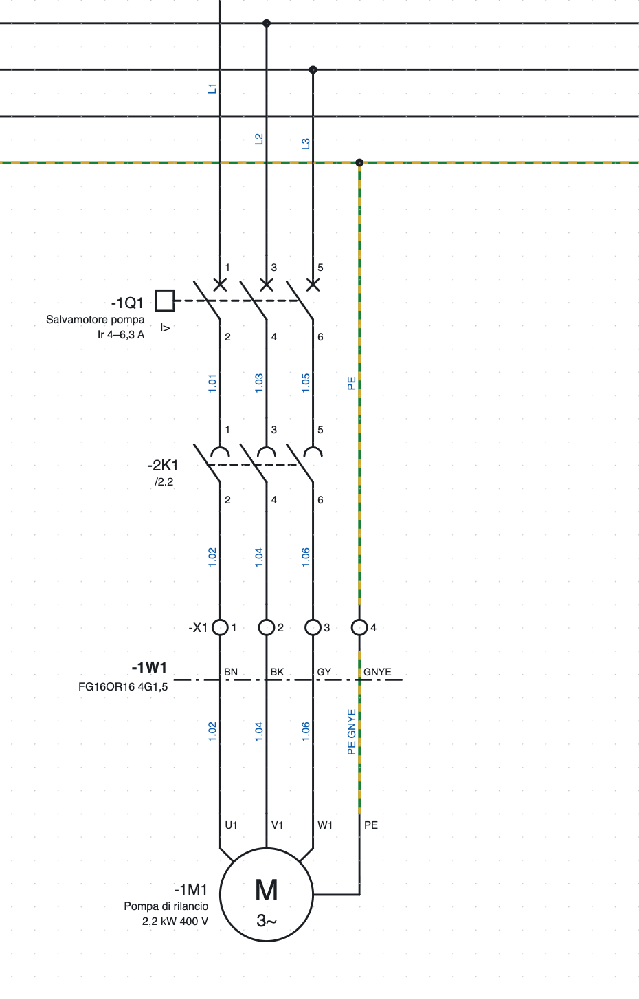
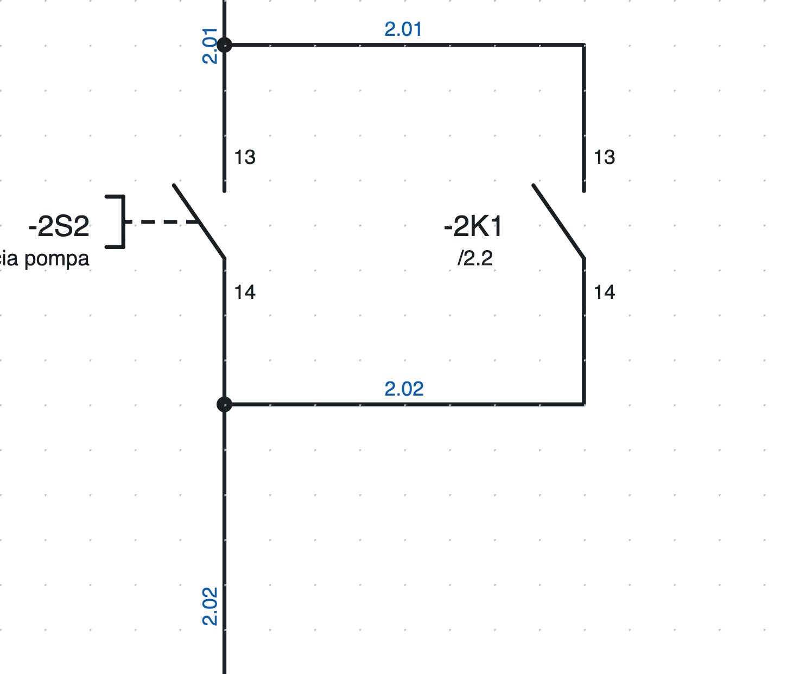
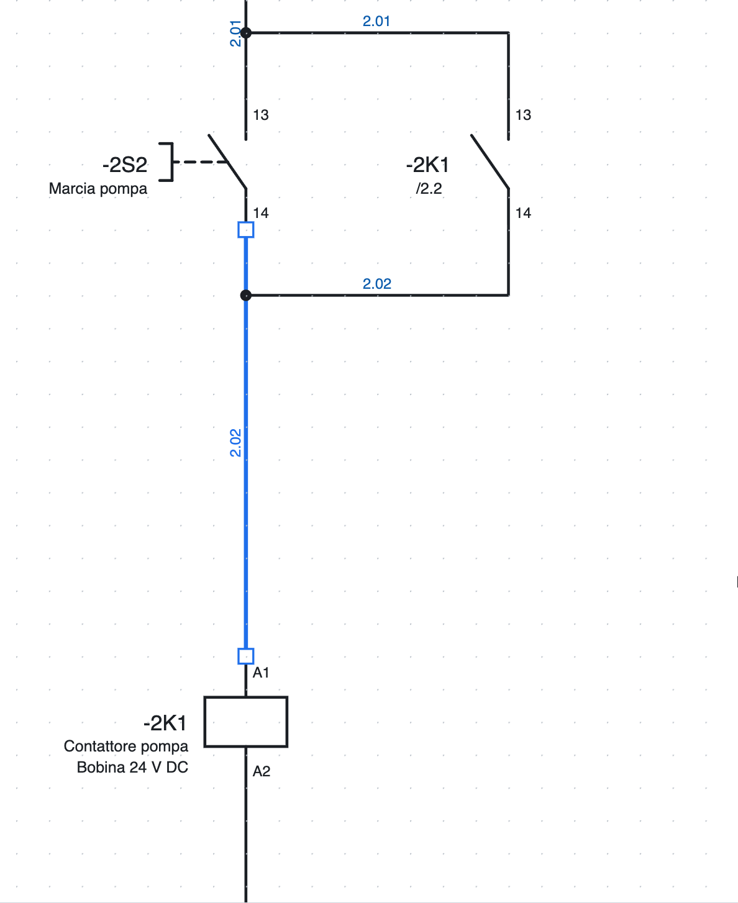
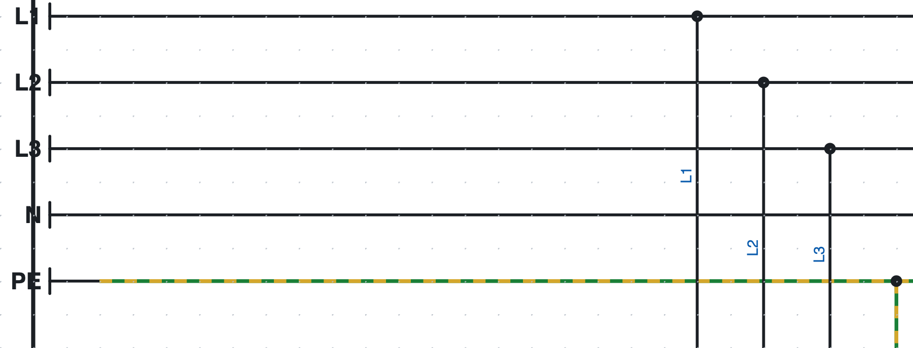
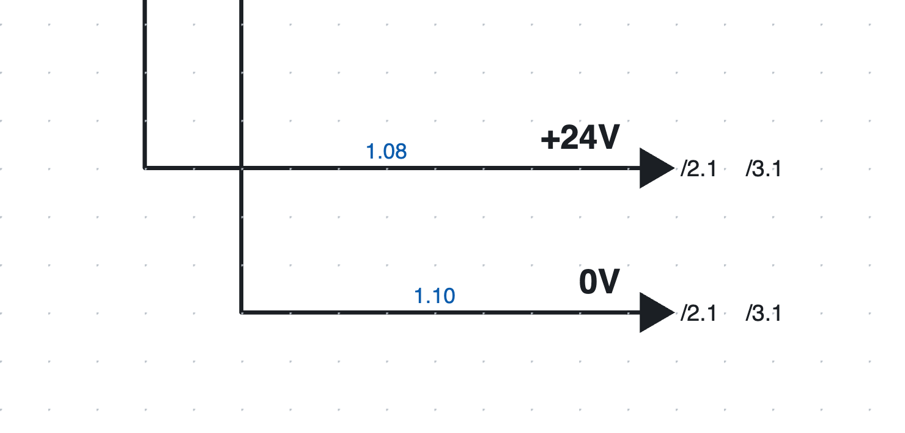

# 5. Disegnare lo schema

## Inserire i simboli

1. Nella libreria a destra (scheda *Simboli*) clicca su un simbolo. Il campo *Cerca…* filtra per nome
   («contatto», «motore»…).
2. Clicca nella pagina: il simbolo si inserisce agganciato alla griglia e **resta attivo**, così puoi
   inserirne altri uguali.
3. **R** ruota di 90° il simbolo prima di inserirlo.
4. **Esc** o tasto destro terminano l'inserimento.

Ogni simbolo nuovo prende una **sigla** libera secondo il modello del progetto (per esempio `-2K3`, vedi
[capitolo 6](06-sigle-e-numerazione.md)). Per un **contatto ausiliario** appena inserito si apre un elenco dei dispositivi a cui abbinarlo: bobine e apparecchi
del progetto, prima quelli con la stessa lettera, ognuno con descrizione, posizione e numero di contatti.
L'elenco si filtra mentre scrivi; puoi anche scrivere una sigla nuova. Il programma ripropone l'ultimo scelto.

### I simboli inclusi

| Categoria | Simboli |
|---|---|
| Bobine e contatti | bobina relè/contattore, bobina temporizzata, contatto NA, contatto NC, contatto in scambio, contatti di potenza 3P |
| Comandi | pulsante NA, pulsante NC, pulsante di emergenza a fungo, selettore, finecorsa, sensore di prossimità PNP a 3 fili |
| Protezioni | fusibile, magnetotermico 1P, 2P e 3P, salvamotore 3P, relè termico 3P |
| Utilizzatori | motore trifase e monofase, lampada di segnalazione, elettrovalvola, alimentatore 230 V AC / 24 V DC, trasformatore |
| Morsetti e collegamenti | morsetto, morsetto PE, sezionabile, portafusibile, pin di presa, di spina e coppia presa+spina, punto di potenziale, terra PE, rimando di partenza e di arrivo |
| PLC | ingresso e uscita digitale, ingresso e uscita analogica, alimentazione della scheda L+/M |
| Reti e bus | nodo a 2 porte (IN/OUT o P1/P2), nodo a 1 porta, switch a 5 porte, terminazione |
| Unifilare | interruttore, salvamotore, sezionatore, fusibile, contattore, motore, trasformatore, inverter, alimentatore, utenza |

Altri simboli si disegnano con l'editor o si importano da QElectroTech e dagli EDZ dei produttori
([capitolo 13](13-macro-simboli-cartigli.md) e [capitolo 7](07-dispositivi-e-articoli.md)).

*La partenza motore della pagina 1: salvamotore `-1Q1`, contatti di potenza del contattore `-2K1`,
morsettiera `-X1`, cavo `-1W1` e motore `-1M1`.*

## Disegnare i fili

1. Premi **W** o *Filo*.
2. Clicca sul punto di partenza: un punto di connessione, un filo esistente o un punto libero.
3. Clicca per ogni angolo. Il tratto è sempre orizzontale o verticale; prima del clic l'anteprima mostra
   il percorso a L.
4. Il filo **termina da solo** quando clicchi su un punto di connessione o su un altro filo. Altrimenti
   chiudilo con doppio clic, Invio o tasto destro.
5. **Esc** annulla il filo in corso.

I punti di connessione liberi sono evidenziati in verde durante il disegno. Arrivando su un filo un po' di
lato, il tratto prosegue dritto fino al filo.

### Giunzioni e incroci

*Le giunzioni dell'autoritenuta nella pagina 2: il pallino indica il collegamento.*

- Un filo che termina su un altro filo forma una **giunzione a T**, disegnata con il pallino.
- Due fili che si **incrociano** senza pallino non sono collegati.
- Il pallino non si disegna a mano: lo mette il programma dove i fili sono collegati davvero.

### Modificare i fili

*Un filo selezionato mostra i vertici come quadratini.*

- **Trascina un tratto** per spostarlo parallelamente: gli estremi restano collegati.
- **Trascina un vertice o un estremo** per allungare, accorciare o ricollegare il filo.
- Il cursore cambia forma per indicare cosa stai trascinando.
- Per eliminare un filo selezionalo e premi **Canc**.

### Spostare i simboli con i fili

Trascinando un simbolo, i fili collegati lo seguono già durante lo spostamento e restano ortogonali,
piegandosi a Z se serve. Un filo tra due simboli spostati insieme si sposta tutto.

### Inserire un contatto su un filo

Se inserisci (o sposti) un contatto, un pulsante o un altro componente **sopra un filo**, il filo si
interrompe sui suoi due punti di connessione: non serve tagliarlo a mano. I due tratti mantengono colore e
sezione.

## Punti di potenziale

*Le barre L1, L2, L3, N e PE della pagina 1.*

Il **punto di potenziale** dà un nome a un conduttore: `L1`, `L2`, `L3`, `N`, `PE`, `+24V`, `0V`…

- Tutti i conduttori con lo stesso nome sono **collegati**, anche su pagine diverse.
- Il nome si scrive nelle proprietà (*Nome*); un punto nuovo si chiama `L1`, la terra **PE** si chiama `PE`.
- I conduttori di un potenziale possono mostrare il nome al posto del numero filo
  (*Proprietà del progetto ▸ Numeri filo ▸ Potenziali*).
- La verifica segnala due potenziali diversi sullo stesso conduttore (per esempio `L1` collegato a `N`).

## Rimandi tra pagine

*I rimandi `+24V` e `0V` della pagina 1: il nome sopra il filo, le pagine di arrivo accanto alla freccia.*

Quando un conduttore continua su un'altra pagina si usa una coppia di **rimandi**. Ogni partenza è
collegata a **un solo** arrivo, anche se il nome si ripete (per esempio è il numero del filo):

1. Alla fine del filo inserisci un **Rimando (partenza)**. Il nome è il numero del filo, se c'è, altrimenti
   `R1`, `R2`… e si cambia in *Proprietà*.
2. Sull'altra pagina, all'inizio del filo, inserisci un **Rimando (arrivo)**: compare l'elenco delle
   partenze ancora libere, prima quelle con lo stesso nome. Scegline una: l'arrivo prende il suo nome e i
   due restano collegati. La prima voce (*nessuna partenza*) lascia l'arrivo libero, quando la partenza non
   è ancora disegnata. Lo stesso vale al contrario: inserendo una partenza si sceglie tra gli arrivi liberi.
   L'elenco si **filtra mentre scrivi**: ogni voce mostra nome, posizione e pagina del rimando.
3. Nel campo *Nome* delle *Proprietà* i suggerimenti sono i rimandi liberi e gli altri nomi di rimando; scegliendo
   un rimando libero i due si collegano. Il collegamento si cambia in *Proprietà ▸ Collegato a*. Cambiando il nome di un rimando cambia anche
   quello del corrispondente.
4. Accanto a ogni freccia compare la pagina dove il conduttore continua (`/2.1`). Un clic porta alla pagina.
   Sui fili verticali nome e pagina sono scritti in verticale, dal basso verso l'alto.

### Rimandi in attesa, senza corrispondente e a stella

Quando inserisci un rimando, il programma prende il nome dal numero del filo e cerca i rimandi liberi:

- se c'è **un solo** rimando libero con lo stesso nome, i due si collegano subito (un messaggio nella vista
  report lo dice);
- se ce ne sono più di uno compare l'elenco con il primo già scelto: *Invio* lo conferma;
- se non ce n'è nessuno il rimando resta **in attesa**: accanto alla freccia compare `/…` in arancione,
  finché non disegni il corrispondente.

In *Proprietà ▸ Collegato a* si sceglie il corrispondente, si rimette il rimando *— in attesa del
corrispondente (/…)* oppure si sceglie *— nessun corrispondente (il conduttore finisce qui)* quando il
conduttore finisce davvero lì: in quel caso accanto alla freccia compare `//` e la verifica non lo segnala
più come errore, solo come informazione.

Nella barra di stato **Rimandi in attesa: N** conta i rimandi ancora da abbinare; ogni clic porta al
prossimo. La verifica li elenca come avvisi.

**Partenza a stella.** Una partenza con *Proprietà ▸ A stella* si collega a **tutti** gli arrivi liberi
con lo stesso nome (per esempio un `+24V` che va su molte pagine) e mostra l'elenco delle loro pagine. La
verifica propone la stella (con il pulsante 🔧) quando una partenza è già collegata e ci sono altri arrivi
con il suo nome.

## Bus di conduttori

Quando molti fili corrono affiancati (per esempio le tre fasi e il neutro che alimentano più utenze) si
possono raggruppare in un **bus di conduttori**, senza disegnare tutte le linee fino in fondo.

1. Scegli lo strumento **Bus fili** nella barra strumenti (o *Inserisci ▸ Bus di conduttori*) e traccia la
   linea del bus: è una linea spessa. Nelle *Proprietà* dai al bus un **nome** (facoltativo, per esempio
   `400V AC` o `24V DC`).
2. Disegna i fili che arrivano al bus e le derivazioni che ne escono, in modo che tocchino la linea.
3. Su ogni filo che tocca il bus compare il **nome del conduttore** (`L1`, `L2`, `PE`…), scritto accanto al filo.
   Si sceglie da un elenco che si filtra mentre scrivi.

Le regole sono semplici:

- fili con lo **stesso conduttore sullo stesso bus** sono lo stesso filo e hanno lo stesso numero filo;
- bus che si toccano, o bus con lo stesso nome su più pagine, sono **un solo bus**: i conduttori proseguono;
- la verifica ([capitolo 15](15-verifica-ricerca-revisioni.md)) segnala i fili che toccano il bus senza il nome del
  conduttore e i conduttori che entrano nel bus senza uscire da nessuna parte.

Nel formato testo ([capitolo 17](17-assistente-ia.md)) la linea del bus è un filo con `busfili=nome` (`busfili=_`
se senza nome) e il conduttore ai due estremi di un filo si scrive con `cond1=` e `cond2=`.

### Bus fili usato come cavo

Un cavo che passa da un quadro all'altro si può disegnare come bus fili: i fili entrano nel bus sulla
pagina di partenza ed escono da un bus con lo stesso nome sulla pagina di arrivo.

1. Dai al bus **la sigla del cavo** (`W1112S1`). Se il cavo non è ancora nel progetto, dopo il nome si
   sceglie l'**articolo del cavo** (anche dopo, in *Proprietà ▸ Articolo del cavo*).
2. Per ogni filo il programma propone i **conduttori del cavo in ordine** (colori o numeri): quelli già
   usati sono attenuati, quelli entrati altrove che aspettano l'uscita sono evidenziati e proposti per
   primi, gli altri sono liberi.
3. Con **Nomina i conduttori in ordine** (*Proprietà* del bus) i fili della pagina ricevono il conduttore
   da sinistra a destra: in partenza i primi liberi, in arrivo quelli che aspettano l'uscita.
4. Disegna la linea del cavo sui singoli fili, su tutte e due le pagine: nella scheda *Cavi* ogni filo
   prende il conduttore scritto nel bus. La linea spessa del bus non conta come conduttore.

Con un **doppio clic sul bus** si apre la finestra delle sue proprietà: i conduttori del cavo con il loro
stato (usati attenuati, in attesa dell'uscita con ⚠, liberi con la barra verde) e la tabella dei fili del
bus, dove il conduttore di ogni filo si corregge scrivendolo o scegliendolo dall'elenco.

La vista **Bus fili** (*Visualizza ▸ Bus fili*, o *Liste ▸ Bus fili*) mostra tutti i bus e, per quello
scelto, ogni filo che entra o esce con pagina, numero filo e collegamenti; il conduttore si corregge
direttamente nella tabella. Sono segnati i fili senza conduttore, quelli che entrano senza uscire e i
conduttori che il cavo non ha. La lista stampabile **Collegamenti bus fili** ha un conduttore per riga
(come *Collegamenti cavi*), con i conduttori liberi del cavo.

## Testi

*Testo* (o *Inserisci ▸ Testo*) e un clic sulla pagina inseriscono un testo libero. In *Proprietà* si
modificano il testo e l'altezza in mm. I testi entrano nel dizionario delle traduzioni
([capitolo 16](16-lingue.md)).

## Immagini

Foto, logo o disegni si inseriscono nello schema come immagini.

- *Inserisci ▸ Immagine…* e scegli un file PNG, JPG, SVG, GIF, WebP o BMP; oppure **incolla** un'immagine
  dagli appunti con ⌘V (Ctrl+V).
- L'immagine si **sposta** trascinandola e si **ridimensiona** trascinando l'angolo in basso a destra: le
  proporzioni restano fisse, con **Maiusc** premuto sono libere.
- Nelle *Proprietà* si cambiano posizione e misure, si rimettono le proporzioni originali, si accende la
  cornice, si sceglie se l'immagine sta **sotto** o **sopra** lo schema e si sostituisce con *Sostituisci immagine…*.
- Le immagini escono nel **PDF**. Nel DXF resta solo un riquadro con il nome dell'immagine.
- Le immagini molto grandi vengono rimpicciolite (a 1600 punti sul lato lungo) per tenere leggero il file.

## Selezionare, copiare, spostare

| Azione | Come |
|---|---|
| Selezionare | clic sull'elemento |
| Aggiungere o togliere dalla selezione | **Shift** + clic |
| Selezione a riquadro | trascina su una zona vuota: **da sinistra a destra** prende gli elementi contenuti, **da destra a sinistra** anche quelli toccati |
| Selezionare tutto | ⌘A |
| Spostare | trascina, oppure frecce (4 mm; con Shift 16 mm) |
| Ruotare, specchiare | **R**, *Modifica ▸ Specchia* |
| Duplicare | ⌘D |
| Copiare, tagliare, incollare | ⌘C, ⌘X, ⌘V; *Incolla qui* dal tasto destro incolla nel punto cliccato |
| Eliminare | **Canc** o Backspace |

Le copie ricevono **sigle e numeri filo nuovi**; bobina e contatti copiati insieme restano collegati tra loro.
Si può incollare anche in un altro progetto: simboli e articoli usati vengono copiati con gli elementi.

Un circuito che si usa spesso si salva come **macro** ([capitolo 13](13-macro-simboli-cartigli.md#macro)).

## Testi dei simboli sempre leggibili

Ruotando o specchiando un simbolo, i suoi testi interni (per esempio «M 3~» del motore) non vengono mai
capovolti né scritti al contrario: si leggono sempre da sotto o da destra, come chiede la norma. Vale a
schermo, nel PDF e nel DXF.
