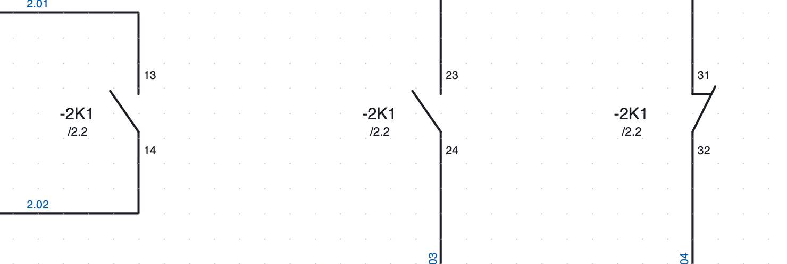
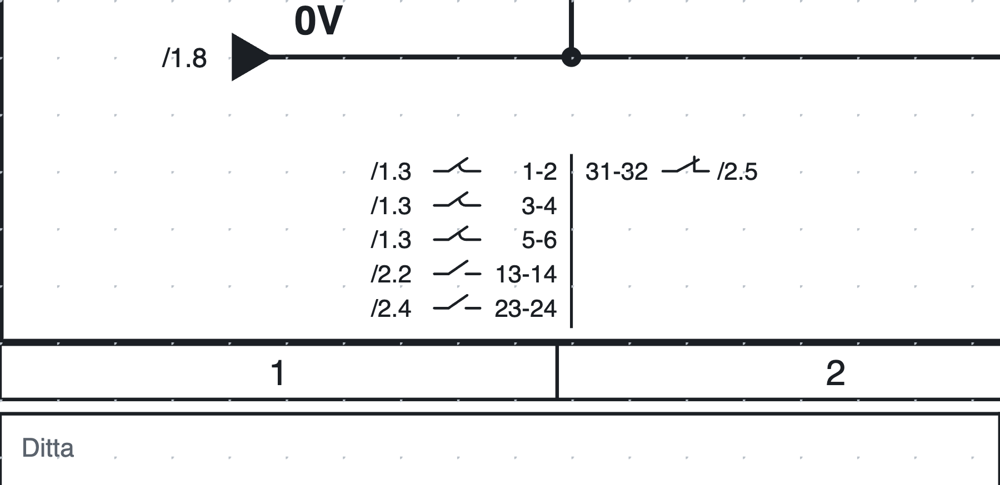
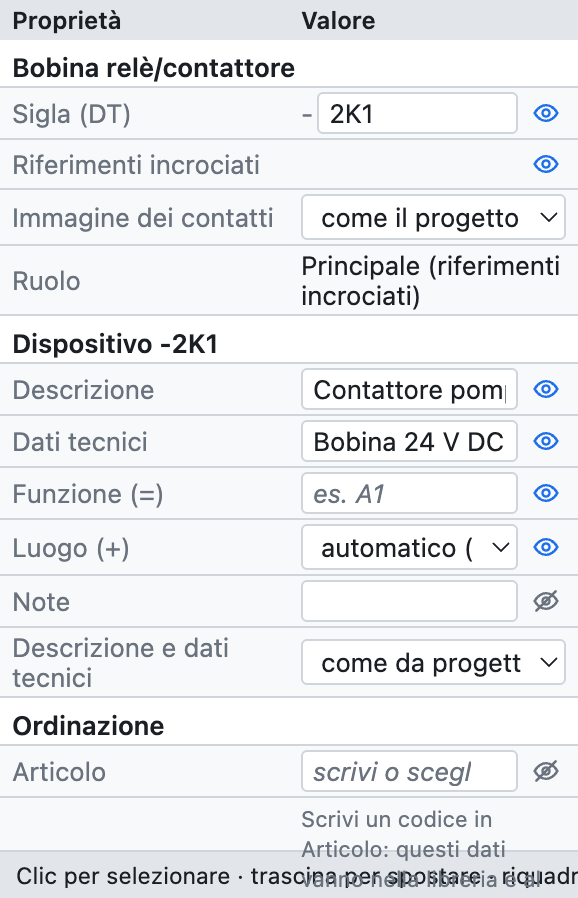
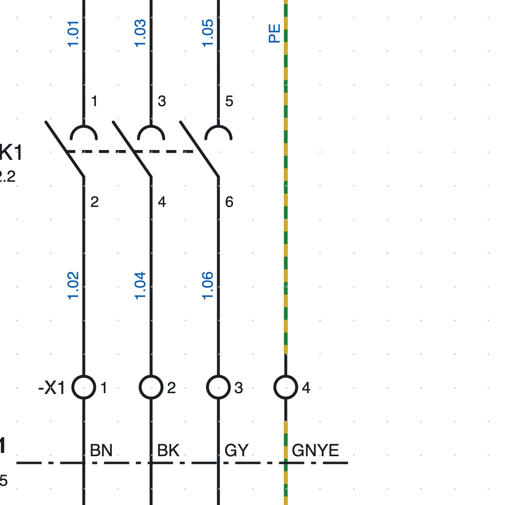
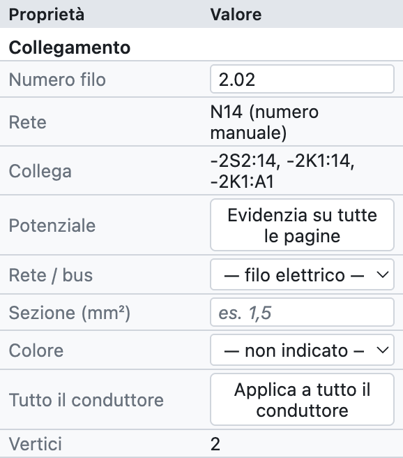
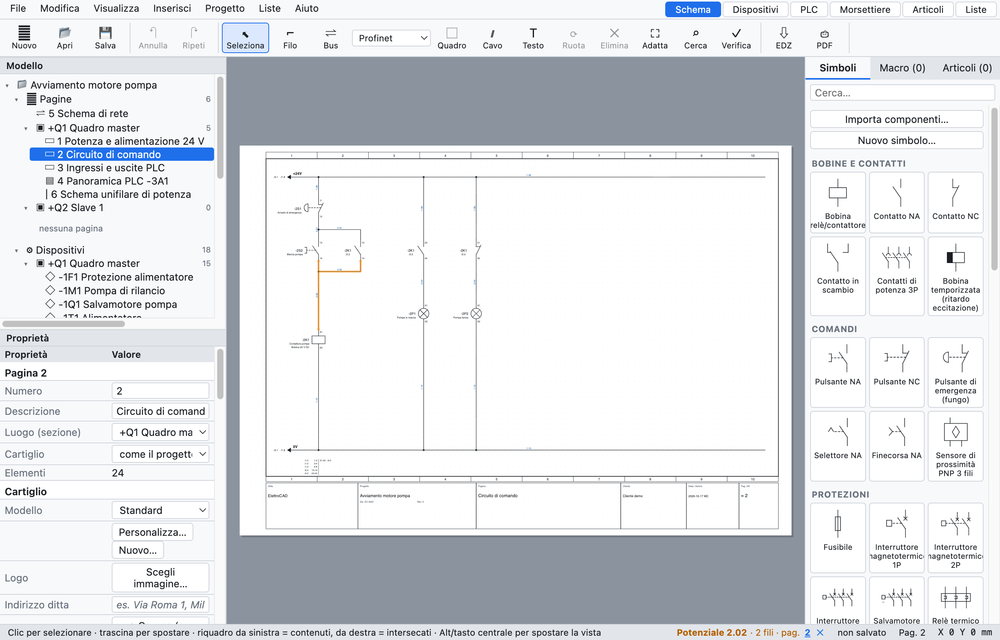

# 6. Sigle, riferimenti incrociati e numeri filo

## Sigle dei dispositivi

Ogni dispositivo ha una **sigla** secondo IEC 81346: un trattino, il numero della pagina, la **lettera**
del tipo di dispositivo e un numero progressivo. `-2K1` è il primo contattore della pagina 2.

| Lettera | Dispositivi |
|---|---|
| K | relè, contattori, bobine temporizzate |
| Q | magnetotermici tripolari, salvamotori, sezionatori |
| F | fusibili, magnetotermici 1P e 2P, relè termici |
| S | pulsanti, pulsanti di emergenza, selettori |
| B | sensori, finecorsa |
| P | lampade di segnalazione |
| M | motori, elettrovalvole |
| T | trasformatori, alimentatori |
| A | PLC, schede, nodi di rete, apparecchi complessi |
| U | inverter |
| E | utenze generiche (unifilare) |
| X | morsettiere e connettori |
| W | cavi |

La lettera dipende dal simbolo; la sigla si può sempre cambiare a mano nelle proprietà.

### Il modello della sigla

In *Proprietà del progetto ▸ Sigle dispositivi* si sceglie come si compone la sigla:

| Segnaposto | Significato | Esempio |
|---|---|---|
| `{pagina}` | numero della pagina | `200` |
| `{colonna}` | colonna (1–10) del dispositivo | `4` |
| `{lettera}` | lettera IEC 81346 | `K` |
| `{n}` | numero progressivo | `1` |
| `{n:2}` | numero progressivo a due cifre | `01` |

| Modello | Risultato a pagina 200 |
|---|---|
| `{pagina}{lettera}{n}` (predefinito) | `-200K1` |
| `{lettera}{n}` | `-K1` |
| `{pagina}{lettera}{n:2}` | `-200K01` |
| `{pagina}.{colonna}{lettera}` | `-200.4K` |

- **Contatore**: riparte su ogni pagina oppure è unico in tutto il progetto.
- **Sigle stabili**: un dispositivo nuovo prende il numero dopo il più alto della pagina (`-2K3` dopo
  `-2K2`) e gli altri non cambiano.
- **Rinumera dispositivi** (*Progetto ▸ Rinumera dispositivi…*) rinumera tutto in ordine di pagina,
  colonna e riga. I contatti seguono la loro bobina; i morsetti hanno la loro numerazione.

### Sigla completa: funzione e luogo

Con la **funzione** (`=`, l'impianto o la parte di macchina) e il **luogo** (`+`, il quadro o la
pulsantiera) compilati, la sigla diventa completa: `=A1+Q1-2K1`. Si compilano nelle proprietà del
dispositivo o, per molti dispositivi insieme, nel navigatore ([capitolo 7](07-dispositivi-e-articoli.md)).

## Bobine e contatti

Il **dispositivo principale** (la bobina di un relè o di un contattore) e i suoi **contatti** hanno la
stessa sigla. Il programma li collega da solo:

1. Inserisci la bobina: prende per esempio `-2K1`.
2. Inserisci i contatti: una finestra chiede *di quale dispositivo?* ed elenca le bobine e gli apparecchi del
   progetto, prima quelli con la stessa lettera. Scegli dall'elenco o scrivi una sigla nuova; dal contatto
   successivo la finestra propone l'ultima bobina scelta.
3. Per assegnare un contatto a un'altra bobina, scrivi la sigla nelle proprietà del contatto:
   l'elenco propone le sigle esistenti con la stessa lettera.

### Numerazione dei contatti (EN 50005)

I contatti ausiliari si numerano da soli con la cifra d'ordine e la cifra di funzione: il primo NA è
`13-14`, il secondo `23-24`, il primo NC `31-32` e così via. Si può disattivare per il singolo contatto e
scrivere i morsetti a mano (*Proprietà ▸ Punti di connessione*). I contatti di potenza sono `1-2`, `3-4`, `5-6`.

### Riferimenti incrociati

*Sotto ogni contatto `-2K1` c'è `/2.2`: la bobina è a pagina 2, colonna 2.*

*L'immagine dei contatti di `-2K1` in fondo alla pagina 2: ogni contatto è il suo simbolo in orizzontale,
con i morsetti sopra le linee e la posizione a sinistra.*

- Sotto ogni **contatto** compare la posizione della bobina (`/2.2`).
- Sotto la **bobina** compare l'**immagine dei contatti**: tutti i suoi contatti con i morsetti e la
  posizione. Sta **in fondo alla pagina**, sotto la barra inferiore, sulla verticale della
  bobina; in alternativa sotto il simbolo (*Proprietà del progetto ▸ Sigle dispositivi ▸ Contatti delle bobine*).
- Ogni contatto è disegnato con il **suo simbolo** ruotato in orizzontale: NA, NC, in scambio (con i due
  morsetti di uscita, es. `12` sopra e `14` sotto) e i poli di potenza uno per riga con il semicerchio.
  I morsetti stanno sopra le linee (il `2` a sinistra, l'`1` a destra), la posizione `/pagina.colonna` a
  sinistra e la linea tratteggiata del comando passa per tutte le lame.
- Se il dispositivo ha un **articolo** con le funzioni, i contatti di **riserva** (non ancora usati nello
  schema, es. il quarto polo `7-8`) sono disegnati anche loro, senza posizione.
- *Sigle dispositivi ▸ Disegno dei contatti ▸ testo compatto* torna all'elenco di testo con il disegnino.
- Ogni riferimento è **cliccabile**: porta alla pagina e seleziona l'elemento. Nel PDF diventa un
  collegamento.
- Il tasto destro su una bobina offre *Vai al contatto…*, su un contatto *Vai all'elemento principale*.

La verifica segnala i contatti senza bobina e i contatti in numero maggiore di quelli dell'articolo
(per esempio un quinto contatto su un contattore con 4 ausiliari).

### Riferimenti a coppie

Un contatto si può **mostrare anche in un'altra pagina** senza duplicarlo, per esempio un contatto ausiliario
dell'interruttore nella pagina della panoramica: tasto destro sul contatto ▸ *Disegna una rappresentazione
(riferimento a coppie)…* e poi un clic dove va disegnato.

Si può partire anche dall'**elemento principale**: tasto destro sulla bobina o sul salvamotore ▸ *Disegna
una rappresentazione di un contatto…* (o *Rappresentazione…* nella scheda *Simbolo*) mostra l'elenco dei
suoi contatti già piazzati nello schema, prima gli ausiliari: scegli quello da disegnare e fai clic dove va.

- La rappresentazione è **solo disegno**: non conta come contatto, non si collega ai fili e non entra nelle
  liste né nella distinta. Sigla e morsetti seguono sempre il contatto vero.
- Il contatto vero e la rappresentazione si rimandano a vicenda con i riferimenti incrociati, in tutte e
  due le direzioni.
- In *Proprietà ▸ Rappresentazione di* c'è il contatto vero (un clic ci porta); *Rendi contatto vero* la
  trasforma in un contatto con i suoi collegamenti.
- Il disegno è **ridotto**: il simbolo vero del contatto più piccolo, senza sigla (sta già accanto
  all'elemento principale), con i morsetti e la posizione del contatto vero scritta sotto, girata come il
  simbolo. È verticale come il contatto; con **R** (prima del clic o dopo) diventa orizzontale e la
  posizione va a sinistra. Altezza e colore dei testi sono quelli dei *Riferimenti incrociati* (Aspetto ▸
  Testi); *Proprietà ▸ Altezza dei testi* cambia anche la grandezza del disegno. *Proprietà ▸ Disegno ▸
  simbolo intero con la sigla* torna al simbolo completo.
- Disegnata accanto all'apparecchio, all'altezza del suo simbolo, la **linea tratteggiata del comando**
  prosegue dall'apparecchio fino alla rappresentazione.
- Un contatto si rappresenta **in un modo solo**: con la rappresentazione accanto all'apparecchio non
  compare più nell'immagine dei contatti in fondo alla pagina, e una rappresentazione nuova dello stesso
  contatto prende il posto della vecchia.
- Il posto si sceglie in *Proprietà ▸ Rappresentazione del contatto*, sul contatto o sulla sua
  rappresentazione: **in fondo alla pagina** (di serie, nell'immagine dei contatti), **a fianco del simbolo
  principale** (accanto all'apparecchio sulla linea del comando, una dopo l'altra, e segue l'apparecchio
  quando si sposta), **libera verticale** o **libera orizzontale** (si trascina dove si vuole).
- Se il contatto vero viene eliminato, la verifica segnala la rappresentazione rimasta sola e propone di
  cancellarla.

## Proprietà di un dispositivo

*Le proprietà della bobina `-2K1` del progetto di esempio.*

| Gruppo | Campi |
|---|---|
| *(nome del simbolo)* | sigla, ruolo (principale, contatto, dispositivo, morsetto…) |
| *Dispositivo* | descrizione, dati tecnici, funzione (=), luogo (+), note, testi sullo schema |
| *Ordinazione* | articolo, costruttore, tipo, codice di ordinazione |
| *Punti di connessione* | il nome di ogni morsetto (A1, A2, 13, 14…) |
| *Posizione* | X e Y in mm, rotazione, specchiato |
| *Numero filo* | se il numero filo passa attraverso l'elemento |

I dati del gruppo *Dispositivo* e *Ordinazione* valgono per **tutto il dispositivo**: scritti sulla bobina,
valgono anche per i contatti. Se è assegnato un articolo, i campi vuoti mostrano in grigio i suoi dati.

## Numeri filo

*Numeri filo della pagina 1: `1.01`, `1.03`… sopra il contattore, gli stessi numeri sotto, perché i
morsetti `-X1` non cambiano il numero.*

Ogni **conduttore** (tutti i fili collegati tra loro fino ai punti di connessione dei componenti) ha un
numero, scritto su ogni suo tratto. Il modello predefinito è `{pagina}.{n:2}`: `200.01`, `200.02`…

### Numerazione bloccata o ricalcolata

In *Proprietà del progetto ▸ Numeri filo ▸ Numerazione*:

- **bloccata** (predefinita): un conduttore numerato mantiene il suo numero; un conduttore nuovo prende
  il primo numero libero della pagina, anche se lo disegni a metà; collegando due conduttori numerati resta
  un numero solo, dividendone uno la parte nuova riceve un numero nuovo. *Rinumera fili* ricalcola tutto
  in ordine di colonna.
- **ricalcolata**: i numeri si ricalcolano a ogni modifica, sempre in ordine.

### Numero manuale

Seleziona un filo e scrivi il numero in *Proprietà ▸ Numero filo*: vale per tutto il conduttore.
Cancellandolo si torna al numero automatico.

### Dove viene scritto

Il numero si scrive in un **punto libero** del filo: se a metà del tratto c'è un incrocio, un componente,
una sigla o un altro numero, si sposta lungo il filo o sull'altro lato. Vale a schermo, nel PDF e nel DXF.
*Mostra* (proprietà del progetto) lo nasconde del tutto.

### Spostare o ripetere il numero

Il numero si **trascina** dove si vuole, anche lontano dal filo: da quel momento resta in quella posizione
e segue il filo quando lo sposti. Con il tasto destro sul filo:

- **Aggiungi il numero filo qui**: un altro numero sullo stesso filo, accanto al tratto cliccato;
- **Togli questo numero filo** (cliccando su un numero, quando ce n'è più di uno);
- **Numero filo in posizione automatica**: torna al punto scelto dal programma.

### Il numero attraversa i morsetti

Un morsetto è solo un punto di passaggio: i fili ai suoi due lati hanno **lo stesso numero**. Ogni elemento
con due o più punti di connessione ha in *Proprietà ▸ Numero filo* la casella **Il numero filo passa**:

- spuntata di serie sui morsetti, tolta sugli altri componenti;
- si può cambiare sul singolo elemento, per esempio per far passare il numero attraverso un sezionatore.

I due lati restano conduttori distinti per la lista morsetti e la lista connessioni.

### Contatore avanzato

In *Proprietà del progetto ▸ Numeri filo*:

- **Modello**: oltre a `{pagina}`, `{colonna}` e `{n}` si possono usare `{quadro}` (codice del quadro della
  pagina), `{n:2}` (almeno 2 cifre: `01`) e `{n:A}` o `{n:a}` (contatore in lettere: `A`, `B`… `Z`, `AA`).
  Esempio: `{quadro}.{n:A}` dà `Q1.A`, `Q1.B`… Anche le sigle dei dispositivi accettano `{quadro}`.
- **Contatore**: *riparte su ogni pagina*, *riparte su ogni quadro* oppure *unico nel progetto*.
- **Riserva per pagina**: numeri lasciati liberi dopo ogni pagina. Con 3 di riserva la pagina 1 usa 1 e
  2, la pagina 2 parte da 6: un filo aggiunto poi alla pagina 1 prende il 3 e le pagine seguenti non
  cambiano numero. Quando la riserva finisce, il contatore salta i numeri già usati dalle pagine seguenti.
- **Ordine sulla pagina**: *per colonne (da sinistra a destra)* oppure *per righe (dall'alto in basso)*.

I numeri scritti a mano, quelli dei rimandi e i nomi dei canali PLC sono fissi: il contatore li salta anche
quando sono scritti su un'altra pagina.

## Sezione e colore dei fili

*Le proprietà di un filo: numero, rete, collegamenti, potenziale, sezione e colore.*

- **Sezione** in mm² (`1,5`, `2,5`, `6`…) e **colore** con le sigle IEC 60757: `BK` nero, `BN` marrone,
  `GY` grigio, `BU` blu, `DBU` blu scuro, `RD` rosso, `WH` bianco, `GNYE` giallo-verde…
- Il **colore** scelto su un tratto vale per tutto il conduttore, anche dopo un rimando o un morsetto.
- Con *Fili colorati* (proprietà del progetto) il filo è disegnato nel suo colore; il PE è giallo-verde tratteggiato.
- La sezione può cambiare lungo il conduttore (partenza da 6 mm², derivazione da 1,5 mm²);
  *Applica a tutto il conduttore* copia sezione e colore su tutti i tratti.
- Con *Sezione e colore* acceso, sono scritti su una **lineetta obliqua** che attraversa il filo, con il
  testo accanto (`BU 1,5`): sui fili verticali a destra, dal basso verso l'alto, sugli orizzontali sotto il
  filo. Il numero filo resta da solo dall'altra parte.
- La lineetta si **trascina** lungo il filo dove si vuole e segue il filo quando si sposta; tasto destro ▸
  *Lineetta della sezione in posizione automatica* la rimette al suo posto. L'altezza e il colore del testo
  sono in *Aspetto ▸ Testi ▸ Sezione e colore dei fili*.
- Per allineare più lineette: **Maiusc+N** (o *Allinea sez.*), poi due clic per tracciare una linea attraverso
  i fili; le loro lineette vanno dove la linea li attraversa. Come **N** per i numeri filo.
- *Numeri filo ▸ Sezione e colore scritti ▸ accanto al numero filo* torna alla scritta attaccata al numero
  (`200.01  1,5 mm² BU`).

### Conduttori di scorta

Un conduttore del cavo portato a **morsetti di riserva** (per esempio tra due quadri) si disegna come
gli altri e poi si segna *Proprietà del filo ▸ Di scorta*. Vale per tutto il conduttore:

- non prende il **numero filo**: sullo schema è tratteggiato e porta la scritta `scorta`;
- prende comunque il suo **conduttore del cavo**; nel disegno del cavo la riga è tratteggiata in arancione
  con `scorta` al posto del numero, e nella lista *Collegamenti cavi* la nota è `scorta`;
- i **morsetti** a cui arriva (solo conduttori di scorta) restano **di riserva** nelle liste dei morsetti e
  nello schema della morsettiera, con le loro destinazioni.

Nel formato testo è `scorta=si` sul filo.

## Evidenziare un potenziale

Per seguire un conduttore in tutto il progetto: seleziona un filo e premi **Evidenzia su tutte le pagine**
nelle proprietà (oppure tasto destro ▸ *Evidenzia potenziale*).

*Il conduttore `2.02` evidenziato in arancione; la barra di stato in basso elenca le pagine in cui compare.*

- Tutti i conduttori collegati sono colorati in **arancione**, anche oltre rimandi, potenziali e morsetti.
- La barra di stato mostra il nome, il numero di fili e le **pagine**, cliccabili.
- ✕ nella barra di stato, o *Togli evidenziazione*, spegne l'evidenziazione.
