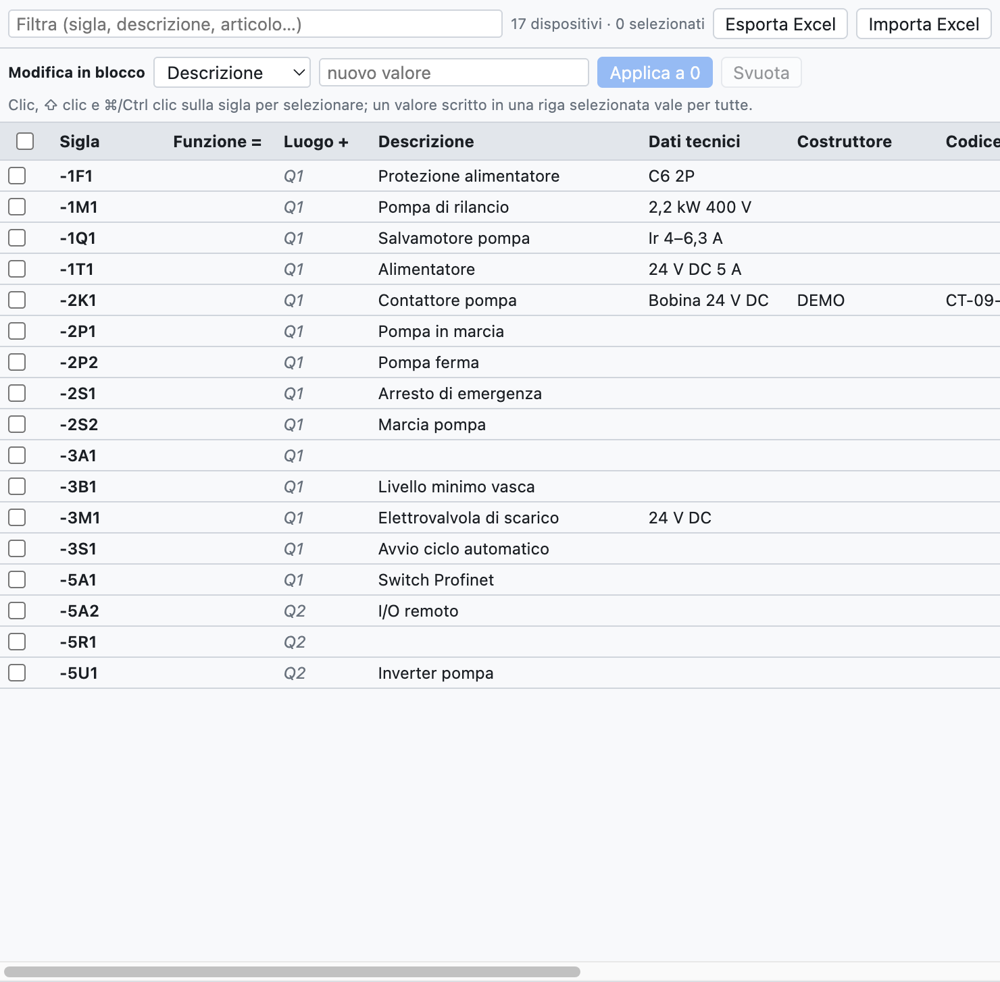
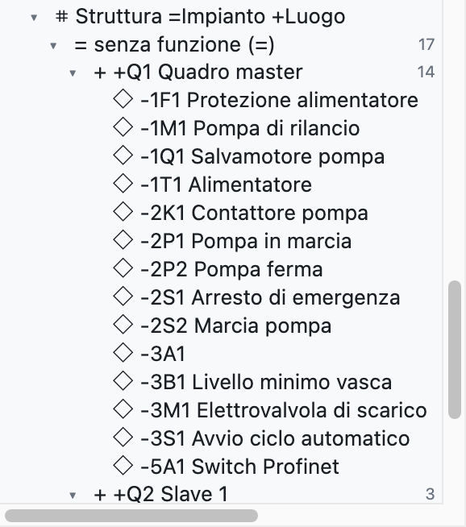
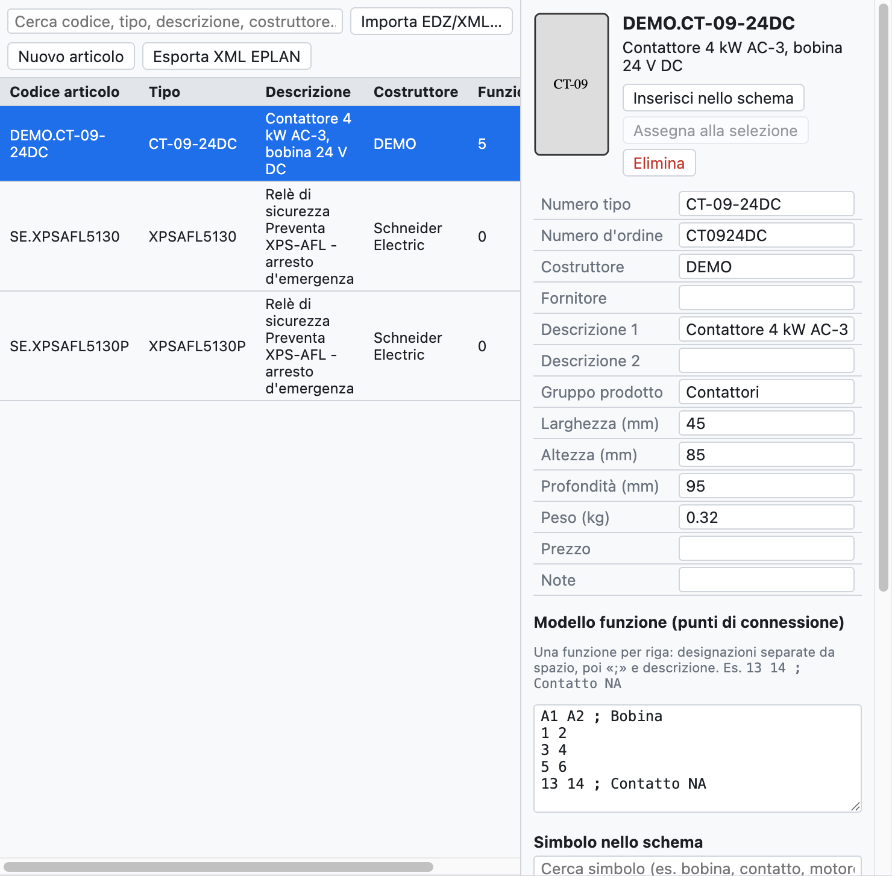

# 7. Dispositivi e articoli

Un **dispositivo** è un componente reale con una sigla: il contattore `-2K1` è un dispositivo, anche se
nello schema compare come bobina, tre contatti di potenza e due ausiliari su pagine diverse. Un **articolo**
è il prodotto del catalogo di un costruttore (codice, descrizione, misure, morsetti) da assegnare ai dispositivi.

## Dati del dispositivo

| Campo | Esempio | Dove compare |
|---|---|---|
| Descrizione | `Contattore pompa` | schema (sotto la sigla), liste, etichette |
| Dati tecnici | `Bobina 24 V DC`, `2,2 kW 400 V` | schema, liste |
| Costruttore | `Schneider Electric` | distinta, lista d'acquisto |
| Tipo | `LC1D09BD` | distinta |
| Codice di ordinazione | `LC1D09BD` | distinta, lista d'acquisto |
| Note | testo libero | lista dispositivi |
| Funzione (=) | `A1` | sigla completa `=A1+Q1-2K1` |
| Luogo (+) | `Q1` | sigla completa, raggruppamenti, layout |
| Articolo | `DEMO.CT-09-24DC` | riempie i campi vuoti con i dati del catalogo |

I dati appartengono al dispositivo: si scrivono su un elemento qualunque (bobina o contatto) e valgono
per tutti. I valori scritti a mano prevalgono su quelli dell'articolo.

**Articoli aggiuntivi**: un dispositivo può avere più articoli (per esempio un contattore e il suo blocco
di contatti ausiliari). Nel navigatore la colonna *Articoli aggiuntivi* si scrive come testo, con il
codice e la quantità dopo ×: `LADN22 ×2; LA4DA2U`. Si modifica anche in blocco e in Excel.

**Descrizioni sullo schema**: con *Proprietà del progetto ▸ Disegno ▸ Descrizioni sullo schema* accesa,
descrizione e dati tecnici compaiono sotto la sigla dell'elemento principale. Il campo *Testi sullo schema*
del dispositivo li forza o li nasconde per quel dispositivo soltanto.

## Navigatore dei dispositivi

La scheda **Dispositivi** (in alto a destra) mostra tutti i dispositivi del progetto in una tabella che
si modifica come un foglio di calcolo.

*Il navigatore con i 17 dispositivi del progetto di esempio. I valori in grigio corsivo vengono
dall'articolo o dal luogo della pagina.*

- **Modificare un valore**: clicca nella cella, scrivi e premi Invio.
- **Rinominare**: cambia la sigla nella prima colonna; cambiano anche i contatti e le altre rappresentazioni.
  Se la sigla è già usata, il programma lo segnala e non cambia niente.
- **Filtrare**: il campo in alto cerca in sigla, descrizione, articolo e negli altri campi.
- **Selezionare più righe**: clic sulla sigla, ⇧ clic per un intervallo, ⌘/Ctrl clic per aggiungere,
  oppure le caselle a sinistra.
- **Andare al dispositivo**: clic sulla posizione `/2.2` nell'ultima colonna.

### Modifica in blocco

Per dare lo stesso valore a molti dispositivi:

1. Seleziona le righe (per esempio tutti i dispositivi del quadro `+Q2`, filtrando per `Q2`).
2. Nella riga *Modifica in blocco* scegli il campo (*Funzione =*, *Costruttore*…) e scrivi il valore.
3. Premi **Applica a N**. *Svuota* cancella quel campo su tutti i selezionati.

In alternativa scrivi il valore direttamente in una cella di una riga selezionata: vale per tutte le
righe selezionate. Tutta la modifica si annulla con un solo ⌘Z.

### Excel

- **Esporta Excel** salva la tabella dei dispositivi (sigla, campi, posizione).
- Compilala in Excel, anche da un'altra persona, e usa **Importa Excel**: i dispositivi si riconoscono
  dalla colonna *Sigla* e si aggiornano solo i campi cambiati. Le sigle che non esistono nel progetto
  vengono segnalate nella vista report.

### Copiare le proprietà

Il tasto destro su un dispositivo offre **Copia proprietà**: copia tutti i dati del dispositivo (descrizione,
dati tecnici, costruttore, tipo, codici, articolo, articoli aggiuntivi, note, funzione, luogo, proprietà
definite dall'utente) tranne la sigla. Su un altro dispositivo, o su una selezione di più dispositivi, il tasto
destro offre **Incolla proprietà di -X**: i dati copiati sostituiscono quelli del dispositivo.

Serve anche per **sostituire un simbolo** con un altro: copia le proprietà del vecchio, inserisci il nuovo
simbolo, incolla le proprietà e cancella il vecchio.

## Struttura =Impianto +Luogo

Nell'albero, il nodo **Struttura =Impianto +Luogo** raggruppa i dispositivi prima per **funzione** (`=A1`,
`=A2`…) e poi per **luogo** (`+Q1`, `+P1`…), come prevede la IEC 81346. I dispositivi senza funzione o
senza luogo stanno in fondo, in *senza funzione (=)* e *senza luogo (+)*. Un clic su un dispositivo lo apre
nello schema.

*Nel progetto di esempio i dispositivi non hanno funzione: sono tutti in «senza funzione», divisi tra i
quadri `+Q1` e `+Q2`.*

Il luogo di un dispositivo è quello scritto nelle sue proprietà; se manca, quello del riquadro in cui
è disegnato nello schema di rete o quello della sua pagina.

## Articoli

La scheda **Articoli** è la libreria personale degli articoli, salvata sul computer e disponibile in
tutti i progetti.

*Un contattore importato da un EDZ: dati, immagine, modello funzione e simbolo.*

### Importare i dati dei produttori (EDZ)

1. Scarica il file **EDZ** dall'Eplan Data Portal o dal sito del costruttore (Schneider, Siemens, Phoenix
   Contact…). L'EDZ è un archivio con i dati dell'articolo nel formato dell'Eplan Data Portal.
2. *File ▸ Importa ▸ Articoli EDZ / XML / CSV…* (o il pulsante *EDZ*) e scegli uno o più file.
3. Gli articoli entrano nella libreria con codice, tipo, codice di ordinazione, costruttore, descrizioni
   (in italiano se ci sono, altrimenti inglese o tedesco), dimensioni, peso, immagine e **modello funzione**
   (i morsetti).

Se l'EDZ contiene il disegno del costruttore in una macro in formato EPLAN leggibile, quel disegno diventa il simbolo
dell'articolo (categoria *Macro EPLAN / costruttore* nella libreria). Altrimenti l'articolo si disegna come
**scatola nera** automatica: ingressi in alto, uscite in basso, contatti e poli disegnati dentro.

Si importano anche i file **XML** nel formato EPLAN; *Esporta XML (formato EPLAN)* scrive gli articoli in un
file dello stesso formato.

I file **CSV dei dati commerciali** (`commercial_data.csv` dell'Eplan Data Portal) si importano con lo stesso
comando, anche più file insieme: per ogni articolo portano costruttore, tipo, codice di ordinazione, gruppo,
descrizioni e descrizione lunga. Gli articoli già importati da EDZ si completano senza perdere simbolo e morsetti.
I collegamenti a schede tecniche e istruzioni compaiono nella scheda dell'articolo, nella sezione **Documenti**.

### La scheda dell'articolo

Selezionando un articolo si vedono e si modificano:

- i dati principali (codice, tipo, ordine, costruttore, fornitore, descrizioni, gruppo, misure, peso, prezzo, note);
- il **modello funzione**: una riga per funzione, con i morsetti separati da spazi e la descrizione dopo `;`
  (per esempio `13 14 ; Contatto NA`);
- il **simbolo nello schema**: uno dei simboli di base, un componente importato o il disegno del costruttore.

### Usare gli articoli

- **Inserisci nello schema**: inserisce il simbolo dell'articolo, già assegnato.
- **Assegna alla selezione**: seleziona un dispositivo nello schema e assegnagli l'articolo. In alternativa
  scegli l'articolo nel campo *Articolo* delle proprietà del dispositivo.
- Gli articoli usati vengono copiati nel progetto (*Articoli del progetto* nell'albero), così il file
  `.ecad` resta completo anche su un altro computer.

### Il database degli articoli

La libreria personale è un database che passa da un impianto all'altro: i dati scritti una volta non si
reinseriscono.

- Nel campo **Articolo** (nelle *Proprietà*, nel navigatore *Dispositivi* e nella scheda *Connettori*) si scrive
  o si sceglie un codice. Se il codice è **nuovo**, diventa un articolo della libreria, con costruttore, tipo,
  codice di ordinazione e dati tecnici del dispositivo. Al prossimo uso del codice, i dati si compilano da soli.
- Se l'articolo esiste già e i dati del dispositivo sono diversi, **Salva questi dati nell'articolo** li scrive
  nell'articolo esistente.
- Descrizione e costruttore degli articoli aggiuntivi vanno anch'essi nella libreria.

### Nuovo articolo

*Nuovo articolo* crea un articolo vuoto da compilare a mano: utile per i componenti senza EDZ.
