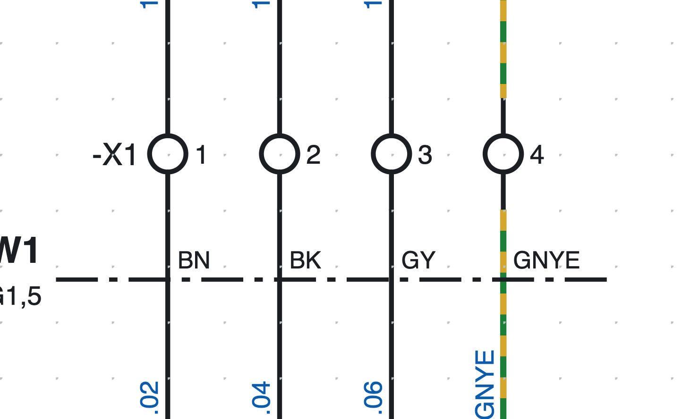
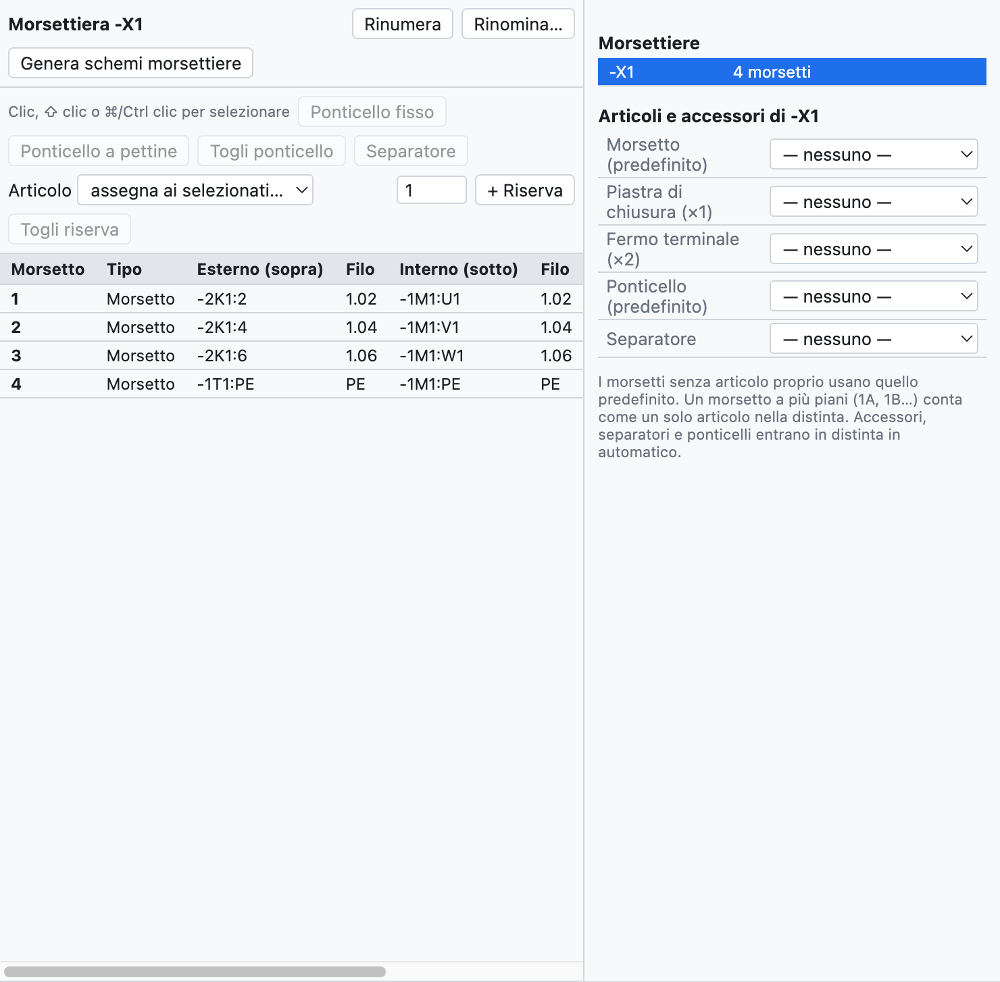
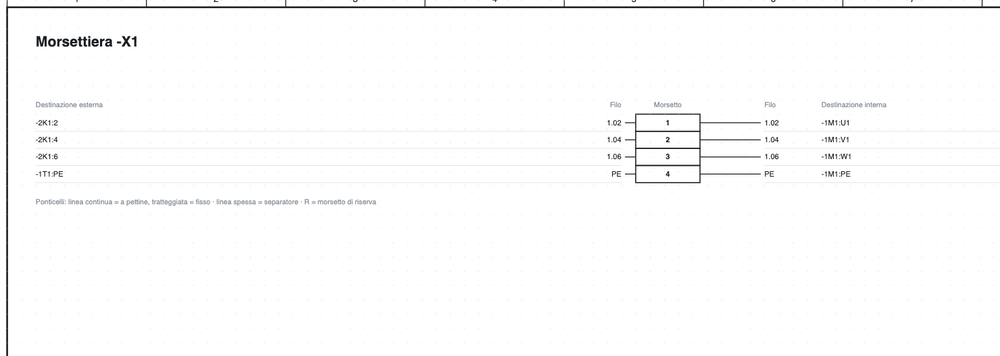

# 8. Morsettiere

## Morsetti nello schema

*I morsetti `-X1:1…4` nella pagina 1: la sigla della morsettiera compare solo sul primo della fila.*

1. Nella libreria, categoria *Morsetti e collegamenti*, scegli **Morsetto** (oppure *Morsetto PE*,
   *Morsetto sezionabile*, *Morsetto portafusibile*).
2. Inseriscilo **sopra il filo**: il filo si interrompe sui due lati del morsetto.
3. Il morsetto prende la sigla `-X1:1`; i successivi `-X1:2`, `-X1:3`…

La sigla di un morsetto è `<morsettiera>:<numero><piano>`:

- la **morsettiera** ha un nome libero, anche gerarchico come `X1.1.2`;
- il **numero** segue i due punti (`X1.1.2:3`);
- il **piano** è una lettera per i morsetti a più piani (`X1:1A`, `X1:1B`).

Su un filo verticale la sigla della morsettiera sta a sinistra e il numero a destra; su un filo
orizzontale (simbolo ruotato) il numero sta sopra e la sigla sotto.

> Il **numero filo** attraversa il morsetto senza cambiare: i fili ai due lati hanno lo stesso numero
> (vedi [capitolo 6](06-sigle-e-numerazione.md#il-numero-attraversa-i-morsetti)).

## Il navigatore delle morsettiere

La scheda **Morsettiere** mostra le morsettiere del progetto e i loro morsetti in una tabella.

*La morsettiera `-X1` del progetto di esempio: destinazioni esterne e interne, numeri filo, articoli e accessori.*

- A destra l'elenco delle **morsettiere** del progetto; un clic ne apre una.
- Al centro la **tabella dei morsetti**: numero, tipo, destinazione esterna (sopra) e interna (sotto),
  numeri filo, ponticelli, articolo, posizione cliccabile.
- I morsetti si selezionano con clic, ⇧ clic (intervallo) e ⌘/Ctrl clic (aggiunta).

## Morsetti a più piani

Un morsetto a due o tre piani ha lo stesso numero e una lettera per piano.

1. Seleziona il morsetto nello schema, per esempio `-X1:1`.
2. Nelle proprietà premi **Aggiungi piano** (anche dal tasto destro): il morsetto diventa `-X1:1A` e il
   programma fa inserire `-X1:1B` con un clic, anche su un'altra pagina.
3. I clic successivi inseriscono `1C`, `1D`…

In distinta un morsetto a più piani conta come **un solo articolo** (`-X1:1A/B`).

## Numerare e rinominare

- Un morsetto nuovo prende il numero dopo il più alto della morsettiera; gli altri non cambiano.
- **Rinumera** numera da 1 nell'ordine dello schema (pagina, poi da sinistra a destra e dall'alto in basso):
  i piani restano insieme con la loro lettera, le riserve vanno in coda, i morsetti con un nome non numerico
  (per esempio `PE`) restano com'erano.
- **Rinomina…** cambia il nome della morsettiera su tutti i suoi morsetti (`X1` → `X2.1`).

## Ponticelli

1. Seleziona due o più morsetti nella tabella.
2. Premi **Ponticello fisso** o **Ponticello a pettine**.

I ponticelli compaiono nella tabella, nella lista morsetti, nella lista connessioni e nello schema della
morsettiera; ognuno può avere il suo articolo. *Togli ponticello* li rimuove.

## Riserve e separatori

- **+ Riserva** aggiunge in coda morsetti non disegnati: entrano in lista e in distinta.
  *Togli riserva* li toglie.
- **Separatore** dopo un morsetto: una piastra di separazione, disegnata come linea spessa nello schema
  della morsettiera.

## Articoli e accessori

Nel riquadro *Articoli e accessori* della morsettiera si scelgono:

| Campo | Quantità in distinta |
|---|---|
| Morsetto (predefinito) | uno per morsetto fisico senza articolo proprio |
| Piastra di chiusura | 1 |
| Fermo terminale | 2 |
| Ponticello (predefinito) | uno per ponticello senza articolo proprio |
| Separatore | uno per separatore |

*Articolo ▸ assegna ai selezionati* dà un articolo diverso a singoli morsetti (per esempio i sezionabili).
Tutto entra in distinta e nella lista d'acquisto in automatico.

## Schema della morsettiera

**Genera schemi morsettiere** crea una pagina per ogni morsettiera (più fogli oltre i 40 morsetti) con
destinazioni, numeri filo, ponticelli, separatori, riserve e posizioni cliccabili, anche nel PDF.

*La parte alta dello schema della morsettiera `-X1`.*

La pagina si aggiorna da sola quando cambi lo schema; rigenerandola si aggiungono le pagine delle
morsettiere nuove e si tolgono quelle sparite.

## Controlli

La verifica segnala morsetti ripetuti, morsetti con un lato libero e dati di morsettiere che non esistono più.
