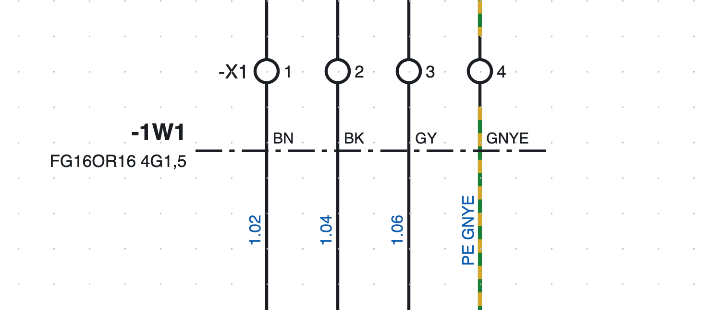
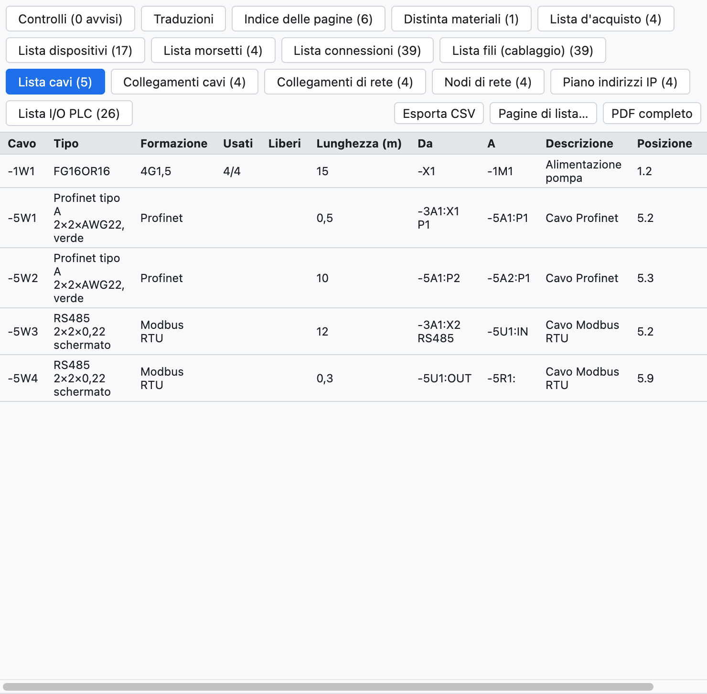

# 9. Cavi e connettori

## Cavi

Un cavo si definisce con una **linea di definizione** che attraversa i fili.

*Il cavo `-1W1 FG16OR16 4G1,5` della pagina 1: la linea tratto-punto attraversa i quattro fili verso il
motore, ognuno con il colore del suo conduttore.*

1. Premi **Cavo** nella barra strumenti (o *Inserisci ▸ Linea di definizione cavo*).
2. Clicca su un lato dei fili e poi sull'altro lato.
3. I fili attraversati diventano **conduttori** del cavo `-1W1` (sigla secondo il modello del progetto).

### Conduttori

Il programma propone i conduttori secondo il numero di fili:

- fino a 5 fili, a colori: `BN BK GY BU GNYE`;
- oltre, numerati con il giallo-verde;
- il filo PE (o giallo-verde) prende il conduttore giallo-verde.

Nelle proprietà del cavo si cambiano **formazione** (`5G1,5`, `7x0,75`…), **tipo** (`FG16OR16`),
**lunghezza** in metri, **estremità** (da, a), **schermatura**, descrizione e **articolo**; nelle proprietà
della linea si sceglie il conduttore di ogni filo.

Più linee, anche su pagine diverse, possono riferirsi allo stesso cavo: un conduttore attraversato due
volte conta una volta sola.

### Liste dei cavi

*La lista cavi del progetto di esempio: il cavo del motore e i cavi di rete.*

- **Lista cavi**: un cavo per riga con tipo, formazione, conduttori usati e liberi, lunghezza, estremità,
  posizione, articolo.
- **Collegamenti cavi**: un conduttore per riga con le due estremità e il numero filo.
- La **lista connessioni** ha la colonna *Cavo*; in distinta la quantità di un cavo con articolo è la sua
  lunghezza in metri; nella lista d'acquisto i cavi senza articolo sono sommati per tipo.

### Controlli

La verifica segnala conduttori esauriti (più fili che conduttori) o ripetuti, cavi senza linea di
definizione e sigle di cavo doppie.

## Connettori e spine

Per le spine e le prese dei connettori multipolari si usano i simboli della categoria *Morsetti e collegamenti*:

| Simbolo | Uso |
|---|---|
| Pin di presa (femmina) | il lato presa |
| Pin di spina (maschio) | il lato spina |
| Pin presa + spina | la coppia accoppiata in un solo simbolo |

- La sigla è come quella dei morsetti: `-X10:3` è il pin 3 del connettore `-X10`; i pin si numerano da soli.
- Il numero totale di pin si scrive nelle proprietà del connettore o si legge dall'articolo.
- La **controparte** (per esempio la spina volante per una presa da quadro) si indica con il suo articolo
  ed entra in distinta.
- La **lista connettori** elenca ogni pin con il lato, i fili, la posizione e i pin usati.
- Nella scheda **Connettori** la tabella dei pin ha le colonne **Descrizione** e **Note**, che si scrivono
  direttamente nella cella. Descrizione, dati tecnici e note sono **propri di ogni pin** (nelle *Proprietà* del
  pin valgono solo per quel pin); costruttore, tipo, articolo e gli altri dati valgono per tutto il connettore.
  Le **note del connettore** si scrivono nei dati del connettore, a destra della tabella.
- La verifica segnala i pin oltre il numero del connettore.
