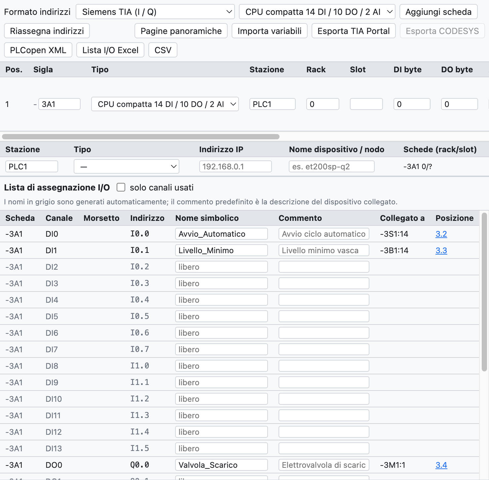
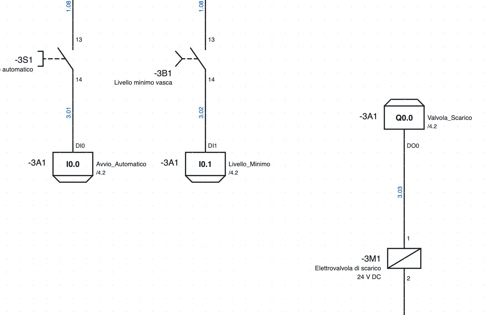
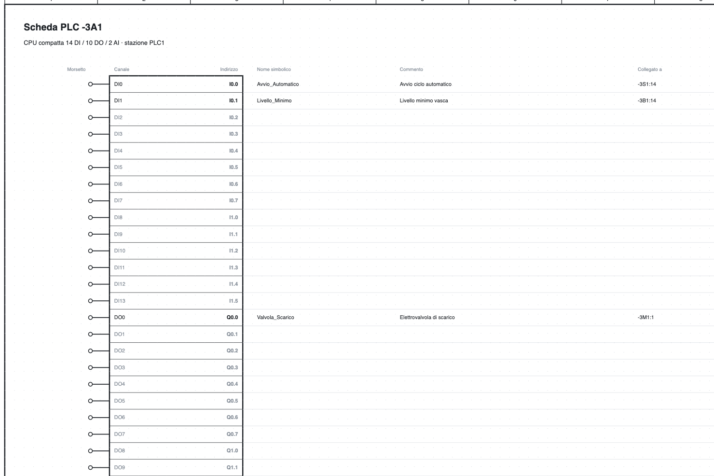

# 10. PLC

OpenWiring tiene insieme lo schema elettrico e l'assegnazione degli I/O del PLC: ogni ingresso e uscita
disegnato prende un canale e un indirizzo, compare nella lista I/O e nella panoramica della scheda, e si
esporta verso TIA Portal, CODESYS o PLCopen.

## La vista PLC

*La vista PLC del progetto di esempio: la CPU `-3A1`, la stazione `PLC1` e la lista di assegnazione I/O.*

La scheda **PLC** in alto a destra raccoglie:

- la barra con formato degli indirizzi, tipo di scheda da aggiungere ed export;
- l'elenco delle **schede** con sigla, tipo, stazione, rack, slot e indirizzi iniziali;
- l'elenco delle **stazioni** con tipo, indirizzo IP e nome del dispositivo;
- la **lista di assegnazione I/O**.

## Schede

**Aggiungi scheda** aggiunge il tipo scelto nell'elenco:

- CPU compatte 14 DI / 10 DO / 2 AI e 8 DI / 6 DO;
- moduli digitali 8 DI, 16 DI, 8 DO, 16 DO, 8 DI / 8 DO;
- moduli analogici 4 AI, 8 AI, 2 AO, 4 AO;
- master **IO-Link** a 4 o 8 porte.

Per ogni scheda si indicano sigla (`-3A1`), stazione (`PLC1`: gli indirizzi sono assegnati per stazione),
rack, slot (assegnato in automatico), indirizzi iniziali, descrizione e codice di ordinazione. La scheda
entra in distinta.

**Scheda da articolo…** crea una scheda da un articolo della libreria, per esempio un modulo I/O importato
da EDZ: il numero di canali si ricava dal modello funzione e si può correggere prima di creare la scheda.
I punti di connessione dell'articolo diventano i morsetti dei canali.

**Indirizzi stabili**: una scheda nuova prende i primi indirizzi liberi della sua stazione, quelli delle
schede esistenti non cambiano. **Riassegna indirizzi** li ricalcola nell'ordine dell'elenco (frecce ↑ ↓).

### Stazioni

Ogni stazione ha un tipo (CPU locale, Profinet, EtherCAT, Profibus DP, EtherNet/IP, Modbus TCP), un indirizzo
IP e un nome di dispositivo. La verifica segnala slot doppi, IP e nomi ripetuti.

### Formato e ordine delle aree per stazione

Nella tabella delle **Stazioni** ogni stazione ha due colonne in più:

- **Formato**: una stazione può avere un formato diverso da quello in alto, per esempio un nodo CODESYS
  accanto a una CPU Siemens. Il formato in alto vale per le stazioni senza un formato proprio. Cambiando il
  formato di una stazione si rifanno solo i suoi indirizzi.
- **Ordine aree** (formati IEC e TwinCAT, dove digitali e analogici stanno nella stessa area):
  *schede in fila* (di serie) oppure *prima gli analogici (WAGO)*, come fanno i nodi WAGO e altri
  accoppiatori CODESYS. Aggiungendo una scheda a una stazione «prima gli analogici» gli indirizzi si
  rifanno da soli.

**TwinCAT (Beckhoff).** Con il formato TwinCAT gli indirizzi sono `%I*` e `%Q*`: li collega TwinCAT. Nella
GVL esportata le variabili hanno `AT %I*` / `AT %Q*`; i fili collegati a un canale prendono il nome da
scheda e canale (`400A1.DI3`), perché `%I*` è uguale per tutti.

Le esportazioni lavorano per stazione: *Esporta TIA Portal* prende solo le stazioni Siemens,
*Esporta CODESYS* quelle IEC e TwinCAT.

### IO-Link

Per ogni porta di un master IO-Link si indicano dispositivo, descrizione e byte di dati di processo; il
programma calcola gli indirizzi (`IB4…IB5`, `%IB4`, `EB4`).

## Punti I/O nello schema

*Due ingressi e un'uscita della pagina 3: nel riquadro l'indirizzo, a destra il nome simbolico e il
rimando alla panoramica `/4.2`, a sinistra la sigla della scheda.*

1. Nella libreria, categoria *PLC*, scegli ingresso o uscita, digitale o analogica.
2. Inseriscilo nello schema e collegalo al dispositivo (pulsante, sensore, elettrovalvola…).
3. Il punto prende in automatico il **primo canale libero** del tipo giusto; se nessuna scheda ne ha, il
   programma ne crea una nuova (la prima è una CPU compatta).

Nelle proprietà del punto si cambiano scheda, canale (quelli occupati sono segnalati), **nome simbolico**
e **commento**. Il morsetto porta il nome del canale (`DI0`, `DO3`).

L'**alimentazione L+ / M** della scheda è un simbolo a parte con la sigla della scheda: si disegna sul
circuito di alimentazione e la sua posizione compare nella panoramica.

## Indirizzi

Il formato si sceglie in alto nella vista PLC:

| Formato | Ingresso digitale | Uscita digitale | Ingresso analogico | Uscita analogica |
|---|---|---|---|---|
| Siemens TIA | `I0.0` | `Q0.0` | `IW64` | `QW64` |
| Siemens tedesco | `E0.0` | `A0.0` | `EW64` | `AW64` |
| IEC 61131 / CODESYS | `%IX0.0` | `%QX0.0` | `%IW0` | `%QW0` |
| Omron CJ/CP | `0.00` | `100.00` | `2000` | `2100` |
| Beckhoff TwinCAT | `%I*` | `%Q*` | `%I*` | `%Q*` |

Gli analogici partono da 64 nei formati Siemens e da 0 in IEC; cambiando formato vengono adeguati. Omron
usa parole da 16 bit, quindi passando da o verso Omron gli indirizzi vengono riassegnati.

## Pagine panoramiche

**Pagine panoramiche** crea una pagina per ogni scheda, in fondo al progetto, e toglie quelle delle schede
eliminate.

*La panoramica della CPU `-3A1`: per ogni canale morsetto, indirizzo, nome simbolico, commento, dispositivo
collegato e pagina.*

La panoramica è sempre allineata allo schema, non va rigenerata quando cambi qualcosa. Ogni punto I/O
dello schema rimanda alla sua riga della panoramica (`/4.2`) e viceversa.

## Lista di assegnazione I/O

La lista contiene tutti i canali di tutte le schede, usati o liberi, con indirizzo, nome simbolico, commento,
**dispositivo collegato** (`-3S1:14`, ricavato dai fili) e posizione.

- Nome e commento si modificano direttamente nella tabella.
- Se il nome manca viene generato (`DI2_3A1`); il commento predefinito è la descrizione del dispositivo collegato.
- *solo canali usati* nasconde quelli liberi.
- La lista compare anche nella scheda *Liste* e nel PDF.
- La verifica segnala canali usati due volte, nomi doppi, punti senza scheda o con un canale del tipo sbagliato.

## Scambio con il software del PLC

### Export

| Pulsante | File | Uso |
|---|---|---|
| *Esporta TIA Portal* | Excel con il foglio `PLC Tags` | in TIA: *Variabili PLC ▸ Importa*; le variabili finiscono nella tabella `OpenWiring` (formati Siemens) |
| *Esporta CODESYS* | testo `VAR_GLOBAL … END_VAR` | da incollare in una lista di variabili globali (formato IEC) |
| *PLCopen XML* | XML TC6 | variabili globali con indirizzo IEC, anche dei dati IO-Link; per CODESYS e ambienti compatibili |
| *Lista I/O Excel*, *CSV* | tabella | documentazione |

Esempio di riga CODESYS: `Avvio_Automatico AT %IX0.0 : BOOL; (* Avvio ciclo automatico - -3S1:14 *)`.

> L'export per TIA Portal segue il formato della tabella variabili di TIA ma non è ancora stato provato su
> un'installazione reale: se l'import segnala errori, esporta da TIA una tabella vuota e confronta le colonne.

### Import delle variabili

**Importa variabili** legge nomi e commenti dal software del PLC e li riporta nello schema:

- **TIA Portal**: il file Excel di *Variabili PLC ▸ Esporta*;
- **CODESYS**: una GVL (`Nome AT %IX0.0 : BOOL; (* commento *)`);
- **CSV** con le colonne Nome, Indirizzo, Commento.

La corrispondenza avviene per **indirizzo** (`%E0.0` e `I0.0` sono equivalenti). I canali già disegnati
ricevono nome e commento; quelli non ancora disegnati li tengono sulla scheda e li mostrano appena
vengono disegnati. Le variabili senza canale sono elencate nella vista report.
