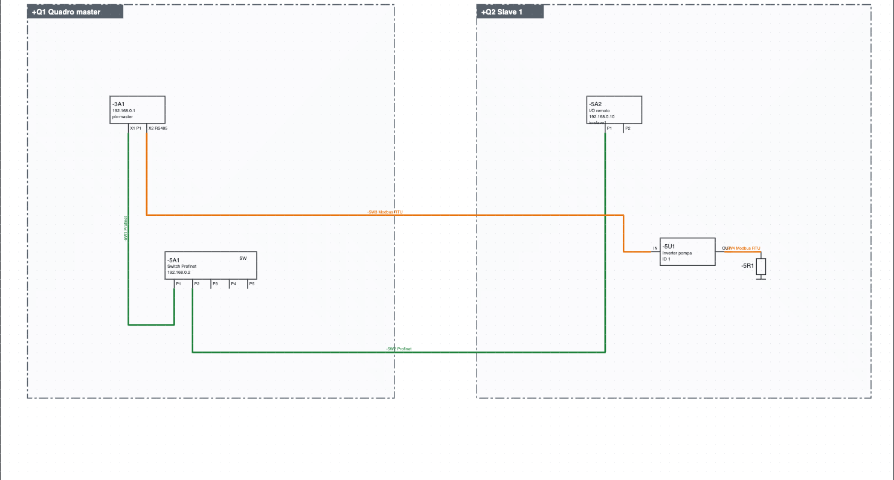
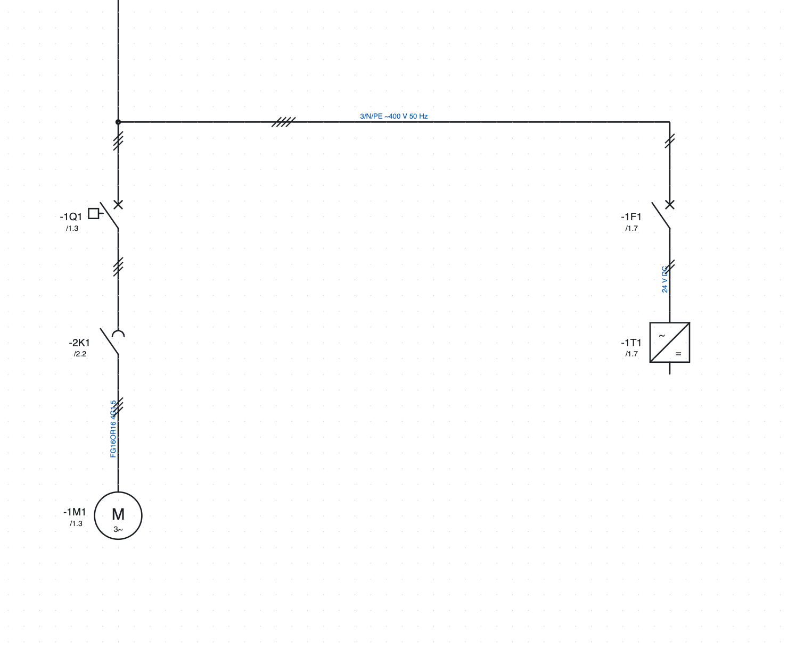

# 11. Reti, luoghi e schema unifilare

## Luoghi

Un **luogo** è un contenitore fisico: quadro elettrico, pulsantiera, bordo macchina, cassetta di
derivazione, campo. Il suo codice è la parte `+` della sigla (`+Q1-2K1`).

1. *Progetto ▸ Nuovo luogo…*, oppure *+ Luogo* nelle proprietà del progetto.
2. Scrivi il **codice** (`Q1`, `BM`, `P1`), il **nome** (`Quadro master`) e il **tipo**.
3. Assegna le pagine al luogo con *Proprietà della pagina ▸ Luogo (sezione)*: una pagina nuova resta
   nel luogo di quella da cui parte.

Ogni dispositivo sta in un luogo: quello scritto nelle sue proprietà, altrimenti il riquadro in cui è
disegnato nello schema di rete, altrimenti il luogo della sua pagina.

Dove si vedono i luoghi:

- l'**albero** raggruppa pagine e dispositivi per luogo;
- la **lista dispositivi** mostra la sigla completa (`+BM-1M1`);
- le **etichette** dei dispositivi sono raggruppate per luogo;
- una **pagina di layout** assegnata a un luogo propone solo i suoi apparecchi.

### Un componente di un quadro collegato a un altro quadro

Caso tipico: un sensore montato nel **+Q2** va a un ingresso PLC del **+Q1**. Se lo disegni nella
pagina degli ingressi del +Q1 con il riquadro di luogo +Q2, la sigla è giusta (`+Q2-B1`) e il
sensore va nelle liste del +Q2. Lo schema però sta nelle pagine del +Q1: chi cabla il +Q2 e riceve
solo le sue pagine non lo vede.

La tecnica consigliata è **dividere il circuito al confine del quadro**, sui morsetti:

1. nella pagina del +Q1: ingresso PLC → morsetto `-X1:5` → cavo `-W12` → rimando verso la pagina del +Q2;
2. in una pagina del +Q2: rimando dal +Q1 → cavo `-W12` → morsetto `-X2:5` → sensore `-B1`.

Ogni componente è disegnato nelle pagine del quadro in cui è montato; il collegamento tra i quadri è
il cavo, che compare nei disegni dei cavi di tutti e due; i rimandi si cliccano nel PDF. Ogni quadro
ha la sua entrata a morsetti e ogni cablatore lavora fino al morsetto.

I **controlli** avvisano quando un dispositivo di un quadro, di una pulsantiera o di una cassetta è
disegnato nelle pagine di un altro quadro: *+Q2-B1 è disegnato nella pagina 310 del quadro +Q1:
stampando solo +Q2 non compare*. Bordo macchina e campo non contano, perché di solito si disegnano
nelle pagine del quadro; nemmeno un sottoluogo dello stesso quadro (es. la porta).

Se preferisci lasciare il componente vicino all'ingresso PLC, stampando solo alcuni quadri spunta
nel PDF *Aggiungi le pagine di altri quadri con dispositivi dei quadri scelti* (capitolo 18).

### Pagine proiettate

C'è anche una terza strada, che tiene tutto sulla pagina del manutentore: il componente del +Q2 si
disegna nella pagina degli ingressi del +Q1 dentro il **riquadro di luogo +Q2**, e il programma crea
nel +Q2 una **pagina proiettata** che mostra quel riquadro.

- Comando: *Pagine ▸ Pagine proiettate dei riquadri di altri quadri* (nel ribbon *Pagine ▸ Pagine
  automatiche ▸ Pagine proiettate*), oppure tasto destro sul riquadro ▸ *Crea la pagina proiettata nel
  quadro +Q2*. Si crea una pagina per ogni riquadro di un altro quadro che non ne ha ancora una, dopo le
  pagine di quel quadro e con lo stesso titolo.
- La pagina proiettata mostra **dal vivo** il contenuto del riquadro, con i suoi testi e rimandi: ogni
  modifica fatta sulla pagina di origine si vede subito. Sotto c'è la scritta cliccabile *Disegnato a
  pagina /311 (+Q1)*; sul riquadro di origine, in basso a destra, il rimando alla pagina proiettata.
- È **solo disegno**: non ha elementi suoi, non raddoppia nulla nelle liste e si stampa con il suo
  quadro. Si modifica sempre la pagina di origine.
- Con la pagina proiettata la verifica non segnala più i componenti del riquadro come disegnati nelle
  pagine di un altro quadro.

## Schema di rete

Lo schema di rete mostra in una pagina sola tutti i nodi dell'impianto e i collegamenti bus tra i quadri.

*Lo schema di rete del progetto di esempio: la CPU `-3A1` e lo switch `-5A1` nel quadro `+Q1`, l'I/O
remoto `-5A2` e l'inverter `-5U1` nel quadro `+Q2`, collegati in Profinet (verde) e Modbus RTU (arancione).*

1. **+ Rete** sotto l'albero crea la pagina.
2. **Quadro** nella barra strumenti: clic su due angoli per disegnare il riquadro di un quadro e sceglierne
   il luogo. I nodi dentro il riquadro appartengono a quel quadro.
3. Dalla categoria *Reti e bus* inserisci i **nodi**: nodo a due porte (IN/OUT o P1/P2), nodo a una porta,
   switch a 5 porte, terminazione. Un nodo prende la sigla di un dispositivo esistente (la CPU, un inverter…)
   e ne diventa una rappresentazione.
4. Scegli il protocollo accanto al pulsante **Bus** e collega le porte come un filo.

### Protocolli

Profinet, EtherCAT, Modbus TCP, Modbus RTU, Profibus DP, EtherNet/IP, CANopen, IO-Link, RS485, Ethernet.
Ogni protocollo ha il suo colore e il nome scritto sulla linea. I bus non ricevono numero filo e non
entrano tra le connessioni elettriche. Un filo esistente si trasforma in bus dalle sue proprietà
(*Rete / bus*).

### Cavi di rete

Ogni collegamento bus è un **cavo**: prende da solo la sigla (`-5W1`, scritta sulla linea accanto al
protocollo). Nelle proprietà del collegamento si indicano tipo (proposto per protocollo, per esempio
*Profinet tipo A 2×2×AWG22*), lunghezza e articolo. I cavi di rete compaiono nella lista cavi con le porte
alle estremità (`-3A1:X1 P1` → `-5A1:P1`), nelle etichette e, con l'articolo, in distinta in metri.

Un cavo che prosegue su un'altra pagina con una coppia di rimandi (per esempio dal controller del robot
alla pagina del robot) è **un cavo solo**: ha una sigla sola su tutti i tratti. Il tratto con la sigla data dal programma prende da solo quella del
cavo, anche se i rimandi li abbini dopo averlo disegnato. Cambiando sigla, tipo,
lunghezza o articolo in un tratto, cambiano anche gli altri. Se i tratti hanno sigle diverse la verifica
lo segnala, e il pulsante **Usa -… su tutti i tratti** mette su tutti la sigla del tratto sulla prima
pagina. I rimandi del cavo prendono da soli il nome del cavo (`1102W1`) e lo seguono se cambi la sigla; rinominando un rimando si rinomina il cavo, su tutti i tratti e sul rimando corrispondente. Tipo, lunghezza e articolo scritti su un tratto passano agli altri tratti che non li hanno. Così accanto al rimando la sigla non si ripete. Per
mostrarla o nasconderla su un tratto usa l'occhio di **Sigla cavo**; l'occhio di **Numero filo** spegne
tutte le scritte sul collegamento.

### Liste e controlli

- **Collegamenti di rete**: protocollo, porte, quadri, collegamenti tra quadri diversi.
- **Nodi di rete**: indirizzo, protocolli, quadro.
- La verifica segnala indirizzi ripetuti sulla stessa rete (anche attraverso gli switch) e porte Ethernet
  con più di un collegamento (serve uno switch). I bus multipunto (Modbus RTU, Profibus, CANopen, RS485)
  ammettono più nodi sullo stesso tratto.

## Piano indirizzi IP

1. *Progetto ▸ Nuova rete IP*: nome, indirizzo e prefisso (`192.168.0.0/24`), gateway, protocollo che la
   usa e primo indirizzo da assegnare.
2. Nelle proprietà di ogni nodo c'è il campo **Indirizzo IP**, separato dall'indirizzo di bus (nome
   Profinet, ID Modbus…). L'IP è scritto nel riquadro del nodo.
3. *Progetto ▸ Assegna indirizzi IP* dà il primo indirizzo libero ai nodi collegati in Profinet, Modbus TCP,
   EtherNet/IP o Ethernet che non ne hanno (EtherCAT e i bus seriali no).
4. *Progetto ▸ Piano indirizzi IP* apre la lista: IP, maschera, gateway, rete, dispositivo, nome,
   protocolli, luogo, comprese le stazioni PLC.

La verifica segnala IP ripetuti, non validi, fuori dalle reti o uguali all'indirizzo di rete o di
broadcast, e gateway fuori rete.

## Indirizzi di rete

*Progetto ▸ Indirizzi di rete…* (anche dal gruppo *Reti* della scheda *Progetto* della barra) apre una tabella con **tutti** i
dispositivi che hanno una porta di rete, anche quelli che non hanno ancora un indirizzo, e le stazioni PLC.

**Come si trovano le porte.** Una porta è ogni pin toccato da un filo di bus (Profinet, Ethernet, Modbus,
EtherCAT…) e ogni nodo di rete. Non servono pin speciali nei simboli.

- Le porte su IP di un dispositivo (Profinet, Ethernet, Modbus TCP, EtherNet/IP) formano **una sola
  interfaccia**, come uno switch integrato: un IP e un nome.
- Ogni bus non IP (Modbus RTU, CAN, EtherCAT…) ha la sua interfaccia, con il suo indirizzo.
- **Separa…** dà ad alcune porte un'interfaccia propria, con IP e nome diversi (per esempio X2 fuori dallo
  switch di X1). **Riunisci** la riporta nell'interfaccia principale.

Nelle colonne *Indirizzo IP* e *Nome Profinet / indirizzo* si scrive direttamente; *Invio* conferma. Per
una stazione PLC i valori restano allineati con la tabella delle stazioni. In fondo:

- **Assegna IP**: un IP libero della rete giusta alle interfacce su IP che non ne hanno (prima serve una
  rete IP);
- **Nomi Profinet automatici**: un nome dalla sigla e dal luogo (`+Q1 -2A1` → `q1-2a1`, con `pn-` davanti
  se il nome inizierebbe con una cifra) ai dispositivi Profinet senza nome; i nomi scritti restano;
- **Lista ed esportazione**: la stessa tabella tra le liste, da stampare o esportare in PDF, CSV ed Excel.

L'ultima colonna mostra i problemi: IP ripetuti o fuori rete, nomi Profinet non validi o ripetuti.

## Schema unifilare

Lo schema unifilare rappresenta la distribuzione di potenza con una linea sola per ogni partenza.

*L'unifilare del progetto di esempio: le stesse sigle del multifilare, con il rimando alla loro posizione.*

1. **+ Unifilare** sotto l'albero crea la pagina.
2. Dalla categoria *Unifilare* inserisci interruttore, salvamotore, sezionatore, fusibile, contattore,
   motore, trasformatore, inverter, alimentatore, utenza.
3. Dai a ogni simbolo **la stessa sigla** del dispositivo nel multifilare: compare il rimando cliccabile
   alla sua posizione (`/1.3`).
4. Le linee hanno il numero di conduttori (*Conduttori (trattini)*) e un testo (`3/N/PE ~400 V 50 Hz`).

Le linee dell'unifilare non entrano nei conduttori, nei numeri filo e nelle liste: lo schema elettrico
vero resta il multifilare.
