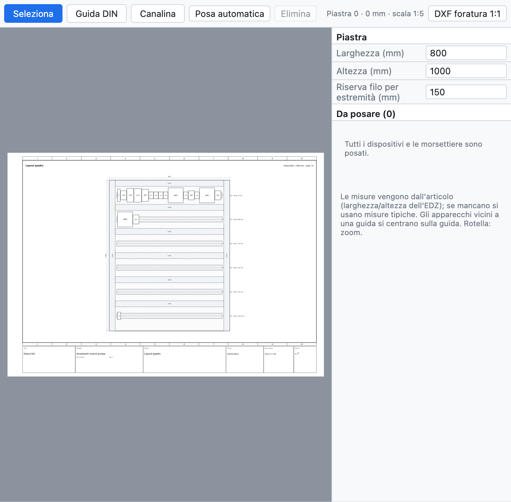

# 12. Layout del quadro

La pagina di layout è la **vista di montaggio** della piastra del quadro: guide DIN, canaline e
apparecchi in scala, con le misure. Serve per controllare che tutto ci stia, per la foratura e per stimare
la lunghezza dei fili.

*Un layout creato con la posa automatica: due file di guide con canaline e gli apparecchi del progetto di esempio.*

## Creare il layout

1. **+ Layout** sotto l'albero crea una pagina di layout con la piastra in scala normalizzata (1:5, 1:10…),
   quotata.
2. Nel pannello a destra imposta **larghezza** e **altezza** della piastra in mm e la **riserva** di filo
   per estremità.
3. Assegna la pagina a un **luogo** per vedere solo gli apparecchi di quel quadro.

## Guide DIN e canaline

Con **Guida DIN** e **Canalina** nella barra della vista, trascina sulla piastra per disegnarle.
Ogni guida mostra i millimetri liberi.

## Posare gli apparecchi

- L'elenco *Da posare* mostra i dispositivi e le morsettiere non ancora posati: trascinali sulla piastra.
- Gli apparecchi vicini a una guida si **centrano sulla guida**.
- Le **misure** vengono dall'articolo (larghezza e altezza dell'EDZ), altrimenti sono valori tipici;
  una morsettiera è larga quanto i suoi morsetti (un morsetto a più piani occupa un passo).
- **Posa automatica** crea file di canaline e guide se mancano e posa sulle guide tutti gli apparecchi
  non ancora posati.

## Controlli

La verifica segnala apparecchi fuori piastra, sovrapposti e guide piene.

## Foratura

**DXF foratura 1:1** esporta piastra, guide, canaline, sagome degli apparecchi e fori di fissaggio Ø 5,5
in scala reale, pronti per la lavorazione.

## Distinta e lunghezza dei fili

- Guide e canaline con articolo entrano in **distinta in metri**.
- La **lista fili (cablaggio)** riporta per ogni filo sezione, colore, **puntali** (DIN 46228) e la
  **lunghezza stimata** dal layout: percorso tra gli apparecchi più la riserva alle estremità.
- La **lista d'acquisto** somma il filo sfuso per sezione e colore con il 10% di scorta
  ([capitolo 14](14-liste-e-pagine-automatiche.md#lista-dacquisto)).
