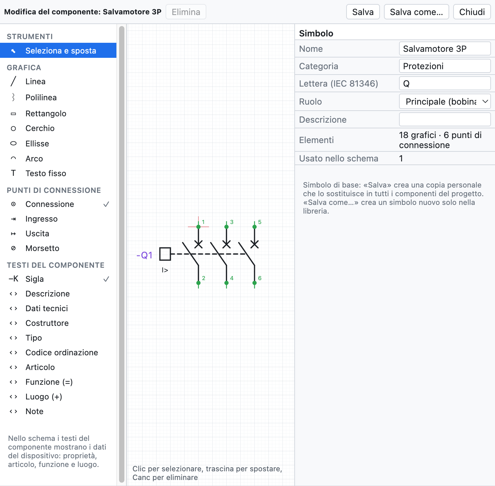
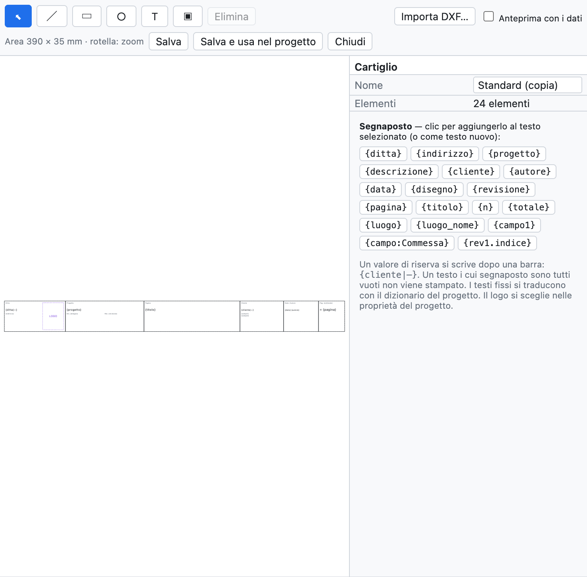

# 13. Macro, simboli e cartigli

## Macro

Una **macro** è un pezzo di schema da riusare: un avviamento motore, un circuito di emergenza, una
partenza con inverter.

### Creare una macro

1. Seleziona il circuito nello schema (selezione a riquadro).
2. Tasto destro ▸ **Crea macro dalla selezione…** (oppure dalla scheda *Macro* della libreria).
3. Scrivi nome, categoria e descrizione.

### Inserire una macro

1. Nella scheda **Macro** della libreria clicca sulla macro.
2. Clicca nella pagina: il punto cliccato è l'angolo in alto a sinistra del circuito.

All'inserimento **sigle, numeri filo, morsetti, canali PLC e cavi vengono rinumerati**; bobina e contatti
copiati insieme restano collegati. Le macro stanno nella libreria personale, disponibili in tutti i
progetti, e si scambiano come file `.ecmacro` (*File ▸ Importa ▸ Macro…* e il pulsante di export nella
scheda *Macro*).

## Editor dei componenti

L'editor disegna un componente da zero o modifica uno esistente: simboli di base, simboli personali,
componenti importati da QElectroTech o da EPLAN, anche le scatole nere degli articoli EDZ.

*Il salvamotore 3P aperto nell'editor: a sinistra gli oggetti da aggiungere, al centro il disegno con i
punti di connessione, a destra le proprietà.*

- Nello schema: tasto destro sul componente ▸ **Modifica il componente…**. Nella libreria:
  **Nuovo simbolo…**, oppure tasto destro su un simbolo.
- Si sceglie un oggetto nel pannello a sinistra e si clicca (o si trascina) nel disegno:

| Gruppo | Oggetti |
|---|---|
| *Grafica* | linea, polilinea (clic su ogni vertice, doppio clic o Invio per finire), rettangolo, cerchio, ellisse, arco, testo fisso |
| *Punti di connessione* | connessione, ingresso, uscita, morsetto: sulla griglia di 4 mm, con designazione (`13`, `A1`) e direzione del filo |
| *Testi del componente* | sigla, descrizione, dati tecnici, costruttore, tipo, codice ordinazione, articolo, funzione (=), luogo (+), note |

- I **testi del componente** mostrano nello schema i dati del dispositivo (proprietà, articolo, funzione e
  luogo). Descrizione e dati tecnici messi qui non si ripetono sotto la sigla.
- *Seleziona e sposta*: clic per selezionare, trascina per spostare, **Canc** per eliminare. Misure e
  angoli si correggono nel pannello a destra.
- A destra anche nome, categoria, **lettera** IEC 81346, **ruolo** (dispositivo, bobina con riferimenti
  incrociati, contatto NA/NC/in scambio, morsetto) e descrizione.
- La rotella fa lo zoom.

### Salvare

| Comando | Effetto |
|---|---|
| **Salva** | stesso nome: il simbolo cambia nella libreria personale e in **tutti i componenti dello schema** che lo usano |
| **Salva come…** | nome nuovo: un simbolo in più nella libreria personale; lo schema non cambia |

I simboli di base non si sovrascrivono: *Salva* crea una copia personale con lo stesso nome, che li
sostituisce nei componenti del progetto e anche nella libreria, nello stesso riquadro: riprendendolo dalla
libreria si usa la versione modificata. *Torna al simbolo di base* (nell'editor) rimette l'originale nella
libreria. La scatola nera modificata di un articolo EPLAN resta il simbolo
di quell'articolo. Usandolo in un progetto, il simbolo viene copiato nel file `.ecad`.

## Componenti di QElectroTech

*File ▸ Importa ▸ Simboli QElectroTech…* (o *Importa componenti…* nella libreria) legge i componenti di
[QElectroTech](https://qelectrotech.org): file `.elmt`, progetti `.qet` con i loro elementi, oppure archivi
`.zip` o `.7z` di intere cartelle, come la collezione ufficiale scaricata da GitHub.

- Viene convertita la grafica (linee, rettangoli, cerchi, ellissi, archi, poligoni, testi) con i morsetti
  e il loro nome.
- Il tipo diventa il ruolo: bobina con riferimenti incrociati, contatto NA/NC con numerazione automatica,
  morsetto, rimando.
- La lettera della sigla viene dal tipo e dal nome: interruttori e sezionatori **Q**, fusibili e relè
  termici **F**, bobine **K**.
- La scala è 10 px = 4 mm; i morsetti fuori griglia vengono portati sulla griglia con un breve raccordo,
  così i fili si agganciano.
- I componenti restano nella libreria personale; quando ne inserisci uno viene copiato nel progetto.

> **Attenzione**: su GitHub scarica il file vero con *Raw* o *Download raw file*. Salvando la pagina web
> si ottiene un file HTML che non contiene il componente.

La collezione di QElectroTech è © The QElectroTech team, licenza CC-BY 3.0: l'uso negli schemi è libero;
OpenWiring non include i loro simboli, li importi tu.

## Cartigli inclusi

Oltre a *Standard*, *Con tabella revisioni* e *Compatto*, il programma include sei cartigli completi, pensati
per diversi tipi di lavoro:

| Cartiglio | Per |
|---|---|
| *ISO 7200 (normativo)* | il cartiglio dei disegni tecnici secondo ISO 7200 |
| *Industriale dettagliato* | schemi industriali, con tabella delle revisioni e riquadri per data, disegnatore, verifica |
| *Macchina (EN 60204-1)* | equipaggiamento elettrico delle macchine |
| *Impianto civile (DM 37/08)* | impianti elettrici civili, con i dati richiesti per la dichiarazione di conformità |
| *Quadro elettrico (EN 61439)* | quadri di bassa tensione |
| *Automazione con firme* | impianti di automazione, con le caselle delle firme |

Si scelgono nelle proprietà del progetto (*Cartiglio ▸ Modello*) o in quelle di una pagina. I campi particolari
di ciascun modello (per esempio `{campo:Matricola}`) compaiono nelle *Proprietà del progetto*, già pronti da
compilare. Per ogni cartiglio incluso si può scegliere *Personalizza…* e partire da quel disegno.

## Cartigli personalizzati

Si può anche disegnare il cartiglio della propria ditta.

*Il cartiglio standard aperto nell'editor, con l'elenco dei segnaposto a destra.*

1. *Progetto ▸ Cartiglio: personalizza o disegna…*, oppure *Personalizza…* / *Nuovo…* nelle proprietà
   del progetto.
2. Disegna con linee, rettangoli, cerchi, testi e l'**area del logo**. L'area del cartiglio è 390 × 35 mm.
3. Nei testi usa i **segnaposto**: un clic su un segnaposto dell'elenco lo aggiunge al testo selezionato.
4. *Anteprima con i dati* mostra il cartiglio riempito con i dati del progetto.
5. **Salva e usa nel progetto**.

### Segnaposto

| Segnaposto | Valore |
|---|---|
| `{ditta}`, `{indirizzo}` | ditta e indirizzo |
| `{progetto}`, `{descrizione}`, `{cliente}`, `{autore}`, `{data}`, `{disegno}`, `{revisione}` | dati del progetto |
| `{pagina}`, `{titolo}` | numero e titolo della pagina |
| `{n}`, `{totale}` | posizione della pagina e numero di pagine (`{n}/{totale}`) |
| `{luogo}`, `{luogo_nome}` | luogo della pagina |
| `{campo1}`, `{campo:Commessa}` | campi aggiuntivi |
| `{prop:Ditta.Commessa}` | proprietà definita dall'utente del progetto o della pagina ([capitolo 4](04-progetto-e-pagine.md#proprietà-definite-dallutente)) |
| `{rev1.indice}`, `{rev1.descrizione}`… | ultime revisioni |

Un valore di riserva si scrive dopo una barra: `{cliente|—}`. Il valore di riserva può contenere a sua volta
un segnaposto: `{campo:Macchina|{progetto}}` scrive il campo *Macchina* e, se è vuoto, il nome del progetto. Un testo con tutti i segnaposto vuoti non
viene stampato.

### Importare un cartiglio da DXF

**Importa DXF…** nell'editor porta nel modello un cartiglio disegnato in AutoCAD o in un altro CAD: linee,
polilinee, cerchi, archi, testi e blocchi. Gli attributi diventano segnaposto (PROGETTO → `{progetto}`,
DATA → `{data}`, FOGLIO → `{pagina}`…). Se è più grande dell'area del cartiglio viene ridotto in scala.

I cartigli salvati restano nella libreria personale per tutti i progetti e vengono copiati nel file del
progetto. Ogni pagina può usare un cartiglio diverso; il cartiglio vale a schermo, nel PDF e nel DXF.
