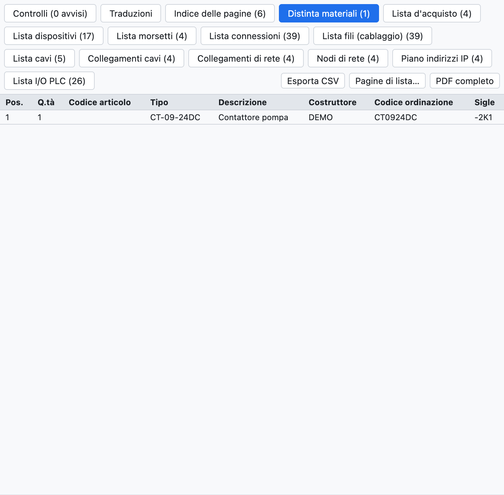
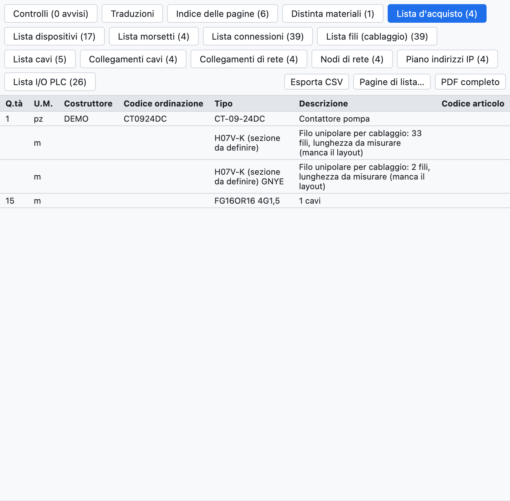
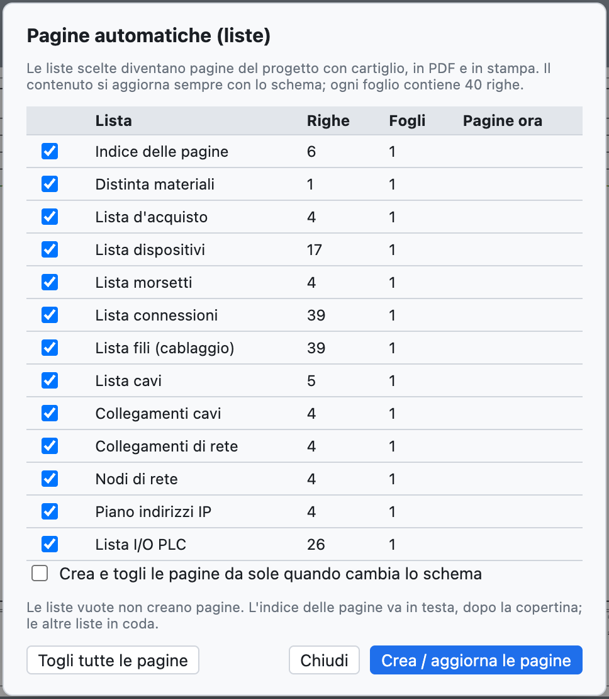
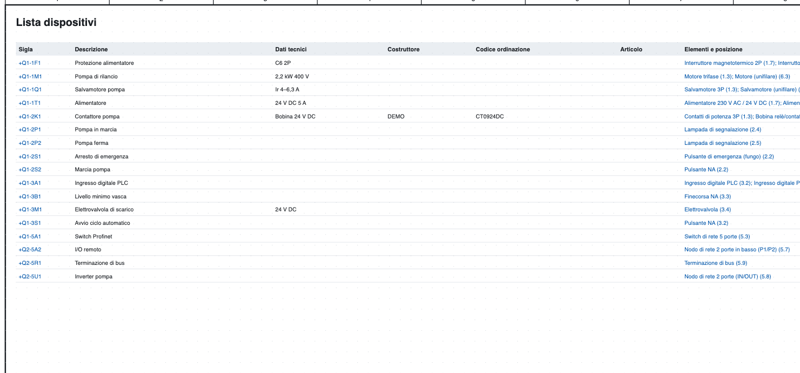
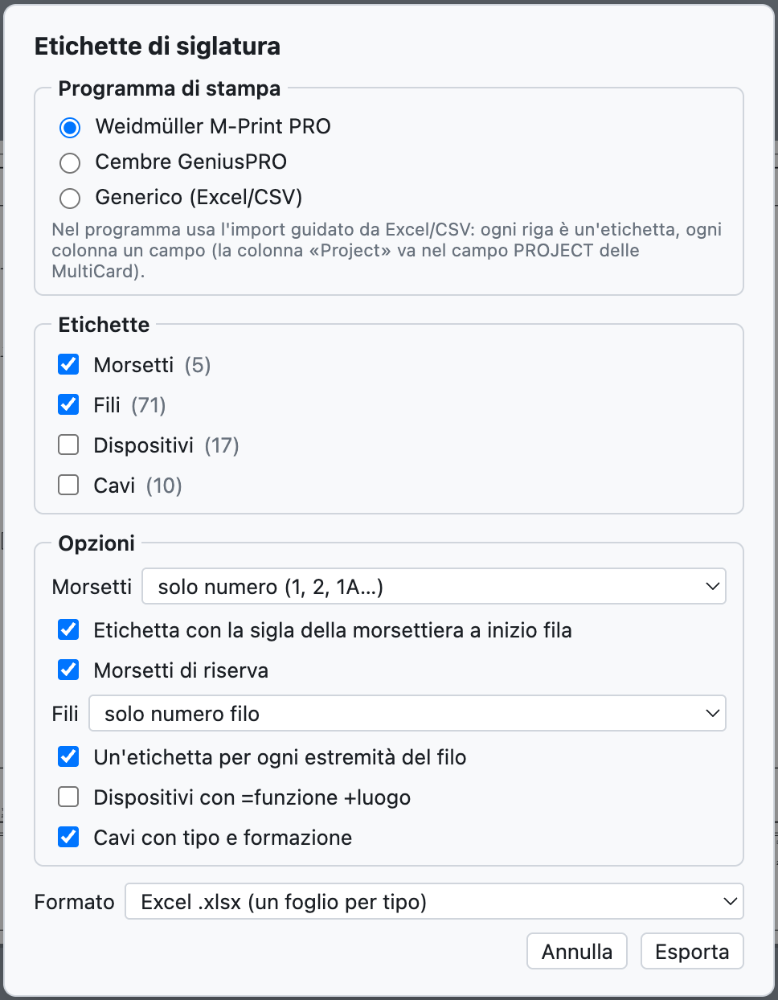

# 14. Liste e pagine automatiche

Tutte le liste sono **calcolate dallo schema**: non si compilano a mano e sono sempre aggiornate.

## La vista Liste

*La scheda Liste con la distinta materiali del progetto di esempio.*

La scheda **Liste** ha una linguetta per ogni lista; *Esporta CSV* salva la lista aperta (separatore `;`,
si apre in Excel), *PDF completo* esporta il progetto con tutte le liste in coda.

| Lista | Contenuto |
|---|---|
| Indice delle pagine | numero, titolo, tipo e luogo di ogni pagina |
| Distinta materiali | articoli raggruppati per codice (o per costruttore + codice di ordinazione), quantità, sigle |
| Lista d'acquisto | articoli per costruttore con l'unità di misura, filo sfuso, cavi |
| Lista dispositivi | sigla completa, descrizione, dati tecnici, costruttore, codici, elementi e posizioni |
| Lista morsetti | morsetti con destinazioni esterne e interne, numeri filo, ponticelli |
| Lista connessioni | ogni collegamento: numero filo, da, a, pagine, sezione, colore, cavo |
| Lista fili (cablaggio) | ogni filo con sezione, colore, puntali e lunghezza stimata |
| Lista cavi, Collegamenti cavi | vedi [capitolo 9](09-cavi-e-connettori.md) |
| Lista connettori | pin, lati, fili |
| Collegamenti di rete, Nodi di rete, Piano indirizzi IP | vedi [capitolo 11](11-reti-luoghi-unifilare.md) |
| Lista I/O PLC | vedi [capitolo 10](10-plc.md) |

Le liste vuote non compaiono. Un clic su una posizione (`/2.4`) porta all'elemento.

## Lista d'acquisto

*La lista d'acquisto del progetto di esempio.*

La lista d'acquisto serve per ordinare il materiale:

- gli articoli della distinta sono **raggruppati per costruttore**, così ogni gruppo è un ordine a un fornitore;
- ogni riga ha l'**unità di misura**: pezzi, oppure metri per cavi, guide e canaline;
- il **filo sfuso** è sommato per sezione e colore (`H07V-K 1,5 mm² BU`), in metri stimati dal layout del
  quadro con il 10% di scorta; senza layout la riga indica quanti fili e che la lunghezza è da misurare;
- i **cavi senza articolo** sono sommati per tipo e formazione.

## Pagine automatiche

Le liste diventano **pagine del progetto** con cartiglio, da stampare e da includere nel PDF.

*La finestra delle pagine automatiche: per ogni lista le righe, i fogli necessari e le pagine già presenti.*

1. *Inserisci ▸ Pagine automatiche (liste)…*, oppure *Pagine di lista…* nella vista Liste.
2. Spunta le liste che vuoi come pagine.
3. Premi **Crea / aggiorna le pagine**.

- Ogni foglio contiene 40 righe; una lista più lunga occupa più fogli.
- L'**indice delle pagine** va in testa, dopo la copertina; le altre liste in coda.
- Il **contenuto** delle pagine segue sempre lo schema.
- Con **Crea e togli le pagine da sole quando cambia lo schema** anche il numero di fogli si adegua da solo:
  se la lista morsetti passa da 40 a 41 righe compare il secondo foglio.
- *Togli tutte le pagine* toglie le pagine di lista.
- *Inserisci ▸ Aggiorna le pagine di lista* riallinea le pagine alle liste scelte.

*La lista dispositivi come pagina del progetto.*

## Etichette di siglatura

*File ▸ Esporta ▸ Etichette M-Print PRO / GeniusPRO…* prepara le etichette per le stampanti di siglatura.

*La finestra delle etichette.*

- **Programma**: Weidmüller M-Print PRO (colonne `Project`, `Text 1`, `Text 2`…, la colonna `Project` va nel
  campo PROJECT delle MultiCard), Cembre GeniusPRO (colonne `Riga 1`, `Riga 2`…, `Gruppo`) o generico.
- **Etichette**: morsetti, fili, dispositivi, cavi.
- **Opzioni**: morsetti con il solo numero o la sigla completa, etichetta della morsettiera a inizio fila,
  riserve; fili con il solo numero o con la destinazione, una etichetta per estremità; dispositivi con
  =funzione +luogo; cavi con tipo e formazione.
- **Formato**: Excel (un foglio per tipo) o CSV.

Entrambi i programmi importano Excel e CSV con una procedura guidata in cui si associa ogni colonna a un campo.
