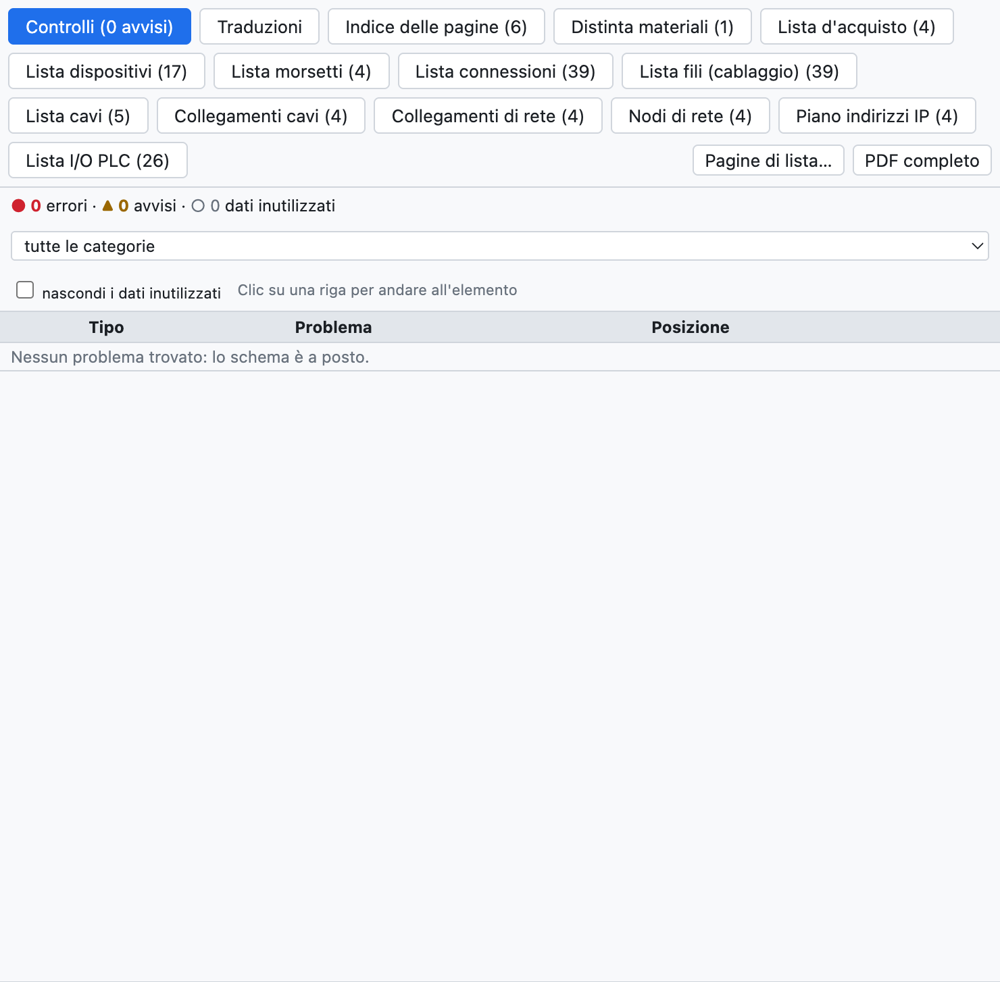
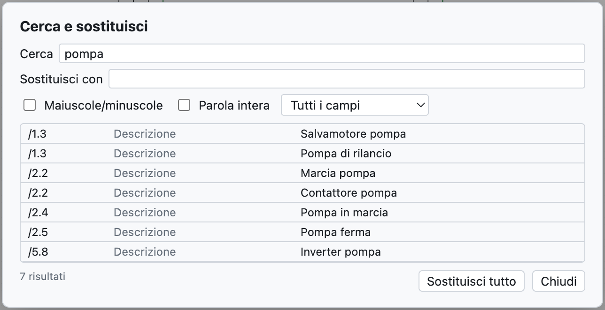

# 15. Verifica, ricerca e revisioni

## Verifica del progetto

**Verifica** nella barra strumenti (o *Progetto ▸ Verifica*) controlla tutto il progetto e apre la scheda
*Controlli* della vista Liste.

*Il progetto di esempio non ha problemi. Per un esempio con avvisi vedi il [capitolo 3](03-primo-progetto.md#passo-6--verifica).*

I problemi sono divisi in:

- **errori** (●): da correggere, per esempio un cortocircuito;
- **avvisi** (▲): probabili errori, per esempio un punto di connessione libero;
- **dati inutilizzati** (○): dati da riordinare, per esempio un articolo copiato nel progetto ma non usato.

Si filtrano per categoria e *nascondi i dati inutilizzati* toglie i ○. **Un clic su una riga** porta
all'elemento e lo seleziona.

### Cosa viene controllato

| Categoria | Esempi |
|---|---|
| Cortocircuiti | potenziali diversi sullo stesso conduttore (`L1` con `N`, `+24V` con `0V`), rimandi con nomi diversi collegati, componenti con i due morsetti sullo stesso conduttore |
| Collegamenti solo apparenti | un filo che passa sopra un punto di connessione senza terminarci: sembra collegato ma non lo è |
| Orfani | componenti, potenziali, rimandi e nodi senza collegamenti, fili isolati, contatti senza bobina |
| Collegamenti incompleti | morsetti liberi di bobine, contatti, lampade, pulsanti, punti I/O; fili con un estremo libero (le barre che arrivano al bordo sono ammesse) |
| Disegno | simboli inesistenti o sovrapposti, fili sovrapposti, elementi fuori dal foglio, numeri filo ripetuti, pagine vuote, rotazioni non ammesse dal simbolo (si corregge ammettendo la rotazione nel simbolo) |
| Bus di conduttori | fili che toccano il bus senza il nome del conduttore, conduttori che entrano nel bus e non escono |
| Sigle e dati | sigle doppie o mancanti, più contatti di quelli dell'articolo, morsetti ripetuti |
| Cavi, connettori, reti, PLC, layout | vedi i capitoli relativi |
| Dati inutilizzati | articoli, simboli, dati di morsettiere e connettori non più usati, luoghi vuoti |

> **Consiglio**: lancia la verifica prima di ogni consegna e prima di esportare il PDF.

## Cerca e sostituisci

**⌘F** (o *Cerca*) apre la ricerca in tutto il progetto.

*La ricerca di «pompa» trova sette descrizioni.*

- Cerca in sigle, descrizioni, testi, numeri filo, nomi PLC, codici; l'elenco *Tutti i campi* restringe la
  ricerca a un campo.
- *Maiuscole/minuscole* e *Parola intera* affinano la ricerca.
- Un clic su un risultato porta all'elemento.
- *Sostituisci con* e **Sostituisci tutto** cambiano il testo in tutti i risultati, in un passo annullabile.

## Revisioni

Una **revisione** fissa lo stato del progetto consegnato, per esempio «Rev. A – prima emissione».

1. *Progetto ▸ Nuova revisione…* (o *Nuova revisione…* nelle proprietà del progetto).
2. Scrivi indice, data, autore e descrizione.

Da quel momento:

- le modifiche successive sono segnate con **nuvolette** rosse a schermo e nel PDF (si spengono con
  *Nuvolette sulle modifiche* nelle proprietà);
- il cartiglio di ogni pagina mostra l'indice dell'ultima revisione che l'ha cambiata;
- l'indice del PDF, la copertina e il cartiglio *Con tabella revisioni* riportano le revisioni.

## Confrontare due progetti

*File ▸ Importa ▸ Confronta con un file .ecad…* (o *Confronta…* nelle proprietà) confronta il progetto aperto
con un altro file, per esempio la versione consegnata al cliente. La scheda *Confronto* della vista Liste
elenca pagine, dispositivi e dati di progetto aggiunti, tolti o cambiati.
