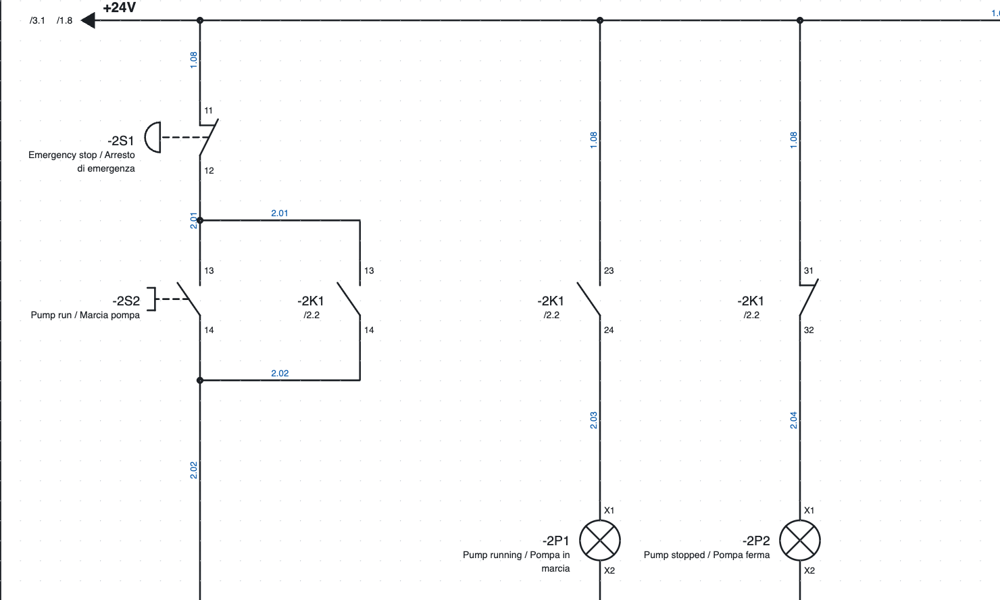
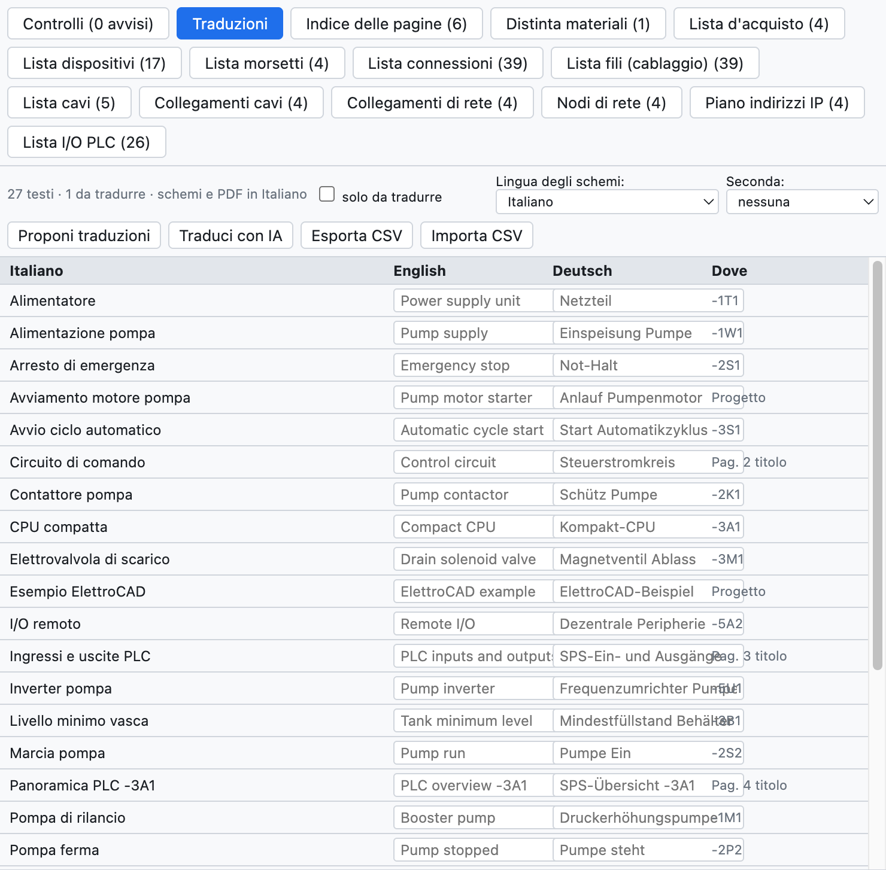

# 16. Lingue degli schemi

Gli schemi si disegnano in italiano e si stampano anche in **inglese** o **tedesco**, oppure in due lingue
insieme. La lingua dell'interfaccia del programma è un'altra impostazione
([capitolo 1](01-introduzione.md#lingua-dellinterfaccia)).

*La pagina 2 in inglese con l'italiano sotto: «Emergency stop / Arresto di emergenza».*

## Il dizionario di progetto

La scheda *Traduzioni* della vista Liste (o *Progetto ▸ Traduzioni…*) elenca tutti i testi traducibili
del progetto: titoli di pagina, testi liberi, descrizioni dei dispositivi, luoghi, commenti PLC, campi del
cartiglio. Per ognuno ci sono la traduzione inglese, quella tedesca e dove compare.

*Il dizionario del progetto di esempio.*

- Scrivi la traduzione nella cella; *solo da tradurre* mostra i testi che ne mancano.
- Il programma contiene già i testi fissi (cartiglio, titoli e colonne delle liste) e circa 250 termini
  elettrici comuni.

## Tradurre in automatico

| Comando | Come traduce |
|---|---|
| *Proponi traduzioni* | frase intera se è nel dizionario incluso, altrimenti parola per parola («Lampada guasto» → «Fault lamp») |
| *Traduci con IA* | con l'assistente IA scelto (Claude, ChatGPT, Gemini), con la terminologia di settore ([capitolo 17](17-assistente-ia.md#tradurre-il-dizionario)) |

Le traduzioni automatiche sono **evidenziate** come da verificare: si confermano con ✓ o modificandole.

## Scegliere la lingua

- **Lingua degli schemi**: *Visualizza ▸ Lingua degli schemi*, le proprietà del progetto (*Lingue*) o la
  scheda Traduzioni. Cambia schemi, cartiglio, copertina, pagine di lista, panoramiche PLC e schemi delle
  morsettiere.
- **Seconda lingua**: scrive i testi in due lingue («Contattore pompa / Pump contactor»).
- Il **PDF** e la **stampa** si possono fare in un'altra lingua senza cambiare quella del progetto
  (scelta *Lingua* nella finestra di export).

## Con un traduttore

*Esporta CSV* salva il dizionario come tabella `Italiano;English;Deutsch`: il traduttore la completa in
Excel e *Importa CSV* la rilegge.
