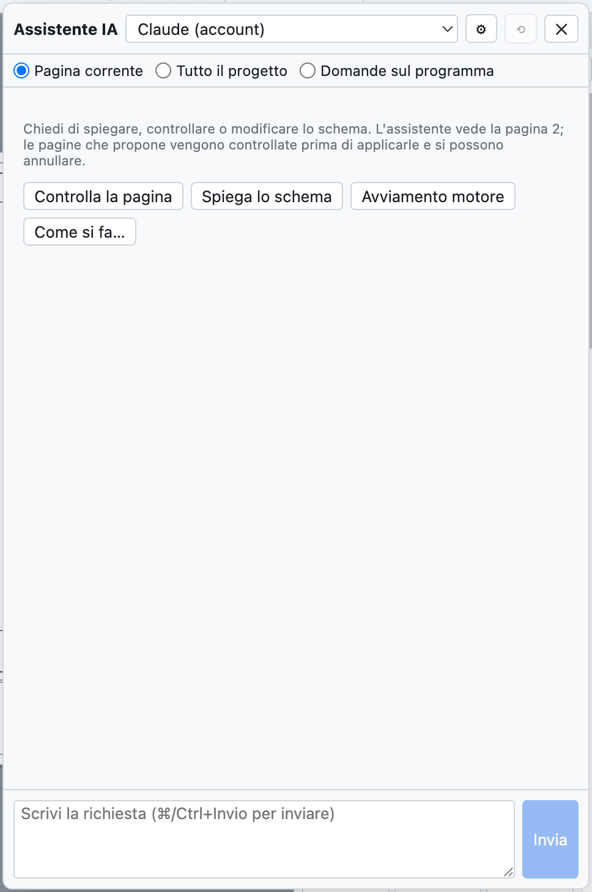
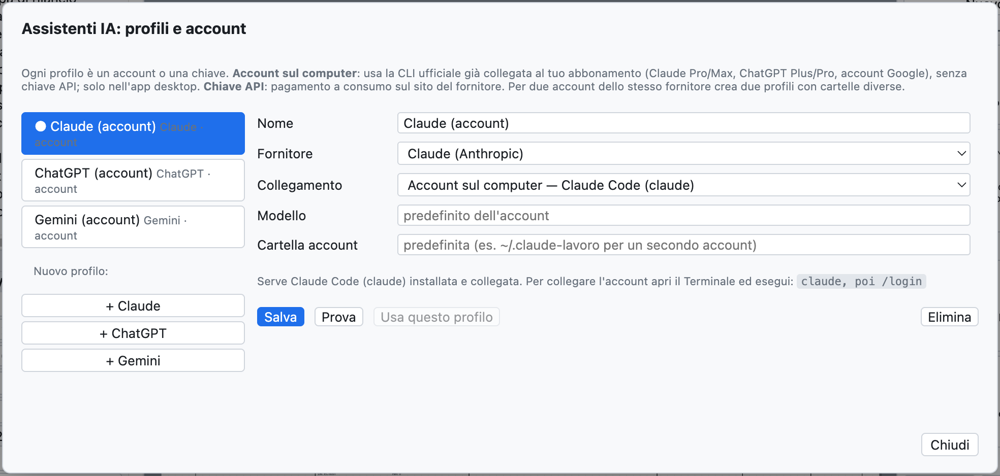
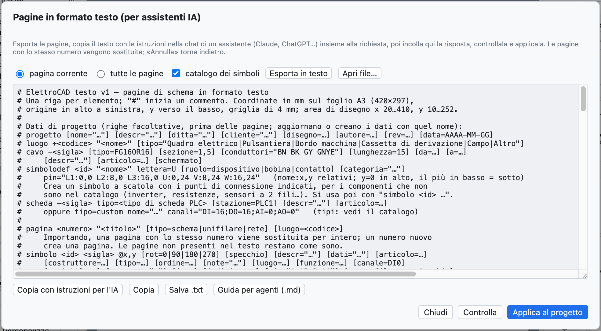

# 17. Assistente IA

L'assistente IA è un collega a cui chiedere, in italiano, di **spiegare**, **controllare** o
**disegnare** parti dello schema. Funziona con **Claude** (Anthropic), **ChatGPT** (OpenAI) e **Gemini**
(Google), usando i tuoi account.



*Il pannello dell'assistente, con i pulsanti rapidi.*

## Aprire l'assistente

*Progetto ▸ Assistente IA…* o **⌘I** apre il pannello a destra; lo schema resta visibile e si può
lavorare mentre l'assistente risponde.

In alto si sceglie:

- il **profilo**: quale assistente e quale account;
- il **contesto**: cosa vede l'assistente.

| Contesto | L'assistente riceve |
|---|---|
| *Pagina corrente* | la pagina nel formato testo, la guida al formato con il catalogo dei simboli, i problemi della verifica sulla pagina |
| *Tutto il progetto* | tutte le pagine, i dati di progetto (luoghi, cavi, schede PLC) e tutti i problemi della verifica |
| *Domande sul programma* | il manuale di OpenWiring, per domande su menu e comandi |

## Cosa chiedere

| Richiesta | Esempio |
|---|---|
| Spiegare | «Spiega come funziona il circuito di questa pagina» |
| Controllare | «Controlla questa pagina: collegamenti, sigle, protezioni, norma CEI EN 60204-1» |
| Disegnare | «Aggiungi una pagina 7 con un avviamento stella-triangolo per un motore da 15 kW» |
| Modificare | «Aggiungi una lampada di guasto comandata dal contatto 95-96 del termico» |
| Usare il programma | «Come si crea una morsettiera a due piani?» |

I pulsanti rapidi *Controlla la pagina*, *Spiega lo schema*, *Avviamento motore*, *Come si fa…* inviano
richieste pronte. **⌘Invio** invia, *Annulla* interrompe una risposta lunga, ⟲ inizia una conversazione nuova.

## Quando l'assistente disegna

Se la risposta contiene pagine nel formato testo, il pannello le **controlla subito**:

- *Pronto: aggiunge la pagina 7 · nessun problema* → premi **Applica al progetto**;
- se ci sono errori o problemi della verifica, compaiono sotto la risposta: **Chiedi la correzione**
  rimanda all'assistente errori e problemi, e lui corregge.

L'applicazione si annulla con **⌘Z**. Una pagina con lo stesso numero di una esistente la sostituisce;
un numero nuovo aggiunge una pagina.

> **Esempio reale.** Chiedendo «Aggiungi una pagina nuova (numero 7) con un avviamento diretto per un motore
> trifase da 4 kW: salvamotore, contattore, morsettiera e motore», Claude ha risposto in circa 30 secondi
> con la pagina completa (salvamotore `-7Q1`, contattore `-7K1`, morsetti `-X2`, motore `-7M1`, cavo `-7W1`),
> segnalando da solo che mancava la bobina del contattore nel circuito di comando.

## Profili e account

*Progetto ▸ Assistenti IA: profili e account…* (o ⚙ nel pannello).



*Un profilo per ogni assistente: al primo uso ce n'è uno per Claude, ChatGPT e Gemini.*

Ogni profilo ha un nome, un fornitore, un modo di collegamento e un modello. Si possono avere più profili
dello stesso fornitore, per esempio l'account personale e quello aziendale.

### Account sul computer (abbonamento)

Nell'app desktop il profilo può usare la **CLI ufficiale** del fornitore, già collegata al tuo abbonamento:
nessuna chiave API, si usa la quota dell'abbonamento.

| Fornitore | Programma da installare | Abbonamento | Comando per collegare l'account |
|---|---|---|---|
| Claude | Claude Code (`claude`) | Claude Pro o Max | `claude`, poi `/login` |
| ChatGPT | Codex CLI (`codex`) | ChatGPT Plus o Pro | `codex login` |
| Gemini | Gemini CLI (`gemini`) | account Google | `gemini`, poi *Login with Google* |

Il comando si esegue una volta nel Terminale. Per un **secondo account** dello stesso fornitore indica nel
profilo una **cartella account** diversa (per esempio `~/.claude-lavoro`): la finestra mostra il comando
esatto, per esempio `CLAUDE_CONFIG_DIR=~/.claude-lavoro claude`.

Se l'accesso scade, l'assistente risponde con il comando da eseguire (per esempio `codex login`).

### Chiave API

Con il collegamento *Chiave API* si paga a consumo sul sito del fornitore:

| Fornitore | Dove si crea la chiave |
|---|---|
| Claude | console.anthropic.com |
| ChatGPT | platform.openai.com |
| Gemini | aistudio.google.com |

Incolla la chiave nel profilo; *Elenca* mostra i modelli disponibili con quella chiave. Nell'app desktop la
chiave è **cifrata** dal sistema operativo e resta solo su quel computer.

**Prova** verifica il collegamento con una domanda breve; **Usa questo profilo** lo rende quello attivo.

## Tradurre il dizionario

*Progetto ▸ Traduci con l'assistente IA* (o *Traduci con IA* nella scheda Traduzioni) manda all'assistente
attivo i testi del progetto senza traduzione, e quelli tradotti parola per parola, e chiede inglese e tedesco
con la terminologia di settore. Le traduzioni entrano nel dizionario come **da verificare** (vedi
[capitolo 16](16-lingue.md)).

## Il formato testo con un assistente esterno

Si può lavorare anche con un assistente in una chat del browser, senza profili:



*La finestra delle pagine in formato testo.*

1. *File ▸ Pagine in testo (assistenti IA)…*: scegli *pagina corrente* o *tutte le pagine* e premi
   **Esporta in testo**.
2. **Copia con istruzioni per l'IA** e incolla nella chat, aggiungendo la richiesta in fondo.
3. Incolla la risposta nella finestra (anche con il testo intorno), premi **Controlla** e poi
   **Applica al progetto**.

Il formato è una riga per elemento:

```text
luogo +Q1 "Quadro elettrico"
pagina 7 "Ventilazione quadro" luogo=Q1
  simbolo potential +24V @28,24
  filo 28,24 400,24
  simbolo potential 0V @28,232
  filo 28,232 400,232
  simbolo pb_no -? @100,60 descr="Marcia ventilatore"     # "-?" = sigla automatica
  simbolo coil -7K1 @100,140 descr="Contattore ventilatore"
  collega -7S1:13 100,24                                  # verso la barra +24V
  collega -7S1:14 -7K1:A1                                 # per sigla e punto di connessione
  collega -7K1:A2 100,232
```

La sintassi completa è nella **guida per agenti** (*Aiuto ▸ Guida per agenti IA (.md)…*), vedi
[capitolo 19](19-riga-di-comando.md).

## Riservatezza

Lo schema inviato all'assistente esce dal computer e arriva al fornitore scelto, con le sue condizioni
d'uso. Con *Pagina corrente* si invia solo la pagina aperta.
