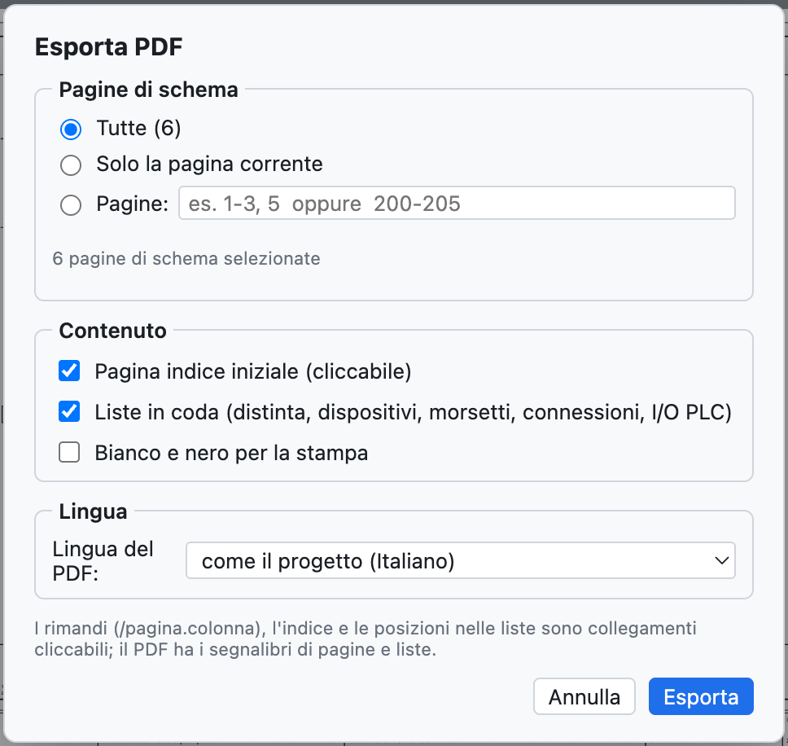
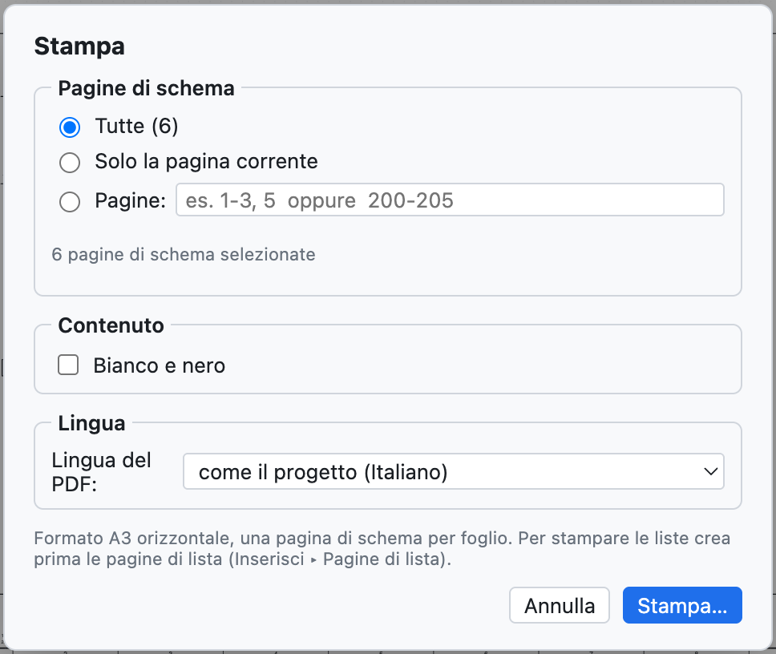

# 18. Import ed export

## PDF

**PDF** nella barra strumenti (o *File ▸ Esporta ▸ PDF…*) crea un PDF vettoriale in A3.

*Le opzioni del PDF.*

| Opzione | Effetto |
|---|---|
| *Tutte*, *Solo la pagina corrente*, *Pagine* | quali pagine; l'intervallo si scrive con i numeri del progetto (`1-3, 5` o `200-205`) |
| *Pagina indice iniziale* | indice cliccabile delle pagine e delle liste |
| *Liste in coda* | distinta, dispositivi, morsetti, connessioni, I/O PLC dopo gli schemi |
| *Bianco e nero per la stampa* | fili e numeri filo in nero |
| *Lingua del PDF*, *Seconda lingua* | il PDF in un'altra lingua, senza cambiare il progetto |

Nel PDF i **rimandi sono cliccabili** (contatti ↔ bobina, rimandi tra pagine, PLC, panoramiche), così
come le posizioni nelle liste e l'indice; il PDF ha i **segnalibri** di pagine e liste.

## Stampa

*File ▸ Stampa…* (⌘P) manda le pagine alla stampante in **A3 orizzontale**, una pagina per foglio.

*Le opzioni di stampa: pagine, bianco e nero, lingua.*

Per stampare anche le liste crea prima le pagine di lista ([capitolo 14](14-liste-e-pagine-automatiche.md#pagine-automatiche)).

## DXF

| Comando | Risultato |
|---|---|
| *File ▸ Esporta ▸ DXF della pagina corrente* | un DXF R12 in scala 1:1, in mm |
| *File ▸ Esporta ▸ DXF di tutto il progetto (ZIP)* | un DXF per pagina, raccolti in un archivio ZIP |
| sulla pagina di layout | il DXF di foratura della piastra ([capitolo 12](12-layout-quadro.md#foratura)) |

I DXF hanno i layer CORNICE, CARTIGLIO, SIMBOLI, FILI, TESTI, SIGLE, NUMERI_FILO (più CAVI e QUADRI dove
servono) e si aprono in AutoCAD, DraftSight, LibreCAD e negli altri CAD. Il formato DWG non è disponibile:
si apre il DXF e si salva in DWG dal CAD.

## Excel e CSV

- Ogni lista si esporta in **CSV** (separatore `;`) dalla vista Liste.
- Il **navigatore dei dispositivi** esporta e reimporta Excel ([capitolo 7](07-dispositivi-e-articoli.md#excel)).
- La vista **PLC** esporta per TIA Portal, CODESYS, PLCopen e la lista I/O ([capitolo 10](10-plc.md)).
- Le **etichette** escono in Excel o CSV ([capitolo 14](14-liste-e-pagine-automatiche.md#etichette-di-siglatura)).
- Il **dizionario** delle traduzioni esce in CSV ([capitolo 16](16-lingue.md)).

## Importare schemi da PDF (SEE Electrical e altri)

*File ▸ Importa ▸ Schema da PDF (SEE Electrical…)…* crea un **progetto nuovo** da uno schema esportato in
**PDF vettoriale** da un altro CAD. È stato provato con un progetto reale di SEE Electrical di 207 pagine,
importato in pochi secondi.

Cosa viene ricostruito:

- **fogli**: uno per ogni foglio di schema, con numero e titolo dal cartiglio; il prefisso del titolo
  (`Q1.1 Ingresso linea`) diventa il luogo `+Q1.1`; copertina e liste del CAD di origine si saltano;
- **fili veri**, con il colore del disegno (blu → BU, giallo-verde → PE, rosso → RD…) e il nome scritto
  accanto (`L1-1.1`, `200.01`) come numero filo;
- **componenti** con la **sigla** più vicina, i **morsetti** dove arrivano i fili e i loro nomi (`1/L1`, `A1`, `95`);
- **morsetti di morsettiera**, anche a più piani (`X1.1.12:1A`);
- **rimandi** tra pagine, accoppiati per nome o dai riferimenti `foglio.colonna`;
- **testi** liberi e testi dei componenti.

Da ricontrollare: i componenti sono riconosciuti dalla grafica e non sanno se sono bobine o contatti
(quindi niente immagine dei contatti); alcuni elementi restano grafica senza sigla. *Progetto ▸ Verifica*
segnala conduttori interrotti e rimandi senza corrispondente. Un PDF scansionato (un'immagine) non si può importare.

## Altri import

| Comando | Cosa importa | Vedi |
|---|---|---|
| *Articoli EDZ / XML / CSV…* | articoli dei produttori, con immagini, morsetti, disegno e dati commerciali (CSV) | [capitolo 7](07-dispositivi-e-articoli.md#importare-i-dati-dei-produttori-edz) |
| *Simboli QElectroTech…* | componenti `.elmt`, `.qet`, archivi | [capitolo 13](13-macro-simboli-cartigli.md#componenti-di-qelectrotech) |
| *Macro…* | file `.ecmacro` | [capitolo 13](13-macro-simboli-cartigli.md#macro) |
| *Confronta con un file .ecad…* | differenze con un altro progetto | [capitolo 15](15-verifica-ricerca-revisioni.md#confrontare-due-progetti) |
| *Importa DXF…* nell'editor dei cartigli | cartiglio disegnato in un altro CAD | [capitolo 13](13-macro-simboli-cartigli.md#importare-un-cartiglio-da-dxf) |
| *Importa variabili* (vista PLC) | tabella variabili di TIA Portal, CODESYS, CSV | [capitolo 10](10-plc.md#import-delle-variabili) |
| *Pagine in testo* | pagine scritte da un assistente IA o da uno script | [capitolo 17](17-assistente-ia.md#il-formato-testo-con-un-assistente-esterno) |

## Altri export

| Comando | Risultato |
|---|---|
| *PLCopen XML (variabili PLC)* | variabili globali per CODESYS e ambienti compatibili |
| *Articoli in XML (formato EPLAN)* | articoli della libreria in un file XML nel formato EPLAN |
| *Dizionario delle traduzioni (CSV)* | tabella `Italiano;English;Deutsch` |
