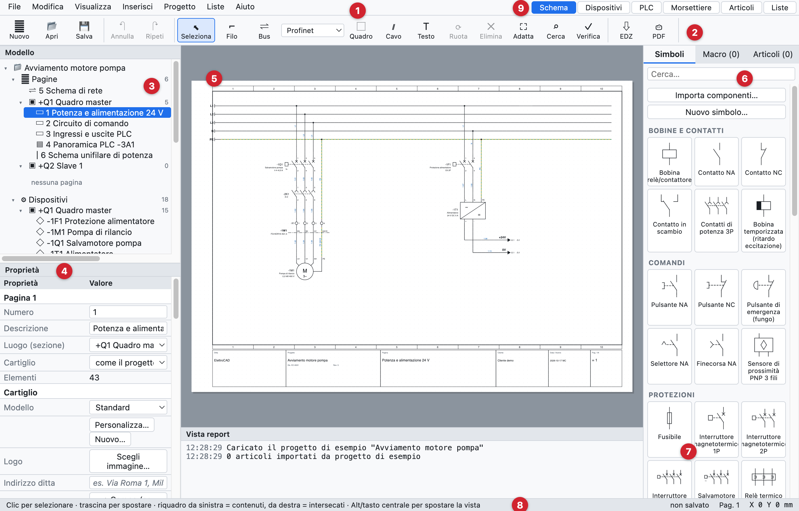
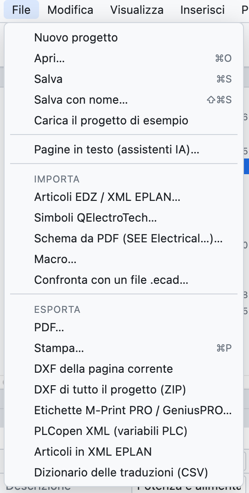
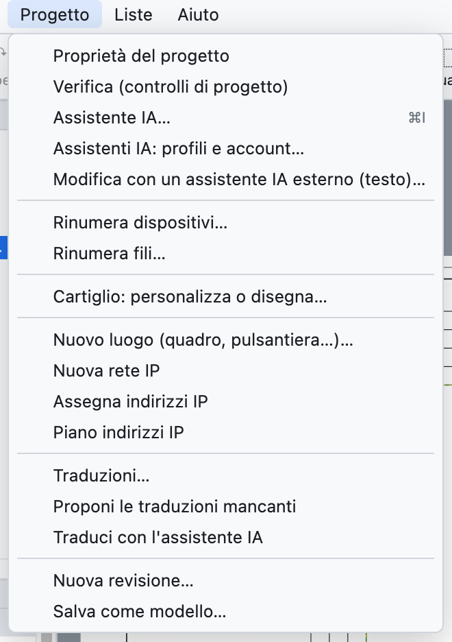
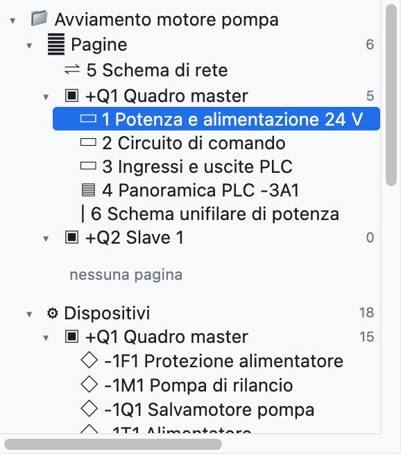
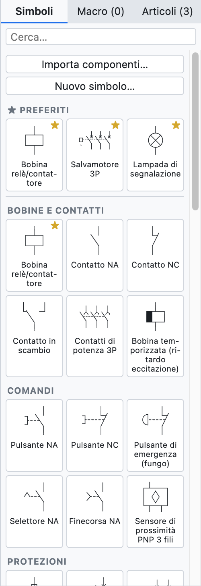
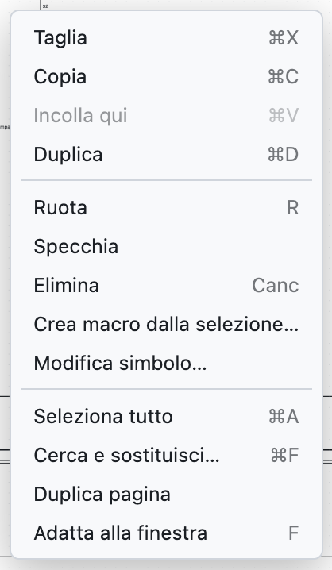

# 2. Интерфейс

*Окно OpenWiring с учебным проектом.*

| № | Часть | Назначение |
|---|---|---|
| 1 | Строка меню | все команды: *Файл, Правка, Вид, Вставка, Проект, Списки, Справка* |
| 2 | Панель инструментов | наиболее часто используемые команды черчения |
| 3 | Дерево модели | страницы, устройства, структура =/+, клеммники, кабели, артикулы проекта |
| 4 | Свойства | данные выбранного элемента, страницы или проекта |
| 5 | Область черчения | текущая страница схемы |
| 6 | Библиотека | символы, макросы и артикулы для вставки |
| 7 | Окно отчёта | сообщения об импорте, экспорте и операциях |
| 8 | Строка состояния | подсказки по активной команде, файл, страница, координаты курсора |
| 9 | Вкладки видов | Схема, Устройства, ПЛК, Клеммники, Артикулы, Списки |

## Строка меню

*Меню «Файл»: проекты, импорт и экспорт.*

Каждая команда программы находится в каком-либо меню; рядом с пунктами указаны сочетания клавиш. При открытом меню стрелки ← → переходят к соседнему меню, а Esc закрывает его.

| Меню | Содержит |
|---|---|
| *Файл* | создать, открыть, сохранить, учебный проект, страницы в текстовом формате для ИИ-ассистентов, **Импорт** (артикулы EDZ/XML/CSV, символы QElectroTech, схема из PDF, макросы, сравнение) и **Экспорт** (PDF, печать, DXF, этикетки, PLCopen, артикулы, словарь) |
| *Правка* | отменить и повторить, вырезать, копировать, вставить, дублировать, удалить, выделить всё, повернуть, зеркально отразить, найти и заменить |
| *Вид* | виды, вписать страницу, предыдущая и следующая страница, светлая или тёмная тема, белый или тёмный лист, язык схем, язык интерфейса, подписи под значками |
| *Вставка* | провод, кабель, рамка шкафа, текст, изображение, шина проводов, сетевые соединения по протоколам, страницы всех типов, автоматические страницы |
| *Проект* | свойства, пользовательские свойства, проверка, ИИ-ассистент, перенумерация, основная надпись, места установки, IP-сети, переводы, ревизии, шаблоны |
| *Списки* | проверки, переводы и все списки проекта, полный PDF |
| *Справка* | руководство, сочетания клавиш, руководство для ИИ-агентов, сайт проекта, сведения о программе (версия, автор, товарные знаки и данные третьих лиц) |

*Меню «Проект».*

## Панель инструментов

| Кнопка | Действие |
|---|---|
| *Создать, Открыть, Сохранить* | работа с файлом проекта |
| *Отменить, Повторить* | ⌘Z и ⇧⌘Z |
| *Выбрать* | возврат к выбору (также клавишей Esc) |
| *Провод* | черчение проводов (клавиша **W**) |
| *Шина* и список протоколов | черчение сетевого соединения (Profinet, EtherCAT, Modbus…) |
| *Шина проводов* | объединяет провода в шину проводов ([глава 5](05-disegnare.md#шины-проводников)) |
| *Шкаф* | рамка шкафа на сетевой схеме |
| *Кабель* | линия определения кабеля |
| *Текст* | свободный текст на странице |
| *Повернуть, Удалить* | для выделенного (клавиши **R** и **Del**) |
| *Вписать* | показать всю страницу (клавиша **F**) |
| *Поиск* | найти и заменить (⌘F) |
| *Проверка* | контроль проекта |
| *EDZ* | импорт артикулов производителей |
| *PDF* | экспорт проекта в PDF |

Если отключить *Вид ▸ Подписи под значками*, панель превратится в более низкую строку только из значков.

## Дерево модели

В дереве показан проект; ветви раскрываются и сворачиваются треугольниками ▸ ▾:

- **Страницы**, сгруппированные по местам установки (шкаф, пульт…): щелчок открывает страницу.
- **Устройства**, сгруппированные по местам установки: щелчок переходит к устройству и выделяет его.
- **Структура =Установка +Место**: устройства по функциям и местам (см. [главу 7](07-dispositivi-e-articoli.md#структура-установка-место)).
- **Клеммники** и **Кабели**: щелчок открывает клеммник или выделяет линию кабеля.
- **Артикулы проекта**: используемые артикулы.

Под деревом расположены кнопки страниц: *+ Страница*, *+ Титульный лист*, *+ Однолинейная*, *+ Сеть*, *+ Компоновка*, *⧉* (дублировать страницу), *↑ ↓* (переместить) и *✕* (удалить).

## Свойства

Панель показывает данные выбранного объекта:

- **ничего не выбрано**: текущая страница и, ниже, данные проекта;
- **символ**: обозначение, данные устройства, заказ, точки подключения, положение;
- **провод**: номер провода, цепь, соединения, сечение, цвет;
- **несколько элементов**: общие поля.

Значение вводится в поле и подтверждается клавишей Enter или выходом из поля. Значения серым курсивом — подсказки или значения, взятые из артикула.

## Библиотека

В правой колонке три вкладки:

- **Символы**: символы IEC 60617 по категориям (катушки и контакты, команды, защита, потребители, клеммы и соединения, ПЛК, сети и шины, однолинейные), а также импортированные или нарисованные вами. Поле *Поиск…* фильтрует по названию. Вверху находится **★ Избранное**: звёздочка ☆ у символа (или правая кнопка на компоненте ▸ *Добавить в избранное*) помещает его сюда. Избранное действует во всех проектах.
- **Макросы**: сохранённые схемы для повторного использования (см. [главу 13](13-macro-simboli-cartigli.md)).
- **Артикулы**: библиотека артикулов производителей.

## Контекстное меню

Правая кнопка на элементе открывает наиболее часто используемые команды: вырезать, копировать, вставить сюда, дублировать, повернуть, отразить, удалить, создать макрос из выделенного, **копировать свойства** и **вставить свойства -X** (все данные устройства, кроме обозначения, [глава 7](07-dispositivi-e-articoli.md#копирование-свойств)), изменить компонент, добавить в избранное, подсветить потенциал (на проводах), перейти к главному элементу или к контактам, добавить ярус (на клеммах), выделить всё, поиск, дублировать страницу, вписать в окно.

## Виды

Вкладки в правом верхнем углу переключают центральную часть:

| Вид | Содержание |
|---|---|
| *Схема* | страница для черчения |
| *Устройства* | навигатор устройств в виде таблицы |
| *ПЛК* | модули, адреса и список входов-выходов |
| *Клеммники* | навигатор клеммников |
| *Артикулы* | управление артикулами |
| *Списки* | проверки, переводы и все списки |

## Перемещение по чертежу

| Действие | Как |
|---|---|
| Увеличить и уменьшить | колёсико мыши, относительно курсора (на трекпаде — щипок) |
| Сдвинуть вид | средняя кнопка мыши или **Alt** + перетаскивание |
| Увидеть всю страницу | **F** или *Вписать* |
| Предыдущая или следующая страница | **PageUp** / **PageDown** |
| Перейти по ссылке | щелчок по межстраничной связи, например `/2.4` |

## Тема и лист

*Вид ▸ Тема* выбирает светлый или тёмный интерфейс либо как в системе. *Вид ▸ Лист чертежа* выбирает белый или тёмный лист (как в CAD с чёрным фоном). PDF, DXF и печать всегда выводятся на белом листе.
