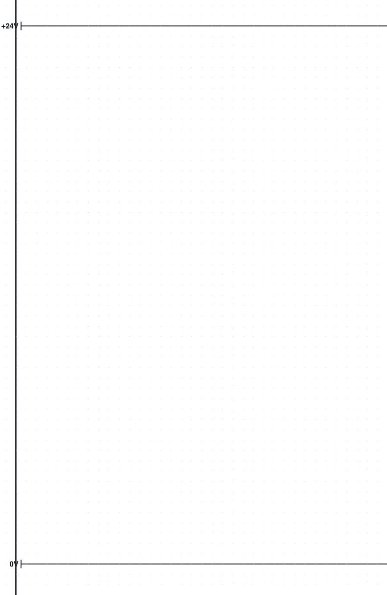
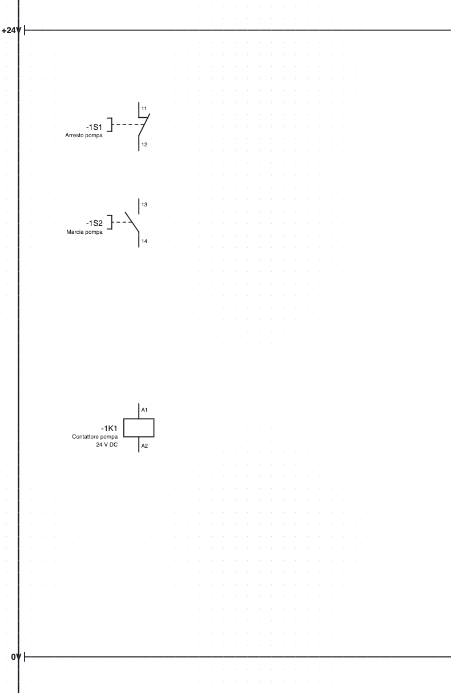
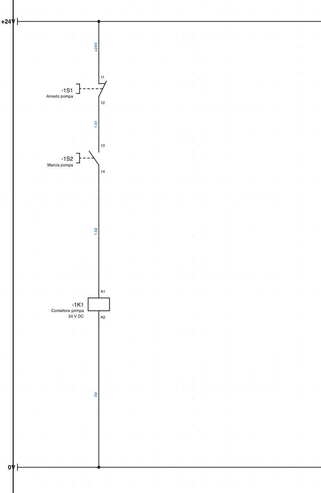
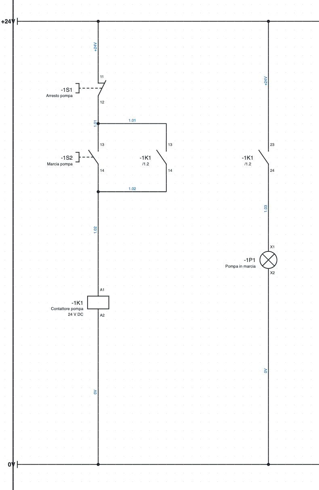
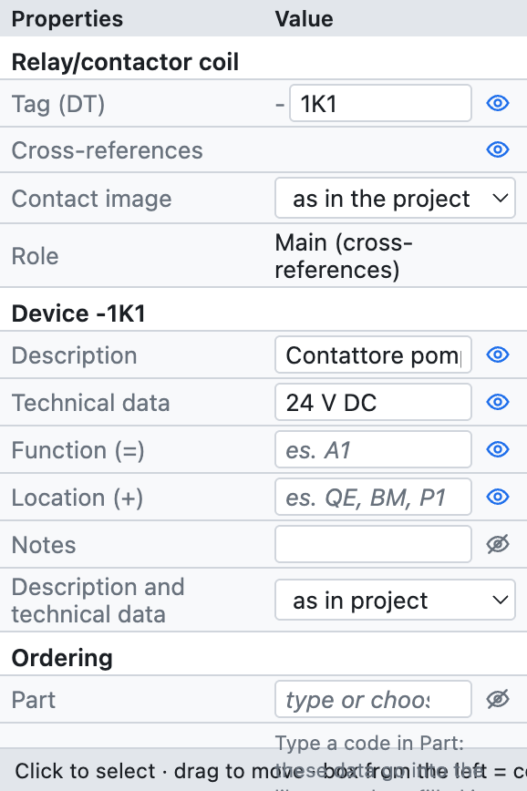
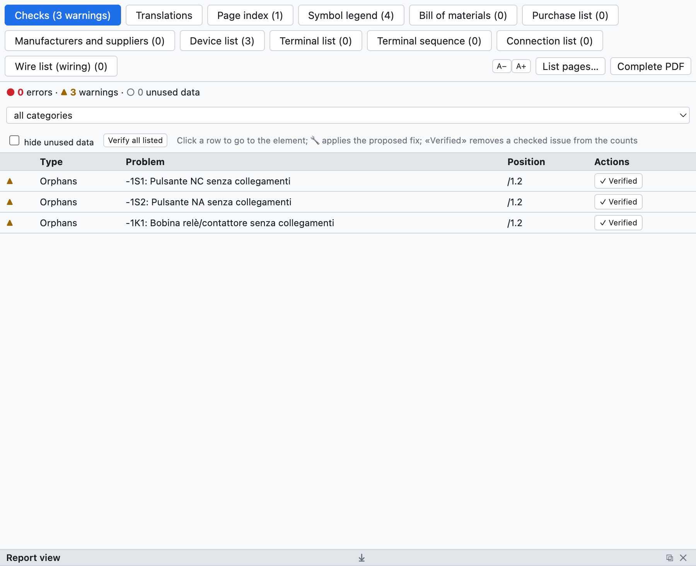
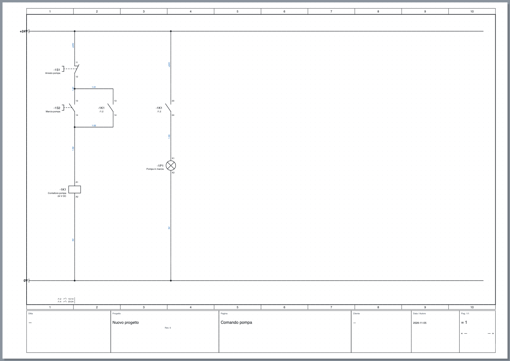

# 3. Первый проект

В этом упражнении чертится **управление насосом**: кнопка «Стоп», кнопка «Пуск», контактор с самоподхватом и сигнальная лампа работы, питание 24 В. Потребуется около двадцати минут, и в конце вы будете знать основные команды: вставка символов, черчение проводов, заполнение данных, проверка и экспорт.

## Шаг 1 – Новый проект и шины питания

1. *Файл ▸ Новый проект*. Откроется пустая страница — страница **1**.
2. Щёлкните имя страницы в дереве и в *Свойствах* введите **Описание**: `Comando pompa`. Заголовок появится в основной надписи.
3. В библиотеке, в категории *Клеммы и соединения*, выберите **Точка потенциала** и щёлкните в левом верхнем углу страницы. Точка получит имя `L1`: в *Свойства ▸ Имя* введите `+24V`.
4. Вставьте вторую точку потенциала внизу и назовите её `0V`. Нажмите **Esc**, чтобы закончить вставку.
5. Нажмите **W** (инструмент *Провод*), щёлкните точку `+24V`, затем правый край страницы; завершите провод двойным щелчком. То же сделайте для шины `0V`.

*Шаг 1: шины питания.*

> **Зачем нужны точки потенциала?** Все проводники с одинаковым именем (`+24V`, `0V`, `L1`, `PE`…) соединены между собой, в том числе на разных страницах. Списки и проверка это учитывают.

## Шаг 2 – Символы

1. Категория *Команды*: выберите **Кнопка НЗ** и щёлкните под шиной `+24V`, в колонке 1–2. Кнопка сама получит обозначение `-1S1` (страница 1, буква S, первая на странице).
2. Там же, в *Командах*, **Кнопка НО** — ниже на той же вертикали: она станет `-1S2`.
3. Категория *Катушки и контакты*: **Катушка реле/контактора** — ещё ниже: она станет `-1K1`.
4. Нажмите **Esc**.

Если символ нужно повернуть, перед вставкой нажмите **R** (поворот на 90°); после вставки поворот выполняется клавишей **R** на выделенном символе. Символы привязываются к сетке 4 мм.

*Шаг 2: кнопки и катушка, пока без проводов.*

## Шаг 3 – Провода

1. Нажмите **W**. Щёлкните шину `+24V` над кнопкой `-1S1`: провод начнётся из точки на шине.
2. Щёлкните верхнюю точку подключения кнопки (`11`): провод заканчивается сам, когда доходит до точки подключения. Доступные точки подсвечены зелёными кружками.
3. Так же соедините `-1S1:12` с `-1S2:13`, `-1S2:14` с `-1K1:A1` и `-1K1:A2` с шиной `0V`.

Там, где провод подходит к другому проводу, программа создаёт **соединение** и рисует его точкой. Два пересекающихся провода без точки не соединены.

> **Автоматическое соединение.** При вставке или перемещении символа его свободные точки подключения сами
> соединяются с точками напротив на той же линии: два символа, поставленные друг под другом на одной
> вертикали, уже соединены проводом. Это удобно для схем, нарисованных столбцами; если вы предпочитаете
> рисовать каждый провод вручную, отключите его в *Свойства проекта ▸ Чертёж ▸ Автоматическое соединение*.

*Шаг 3: соединённая схема управления. Голубые номера проводов назначены автоматически.*

## Шаг 4 – Самоподхват и лампа

1. Категория *Катушки и контакты*: **Замыкающий контакт (NO)**. Вставьте его справа от кнопки «Пуск». Откроется окно *Замыкающий контакт (NO): какое устройство?* со списком катушек проекта: выберите `-1K1` и нажмите Enter. Контакт получит клеммы `13-14`. Если подтвердить без выбора, он останется новым устройством (`-1K2`).
2. Подключите его **параллельно** кнопке «Пуск»: провод от участка над `-1S2` к контакту и провод от контакта к участку под `-1S2`. Т-образные соединения создаются сами.
3. Вставьте второй **Замыкающий контакт (NO)** правее: окно уже предлагает `-1K1`, последнюю выбранную катушку; нажмите Enter, и контакт получит клеммы `23-24`.
4. Категория *Потребители*: **Сигнальная лампа** под контактом: она станет `-1P1`.
5. Соедините шину `+24V` → контакт → лампа → шина `0V`.

*Шаг 4: самоподхват `-1K1 13-14` и лампа работы, управляемая контактом `-1K1 23-24`.*

Под каждым контактом появляется **`/1.2`**: это положение катушки (страница 1, колонка 2). Внизу страницы, под шиной `0V`, появляется **изображение контактов** катушки с положениями контактов (`/1.2 13-14`, `/1.4 23-24`). Щелчок по ссылке переводит к связанному элементу.

## Шаг 5 – Данные компонента

Выберите катушку `-1K1`. На панели *Свойства* заполните:

- **Описание**: `Contattore pompa`;
- **Технические данные**: `24 V DC`;
- если известно, **артикул**, либо производителя, тип и код заказа.

*Свойства катушки `-1K1`: обозначение, данные устройства, заказ, точки подключения и положение.*

Описание и технические данные отображаются на схеме под обозначением и попадают в списки. Они принадлежат **устройству**: введённые на катушке, они действуют и для её контактов. Заполните также кнопки (`Arresto pompa`, `Marcia pompa`) и лампу (`Pompa in marcia`).

## Шаг 6 – Проверка

Нажмите **Проверка** на панели инструментов. Откроется вкладка *Проверки* с ошибками (●), предупреждениями (▲) и неиспользуемыми данными (○). Щелчок по строке переводит к элементу.

*Вот что сообщает проверка, если запустить её после шага 2, когда символы ещё не соединены.*

На готовой схеме проверка не находит проблем. Попробуйте удалить провод: появятся предупреждения о свободных точках подключения.

## Шаг 7 – Сохранение и экспорт

1. **Сохранить** (⌘S) и выберите имя файла, например `Comando pompa.ecad`.
2. **PDF** на панели инструментов: оставьте *Отмеченные в списке ниже* (сначала отмечены все) и нажмите *Экспорт*. В PDF будут оглавление, списки в конце и интерактивные межстраничные связи.

*Готовая страница с основной надписью, заполненной данными проекта.*

## Что дальше?

- Данные основной надписи (фирма, заказчик, номер чертежа) заполняются в свойствах проекта: [глава 4](04-progetto-e-pagine.md).
- Для связи разных страниц используются межстраничные связи: [глава 5](05-disegnare.md#межстраничные-связи).
- Для силовой части (автомат защиты двигателя, контактор, двигатель) откройте страницу 1 учебного проекта.
- Эту же схему можно поручить нарисовать **ИИ-ассистенту**, описав её словами: [глава 17](17-assistente-ia.md).
