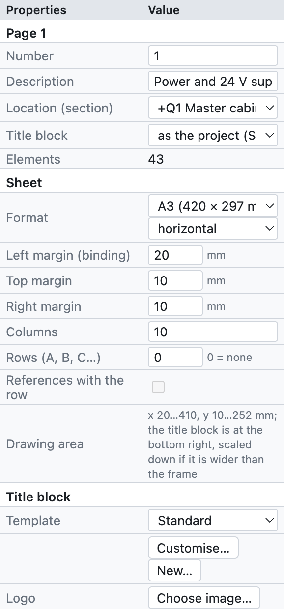
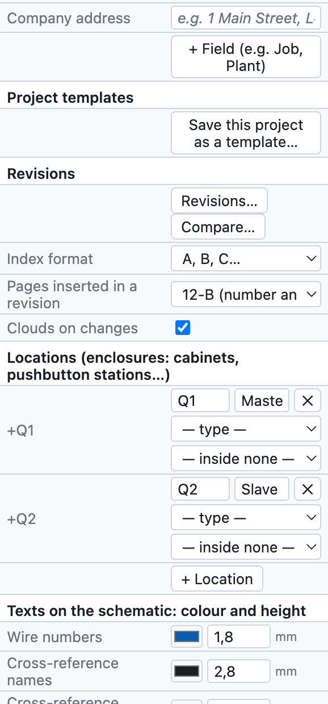
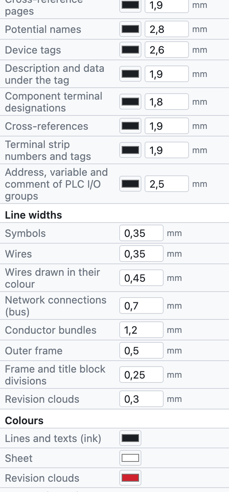
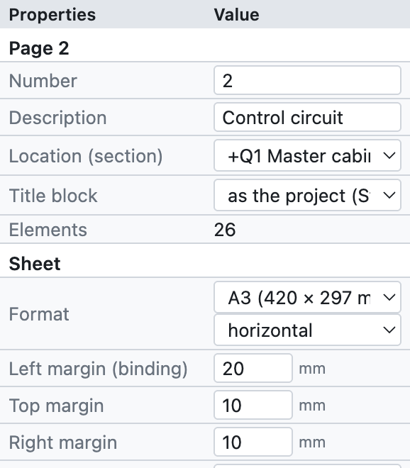
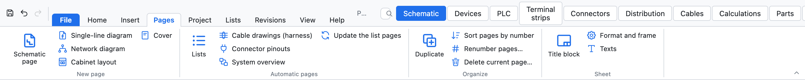
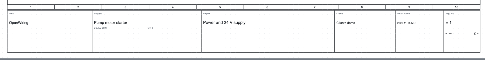
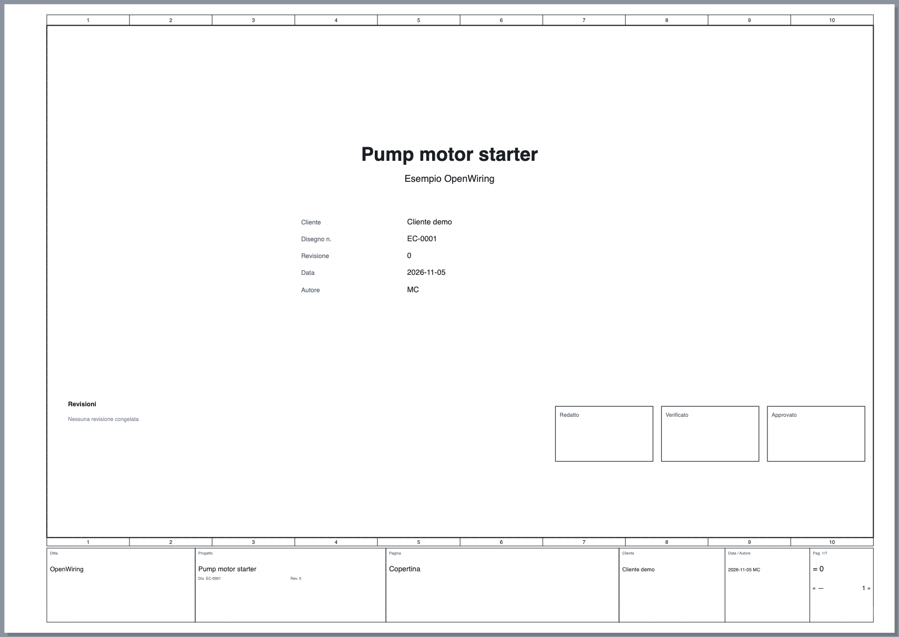

# 4. Проект и страницы

## Свойства проекта

Настройки проекта открываются через *Проект ▸ Свойства проекта*, либо щелчком по имени проекта в дереве,
либо снятием выделения со всего (щелчок по пустому месту): панель *Свойства* показывает текущую страницу
и, ниже, данные проекта.

*Панель свойств проекта сверху вниз.*

| Группа | Поля | См. |
|---|---|---|
| *Страница* | номер, описание, место установки, основная надпись страницы | [Страницы](#страницы) |
| *Основная надпись* | шаблон, логотип, адрес фирмы, дополнительные поля | [Основная надпись](#основная-надпись) |
| *Шаблоны проектов* | сохранение проекта как шаблона | [Шаблоны проектов](#шаблоны-проектов) |
| *Ревизии* | новая ревизия, сравнение, выноски | [глава 15](15-verifica-ricerca-revisioni.md#ревизии) |
| *Места установки* | шкафы, пульты, борт машины… | [глава 11](11-reti-luoghi-unifilare.md#места-установки) |
| *Языки* | язык схем и второй язык | [глава 16](16-lingue.md) |
| *IP-сети* | подсети плана адресов | [глава 11](11-reti-luoghi-unifilare.md#план-ip-адресов) |
| *Проект (основная надпись)* | название, описание, фирма, заказчик, автор, номер чертежа, ревизия, дата | ниже |
| *Обозначения устройств* | шаблон обозначения, счётчик, изображение контактов | [глава 6](06-sigle-e-numerazione.md) |
| *Номера проводов* | видимость, сечение и цвет, цветные провода, нумерация, шаблон | [глава 6](06-sigle-e-numerazione.md#номера-проводов) |
| *Чертёж* | описания на схеме, шаг сетки | ниже |

### Данные основной надписи

Название, описание, фирма, заказчик, автор, номер чертежа, ревизия и дата попадают в основную надпись
каждой страницы, на титульный лист и в свойства PDF. Они вводятся один раз.

### Чертёж

- **Описания на схеме**: выводит описание и технические данные под обозначением устройств
  (для отдельного устройства это можно изменить).
- **Шаг сетки**: 4 мм (рекомендуется), либо 1, 2, 5 или 8 мм.

## Страницы

Лист представляет собой **горизонтальный A3** (420 × 297 мм) с рамкой, разделённой на **10 пронумерованных
колонок**, и основной надписью внизу. Колонки нужны для ссылок: `/2.4` означает страница 2, колонка 4.

*Свойства страницы 2 демонстрационного проекта.*

- **Номер**: имя страницы, произвольное (`1`, `200`, `10.1`). Входит в обозначения (`-200K1`), в
  номера проводов (`200.01`) и в межстраничные связи (`/200.4`).
- **Описание**: заголовок страницы, в основной надписи и в оглавлении.
- **Место установки (раздел)**: шкаф или место, к которому относится страница; дерево группирует страницы по месту установки.
- **Основная надпись**: основная надпись страницы, если она отличается от надписи проекта.

### Команды страниц

| Команда | Где | Действие |
|---|---|---|
| Новая страница | *+ Страница* под деревом, *Вставка ▸ Страница схемы* | пустая страница после текущей, со следующим номером |
| Дублировать | *⧉*, *Вставка ▸ Дублировать текущую страницу…*, правая кнопка | копия с новыми обозначениями и номерами проводов |
| Переместить | *↑ ↓* под деревом | меняет порядок |
| Удалить | *✕* под деревом | запрашивает подтверждение; отменяется по ⌘Z |
| Сменить страницу | щелчок в дереве, **PageUp/PageDown** | |

*Вкладка «Страницы»: новые страницы любого типа, автоматические страницы, порядок страниц и лист.*

### Типы страниц

| Тип | Как создаётся | Содержимое |
|---|---|---|
| Многолинейная схема | *+ Страница* | собственно электрическая схема |
| Однолинейная схема | *+ Однолинейная* | однолинейные символы ([глава 11](11-reti-luoghi-unifilare.md#однолинейная-схема)) |
| Схема сети | *+ Сеть* | узлы и шинные соединения между шкафами ([глава 11](11-reti-luoghi-unifilare.md)) |
| Компоновка шкафа | *+ Компоновка* | вид монтажной панели ([глава 12](12-layout-quadro.md)) |
| Титульный лист | *+ Титульный лист* | название, данные, ревизии, подписи |
| Обзор ПЛК | вид ПЛК ▸ *Обзорные страницы* | создаётся программой ([глава 10](10-plc.md)) |
| Схема клеммника | вид «Клеммники» ▸ *Создать схемы клеммников* | создаётся программой ([глава 8](08-morsettiere.md)) |
| Страница списка | *Вставка ▸ Автоматические страницы* | создаётся программой ([глава 14](14-liste-e-pagine-automatiche.md)) |

Созданные автоматически страницы обновляются сами: их содержимое всегда берётся из схемы.

## Основная надпись

*Стандартная основная надпись: фирма, проект с номером чертежа и ревизией, заголовок страницы, заказчик,
дата и автор, номер страницы.*

В группе *Основная надпись* свойств:

- **Шаблон**: *Стандартный*, *С таблицей ревизий* (последние три ревизии), *Компактный*, шесть
  подробных основных надписей (*ISO 7200*, *Индустриальный подробный*, *Машина EN 60204-1*, *Гражданское здание DM 37/08*,
  *Распределительное устройство EN 61439*, *Автоматизация с подписями*, описаны в [главе 13](13-macro-simboli-cartigli.md#встроенные-основные-надписи)),
  либо пользовательская основная надпись. *Настроить…* открывает шаблон в редакторе, *Создать…* создаёт новый с нуля
  (см. [главу 13](13-macro-simboli-cartigli.md#пользовательские-основные-надписи)).
- **Логотип**: изображение PNG, JPG или SVG.
- **Адрес фирмы**: под названием фирмы.
- **+ Поле**: дополнительные поля с именем и значением, например *Заказ* или *Установка*. Если выбран шаблон
  со своими полями (например `{campo:Matricola}`), эти поля сами появляются в свойствах проекта.

Каждая страница может иметь основную надпись, отличную от остального проекта (*Свойства страницы ▸ Основная надпись*).

## Пользовательские свойства

*Проект ▸ Пользовательские свойства…* открывает список собственных свойств проекта в дополнение к встроенным:
например, заказ заказчика, номер договора или внутренний код. Для каждого свойства указываются:

- **идентификационное имя** хотя бы с одной точкой (например `Ditta.Commessa`);
- **отображаемое имя**;
- к чему оно относится: **устройства, страницы, соединения, проект или артикулы**;
- **тип**, **единица измерения** и **категория**;
- **список выбора** (значения через `;`) и, при необходимости, *Не использовать*, чтобы отложить свойство, не удаляя его.

Значения вводятся в *Свойствах* объектов, к которым относится свойство. Для устройств они также появляются
столбцами на вкладке *Устройства* и в Excel; в основных надписях они используются через заполнитель `{prop:nome}`
([глава 13](13-macro-simboli-cartigli.md#подстановочные-поля)).

Список можно **экспортировать и импортировать в XML**. Импорт нестрогий: принимает имена на английском, немецком или
итальянском и тексты на нескольких языках; свойства с недопустимым идентификационным именем отбрасываются, и
программа сообщает, сколько их.

## Титульный лист

*+ Титульный лист* добавляет в начало проекта страницу **0** с логотипом, названием, описанием, данными
проекта, таблицей ревизий и полями *Составил*, *Проверил*, *Утвердил*. Она обновляется сама
по данным проекта.

*Титульный лист демонстрационного проекта.*

## Шаблоны проектов

Шаблон хранит настройки, основную надпись, логотип, места установки и титульный лист, без схем.

1. Подготовьте проект с настройками вашей фирмы.
2. *Проект ▸ Сохранить как шаблон…* и задайте имя, например `Standard officina`.
3. С этого момента в меню *Файл* появляется пункт *Создать из шаблона «Standard officina»*.

Шаблоны остаются на компьютере и доступны для всех проектов.
