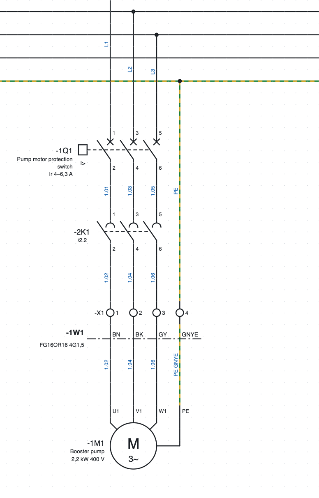
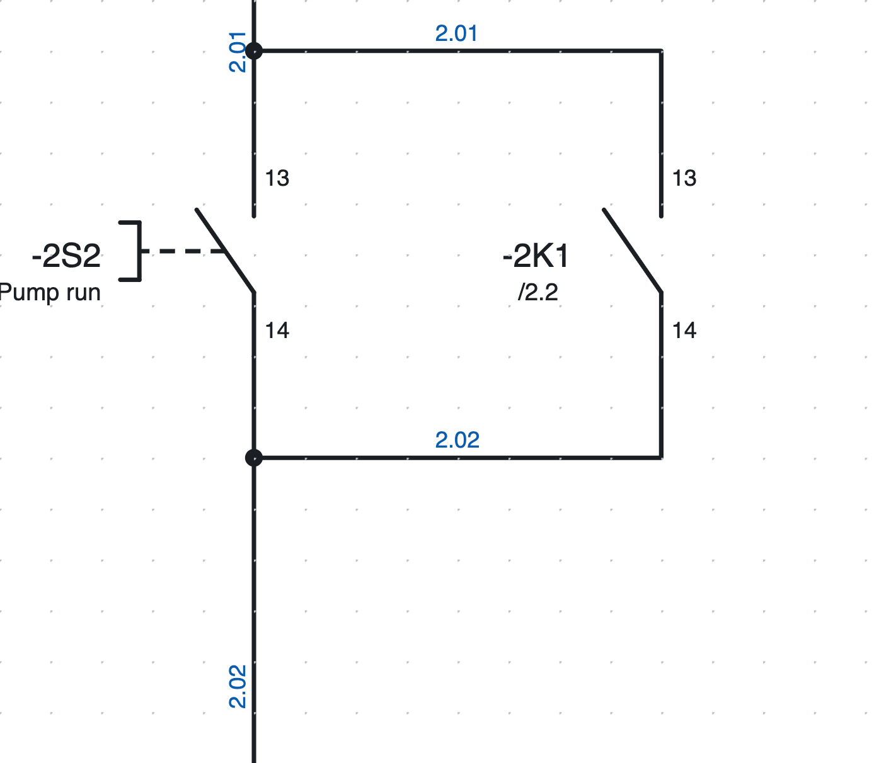
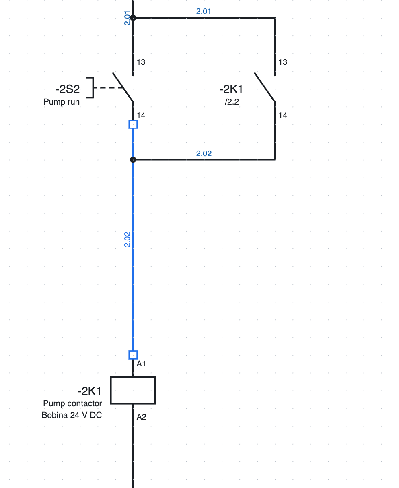
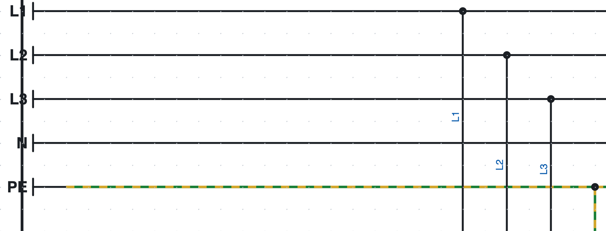
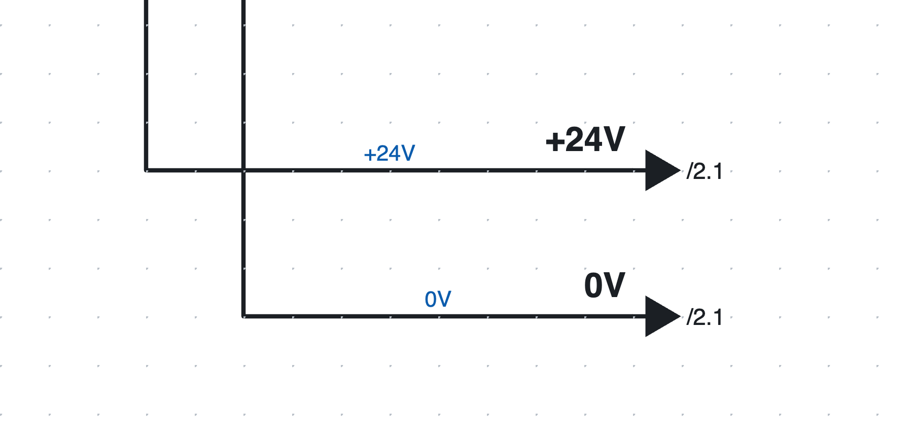

# 5. Черчение схемы

## Вставка символов

1. В библиотеке справа (вкладка *Символы*) щёлкните по символу. Поле *Поиск…* фильтрует по имени
   («контакт», «двигатель»…).
2. Щёлкните по странице: символ вставляется с привязкой к сетке и **остаётся активным**, так что можно
   вставить ещё несколько таких же.
3. **R** поворачивает символ на 90° перед вставкой.
4. **Esc** или правая кнопка завершают вставку.

Каждый новый символ получает свободное **обозначение** по шаблону проекта (например `-2K3`, см.
[главу 6](06-sigle-e-numerazione.md)). Для только что вставленного **вспомогательного контакта** открывается список устройств, к которым его можно отнести: катушки и аппараты
проекта, сначала с той же буквой, каждый с описанием, положением и числом контактов.
Список фильтруется по мере ввода; можно также ввести новое обозначение. Программа предлагает последний выбранный вариант.

### Встроенные символы

| Категория | Символы |
|---|---|
| Катушки и контакты | катушка реле/контактора, катушка с выдержкой времени, контакт НО, контакт НЗ, переключающий контакт, силовые контакты 3P |
| Управление | кнопка НО, кнопка НЗ, аварийная грибовидная кнопка, переключатель, концевой выключатель, датчик приближения PNP, 3-проводной |
| Защита | предохранитель, автоматический выключатель 1P, 2P и 3P, автомат защиты двигателя 3P, тепловое реле 3P |
| Потребители | двигатель трёхфазный и однофазный, сигнальная лампа, электроклапан, блок питания 230 В AC / 24 В DC, трансформатор |
| Клеммы и соединения | клемма, клемма PE, разъединяемая, держатель предохранителя, контакт розетки, вилки и пара розетка+вилка, точка потенциала, заземление PE, межстраничная связь (уход и приход) |
| ПЛК | цифровой вход и выход, аналоговый вход и выход, питание модуля L+/M |
| Сети и шины | узел с 2 портами (IN/OUT или P1/P2), узел с 1 портом, коммутатор на 5 портов, терминатор |
| Однолинейные | выключатель, автомат защиты двигателя, разъединитель, предохранитель, контактор, двигатель, трансформатор, инвертор, блок питания, потребитель |

Другие символы рисуются в редакторе или импортируются из QElectroTech и из EDZ производителей
([глава 13](13-macro-simboli-cartigli.md) и [глава 7](07-dispositivi-e-articoli.md)).

*Пуск двигателя на странице 1: автомат защиты двигателя `-1Q1`, силовые контакты контактора `-2K1`,
клеммник `-X1`, кабель `-1W1` и двигатель `-1M1`.*

## Черчение проводов

1. Нажмите **W** или *Провод*.
2. Щёлкните по начальной точке: точке подключения, существующему проводу или свободной точке.
3. Щёлкните в каждом углу. Участок всегда горизонтальный или вертикальный; перед щелчком предпросмотр показывает
   Г-образную трассу.
4. Провод **заканчивается сам**, когда вы щёлкаете по точке подключения или по другому проводу. Иначе
   завершите его двойным щелчком, Enter или правой кнопкой.
5. **Esc** отменяет текущий провод.

Свободные точки подключения во время черчения подсвечиваются зелёным. Если подойти к проводу немного
сбоку, участок продолжается прямо до провода.

### Соединения и пересечения

*Соединения самоподхвата на странице 2: точка обозначает соединение.*

- Провод, заканчивающийся на другом проводе, образует **Т-образное соединение**, рисуемое точкой.
- Два провода, которые **пересекаются** без точки, не соединены.
- Точка не рисуется вручную: её ставит программа там, где провода действительно соединены.

### Изменение проводов

*У выделенного провода вершины показаны маленькими квадратами.*

- **Перетащите участок**, чтобы сдвинуть его параллельно: концы остаются соединёнными.
- **Перетащите вершину или конец**, чтобы удлинить, укоротить или подключить провод заново.
- Курсор меняет форму, показывая, что именно вы перетаскиваете.
- Чтобы удалить провод, выделите его и нажмите **Del**.

### Перемещение символов вместе с проводами

При перетаскивании символа подключённые провода следуют за ним уже во время перемещения и остаются
ортогональными, при необходимости изгибаясь Z-образно. Провод между двумя символами, перемещаемыми вместе, перемещается целиком.

### Вставка контакта на провод

Если вы вставляете (или перемещаете) контакт, кнопку или другой компонент **поверх провода**, провод
разрывается на двух его точках подключения: резать его вручную не нужно. Оба участка сохраняют цвет и
сечение.

## Точки потенциала

*Шины L1, L2, L3, N и PE на странице 1.*

**Точка потенциала** даёт имя проводнику: `L1`, `L2`, `L3`, `N`, `PE`, `+24V`, `0V`…

- Все проводники с одним именем **соединены**, даже на разных страницах.
- Имя вводится в свойствах (*Имя*); новая точка называется `L1`, заземление **PE** называется `PE`.
- Проводники потенциала могут показывать имя вместо номера провода
  (*Свойства проекта ▸ Номера проводов ▸ Потенциалы*).
- Проверка сообщает о двух разных потенциалах на одном проводнике (например, `L1` соединён с `N`).

## Межстраничные связи

*Межстраничные связи `+24V` и `0V` на странице 1: имя над проводом, страницы прихода рядом со стрелкой.*

Когда проводник продолжается на другой странице, используется пара **межстраничных связей**. Каждый уход
связан только с **одним** приходом, даже если имя повторяется (например, это номер провода):

1. В конце провода вставьте **Межстраничная связь (уход)**. Имя равно номеру провода, если он есть, иначе
   `R1`, `R2`… и меняется в *Свойствах*.
2. На другой странице, в начале провода, вставьте **Межстраничная связь (приход)**: появляется список
   ещё свободных уходов, сначала с тем же именем. Выберите один: приход получает его имя, и
   они остаются связанными. Первый пункт (*нет ухода*) оставляет приход свободным, если уход
   ещё не нарисован. Так же и наоборот: при вставке ухода выбирается один из свободных приходов.
   Список **фильтруется по мере ввода**: каждый пункт показывает имя, положение и страницу связи.
3. В поле *Имя* в *Свойствах* подсказками служат свободные связи и другие имена связей; при выборе
   свободной связи они соединяются. Связь меняется в *Свойства ▸ Подключено к*. При изменении имени одной связи меняется и
   имя соответствующей.
4. Рядом с каждой стрелкой показана страница, на которой проводник продолжается (`/2.1`). Щелчок переходит на страницу.
   На вертикальных проводах имя и страница пишутся вертикально, снизу вверх.

### Ссылки в ожидании, без ответной части и звездой

При вставке ссылки программа берёт имя из номера провода и ищет свободные ссылки:

- если есть **ровно одна** свободная ссылка с тем же именем **на другой странице**, они соединяются сразу (об этом сообщает
  сообщение в окне отчёта);
- если их несколько, открывается список, в котором уже выбрана первая: *Enter* подтверждает выбор. Первый пункт, *— ожидает ещё не нарисованную парную ссылку (/…)*
  (или новое имя, или *Esc*), оставляет ссылку в ожидании: она не связывается сама с существующими,
  даже с одноимённой на той же странице;
- если нет ни одной, ссылка остаётся **в ожидании**: рядом со стрелкой появляется оранжевое `/…`, пока вы
  не нарисуете ответную часть.

В *Свойства ▸ Подключено к* выбирают ответную часть, возвращают ссылку в состояние *— ожидает ответной
части (/…)* или выбирают *— без ответной части (проводник заканчивается здесь)*, когда проводник
действительно заканчивается там: тогда рядом со стрелкой появляется `//`, и проверка сообщает об этом
только как об информации, а не как об ошибке.

В строке состояния **Ссылок в ожидании: N** показывает, сколько ссылок ещё не связано; каждый щелчок
переходит к следующей. Проверка выводит их как предупреждения.

**Исходная ссылка звездой.** Исходная ссылка с *Свойства ▸ Звездой* соединяется со **всеми** свободными
входящими ссылками с тем же именем (например, `+24V`, идущее на многие страницы) и показывает список их
страниц. Проверка предлагает звезду (кнопкой 🔧), когда исходная ссылка уже связана, а другие входящие
ссылки носят её имя.

## Шины проводников

Когда много проводов идут рядом (например, три фазы и нейтраль, питающие несколько потребителей), их
можно сгруппировать в **шину проводников**, не рисуя все линии до конца.

1. Выберите инструмент **Шина проводов** на панели инструментов (или *Вставка ▸ Шина проводников*) и проведите
   линию шины: это толстая линия. В *Свойствах* задайте шине **имя** (необязательно, например
   `400V AC` или `24V DC`).
2. Нарисуйте провода, подходящие к шине, и ответвления, выходящие из неё, так, чтобы они касались линии.
3. На каждом проводе, касающемся шины, появляется **имя проводника** (`L1`, `L2`, `PE`…), записанное рядом с проводом.
   Оно выбирается из списка, который фильтруется по мере ввода.

Правила просты:

- провода с **одним и тем же проводником на одной шине** являются одним проводом и имеют один номер провода;
- шины, которые касаются друг друга, или шины с одним именем на нескольких страницах образуют **одну шину**: проводники продолжаются;
- проверка ([глава 15](15-verifica-ricerca-revisioni.md)) сообщает о проводах, касающихся шины без имени
  проводника, и о проводниках, которые входят в шину и никуда не выходят.

В текстовом формате ([глава 17](17-assistente-ia.md)) линия шины представляет собой провод с `busfili=nome` (`busfili=_`,
если без имени), а проводник на двух концах провода записывается как `cond1=` и `cond2=`.

### Шина проводов как кабель

Кабель, идущий из одного шкафа в другой, можно нарисовать как шину проводов: провода входят в шину на
начальной странице и выходят из шины с тем же именем на странице прибытия.

1. Дайте шине **обозначение кабеля** (`W1112S1`). Если кабеля ещё нет в проекте, после имени выбирается
   **артикул кабеля** (можно и позже, в *Свойства ▸ Артикул кабеля*).
2. Для каждого провода программа предлагает **жилы кабеля по порядку** (цвета или номера): уже
   использованные приглушены, вошедшие в другом месте и ожидающие выхода выделены и предлагаются первыми,
   остальные свободны.
3. Кнопкой **Назвать жилы по порядку** (*Свойства* шины) провода страницы получают жилу слева направо: на
   начальной странице первые свободные, на странице прибытия — ожидающие выхода.
4. Нарисуйте линию кабеля поперёк отдельных проводов на обеих страницах: в окне *Кабели* каждый провод
   получает жилу, записанную в шине. Толстая линия шины не считается жилой.

**Двойной щелчок по шине** открывает её свойства: жилы кабеля с их состоянием (занятые приглушены,
ждущие выхода отмечены ⚠, свободные — зелёной полосой) и таблица проводов шины, где жилу каждого провода
можно исправить, введя её или выбрав из списка.

Окно **Шина проводов** (*Вид ▸ Шина проводов* или *Перечни ▸ Шина проводов*) показывает все шины и для
выбранной — каждый входящий или выходящий провод со страницей, номером провода и соединениями; жилу
можно исправить прямо в таблице. Отмечаются провода без жилы, провода, которые входят и не выходят, и
жилы, которых нет у кабеля. Печатный перечень **Соединения шин проводов** содержит одну жилу в строке
(как подключения кабелей), со свободными жилами кабеля.

Шина с артикулом кабеля (нумерованные или цветные жилы) получает, как и кабели, свою страницу
**монтажа**: *Списки ▸ Чертежи кабелей (жгуты)* создаёт страницу «Cablaggio bus fili …» с двумя концами,
жилами и таблицей свободных жил. Шина без артикула остаётся только в перечне *Соединения шин проводов*.

## Тексты

*Текст* (или *Вставка ▸ Текст*) и щелчок по странице вставляют произвольный текст. В *Свойствах* можно
изменить текст и высоту в мм. Тексты попадают в словарь переводов
([глава 16](16-lingue.md)).

## Изображения

Фотографии, логотипы или рисунки вставляются в схему как изображения.

- *Вставка ▸ Изображение…* и выберите файл PNG, JPG, SVG, GIF, WebP или BMP; либо **вставьте** изображение
  из буфера обмена по ⌘V (Ctrl+V).
- Изображение **перемещается** перетаскиванием и **масштабируется** перетаскиванием правого нижнего угла: пропорции
  остаются фиксированными, а при нажатой клавише **Shift** свободны.
- В *Свойствах* меняются положение и размеры, восстанавливаются исходные пропорции, включается
  рамка, выбирается, находится ли изображение **под** схемой или **над** ней, и заменяется через *Заменить изображение…*.
- Изображения выводятся в **PDF**. В DXF остаётся только рамка с именем изображения.
- Очень большие изображения уменьшаются (до 1600 точек по длинной стороне), чтобы файл оставался небольшим.

## Выделение, копирование, перемещение

| Действие | Как |
|---|---|
| Выделить | щелчок по элементу |
| Добавить в выделение или убрать из него | **Shift** + щелчок |
| Выделение рамкой | перетащите по пустому месту: **слева направо** захватывает полностью вошедшие элементы, **справа налево** также и задетые |
| Выделить всё | ⌘A |
| Переместить | перетащить либо стрелками (4 мм; с Shift 16 мм) |
| Повернуть, отразить | **R**, *Правка ▸ Зеркало* |
| Дублировать | ⌘D |
| Копировать, вырезать, вставить | ⌘C, ⌘X, ⌘V; *Вставьте сюда* в контекстном меню вставляет в точку щелчка |
| Удалить | **Del** или Backspace |

Копии получают **новые обозначения и номера проводов**; катушка и контакты, скопированные вместе, остаются связанными между собой.
Можно вставлять и в другой проект: используемые символы и артикулы копируются вместе с элементами.

При **вырезании и вставке** элементы **перемещаются**: на другой странице они сохраняют обозначения, номера
клемм, номера проводов и связь ссылок. При **копировании и вставке** каждая скопированная клемма предлагает
первый свободный номер клеммника, начиная с наименьшего и с тем же уровнем (A, B…), и номер выбирается;
скопированные провода получают новый номер.

Часто используемую цепь сохраняют как **макрос** ([глава 13](13-macro-simboli-cartigli.md#макросы)).

## Тексты символов всегда читаемы

При повороте или отражении символа его внутренние тексты (например «M 3~» двигателя) никогда не
переворачиваются и не пишутся зеркально: они всегда читаются снизу или справа, как требует стандарт. Это действует на
экране, в PDF и в DXF.
