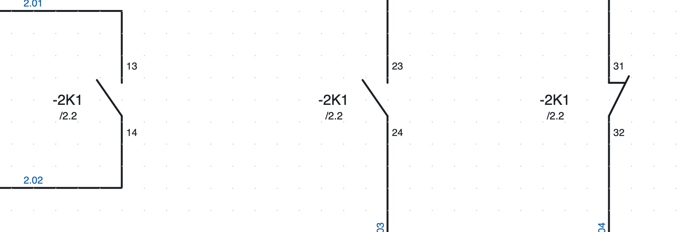
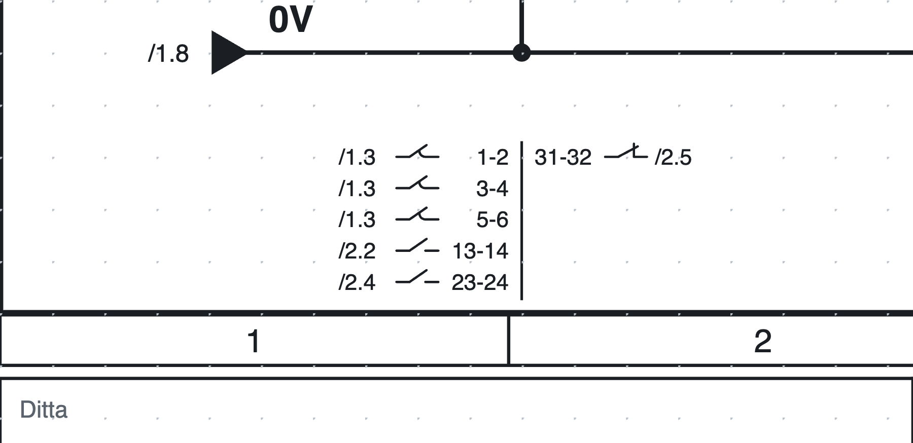
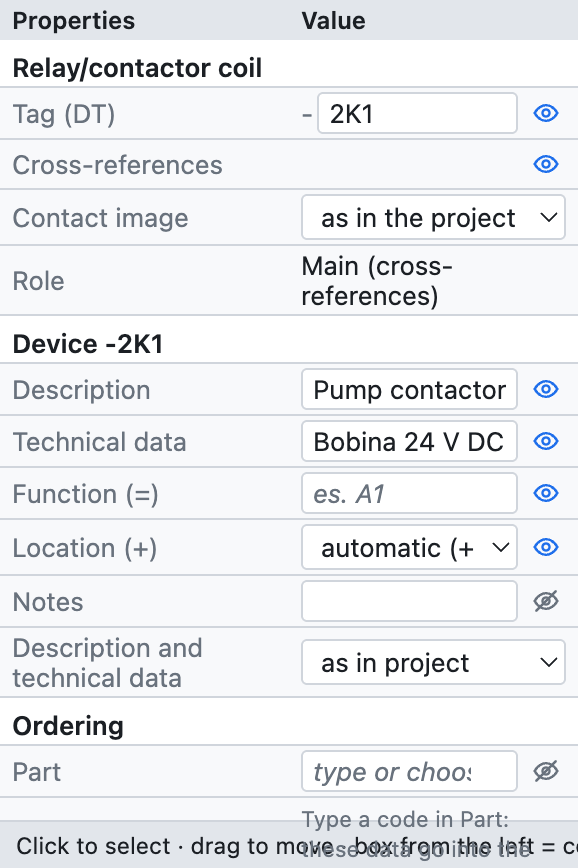
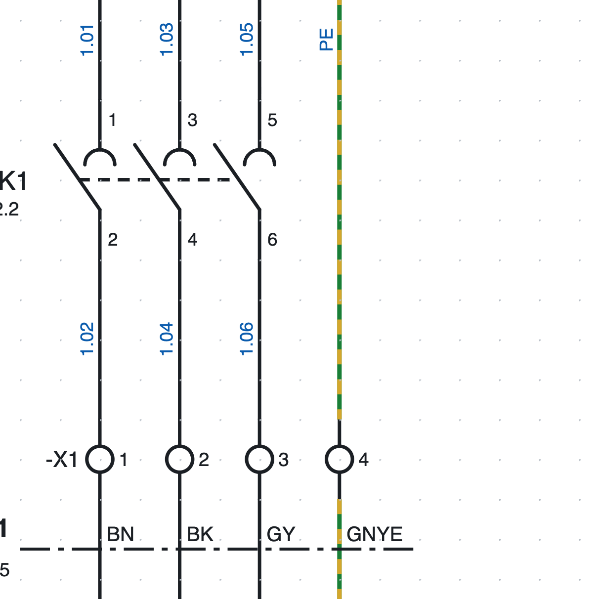
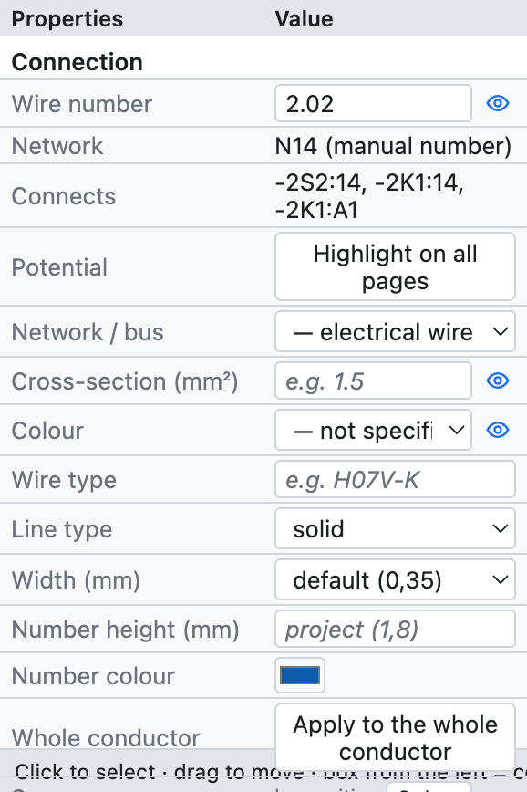
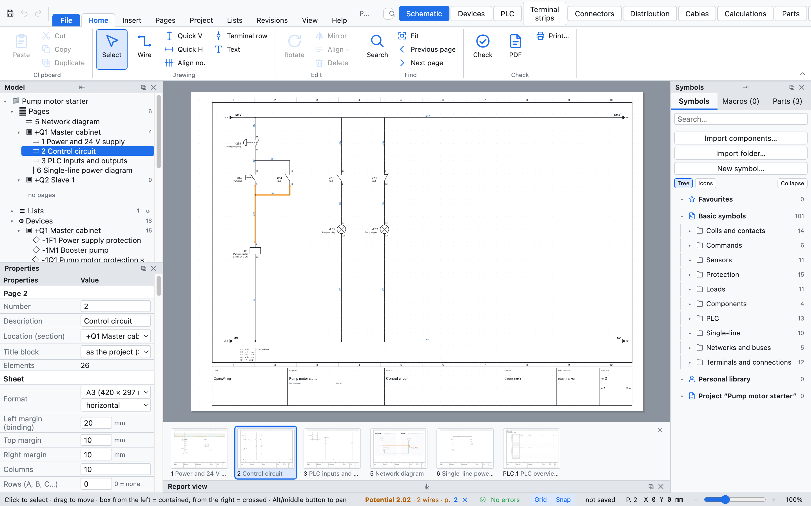

# 6. Обозначения, перекрёстные ссылки и номера проводов

## Обозначения устройств

У каждого устройства есть **обозначение** по IEC 81346: дефис, номер страницы, **буква**
типа устройства и порядковый номер. `-2K1` — первый контактор на странице 2.

| Буква | Устройства |
|---|---|
| K | реле, контакторы, реле времени |
| Q | трёхполюсные автоматы, автоматы защиты двигателя, разъединители |
| F | предохранители, однополюсные и двухполюсные автоматы, тепловые реле |
| S | кнопки, аварийные кнопки, переключатели |
| B | датчики, конечные выключатели |
| P | сигнальные лампы |
| M | двигатели, электроклапаны |
| T | трансформаторы, блоки питания |
| A | ПЛК, модули, узлы сети, сложные аппараты |
| U | преобразователи частоты |
| E | обобщённые потребители (однолинейная схема) |
| X | клеммники и разъёмы |
| W | кабели |

Буква зависит от символа; обозначение всегда можно изменить вручную в свойствах.

### Шаблон обозначения

В *Свойства проекта ▸ Обозначения устройств* выбирается, как составляется обозначение:

| Подстановка | Значение | Пример |
|---|---|---|
| `{pagina}` | номер страницы | `200` |
| `{colonna}` | колонка (1–10) устройства | `4` |
| `{lettera}` | буква IEC 81346 | `K` |
| `{n}` | порядковый номер | `1` |
| `{n:2}` | порядковый номер из двух цифр | `01` |

| Шаблон | Результат на странице 200 |
|---|---|
| `{pagina}{lettera}{n}` (по умолчанию) | `-200K1` |
| `{lettera}{n}` | `-K1` |
| `{pagina}{lettera}{n:2}` | `-200K01` |
| `{pagina}.{colonna}{lettera}` | `-200.4K` |

- **Счётчик**: начинается заново на каждой странице либо един для всего проекта.
- **Стабильные обозначения**: новое устройство получает номер после наибольшего на странице (`-2K3` после
  `-2K2`), остальные не меняются.
- **Перенумеровать устройства** (*Проект ▸ Перенумеровать устройства…*) перенумеровывает всё по порядку страниц,
  колонок и строк. Контакты следуют за своей катушкой; у клемм своя нумерация.

### Полное обозначение: функция и место

Если заполнены **функция** (`=`, установка или часть машины) и **место** (`+`, шкаф или
пульт), обозначение становится полным: `=A1+Q1-2K1`. Они заполняются в свойствах
устройства или, сразу для многих устройств, в навигаторе ([глава 7](07-dispositivi-e-articoli.md)).

## Катушки и контакты

**Главное устройство** (катушка реле или контактора) и его **контакты** имеют одно и то же
обозначение. Программа связывает их сама:

1. Вставьте катушку: она получит, например, `-2K1`.
2. Вставьте контакты: окно спросит *какое устройство?* и покажет катушки и аппараты проекта, сначала с той же
   буквой. Выберите из списка или впишите новое обозначение; со следующего контакта окно предлагает
   последнюю выбранную катушку.
3. Чтобы отнести контакт к другой катушке, впишите обозначение в свойствах контакта:
   список предлагает существующие обозначения с той же буквой.

### Нумерация контактов (EN 50005)

Вспомогательные контакты нумеруются автоматически по цифре порядка и цифре функции: первый замыкающий —
`13-14`, второй `23-24`, первый размыкающий `31-32` и так далее. Для отдельного контакта это можно отключить и
вписать клеммы вручную (*Свойства ▸ Точки подключения*). Силовые контакты — `1-2`, `3-4`, `5-6`.

### Перекрёстные ссылки

*Под каждым контактом `-2K1` стоит `/2.2`: катушка на странице 2, в колонке 2.*

*Изображение контактов `-2K1` внизу страницы 2: слева от линии силовые и замыкающие контакты,
справа размыкающие, у каждого указано его положение.*

- Под каждым **контактом** показано положение катушки (`/2.2`).
- Под **катушкой** показано **изображение контактов**: все её контакты с клеммами и
  положением. Оно располагается **внизу страницы**, под нижней шиной, на вертикали
  катушки; можно разместить его под символом (*Свойства проекта ▸ Обозначения устройств ▸ Контакты катушек*).
- Каждая ссылка **кликабельна**: она переходит на страницу и выделяет элемент. В PDF она становится
  гиперссылкой.
- Правая кнопка мыши на катушке предлагает *Перейти к контакту…*, на контакте — *Перейти к главному элементу*.

Проверка сообщает о контактах без катушки и о контактах в количестве, превышающем число контактов у
артикула (например, пятый контакт у контактора с 4 вспомогательными).

### Парные перекрёстные ссылки

Контакт можно также **показать на другой странице**, не дублируя его, например вспомогательный контакт
автоматического выключателя на обзорной странице: правый щелчок по контакту ▸ *Нарисовать изображение
(парная перекрёстная ссылка)…*, затем щелчок там, где его нужно нарисовать.

Можно начать и с **главного элемента**: правый щелчок по катушке или автомату защиты двигателя ▸
*Нарисовать изображение контакта…* (или *Изображение…* на вкладке *Символ*) показывает его контакты, уже
размещённые на схеме, сначала вспомогательные: выберите нужный и щёлкните, куда его поставить.

- Изображение — **только рисунок**: оно не считается контактом, не соединяется с проводами и не попадает ни
  в списки, ни в спецификацию. Обозначение и выводы всегда следуют настоящему контакту.
- Настоящий контакт и изображение ссылаются друг на друга перекрёстными ссылками в обоих направлениях.
- *Свойства ▸ Изображение* показывает настоящий контакт (щелчок переходит к нему); *Сделать настоящим
  контактом* превращает его в контакт со своими соединениями.
- Если настоящий контакт удалён, проверка сообщает об оставшемся изображении и предлагает его удалить.

## Свойства устройства

*Свойства катушки `-2K1` из примера проекта.*

| Группа | Поля |
|---|---|
| *(имя символа)* | обозначение, роль (главный, контакт, устройство, клемма…) |
| *Устройство* | описание, технические данные, функция (=), место (+), примечания, тексты на схеме |
| *Заказ* | артикул, производитель, тип, код заказа |
| *Точки подключения* | имя каждой клеммы (A1, A2, 13, 14…) |
| *Положение* | X и Y в мм, поворот, отражение |
| *Номер провода* | проходит ли номер провода через элемент |

Данные групп *Устройство* и *Заказ* действуют для **всего устройства**: записанные на катушке,
они действуют и для контактов. Если назначен артикул, пустые поля показывают его данные серым цветом.

## Номера проводов

*Номера проводов страницы 1: `1.01`, `1.03`… над контактором, те же номера под ним, потому что
клеммы `-X1` номер не меняют.*

Каждому **проводнику** (все провода, соединённые между собой, вплоть до точек подключения
компонентов) присваивается номер, который пишется на каждом его участке. Шаблон по умолчанию — `{pagina}.{n:2}`: `200.01`, `200.02`…

### Фиксированная или пересчитываемая нумерация

В *Свойства проекта ▸ Номера проводов ▸ Нумерация*:

- **фиксированная** (по умолчанию): пронумерованный проводник сохраняет свой номер; новый проводник получает
  первый свободный номер страницы, даже если вы рисуете его посередине; при соединении двух пронумерованных
  проводников остаётся один номер, а при разделении одного новая часть получает новый номер. *Перенумеровать провода* пересчитывает всё
  по порядку колонок.
- **пересчитываемая**: номера пересчитываются при каждом изменении, всегда по порядку.

### Номер вручную

Выделите провод и впишите номер в *Свойства ▸ Номер провода*: он действует для всего проводника.
Если его удалить, вернётся автоматический номер.

### Где он пишется

Номер пишется в **свободном месте** провода: если посередине участка есть пересечение, компонент,
обозначение или другой номер, он смещается вдоль провода или на другую сторону. Это действует на экране, в PDF и в DXF.
*Показать* (свойства проекта) скрывает его полностью.

### Перемещение и повтор номера

Номер можно **перетащить** куда угодно, даже далеко от провода: с этого момента он остаётся в этом положении
и следует за проводом при его перемещении. Правая кнопка мыши на проводе:

- **Добавить номер провода здесь**: ещё один номер на том же проводе, рядом с выбранным участком;
- **Убрать этот номер провода** (щелчок по номеру, когда их несколько);
- **Номер провода в автоматической позиции**: возврат в место, выбранное программой.

### Номер проходит через клеммы

Клемма — всего лишь точка перехода: провода по обе её стороны имеют **один и тот же номер**. У каждого элемента
с двумя и более точками подключения в *Свойства ▸ Номер провода* есть флажок **Номер провода проходит**:

- по умолчанию он установлен у клемм и снят у остальных компонентов;
- его можно изменить для отдельного элемента, например чтобы номер проходил через разъединитель.

Обе стороны остаются разными проводниками для списка клемм и списка соединений.

### Расширенный счётчик

В *Свойства проекта ▸ Номера проводов*:

- **Шаблон**: кроме `{pagina}` (страница), `{colonna}` (столбец) и `{n}` можно использовать `{quadro}` (код
  шкафа страницы), `{n:2}` (не менее 2 цифр: `01`) и `{n:A}` или `{n:a}` (счётчик буквами: `A`, `B`… `Z`,
  `AA`). Пример: `{quadro}.{n:A}` даёт `Q1.A`, `Q1.B`… Обозначения устройств тоже принимают `{quadro}`.
- **Счётчик**: начинается заново на каждой странице, начинается заново для каждого шкафа или единый в
  проекте.
- **Резерв на страницу**: номера, оставляемые свободными после каждой страницы. С резервом 3 страница 1
  использует 1 и 2, а страница 2 начинается с 6: провод, добавленный позже на страницу 1, получает 3, и
  следующие страницы сохраняют свои номера. Когда резерв исчерпан, счётчик пропускает номера, уже
  занятые следующими страницами.
- **Порядок на странице**: по столбцам (слева направо) или по строкам (сверху вниз).

Номера, написанные вручную, номера ссылок и имена каналов ПЛК фиксированы: счётчик пропускает их, даже если
они написаны на другой странице.

## Сечение и цвет проводов

*Свойства провода: номер, сеть, соединения, потенциал, сечение и цвет.*

- **Сечение** в мм² (`1,5`, `2,5`, `6`…) и **цвет** с обозначениями IEC 60757: `BK` чёрный, `BN` коричневый,
  `GY` серый, `BU` синий, `DBU` тёмно-синий, `RD` красный, `WH` белый, `GNYE` жёлто-зелёный…
- **Цвет**, выбранный на одном участке, действует для всего проводника, в том числе после межстраничной связи или клеммы.
- При включённом *Цветные провода* (свойства проекта) провод рисуется своим цветом; PE — жёлто-зелёный пунктиром.
- Сечение может меняться вдоль проводника (начало 6 мм², ответвление 1,5 мм²);
  *Применить ко всему проводнику* копирует сечение и цвет на все участки.
- При включённом *Сечение и цвет* они пишутся рядом с номером (`200.01  1,5 мм² BU`).

## Подсветка потенциала

Чтобы проследить проводник по всему проекту: выделите провод и нажмите **Подсветить на всех страницах**
в свойствах (или правая кнопка ▸ *Подсветить потенциал*).

*Проводник `2.02`, подсвеченный оранжевым; строка состояния внизу перечисляет страницы, на которых он встречается.*

- Все соединённые проводники окрашиваются в **оранжевый**, в том числе за межстраничными связями, потенциалами и клеммами.
- Строка состояния показывает имя, число проводов и **страницы**, по которым можно щёлкнуть.
- ✕ в строке состояния или *Снять подсветку* выключает подсветку.
