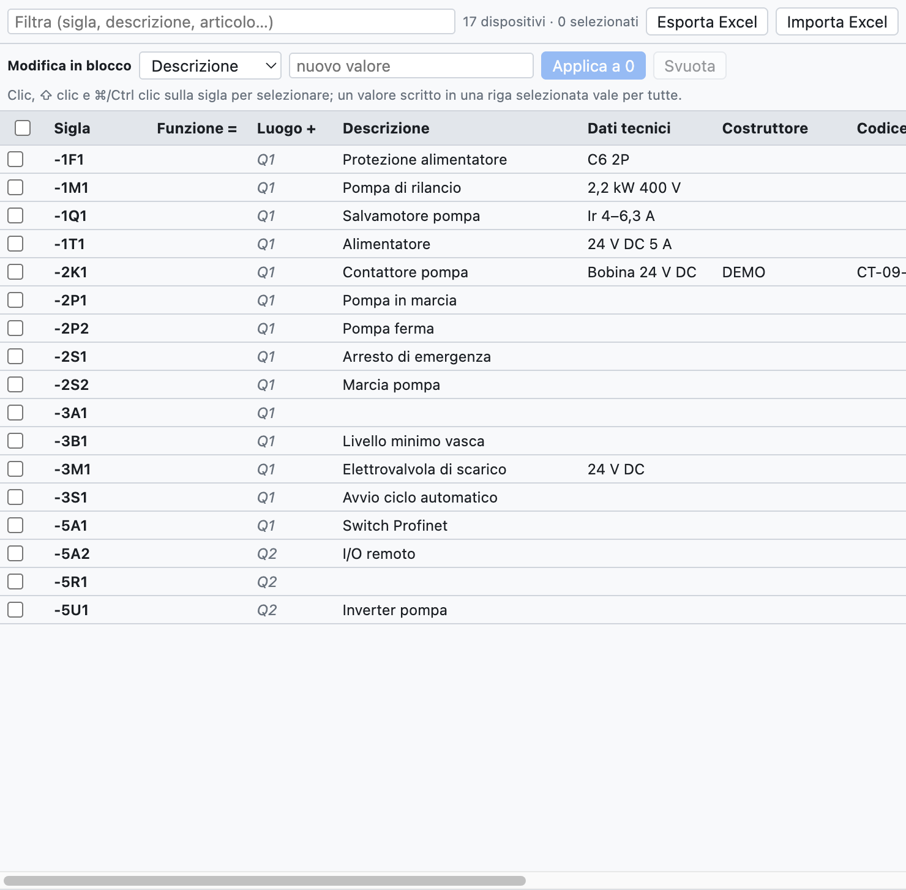
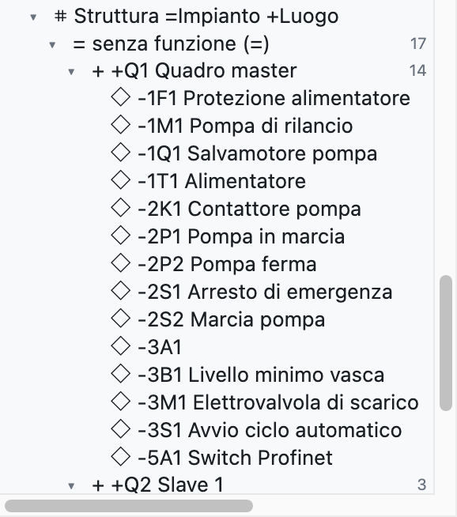
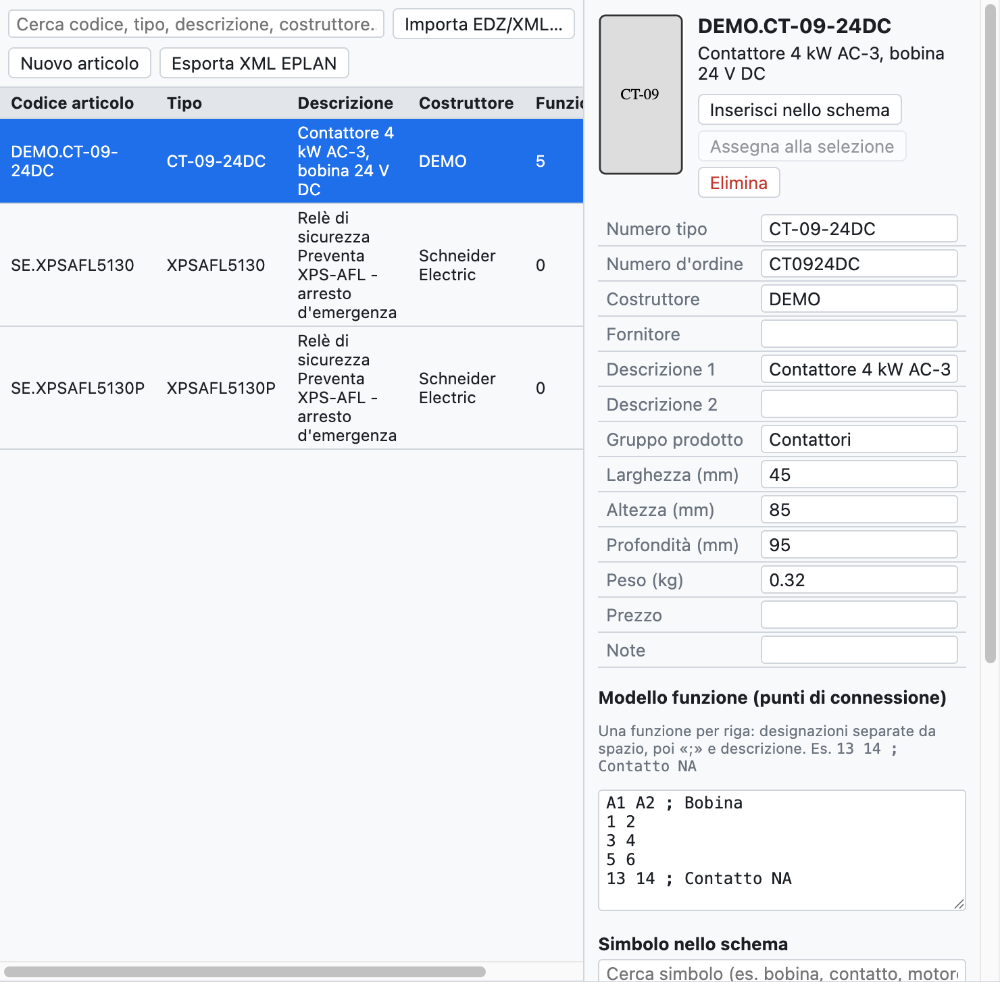

# 7. Устройства и артикулы

**Устройство** — это реальный компонент с обозначением: контактор `-2K1` является устройством, даже если
на схеме он выглядит как катушка, три силовых контакта и два вспомогательных на разных страницах. **Артикул**
— это изделие из каталога производителя (код, описание, размеры, клеммы), которое назначается устройствам.

## Данные устройства

| Поле | Пример | Где отображается |
|---|---|---|
| Описание | `Контактор насоса` | схема (под обозначением), списки, этикетки |
| Технические данные | `Катушка 24 В DC`, `2,2 кВт 400 В` | схема, списки |
| Производитель | `Schneider Electric` | спецификация, список закупки |
| Тип | `LC1D09BD` | спецификация |
| Код заказа | `LC1D09BD` | спецификация, список закупки |
| Примечания | произвольный текст | список устройств |
| Функция (=) | `A1` | полное обозначение `=A1+Q1-2K1` |
| Место установки (+) | `Q1` | полное обозначение, группировки, компоновка |
| Артикул | `DEMO.CT-09-24DC` | заполняет пустые поля данными из каталога |

Данные принадлежат устройству: их можно записать на любом элементе (катушке или контакте), и они действуют
для всех. Значения, введённые вручную, имеют приоритет над значениями артикула.

**Дополнительные артикулы**: у устройства может быть несколько артикулов (например, контактор и его блок
вспомогательных контактов). В навигаторе столбец *Дополнительные артикулы* записывается текстом, с
кодом и количеством после ×: `LADN22 ×2; LA4DA2U`. Его можно изменять и группой, и в Excel.

**Описания на схеме**: если включено *Свойства проекта ▸ Чертёж ▸ Описания на схеме*,
описание и технические данные показываются под обозначением главного элемента. Поле *Тексты на схеме*
устройства принудительно показывает или скрывает их только для этого устройства.

## Навигатор устройств

Вкладка **Устройства** (вверху справа) показывает все устройства проекта в таблице, которая
редактируется как электронная таблица.

*Навигатор с 17 устройствами примера проекта. Значения серым курсивом берутся
из артикула или из места страницы.*

- **Изменить значение**: щёлкните в ячейке, введите текст и нажмите Enter.
- **Переименовать**: измените обозначение в первом столбце; изменятся также контакты и другие представления.
  Если обозначение уже занято, программа сообщит об этом и ничего не изменит.
- **Фильтровать**: поле вверху ищет по обозначению, описанию, артикулу и другим полям.
- **Выделить несколько строк**: щелчок по обозначению, ⇧ щелчок для диапазона, ⌘/Ctrl щелчок для добавления,
  или флажки слева.
- **Перейти к устройству**: щелчок по положению `/2.2` в последнем столбце.

### Групповое редактирование

Чтобы задать одно значение многим устройствам:

1. Выделите строки (например, все устройства шкафа `+Q2`, отфильтровав по `Q2`).
2. В строке *Групповое редактирование* выберите поле (*Функция =*, *Производитель*…) и введите значение.
3. Нажмите **Применить к N**. *Очистить* стирает это поле у всех выделенных.

Кроме того, можно ввести значение прямо в ячейку выделенной строки: оно действует для всех
выделенных строк. Всё изменение отменяется одним нажатием ⌘Z.

### Excel

- **Экспорт Excel** сохраняет таблицу устройств (обозначение, поля, положение).
- Заполните её в Excel, в том числе другим человеком, и воспользуйтесь **Импорт Excel**: устройства распознаются
  по столбцу *Обозначение*, и обновляются только изменённые поля. Обозначения, которых нет в проекте,
  выводятся в окне отчёта.

### Копирование свойств

Правая кнопка мыши на устройстве предлагает **Копировать свойства**: копируются все данные устройства (описание,
технические данные, производитель, тип, коды, артикул, дополнительные артикулы, примечания, функция, место,
пользовательские свойства), кроме обозначения. На другом устройстве или на выделении из нескольких устройств правая кнопка
предлагает **Вставить свойства -X**: скопированные данные заменяют данные устройства.

Это же позволяет **заменить символ** другим: скопируйте свойства старого, вставьте новый
символ, вставьте свойства и удалите старый.

## Структура =Установка +Место

В дереве узел **Структура =Установка +Место** группирует устройства сначала по **функции** (`=A1`,
`=A2`…), а затем по **месту** (`+Q1`, `+P1`…), как предусматривает IEC 81346. Устройства без функции или
без места находятся внизу, в *без функции (=)* и *без места (+)*. Щелчок по устройству открывает его
на схеме.

*В примере проекта у устройств нет функции: все они в «без функции», распределены между
шкафами `+Q1` и `+Q2`.*

Место устройства — то, что записано в его свойствах; если его нет, берётся место рамки, в которой оно
нарисовано на сетевой схеме, или место его страницы.

## Артикулы

Вкладка **Артикулы** — это личная библиотека артикулов, хранящаяся на компьютере и доступная во
всех проектах.

*Контактор, импортированный из EDZ: данные, изображение, шаблон функции и символ.*

### Импорт данных производителей (EDZ)

1. Скачайте файл **EDZ** с Eplan Data Portal или с сайта производителя (Schneider, Siemens, Phoenix
   Contact…). EDZ — это архив с данными артикула в формате Eplan Data Portal.
2. *Файл ▸ Импорт ▸ Артикулы EDZ / XML / CSV…* (или кнопка *EDZ*) и выберите один или несколько файлов.
3. Артикулы попадают в библиотеку с кодом, типом, кодом заказа, производителем, описаниями
   (на итальянском, если есть, иначе на английском или немецком), размерами, весом, изображением и **шаблоном функции**
   (клеммы).

Если EDZ содержит чертёж производителя в читаемом макросе формата EPLAN, этот чертёж становится символом
артикула (категория *Макрос EPLAN / производитель* в библиотеке). В противном случае артикул рисуется как автоматический
**чёрный ящик**: входы сверху, выходы снизу, контакты и полюса нарисованы внутри.

Импортируются также файлы **XML** в формате EPLAN; *Экспорт XML (формат EPLAN)* записывает артикулы в
файл того же формата.

Файлы **CSV с коммерческими данными** (`commercial_data.csv` из Eplan Data Portal) импортируются той же
командой, в том числе несколько файлов сразу: для каждого артикула они содержат производителя, тип, код заказа, группу,
описания и длинное описание. Артикулы, уже импортированные из EDZ, дополняются без потери символа и клемм.
Ссылки на технические паспорта и инструкции отображаются в карточке артикула, в разделе **Документы**.

### Карточка артикула

При выборе артикула можно просматривать и изменять:

- основные данные (код, тип, заказ, производитель, поставщик, описания, группа, размеры, вес, цена, примечания);
- **шаблон функции**: одна строка на функцию, клеммы через пробел, описание после `;`
  (например, `13 14 ; Замыкающий контакт`);
- **символ на схеме**: один из базовых символов, импортированный компонент или чертёж производителя.

### Использование артикулов

- **Вставить в схему**: вставляет символ артикула, уже назначенный.
- **Назначить выделенному**: выделите устройство на схеме и назначьте ему артикул. Либо
  выберите артикул в поле *Артикул* свойств устройства.
- Использованные артикулы копируются в проект (*Артикулы проекта* в дереве), так что файл
  `.ecad` остаётся полным и на другом компьютере.

### База данных артикулов

Личная библиотека — это база данных, переходящая из одной установки в другую: данные, записанные один раз, не
нужно вводить повторно.

- В поле **Артикул** (в *Свойствах*, в навигаторе *Устройства* и на вкладке *Разъёмы*) записывается
  или выбирается код. Если код **новый**, он становится артикулом библиотеки с производителем, типом,
  кодом заказа и техническими данными устройства. При следующем использовании кода данные заполняются сами.
- Если артикул уже существует, а данные устройства отличаются, **Сохранить эти данные в артикуле** записывает их
  в существующий артикул.
- Описание и производитель дополнительных артикулов также попадают в библиотеку.

### Новый артикул

*Новое изделие* создаёт пустой артикул для заполнения вручную: удобно для компонентов без EDZ.
