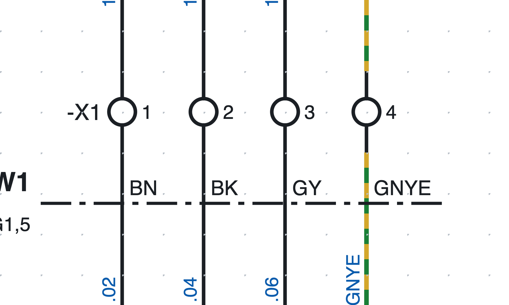
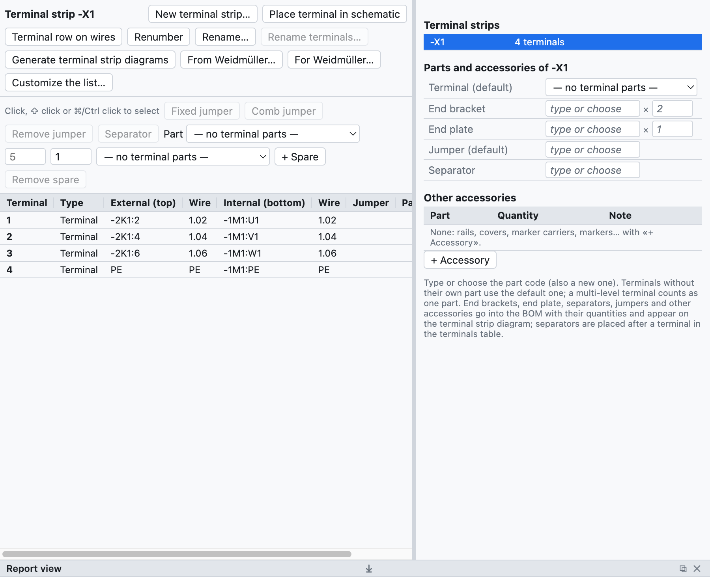
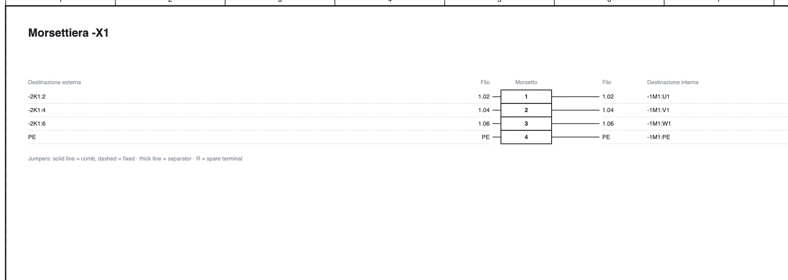

# 8. Клеммники

## Клеммы на схеме

*Клеммы `-X1:1…4` на странице 1: обозначение клеммника показано только у первой клеммы в ряду.*

1. В библиотеке, в категории *Клеммы и соединения*, выберите **Клемма** (либо *Клемма PE*,
   *Разъединяемая клемма*, *Клемма с предохранителем*).
2. Вставьте её **на провод**: провод разрывается с двух сторон клеммы.
3. Клемма получает обозначение `-X1:1`; следующие получают `-X1:2`, `-X1:3`…

Обозначение клеммы имеет вид `<клеммник>:<номер><ярус>`:

- у **клеммника** имя свободное, возможно и иерархическое, например `X1.1.2`;
- **номер** идёт после двоеточия (`X1.1.2:3`);
- **ярус** — буква для многоярусных клемм (`X1:1A`, `X1:1B`).

На вертикальном проводе обозначение клеммника стоит слева, а номер справа; на горизонтальном проводе
(повёрнутый символ) номер стоит сверху, а обозначение снизу.

> **Номер провода** проходит через клемму без изменений: провода по обе стороны имеют один и тот же номер
> (см. [главу 6](06-sigle-e-numerazione.md#номер-проходит-через-клеммы)).

## Навигатор клеммников

Вкладка **Клеммники** показывает клеммники проекта и их клеммы в виде таблицы.

*Клеммник `-X1` учебного проекта: внешние и внутренние назначения, номера проводов, артикулы и аксессуары.*

- Справа список **клеммников** проекта; щелчок открывает нужный.
- В центре **таблица клемм**: номер, тип, внешнее (сверху) и внутреннее (снизу) назначение,
  номера проводов, перемычки, артикул, позиция со ссылкой.
- Клеммы выделяются щелчком, ⇧ + щелчок (диапазон) и ⌘/Ctrl + щелчок (добавление).

## Многоярусные клеммы

У двух- или трёхъярусной клеммы один и тот же номер и по букве на каждый ярус.

1. Выделите клемму на схеме, например `-X1:1`.
2. В свойствах нажмите **Добавить ярус** (также из контекстного меню): клемма станет `-X1:1A`, а
   программа предложит вставить `-X1:1B` одним щелчком, в том числе на другой странице.
3. Следующие щелчки вставляют `1C`, `1D`…

В спецификации многоярусная клемма считается **одним артикулом** (`-X1:1A/B`).

## Нумерация и переименование

- Новая клемма получает номер, следующий за наибольшим в клеммнике; остальные не меняются.
- **Перенумеровать** нумерует с 1 в порядке расположения на схеме (страница, затем слева направо и сверху
  вниз): ярусы остаются вместе со своими буквами, резервные клеммы уходят в конец, клеммы с нечисловым
  именем (например `PE`) остаются как были.
- **Переименовать…** меняет имя клеммника у всех его клемм (`X1` → `X2.1`).

## Перемычки

1. Выделите в таблице две или более клемм.
2. Нажмите **Фиксированная перемычка** или **Гребёнчатая перемычка**.

Перемычки отображаются в таблице, в перечне клемм, в перечне соединений и на схеме клеммника;
у каждой может быть свой артикул. *Убрать перемычку* удаляет их.

## Резервные клеммы и разделители

- **+ Резерв** добавляет в конец не нарисованные клеммы: они попадают в перечень и в спецификацию.
  *Убрать резерв* убирает их.
- **Разделитель** после клеммы: разделительная пластина, на схеме клеммника она рисуется толстой линией.

## Артикулы и аксессуары

В поле *Артикулы и аксессуары* клеммника выбираются:

| Поле | Количество в спецификации |
|---|---|
| Клемма (по умолчанию) | по одной на каждую физическую клемму без собственного артикула |
| Торцевая пластина | 1 |
| Концевой фиксатор | 2 |
| Перемычка (по умолчанию) | по одной на каждую перемычку без собственного артикула |
| Разделитель | по одному на каждый разделитель |

*Артикул ▸ назначить выделенным* присваивает отдельным клеммам другой артикул (например, разъединяемым).
Всё автоматически попадает в спецификацию и в список закупки.

## Схема клеммника

**Создать схемы клеммников** создаёт страницу для каждого клеммника (несколько листов при более чем 40
клеммах) с назначениями, номерами проводов, перемычками, разделителями, резервами и позициями со ссылками,
в том числе в PDF.

*Верхняя часть схемы клеммника `-X1`.*

Страница обновляется сама при изменении схемы; при повторном создании добавляются страницы новых
клеммников и удаляются страницы исчезнувших.

## Контроль

Проверка выявляет повторяющиеся клеммы, клеммы со свободной стороной и данные клеммников, которых больше нет.
