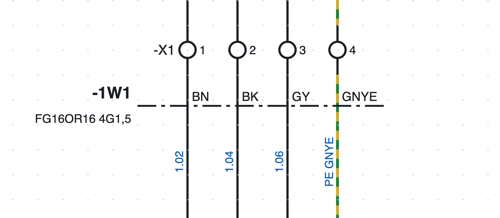
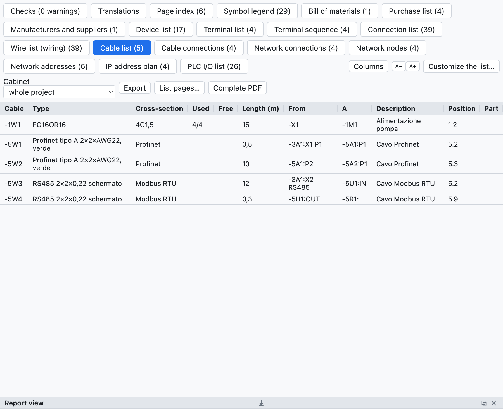

# 9. Кабели и разъёмы

## Кабели

Кабель задаётся **линией определения**, пересекающей провода.

*Кабель `-1W1 FG16OR16 4G1,5` на странице 1: штрихпунктирная линия пересекает четыре провода к двигателю,
каждый с цветом своей жилы.*

1. Нажмите **Кабель** на панели инструментов (или *Вставка ▸ Линия определения кабеля*).
2. Щёлкните с одной стороны проводов, затем с другой.
3. Пересечённые провода становятся **жилами** кабеля `-1W1` (обозначение по шаблону проекта).

### Жилы

Программа предлагает жилы в зависимости от числа проводов:

- до 5 проводов — цветные: `BN BK GY BU GNYE`;
- свыше — пронумерованные, с жёлто-зелёной жилой;
- провод PE (или жёлто-зелёный) получает жёлто-зелёную жилу.

В свойствах кабеля меняются **состав** (`5G1,5`, `7x0,75`…), **тип** (`FG16OR16`),
**длина** в метрах, **концы** (откуда, куда), **экранирование**, описание и **артикул**; в свойствах
линии выбирается жила для каждого провода.

Несколько линий, в том числе на разных страницах, могут относиться к одному кабелю: жила, пересечённая
дважды, считается один раз.

### Перечни кабелей

*Перечень кабелей учебного проекта: кабель двигателя и сетевые кабели.*

- **Перечень кабелей**: один кабель в строке с типом, составом, занятыми и свободными жилами, длиной,
  концами, позицией, артикулом.
- **Подключения кабелей**: одна жила в строке с двумя концами и номером провода.
- В **перечне соединений** есть столбец *Кабель*; в спецификации количество кабеля с артикулом — его
  длина в метрах; в списке закупки кабели без артикула суммируются по типам.

### Контроль

Проверка выявляет исчерпанные жилы (проводов больше, чем жил) или повторяющиеся, кабели без линии
определения и дублирующиеся обозначения кабелей.

## Разъёмы и вилки

Для вилок и розеток многополюсных разъёмов используются символы категории *Клеммы и соединения*:

| Символ | Назначение |
|---|---|
| Контакт розетки (гнездо) | сторона розетки |
| Контакт вилки (штырь) | сторона вилки |
| Контакт розетка + вилка | сопряжённая пара в одном символе |

- Обозначение строится как у клемм: `-X10:3` — контакт 3 разъёма `-X10`; контакты нумеруются автоматически.
- Общее число контактов указывается в свойствах разъёма или берётся из артикула.
- **Ответная часть** (например, кабельная вилка для панельной розетки) указывается своим артикулом
  и попадает в спецификацию.
- **Перечень разъёмов** содержит каждый контакт со стороной, проводами, позицией и используемыми контактами.
- На вкладке **Разъёмы** в таблице контактов есть столбцы **Описание** и **Примечания**, которые
  заполняются прямо в ячейке. Описание, технические данные и примечания **принадлежат каждому контакту
  отдельно** (в *Свойствах* контакта они действуют только для него); производитель, тип, артикул и прочие
  данные относятся ко всему разъёму. **Примечания разъёма** вводятся в данных разъёма, справа от таблицы.
- Проверка выявляет контакты сверх числа контактов разъёма.
