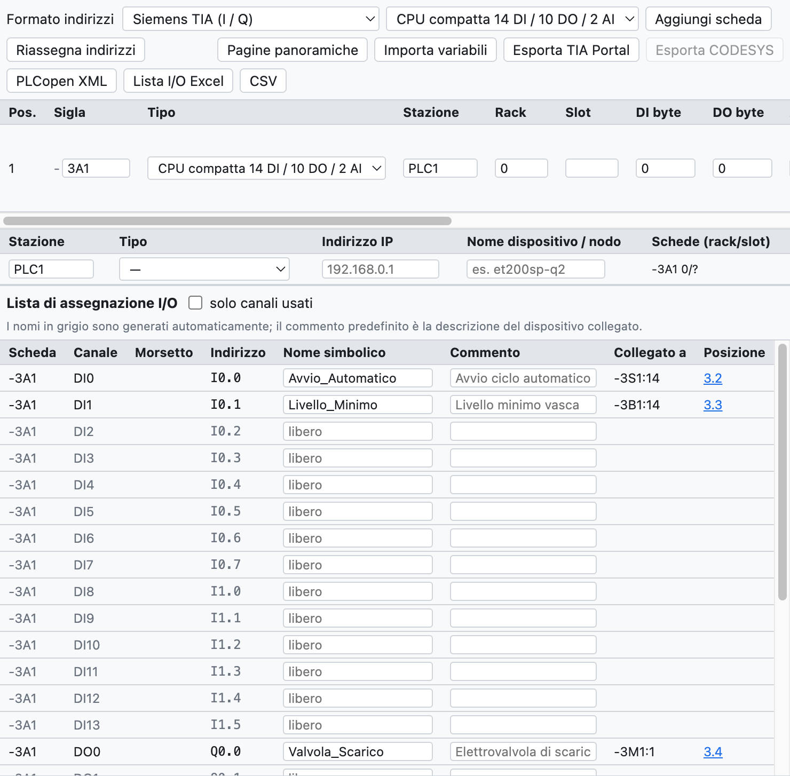
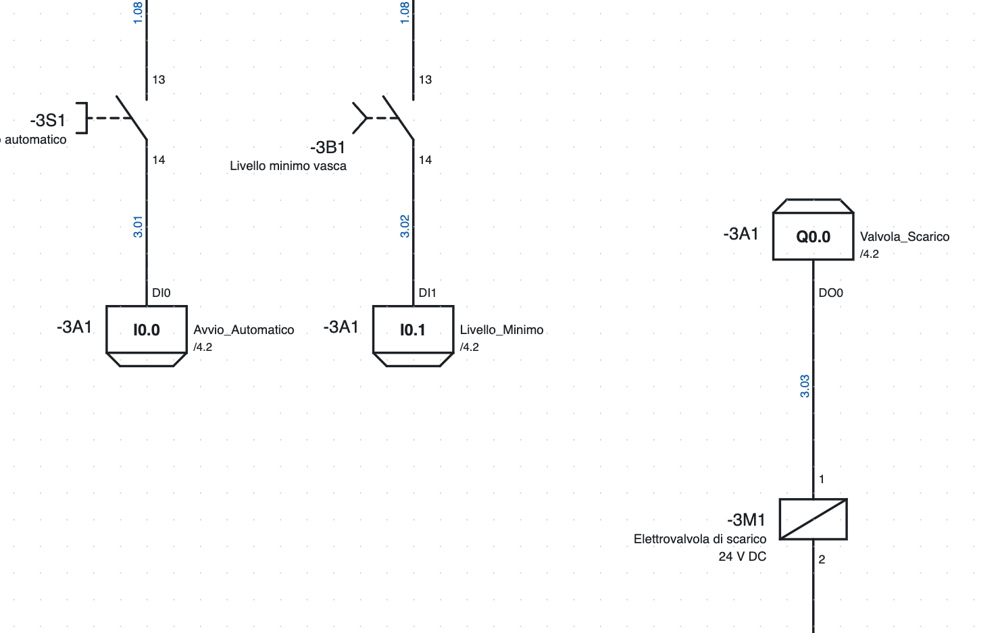
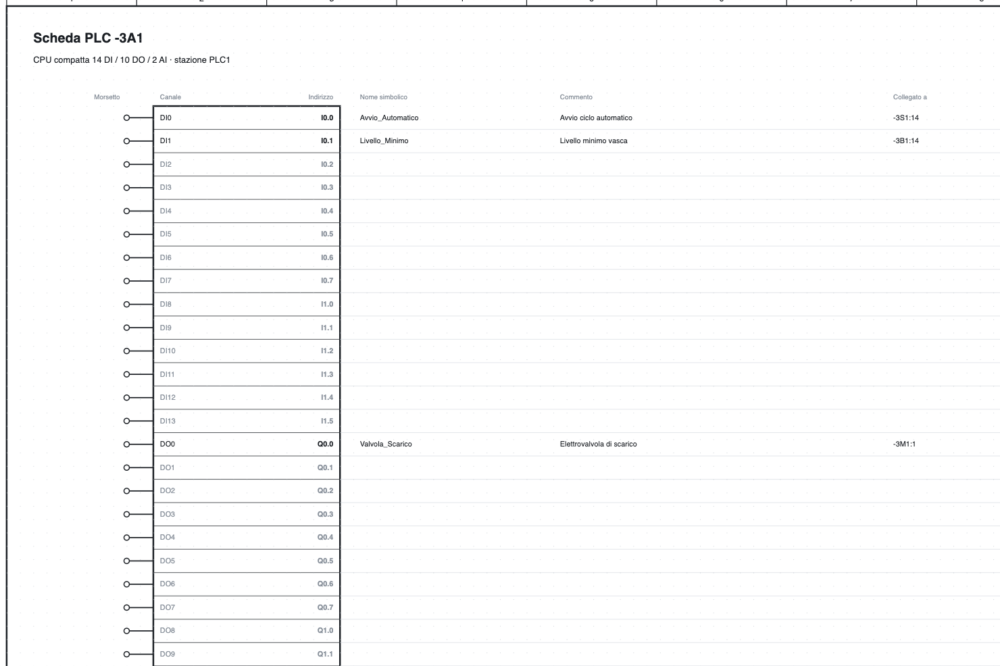

# 10. ПЛК

OpenWiring объединяет электрическую схему и распределение входов-выходов ПЛК: каждый нарисованный вход и
выход получает канал и адрес, попадает в список входов-выходов и в обзор модуля, а затем экспортируется
в TIA Portal, CODESYS или PLCopen.

## Вид ПЛК

*Вид ПЛК учебного проекта: ЦП `-3A1`, станция `PLC1` и список распределения входов-выходов.*

Вкладка **ПЛК** вверху справа содержит:

- панель с форматом адресов, типом добавляемого модуля и экспортом;
- список **модулей** с обозначением, типом, станцией, стойкой, слотом и начальными адресами;
- список **станций** с типом, IP-адресом и именем устройства;
- **список распределения входов-выходов**.

## Модули

**Добавить модуль** добавляет тип, выбранный в списке:

- компактные ЦП 14 DI / 10 DO / 2 AI и 8 DI / 6 DO;
- цифровые модули 8 DI, 16 DI, 8 DO, 16 DO, 8 DI / 8 DO;
- аналоговые модули 4 AI, 8 AI, 2 AO, 4 AO;
- мастера **IO-Link** на 4 или 8 портов.

Для каждого модуля указываются обозначение (`-3A1`), станция (`PLC1`: адреса назначаются по станциям),
стойка, слот (назначается автоматически), начальные адреса, описание и код заказа. Модуль
попадает в спецификацию.

**Модуль из артикула…** создаёт модуль из артикула библиотеки, например модуля ввода-вывода, импортированного
из EDZ: число каналов определяется по функциональной модели и может быть исправлено до создания модуля.
Точки подключения артикула становятся клеммами каналов.

**Стабильные адреса**: новый модуль получает первые свободные адреса своей станции, адреса существующих
модулей не меняются. **Переназначить адреса** пересчитывает их в порядке списка (стрелки ↑ ↓).

### Станции

У каждой станции есть тип (локальный ЦП, Profinet, EtherCAT, Profibus DP, EtherNet/IP, Modbus TCP),
IP-адрес и имя устройства. Проверка выявляет повторяющиеся слоты, IP-адреса и имена.

### Формат и порядок областей для станции

В таблице **Станции** у каждой станции есть два дополнительных столбца:

- **Формат**: станция может иметь формат, отличный от выбранного вверху, например узел CODESYS рядом с CPU
  Siemens. Формат вверху действует для станций без собственного формата. При смене формата станции
  переназначаются только её адреса.
- **Порядок областей** (форматы IEC и TwinCAT, где дискретные и аналоговые сигналы в одной области):
  *модули по порядку* (по умолчанию) или *сначала аналоговые (WAGO)*, как делают узлы WAGO и другие
  каплеры CODESYS. При добавлении модуля в станцию «сначала аналоговые» адреса переназначаются
  автоматически.

**TwinCAT (Beckhoff).** В формате TwinCAT адреса — `%I*` и `%Q*`: их связывает TwinCAT. В экспортированном
GVL переменные имеют `AT %I*` / `AT %Q*`; провода, подключённые к каналу, получают имя по модулю и каналу
(`400A1.DI3`), потому что `%I*` одинаков для всех.

Экспорт работает по станциям: *Экспорт TIA Portal* берёт только станции Siemens, *Экспорт CODESYS* —
станции IEC и TwinCAT.

### IO-Link

Для каждого порта мастера IO-Link указываются устройство, описание и число байт технологических данных;
программа вычисляет адреса (`IB4…IB5`, `%IB4`, `EB4`).

## Точки ввода-вывода на схеме

*Два входа и один выход страницы 3: в рамке адрес, справа символическое имя и ссылка на обзор `/4.2`,
слева обозначение модуля.*

1. В библиотеке, в категории *ПЛК*, выберите вход или выход, дискретный или аналоговый.
2. Вставьте его на схему и соедините с устройством (кнопка, датчик, электромагнитный клапан…).
3. Точка автоматически получает **первый свободный канал** нужного типа; если ни у одного модуля его нет,
   программа создаёт новый (первым будет компактный ЦП).

В свойствах точки меняются модуль, канал (занятые помечены), **символическое имя**
и **комментарий**. Клемма носит имя канала (`DI0`, `DO3`).

**Питание L+ / M** модуля — отдельный символ с обозначением модуля: он рисуется в цепи питания,
а его позиция показывается в обзоре.

## Адреса

Формат выбирается вверху вида ПЛК:

| Формат | Дискретный вход | Дискретный выход | Аналоговый вход | Аналоговый выход |
|---|---|---|---|---|
| Siemens TIA | `I0.0` | `Q0.0` | `IW64` | `QW64` |
| Siemens немецкий | `E0.0` | `A0.0` | `EW64` | `AW64` |
| IEC 61131 / CODESYS | `%IX0.0` | `%QX0.0` | `%IW0` | `%QW0` |
| Omron CJ/CP | `0.00` | `100.00` | `2000` | `2100` |
| Beckhoff TwinCAT | `%I*` | `%Q*` | `%I*` | `%Q*` |

Аналоговые адреса начинаются с 64 в форматах Siemens и с 0 в IEC; при смене формата они пересчитываются.
Omron использует 16-битные слова, поэтому при переходе на Omron или с него адреса назначаются заново.

## Обзорные страницы

**Обзорные страницы** создаёт страницу для каждого модуля в конце проекта и удаляет страницы
удалённых модулей.

*Обзор ЦП `-3A1`: для каждого канала клемма, адрес, символическое имя, комментарий, подключённое
устройство и страница.*

Обзор всегда соответствует схеме, его не нужно создавать заново при изменениях. Каждая точка
ввода-вывода на схеме ссылается на свою строку обзора (`/4.2`) и наоборот.

## Список распределения входов-выходов

Список содержит все каналы всех модулей, занятые и свободные, с адресом, символическим именем,
комментарием, **подключённым устройством** (`-3S1:14`, определяется по проводам) и позицией.

- Имя и комментарий редактируются прямо в таблице.
- Если имени нет, оно создаётся автоматически (`DI2_3A1`); комментарий по умолчанию — описание подключённого устройства.
- *только занятые каналы* скрывает свободные.
- Список отображается также на вкладке *Списки* и в PDF.
- Проверка выявляет каналы, занятые дважды, повторяющиеся имена, точки без модуля или с каналом неправильного типа.

## Обмен с программным обеспечением ПЛК

### Экспорт

| Кнопка | Файл | Применение |
|---|---|---|
| *Экспорт TIA Portal* | Excel с листом `PLC Tags` | в TIA: *Переменные ПЛК ▸ Импорт*; переменные попадают в таблицу `OpenWiring` (форматы Siemens) |
| *Экспорт CODESYS* | текст `VAR_GLOBAL … END_VAR` | для вставки в список глобальных переменных (формат IEC) |
| *PLCopen XML* | XML TC6 | глобальные переменные с адресом IEC, в том числе данные IO-Link; для CODESYS и совместимых сред |
| *Список I/O Excel*, *CSV* | таблица | документация |

Пример строки CODESYS: `Avvio_Automatico AT %IX0.0 : BOOL; (* Avvio ciclo automatico - -3S1:14 *)`.

> Экспорт для TIA Portal следует формату таблицы переменных TIA, но ещё не проверен на реальной
> установке: если при импорте возникают ошибки, экспортируйте из TIA пустую таблицу и сравните столбцы.

### Импорт переменных

**Импорт переменных** считывает имена и комментарии из программного обеспечения ПЛК и переносит их на схему:

- **TIA Portal**: файл Excel из *Переменные ПЛК ▸ Экспорт*;
- **CODESYS**: GVL (`Nome AT %IX0.0 : BOOL; (* commento *)`);
- **CSV** со столбцами Имя, Адрес, Комментарий.

Соответствие определяется по **адресу** (`%E0.0` и `I0.0` равнозначны). Уже нарисованные каналы
получают имя и комментарий; ещё не нарисованные сохраняют их в модуле и показывают, как только
они будут нарисованы. Переменные без канала перечислены в окне отчёта.
