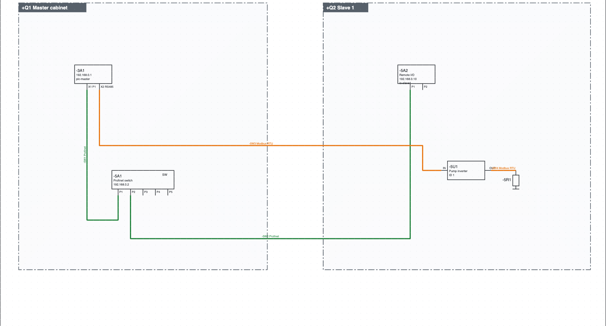
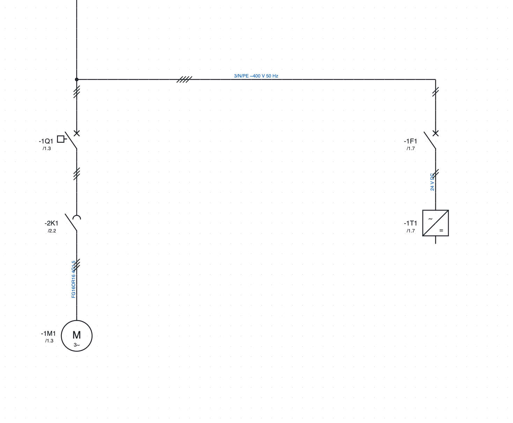

# 11. Сети, места установки и однолинейная схема

## Места установки

**Место установки** — физическая оболочка: электрический шкаф, кнопочный пост, сторона машины,
распределительная коробка, полевое оборудование. Его код — часть обозначения с `+` (`+Q1-2K1`).

1. *Проект ▸ Новое место…*, либо *+ Место* в свойствах проекта.
2. Введите **код** (`Q1`, `BM`, `P1`), **имя** (`Главный шкаф`) и **тип**.
3. Назначьте страницы месту через *Свойства страницы ▸ Место установки (раздел)*: новая страница остаётся
   в месте той страницы, от которой создана.

Каждое устройство находится в каком-то месте: указанном в его свойствах, иначе в рамке, в которой оно
нарисовано на сетевой схеме, иначе в месте своей страницы.

Где отображаются места установки:

- **дерево** группирует страницы и устройства по местам;
- **перечень устройств** показывает полное обозначение (`+BM-1M1`);
- **этикетки** устройств сгруппированы по местам;
- **страница компоновки**, назначенная месту, предлагает только его аппараты.

### Компонент одного шкафа, подключённый к другому шкафу

Типичный случай: датчик, установленный в **+Q2**, подключён к входу ПЛК в **+Q1**. Если нарисовать его
на странице входов +Q1 в рамке места +Q2, обозначение верное (`+Q2-B1`) и датчик попадает в списки
+Q2. Но схема находится на страницах +Q1: тот, кто монтирует +Q2 и получает только его страницы, его
не увидит.

Рекомендуемый приём — **разделить цепь на границе шкафа**, на клеммах:

1. на странице +Q1: вход ПЛК → клемма `-X1:5` → кабель `-W12` → связь на страницу +Q2;
2. на странице +Q2: связь от +Q1 → кабель `-W12` → клемма `-X2:5` → датчик `-B1`.

Каждый компонент рисуется на страницах шкафа, где он установлен; соединение между шкафами — кабель,
который есть на кабельных схемах обоих; связи кликабельны в PDF. У каждого шкафа свой клеммный ввод,
и каждый монтажник работает до клеммы.

**Проверки** предупреждают, когда устройство шкафа, кнопочного поста или распределительной коробки
нарисовано на страницах другого шкафа: *+Q2-B1 нарисован на странице 310 шкафа +Q1: при печати
только +Q2 его нет*. Места «на машине» и «в поле» не учитываются, так как их обычно рисуют на
страницах шкафа; подместо того же шкафа (например, дверь) тоже.

Если удобнее оставить компонент рядом со входом ПЛК, при печати только некоторых шкафов отметьте в
PDF *Добавить страницы других шкафов с устройствами выбранных шкафов* (глава 18).

## Сетевая схема

Сетевая схема показывает на одной странице все узлы установки и шинные соединения между шкафами.

*Сетевая схема учебного проекта: ЦП `-3A1` и коммутатор `-5A1` в шкафу `+Q1`, удалённый ввод-вывод
`-5A2` и преобразователь частоты `-5U1` в шкафу `+Q2`, соединённые по Profinet (зелёный) и Modbus RTU (оранжевый).*

1. **+ Сеть** под деревом создаёт страницу.
2. **Шкаф** на панели инструментов: щелчок в двух углах рисует рамку шкафа, затем выбирается его
   место установки. Узлы внутри рамки принадлежат этому шкафу.
3. Из категории *Сети и шины* вставляются **узлы**: узел с двумя портами (IN/OUT или P1/P2), узел с одним портом,
   коммутатор на 5 портов, терминатор. Узел принимает обозначение существующего устройства (ЦП, преобразователя
   частоты…) и становится его представлением.
4. Выберите протокол рядом с кнопкой **Шина** и соедините порты, как провод.

### Протоколы

Profinet, EtherCAT, Modbus TCP, Modbus RTU, Profibus DP, EtherNet/IP, CANopen, IO-Link, RS485, Ethernet.
У каждого протокола свой цвет, а имя написано на линии. Шины не получают номер провода и не
входят в электрические соединения. Существующий провод превращается в шину в его свойствах
(*Сеть / шина*).

### Сетевые кабели

Каждое шинное соединение — это **кабель**: оно само получает обозначение (`-5W1`, написанное на линии рядом
с протоколом). В свойствах соединения указываются тип (предлагается по протоколу, например
*Profinet тип A 2×2×AWG22*), длина и артикул. Сетевые кабели попадают в перечень кабелей с портами
на концах (`-3A1:X1 P1` → `-5A1:P1`), в этикетки и, при наличии артикула, в спецификацию в метрах.

Кабель, который продолжается на другой странице через пару ссылок (например, от контроллера робота к
странице робота), — это **один кабель**: у него одно обозначение на всех участках. Участок с обозначением, которое дала программа, сам получает
обозначение кабеля, даже если ссылки связаны после того, как он нарисован. Если изменить
обозначение, тип, длину или артикул на одном участке, меняются и остальные. Если у участков разные
обозначения, проверка сообщает об этом, а кнопка **Использовать -… на всех участках** ставит на все
участки обозначение участка с первой страницы. Дайте ссылкам то же имя, что и кабелю (`1102W1`): рядом
со ссылкой обозначение не повторяется. Чтобы показать или скрыть его на участке, используйте глазок
**Обозначение кабеля**; глазок **Номер провода** выключает все надписи на соединении.

### Перечни и контроль

- **Сетевые соединения**: протокол, порты, шкафы, соединения между разными шкафами.
- **Сетевые узлы**: адрес, протоколы, шкаф.
- Проверка выявляет повторяющиеся адреса в одной сети (в том числе через коммутаторы) и порты Ethernet
  с более чем одним соединением (нужен коммутатор). Многоточечные шины (Modbus RTU, Profibus, CANopen, RS485)
  допускают несколько узлов на одном участке.

## План IP-адресов

1. *Проект ▸ Новая IP-сеть*: имя, адрес и префикс (`192.168.0.0/24`), шлюз, использующий её протокол
   и первый назначаемый адрес.
2. В свойствах каждого узла есть поле **IP-адрес**, отдельное от адреса шины (имя
   Profinet, ID Modbus…). IP-адрес написан в рамке узла.
3. *Проект ▸ Назначить IP-адреса* выдаёт первый свободный адрес узлам, подключённым по Profinet, Modbus TCP,
   EtherNet/IP или Ethernet, у которых его нет (EtherCAT и последовательные шины не получают).
4. *Проект ▸ План IP-адресов* открывает перечень: IP, маска, шлюз, сеть, устройство, имя,
   протоколы, место установки, включая станции ПЛК.

Проверка выявляет повторяющиеся и недопустимые IP-адреса, адреса вне сетей или равные адресу сети или
широковещательному адресу, а также шлюзы вне сети.

## Сетевые адреса

*Проект ▸ Сетевые адреса…* (также в группе *Сети* вкладки *Проект* ленты) открывает таблицу со **всеми** устройствами,
у которых есть сетевой порт, в том числе ещё без адреса, и станциями ПЛК.

**Как находятся порты.** Порт — это любой вывод, которого касается провод шины (Profinet, Ethernet,
Modbus, EtherCAT…), и любой сетевой узел. Специальные выводы в символах не нужны.

- IP-порты устройства (Profinet, Ethernet, Modbus TCP, EtherNet/IP) образуют **один интерфейс**, как
  встроенный коммутатор: один IP и одно имя.
- Каждая не-IP шина (Modbus RTU, CAN, EtherCAT…) имеет собственный интерфейс со своим адресом.
- **Отделить…** даёт некоторым портам собственный интерфейс с другим IP и именем (например, X2 вне
  коммутатора X1). **Объединить** возвращает их в основной интерфейс.

В столбцы *IP-адрес* и *Имя Profinet / адрес* пишут напрямую; *Enter* подтверждает. Для станции ПЛК
значения остаются согласованными с таблицей станций. Внизу:

- **Назначить IP**: свободный IP нужной сети для IP-интерфейсов без адреса (сначала нужна IP-сеть);
- **Автоматические имена Profinet**: имя из обозначения и места (`+Q1 -2A1` → `q1-2a1`, с `pn-` впереди,
  если имя начиналось бы с цифры) для устройств Profinet без имени; уже написанные имена остаются;
- **Список и экспорт**: та же таблица среди списков, для печати или экспорта в PDF, CSV и Excel.

В последнем столбце показаны проблемы: повторяющиеся IP или IP вне сети, недопустимые или повторяющиеся
имена Profinet.

## Однолинейная схема

Однолинейная схема представляет распределение мощности одной линией на каждый отходящий фидер.

*Однолинейная схема учебного проекта: те же обозначения, что и в многолинейной, со ссылкой на их позицию.*

1. **+ Однолинейная** под деревом создаёт страницу.
2. Из категории *Однолинейная схема* вставьте выключатель, автомат защиты двигателя, разъединитель,
   предохранитель, контактор, двигатель, трансформатор, преобразователь частоты, блок питания, потребитель.
3. Дайте каждому символу **то же обозначение**, что у устройства на многолинейной схеме: появится ссылка
   на его позицию (`/1.3`).
4. У линий есть число проводников (*Проводники (штрихи)*) и текст (`3/N/PE ~400 V 50 Hz`).

Линии однолинейной схемы не входят в жилы, номера проводов и перечни: настоящей электрической схемой
остаётся многолинейная.
