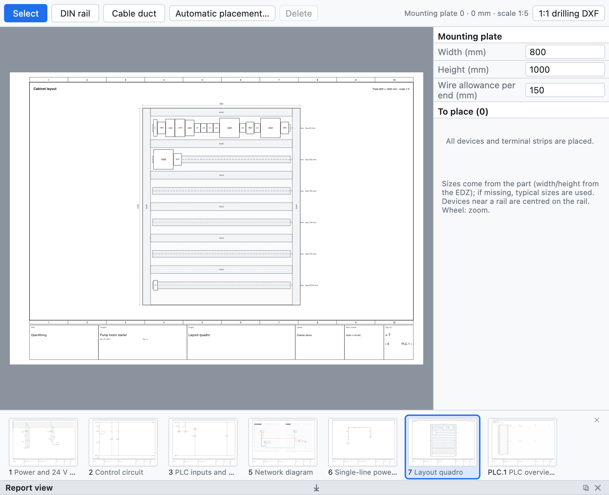

# 12. Компоновка шкафа

Страница компоновки — это **монтажный вид** панели шкафа: DIN-рейки, кабельные каналы и аппараты в
масштабе, с размерами. Она нужна, чтобы проверить, что всё помещается, для сверления отверстий и для
оценки длины проводов.

*Компоновка, созданная автоматической раскладкой: два ряда DIN-реек с кабельными каналами и аппараты демонстрационного проекта.*

## Создание компоновки

1. **+ Компоновка** под деревом создаёт страницу компоновки с панелью в стандартном масштабе (1:5, 1:10…)
   и с размерами.
2. В правой панели задайте **ширину** и **высоту** панели в мм и **запас** провода на каждый конец.
3. Назначьте странице **место установки**, чтобы видеть только аппараты этого шкафа.

## DIN-рейки и кабельные каналы

Выберите **DIN-рейка** и **Кабельный канал** на панели вида и протяните мышью по панели, чтобы их начертить.
Каждая рейка показывает свободные миллиметры.

## Размещение аппаратов

- Список *Для размещения* показывает устройства и клеммники, которые ещё не размещены: перетащите их на панель.
- Аппараты рядом с рейкой **центрируются по рейке**.
- **Размеры** берутся из артикула (ширина и высота из EDZ), иначе используются типовые значения;
  клеммник по ширине равен его клеммам (многоярусная клемма занимает один шаг).
- **Автоматическая раскладка** создаёт ряды каналов и реек, если их нет, и размещает на рейках все ещё
  не размещённые аппараты.

## Проверки

Проверка сообщает об аппаратах за пределами панели, о перекрывающихся аппаратах и о заполненных рейках.

## Сверление

**DXF сверления 1:1** экспортирует панель, рейки, каналы, контуры аппаратов и крепёжные отверстия Ø 5,5
в натуральную величину, готовые для обработки.

## Спецификация и длина проводов

- Рейки и каналы с артикулом попадают в **спецификацию в метрах**.
- **Перечень проводов (монтаж)** содержит для каждого провода сечение, цвет, **наконечники** (DIN 46228) и
  **длину, оценённую по компоновке**: путь между аппаратами плюс запас на концах.
- **Список закупки** суммирует провод россыпью по сечению и цвету с запасом 10%
  ([глава 14](14-liste-e-pagine-automatiche.md#список-закупки)).
