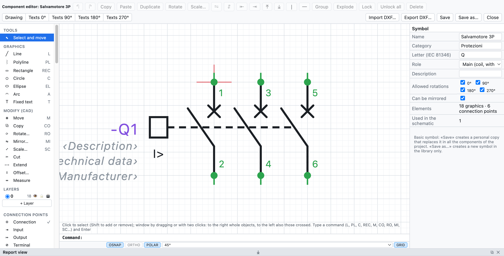
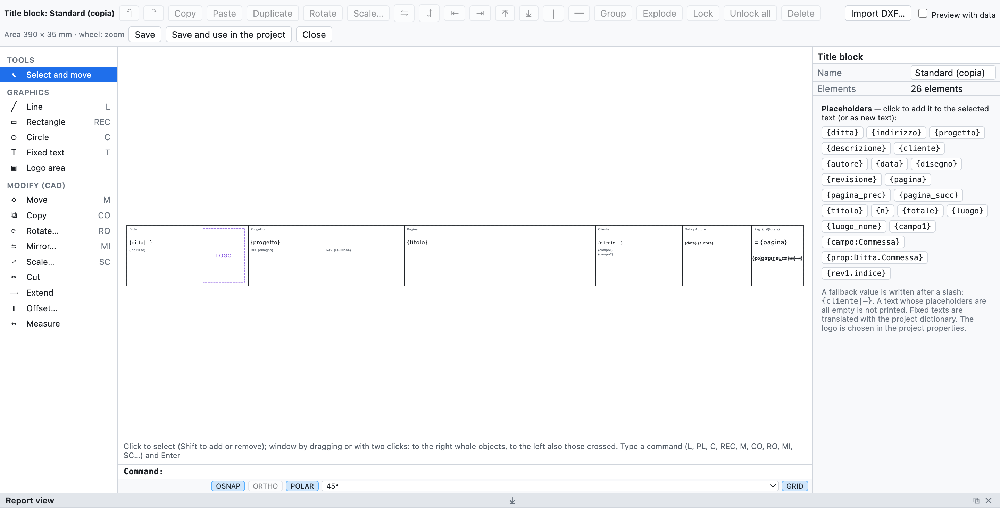

# 13. Макросы, символы и основные надписи

## Макросы

**Макрос** — это фрагмент схемы для повторного использования: пуск двигателя, цепь аварийной остановки,
отходящая линия с частотным преобразователем.

### Создание макроса

1. Выделите цепь на схеме (выделение рамкой).
2. Правая кнопка ▸ **Создать макрос из выделенного…** (или на вкладке *Макросы* библиотеки).
3. Введите название, категорию и описание.

### Вставка макроса

1. На вкладке **Макросы** библиотеки щёлкните по макросу.
2. Щёлкните на странице: точка щелчка станет левым верхним углом цепи.

При вставке **обозначения, номера проводов, клеммы, каналы ПЛК и кабели нумеруются заново**; катушка и контакты,
скопированные вместе, остаются связанными. Макросы хранятся в личной библиотеке, доступной во всех
проектах, и передаются как файлы `.ecmacro` (*Файл ▸ Импорт ▸ Макросы…* и кнопка экспорта на
вкладке *Макросы*).

## Редактор компонентов

Редактор создаёт компонент с нуля или изменяет существующий: базовые символы, личные символы,
компоненты, импортированные из QElectroTech или из макросов в формате EPLAN, а также «чёрные ящики» артикулов EDZ.

*Автомат защиты двигателя 3P, открытый в редакторе: слева объекты для добавления, в центре чертёж с
точками подключения, справа свойства.*

- На схеме: правая кнопка по компоненту ▸ **Изменить компонент…**. В библиотеке:
  **Новый символ…** или правая кнопка по символу.
- Объект выбирается на левой панели, затем щелчок (или перетаскивание) на чертеже:

| Группа | Объекты |
|---|---|
| *Графика* | линия, полилиния (щелчок в каждой вершине, двойной щелчок или Enter для завершения), прямоугольник, окружность, эллипс, дуга, постоянный текст |
| *Точки подключения* | соединение, вход, выход, клемма: на сетке 4 мм, с обозначением (`13`, `A1`) и направлением провода |
| *Тексты компонента* | обозначение, описание, технические данные, производитель, тип, код заказа, артикул, функция (=), место (+), примечания |

- **Тексты компонента** показывают на схеме данные устройства (свойства, артикул, функцию и
  место). Описание и технические данные, размещённые здесь, не повторяются под обозначением.
- *Выбрать и переместить*: щелчок для выбора, перетаскивание для перемещения, **Del** для удаления. Размеры и
  углы исправляются на правой панели.
- Справа также имя, категория, **буква** IEC 81346, **роль** (устройство, катушка с перекрёстными
  ссылками, контакт NO/NC/переключающий, клемма) и описание.
- Колёсико мыши масштабирует.

### Сохранение

| Команда | Действие |
|---|---|
| **Сохранить** | то же имя: символ изменяется в личной библиотеке и во **всех компонентах схемы**, которые его используют |
| **Сохранить как…** | новое имя: ещё один символ в личной библиотеке; схема не меняется |

Базовые символы не перезаписываются: *Сохранить* создаёт личную копию с тем же именем, которая заменяет их
в компонентах проекта, а также в библиотеке, в том же разделе: при повторном выборе из библиотеки
используется изменённая версия. *Вернуться к базовому символу* (в редакторе) возвращает оригинал в
библиотеку. Изменённый «чёрный ящик» артикула EPLAN остаётся символом
этого артикула. При использовании в проекте символ копируется в файл `.ecad`.

## Компоненты QElectroTech

*Файл ▸ Импорт ▸ Символы QElectroTech…* (или *Импорт компонентов…* в библиотеке) читает компоненты
[QElectroTech](https://qelectrotech.org): файлы `.elmt`, проекты `.qet` с их элементами или архивы
`.zip` либо `.7z` с целыми папками, например официальную коллекцию, скачанную с GitHub.

- Преобразуется графика (линии, прямоугольники, окружности, эллипсы, дуги, многоугольники, тексты) с клеммами
  и их именами.
- Тип становится ролью: катушка с перекрёстными ссылками, контакт NO/NC с автоматической нумерацией,
  клемма, межстраничная связь.
- Буква обозначения определяется по типу и названию: выключатели и разъединители **Q**, предохранители и
  тепловые реле **F**, катушки **K**.
- Масштаб: 10 px = 4 мм; клеммы вне сетки переносятся на сетку коротким отводом,
  чтобы провода подключались.
- Компоненты остаются в личной библиотеке; при вставке компонент копируется в проект.

> **Внимание**: на GitHub скачивайте настоящий файл через *Raw* или *Download raw file*. Если сохранить веб-страницу,
> получится HTML-файл, не содержащий компонента.

Коллекция QElectroTech — © The QElectroTech team, лицензия CC-BY 3.0: использование в схемах свободно;
OpenWiring не включает их символы, вы импортируете их сами.

## Встроенные основные надписи

Помимо *Стандартный*, *С таблицей ревизий* и *Компактный*, программа включает шесть полных основных надписей для
разных видов работ:

| Основная надпись | Для чего |
|---|---|
| *ISO 7200 (нормативный)* | основная надпись технических чертежей по ISO 7200 |
| *Индустриальный подробный* | промышленные схемы, с таблицей ревизий и графами для даты, чертёжника, проверяющего |
| *Машина (EN 60204-1)* | электрооборудование машин |
| *Гражданское здание (DM 37/08)* | электроустановки гражданских зданий, с данными, необходимыми для декларации соответствия |
| *Распределительное устройство (EN 61439)* | низковольтные комплектные устройства |
| *Автоматизация с подписями* | установки автоматизации, с графами для подписей |

Выбираются в свойствах проекта (*Основная надпись ▸ Шаблон*) или в свойствах страницы. Специальные поля
каждого шаблона (например `{campo:Matricola}`) появляются в *Свойствах проекта* уже готовыми к
заполнению. Для любой встроенной основной надписи можно выбрать *Настроить…* и начать с этого чертежа.

## Пользовательские основные надписи

Можно также начертить основную надпись своей фирмы.

*Стандартная основная надпись, открытая в редакторе, со списком подстановочных полей справа.*

1. *Проект ▸ Основная надпись: настроить или начертить…* или *Настроить…* / *Создать…* в свойствах
   проекта.
2. Чертите линиями, прямоугольниками, окружностями, текстами и **областью логотипа**. Область основной надписи — 390 × 35 мм.
3. В текстах используйте **подстановочные поля**: щелчок по полю в списке добавляет его в выбранный текст.
4. *Предпросмотр с данными* показывает основную надпись, заполненную данными проекта.
5. **Сохранить и использовать в проекте**.

### Подстановочные поля

| Поле | Значение |
|---|---|
| `{ditta}`, `{indirizzo}` | фирма и адрес |
| `{progetto}`, `{descrizione}`, `{cliente}`, `{autore}`, `{data}`, `{disegno}`, `{revisione}` | данные проекта |
| `{pagina}`, `{titolo}` | номер и название страницы |
| `{n}`, `{totale}` | положение страницы и число страниц (`{n}/{totale}`) |
| `{luogo}`, `{luogo_nome}` | место установки страницы |
| `{campo1}`, `{campo:Commessa}` | дополнительные поля |
| `{prop:Ditta.Commessa}` | пользовательское свойство проекта или страницы ([глава 4](04-progetto-e-pagine.md#пользовательские-свойства)) |
| `{rev1.indice}`, `{rev1.descrizione}`… | последние ревизии |

Резервное значение пишется после косой черты: `{cliente|—}`. Резервное значение само может содержать
подстановочное поле: `{campo:Macchina|{progetto}}` выводит поле *Macchina* и, если оно пусто, название проекта. Текст, в котором все подстановочные поля пусты,
не печатается.

### Импорт основной надписи из DXF

**Импорт DXF…** в редакторе переносит в шаблон основную надпись, начерченную в AutoCAD или другой САПР: линии,
полилинии, окружности, дуги, тексты и блоки. Атрибуты становятся подстановочными полями (PROGETTO → `{progetto}`,
DATA → `{data}`, FOGLIO → `{pagina}`…). Если она больше области основной надписи, то уменьшается в масштабе.

Сохранённые основные надписи остаются в личной библиотеке для всех проектов и копируются в файл
проекта. Каждая страница может использовать свою основную надпись; она действует на экране, в PDF и в DXF.
