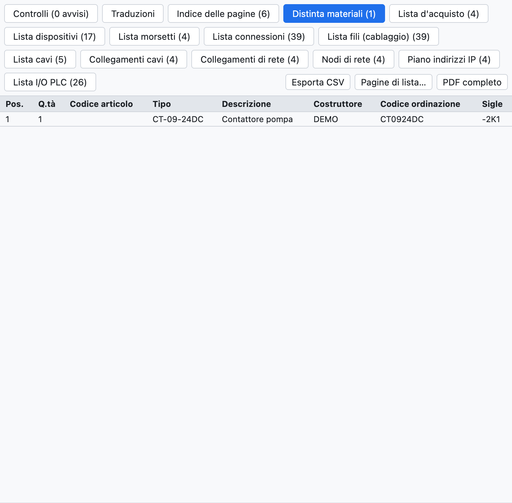
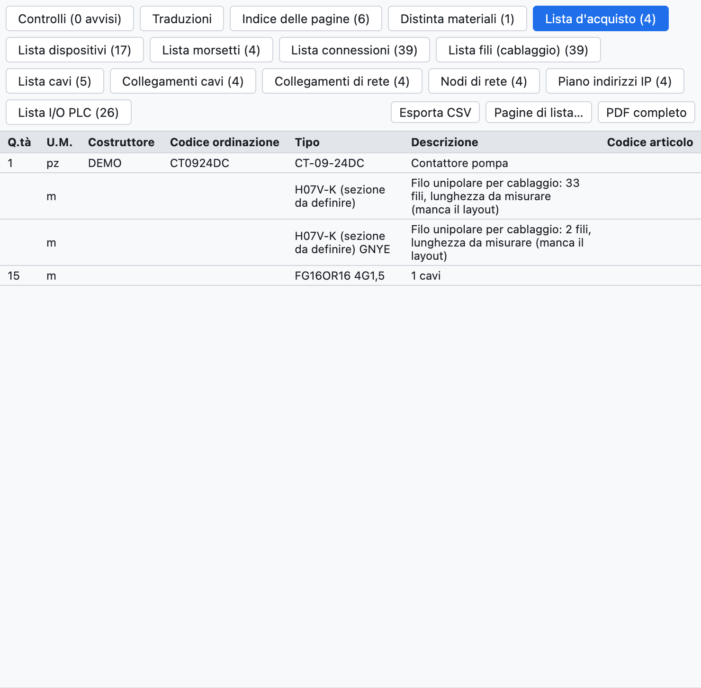
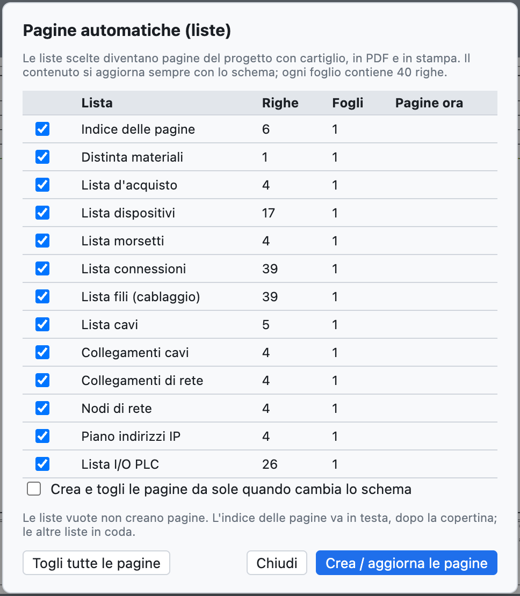
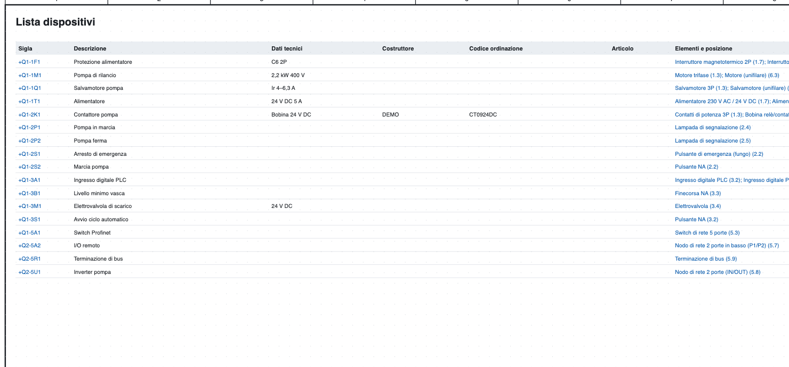
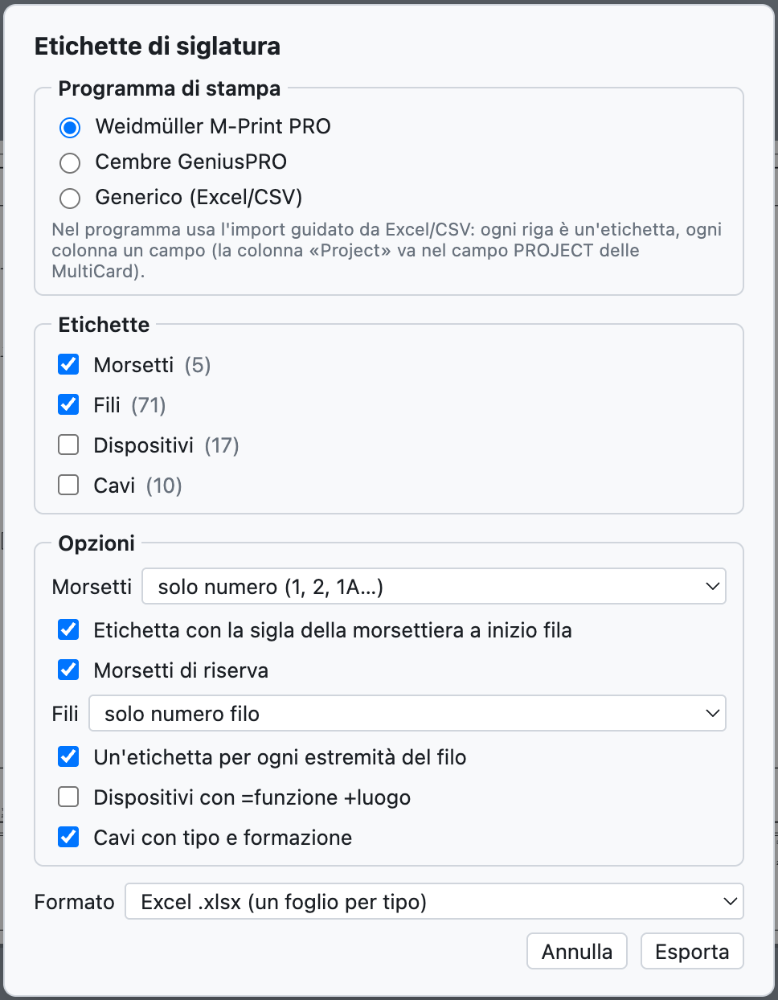

# 14. Списки и автоматические страницы

Все списки **вычисляются по схеме**: их не нужно заполнять вручную, и они всегда актуальны.

## Вид «Списки»

*Вкладка «Списки» со спецификацией материалов демонстрационного проекта.*

На вкладке **Списки** для каждого списка есть закладка; *Экспорт CSV* сохраняет открытый список (разделитель `;`,
открывается в Excel), *Полный PDF* экспортирует проект со всеми списками в конце.

| Список | Содержание |
|---|---|
| Оглавление страниц | номер, название, тип и место установки каждой страницы |
| Спецификация материалов | артикулы, сгруппированные по коду (или по производителю + коду заказа), количество, обозначения |
| Список закупки | артикулы по производителям с единицей измерения, провод россыпью, кабели |
| Перечень аппаратов | полное обозначение, описание, технические данные, производитель, коды, элементы и положения |
| Перечень клемм | клеммы с внешними и внутренними назначениями, номера проводов, перемычки |
| Перечень соединений | каждое соединение: номер провода, откуда, куда, страницы, сечение, цвет, кабель |
| Перечень проводов (монтаж) | каждый провод с сечением, цветом, наконечниками и оценённой длиной |
| Перечень кабелей, Подключения кабелей | см. [глава 9](09-cavi-e-connettori.md) |
| Перечень разъёмов | контакты, стороны, провода |
| Сетевые соединения, Сетевые узлы, План IP-адресов | см. [глава 11](11-reti-luoghi-unifilare.md) |
| Перечень входов/выходов ПЛК | см. [глава 10](10-plc.md) |

Пустые списки не показываются. Щелчок по положению (`/2.4`) переходит к элементу.

## Список закупки

*Список закупки демонстрационного проекта.*

Список закупки нужен для заказа материалов:

- артикулы спецификации **сгруппированы по производителям**, так что каждая группа — это заказ одному поставщику;
- у каждой строки есть **единица измерения**: штуки, а для кабелей, реек и каналов — метры;
- **провод россыпью** суммируется по сечению и цвету (`H07V-K 1,5 mm² BU`), в метрах, оценённых по компоновке
  шкафа, с запасом 10%; без компоновки в строке указано, сколько проводов и что длину нужно измерить;
- **кабели без артикула** суммируются по типу и составу жил.

## Автоматические страницы

Списки становятся **страницами проекта** с основной надписью, которые можно печатать и включать в PDF.

*Окно автоматических страниц: для каждого списка строки, необходимые листы и уже имеющиеся страницы.*

1. *Вставка ▸ Автоматические страницы (списки)…* или *Страницы списков…* в виде «Списки».
2. Отметьте списки, которые нужны в виде страниц.
3. Нажмите **Создать / обновить страницы**.

- Каждый лист содержит 40 строк; более длинный список занимает несколько листов.
- **Оглавление страниц** идёт в начале, после титульного листа; остальные списки — в конце.
- **Содержимое** страниц всегда следует за схемой.
- При включённом **Автоматически создавать и удалять страницы при изменении схемы** число листов тоже
  подстраивается само: если перечень клемм вырос с 40 до 41 строки, появляется второй лист.
- *Убрать все страницы* убирает страницы списков.
- *Вставка ▸ Обновить страницы списков* приводит страницы в соответствие с выбранными списками.

*Перечень аппаратов как страница проекта.*

## Этикетки для маркировки

*Файл ▸ Экспорт ▸ Этикетки M-Print PRO / GeniusPRO…* готовит этикетки для маркировочных принтеров.

*Окно этикеток.*

- **Программа**: Weidmüller M-Print PRO (столбцы `Project`, `Text 1`, `Text 2`…, столбец `Project` попадает в
  поле PROJECT карт MultiCard), Cembre GeniusPRO (столбцы `Riga 1`, `Riga 2`…, `Gruppo`) или универсальный формат.
- **Этикетки**: клеммы, провода, устройства, кабели.
- **Параметры**: клеммы только с номером или с полным обозначением, этикетка клеммника в начале ряда,
  резервные клеммы; провода только с номером или с назначением, по одной этикетке на каждый конец; устройства с
  =функция +место; кабели с типом и составом жил.
- **Формат**: Excel (по листу на каждый тип) или CSV.

Обе программы импортируют Excel и CSV с помощью пошагового мастера, в котором каждый столбец сопоставляется полю.
