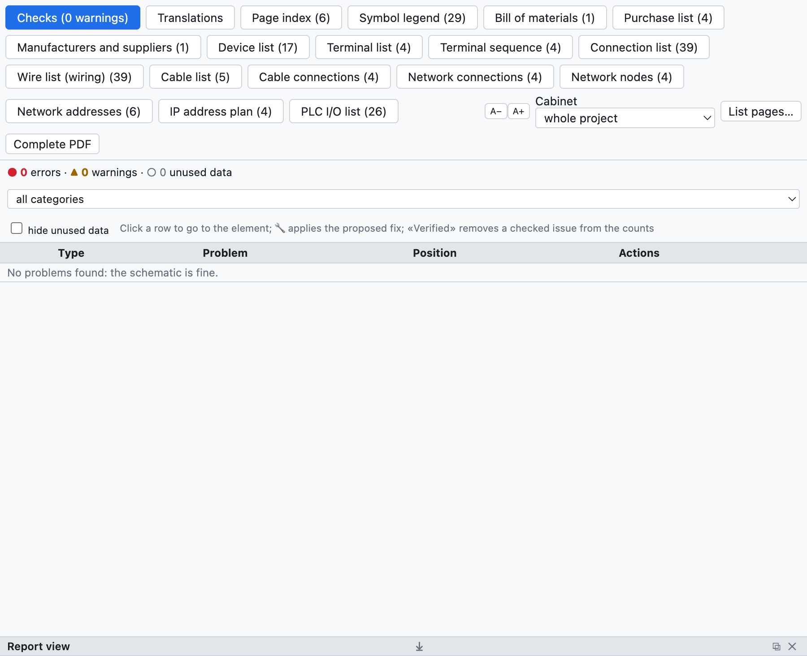
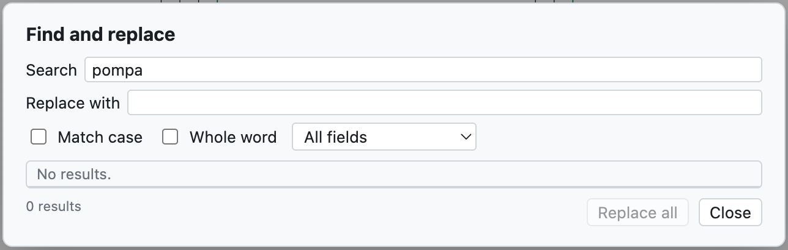

# 15. Проверка, поиск и ревизии

## Проверка проекта

**Проверка** на панели инструментов (или *Проект ▸ Проверка*) проверяет весь проект и открывает вкладку
*Проверки* вида «Списки».

*В демонстрационном проекте проблем нет. Пример с предупреждениями см. в [главе 3](03-primo-progetto.md#шаг-6--проверка).*

Проблемы делятся на:

- **ошибки** (●): их нужно исправить, например короткое замыкание;
- **предупреждения** (▲): вероятные ошибки, например свободная точка подключения;
- **неиспользуемые данные** (○): данные, которые стоит привести в порядок, например артикул, скопированный в проект, но не используемый.

Их можно фильтровать по категориям, а *скрыть неиспользуемые данные* убирает значки ○. **Щелчок по строке** переходит
к элементу и выделяет его.

### Что проверяется

| Категория | Примеры |
|---|---|
| Короткие замыкания | разные потенциалы на одном проводнике (`L1` с `N`, `+24V` с `0V`), соединённые межстраничные связи с разными именами, компоненты с обеими клеммами на одном проводнике |
| Кажущиеся соединения | провод проходит над точкой подключения, не заканчиваясь в ней: выглядит соединённым, но это не так |
| «Сироты» | компоненты, потенциалы, межстраничные связи и узлы без соединений, изолированные провода, контакты без катушки |
| Неполные соединения | свободные клеммы катушек, контактов, ламп, кнопок, точек ввода-вывода; провода со свободным концом (шины, доходящие до края, допускаются) |
| Чертёж | несуществующие или перекрывающиеся символы, перекрывающиеся провода, элементы за пределами листа, повторяющиеся номера проводов, пустые страницы |
| Шины проводников | провода, касающиеся шины без имени проводника, проводники, которые входят в шину и никуда не выходят |
| Обозначения и данные | повторяющиеся или отсутствующие обозначения, контактов больше, чем в артикуле, повторяющиеся клеммы |
| Кабели, разъёмы, сети, ПЛК, компоновка | см. соответствующие главы |
| Неиспользуемые данные | артикулы, символы, данные клеммников и разъёмов, которые больше не используются, пустые места установки |

> **Совет**: запускайте проверку перед каждой сдачей проекта и перед экспортом в PDF.

## Поиск и замена

**⌘F** (или *Поиск*) открывает поиск по всему проекту.

*Поиск «pompa» находит семь описаний.*

- Поиск идёт по обозначениям, описаниям, текстам, номерам проводов, именам ПЛК, кодам; список *Все поля* сужает
  поиск до одного поля.
- *Учитывать регистр* и *Слово целиком* уточняют поиск.
- Щелчок по результату переходит к элементу.
- *Заменить на* и **Заменить всё** меняют текст во всех результатах одним действием, которое можно отменить.

## Ревизии

**Ревизия** фиксирует состояние сданного проекта, например «Rev. A – первый выпуск».

1. *Проект ▸ Новая ревизия…* (или *Новая ревизия…* в свойствах проекта).
2. Укажите индекс, дату, автора и описание.

С этого момента:

- последующие изменения отмечаются красными **облачками** на экране и в PDF (отключаются параметром
  *Облака на изменениях* в свойствах);
- основная надпись каждой страницы показывает индекс последней ревизии, изменившей эту страницу;
- оглавление PDF, титульный лист и основная надпись *С таблицей ревизий* содержат ревизии.

## Сравнение двух проектов

*Файл ▸ Импорт ▸ Сравнить с файлом .ecad…* (или *Сравнить…* в свойствах) сравнивает открытый проект
с другим файлом, например с версией, сданной заказчику. Вкладка *Сравнение* вида «Списки»
перечисляет добавленные, удалённые или изменённые страницы, устройства и данные проекта.
