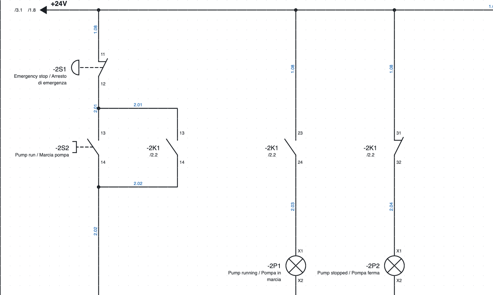
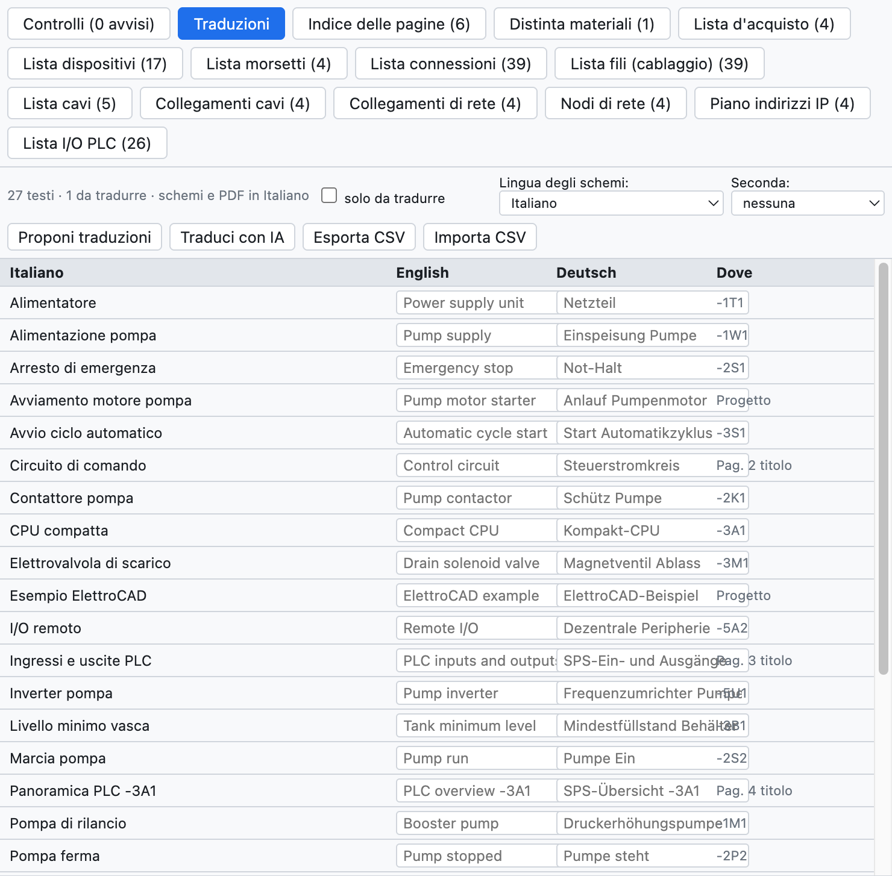

# 16. Языки схем

Схемы рисуются на итальянском и печатаются также на **английском** или **немецком**, либо на двух языках
одновременно. Язык интерфейса программы — это отдельная настройка
([глава 1](01-introduzione.md#язык-интерфейса)).

*Страница 2 на английском с итальянским внизу: «Emergency stop / Arresto di emergenza».*

## Словарь проекта

Вкладка *Переводы* вида «Списки» (или *Проект ▸ Переводы…*) перечисляет все переводимые тексты
проекта: заголовки страниц, свободные тексты, описания устройств, места установки, комментарии ПЛК, поля
основной надписи. Для каждого указаны английский перевод, немецкий перевод и место, где текст встречается.

*Словарь учебного проекта.*

- Впишите перевод в ячейку; *только непереведённые* показывает тексты, для которых перевода ещё нет.
- В программе уже есть постоянные тексты (основная надпись, заголовки и столбцы списков) и около 250 распространённых
  электротехнических терминов.

## Автоматический перевод

| Команда | Как переводит |
|---|---|
| *Предложить переводы* | фразу целиком, если она есть во встроенном словаре, иначе слово за словом («Lampada guasto» → «Fault lamp») |
| *Перевести с помощью ИИ* | выбранным ИИ-ассистентом (Claude, ChatGPT, Gemini) с отраслевой терминологией ([глава 17](17-assistente-ia.md#перевод-словаря)) |

Автоматические переводы **выделяются** как требующие проверки: их подтверждают значком ✓ или правкой.

## Выбор языка

- **Язык схем**: *Вид ▸ Язык схем*, свойства проекта (*Языки*) или
  вкладка «Переводы». Меняет схемы, основную надпись, титульный лист, страницы списков, обзоры ПЛК и схемы
  клеммников.
- **Второй язык**: тексты пишутся на двух языках («Contattore pompa / Pump contactor»).
- **PDF** и **печать** можно выполнить на другом языке, не меняя язык проекта
  (выбор *Язык* в окне экспорта).

## Через переводчика

*Экспорт CSV* сохраняет словарь в виде таблицы `Italiano;English;Deutsch`: переводчик дополняет её в
Excel, а *Импорт CSV* считывает её обратно.
